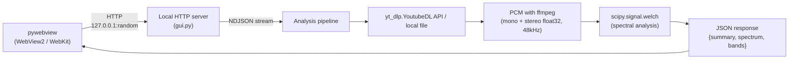

# analyze-spectrum

A tool that comprehensively analyzes the frequency spectrum of a YouTube video or a local audio file.
It combines level measurement, spectral shape evaluation, band balance analysis and A/B comparison.
Built on the same architecture as analyze-loudness (pywebview + a local HTTP server).

## Documentation languages

- **Override of the global CLAUDE.md's 「ドキュメント」 language rule**: this file is written entirely in English, and the documents are maintained in both English and Japanese — English at `README.md` and `docs/<name>.md`, Japanese at `README.ja.md` and `docs/<name>.ja.md`. The decision records under `docs/decisions/` are pairs of the same form (`<subject>.md` and `<subject>.ja.md`), kept section for section, with the Japanese file under the same headings as the English one

## Architecture overview



## Analysis

The steps of the pipeline and their formulas, the reference standards and the value and rationale of each parameter are in `docs/architecture.md`: sections "Analysis pipeline", "PCM conversion (mono downmix)", "Analysis parameters" and "Reference standards". Read them before changing a step, a metric or a constant in `src/analyze_spectrum/analysis.py` or `src/analyze_spectrum/pcm.py`.

- The mono PCM comes from `pan=mono|c0=0.5*c0+0.5*c1`, never from ffmpeg's `-ac 1` (its coefficients add +3 dB to a correlated stereo signal)
- True Peak is measured on the stereo PCM, for each channel separately (ITU-R BS.1770)

## Directory layout

The tree of the repository, with what each workflow, script, module and test file holds, is in `docs/architecture.md`, section "Directory layout". Read it before adding, moving or renaming a file, and change the tree in the same change.

## CLI usage

```
python3 -m venv .venv            # Windows: python -m venv .venv
source .venv/bin/activate        # Windows: .venv\Scripts\activate
pip install -e ".[dev]"

# Single file analysis
analyze-spectrum "https://www.youtube.com/watch?v=XXXXX"
analyze-spectrum ./recording.m4a

# A/B comparison
analyze-spectrum original.m4a eq_v1.m4a eq_v2.m4a

# Duration limit (middle extraction)
analyze-spectrum "https://..." --duration 2

# Estimated EQ: up to 3 peaking bands per transfer function (default 5)
analyze-spectrum original.m4a eq_v1.m4a --eq-bands 3
```

## GUI usage

### Launching during development

```
pip install -e ".[gui]"
analyze-spectrum-gui
```

### Build and distribution

```bash
# Windows
.venv/Scripts/python build.py              # download assets + PyInstaller bundle
.venv/Scripts/python build.py --installer  # + Inno Setup installer (.exe)

# macOS (requires create-dmg: brew install create-dmg)
.venv/bin/python build.py
.venv/bin/python build.py --installer      # + DMG
```

The flags are in the "Building a consumer" section of `vendor/py-analyze-common/README.md`.

> **Note**: run it with the python of this project's venv: `.venv/bin/python` (macOS) / `.venv/Scripts/python` (Windows).

## Dependencies

What the CLI and the GUI depend on, and how each dependency reaches the bundle, are in `docs/architecture.md`, section "Dependencies". Read it before adding, removing or re-pinning a dependency.

- `py-analyze-common` is the git submodule `vendor/py-analyze-common`. It is not listed in `pyproject.toml`; it is used through `sys.path` injection
- Dependabot moves yt-dlp and yt-dlp-ejs in one pull request (the `yt-dlp` group of `.github/dependabot.yml`); `tests/test_yt_dlp_ejs.py` fails when the version or scripts of the installed yt-dlp-ejs are not the ones the installed yt-dlp accepts
- ffmpeg, ffprobe and deno are bundled from `build_assets/bin/`

## Tests

```bash
pytest -q                                          # all tests
pytest -q --cov --cov-report=term-missing          # with line and branch coverage of src/analyze_spectrum, without __main__.py ([tool.coverage.run] in pyproject.toml)
pytest -q --js-coverage=coverage-js.lcov           # with the line coverage of frontend/*.js that the Playwright tests run, as LCOV (tests/js_coverage.py)
python -m playwright install --with-deps chromium  # first time only (used by test_frontend.py)
python build.py --ffmpeg-only && EXPECT_FFMPEG_DIR=build_assets/bin pytest -q tests/test_ffmpeg_binary.py  # with the bundled ffmpeg / ffprobe
```

The procedures this app shares with analyze-loudness (running the tests from a git worktree, test runs for each commit of a pull request, probing the real app on macOS) are in `vendor/py-analyze-common/docs/development.md`.

CI (`.github/workflows/ci.yaml`) runs `pytest -q --cov --cov-report=xml --js-coverage=coverage-js.lcov` and uploads `coverage.xml` and `coverage-js.lcov` to Codecov with `codecov/codecov-action`. The job's `id-token: write` lets the upload authenticate with GitHub's OIDC token (`use_oidc: true`), so the repository holds no Codecov token. On a pull request a failed upload fails `Test 🧪` (`fail_ci_if_error: true`); on a push to master the step's `continue-on-error` leaves the run green ([.github/workflows/ci.yaml:127](https://github.com/semnil/analyze-spectrum/blob/b1c8aecc3e72cc931936d52c057dadf17cd86c4d/.github/workflows/ci.yaml#L127)). `codecov/project` is a required check of master, reported by Codecov once the upload has arrived, after the run; `ffmpeg-watch.yml`'s land therefore hands its merges to auto-merge, which waits for it. `codecov/patch` is not required. `vendor/py-analyze-common` is not measured here (`source_pkgs` names this package only); py-analyze-common's own CI uploads its coverage.

What each test file covers and how the following work are in `docs/architecture.md`, section "Tests": "Test layout", "JavaScript coverage" (what `--js-coverage` counts and when it fails a test), "Browser operation tests" (`tests/test_browser_operations.py`) and "ffmpeg / ffprobe binary test" (`tests/test_ffmpeg_binary.py`). Read them before adding a test file or changing those tests.

## GUI endpoints

The table of every endpoint (method, request, response and error status) and the Host and Content-Type checks of POST are in `docs/architecture.md`, section "GUI endpoints". Read it before adding or changing an endpoint, and change the table in the same change.

## Response format (GUI NDJSON)

The JSON of a single analysis result (`type: "result"`) and of a comparison result (`type: "compare_result"`) is in `docs/architecture.md`, section "Response format (GUI NDJSON)". Read it before adding, renaming or removing a field, together with "Schema versioning" below.

## Design decisions

These descriptions are in `docs/architecture.md`, in the section named here. Read the section before changing what it describes:

| Before changing | Section of `docs/architecture.md` |
|---|---|
| the accent color, or which CSS lives in py-analyze-common's `common.css` and which in `frontend/style.css` | "Accent color" |
| how yt-dlp is called or bundled | "yt-dlp is used through the Python API (no binary is bundled)" |
| how much audio is read into memory | "PCM conversion approach" |
| the comparison of tracks | "Comparison mode" |
| a chart, its text or its fonts | "Chart types" |
| the result cache, or what `/analyze`, `/compare`, `/save` and `/load` read from it and write to it | "Result cache" |
| what Load JSON does with the value waiting in the input field | "Keeping the pending source on Load JSON" |
| how Submit, Remove Track and moving a row decide the mode and the next run | "Frontend state management" |
| the theme switch | "Theme" |
| the UI strings or the language switch | "i18n (languages)" |
| where the theme and language are saved | "Saving the theme and language" |
| file drops | "WebView2 drag & drop" |

Rules from those sections:

- The `h1` in `@media (max-width: 480px)` stays in `frontend/style.css`: it has to come after the `h1` in `style.css`
- No yt-dlp binary is bundled; `yt_dlp.YoutubeDL` is called directly as a Python library
- Elements whose text `main.js` writes according to the state (the theme button's `aria-label`, the submit button's text and `aria-label`) do not get `data-i18n*`
- WebView2's `AllowExternalDrop` is left at its default, true
- `gui.py` creates only one `SettingsStore` for the settings file (`_settings`) and passes it to both `Updater` and `UiSettings`

### yt-dlp version pin

`pyproject.toml` has an exact pin `yt-dlp==<version>`. Who updates it, why it is pinned and the check before a release are in the "yt-dlp version pin" section of `vendor/py-analyze-common/AGENTS.md`.

### macOS is Apple Silicon (arm64) only (v1.3.0+)

The reason is in the "Building a consumer (build)" section of `vendor/py-analyze-common/AGENTS.md`.

### Bundled ffmpeg pin

`build_assets/ffmpeg.json` holds the pin. How each OS bundles it, how it is updated and how the release build checks the distributed copies are in the "Bundled ffmpeg pin (ffmpeg_release)" section of `vendor/py-analyze-common/AGENTS.md`.

### Starting ffmpeg / ffprobe by absolute path

`extract_audio()` in `src/analyze_spectrum/pcm.py`, and py-analyze-common's `probe_info()` / `download_audio()`, start ffmpeg / ffprobe (and yt-dlp's deno) by the absolute path that py-analyze-common's `find_executable()` returns. It searches only the absolute entries of PATH, in order; the frozen app puts the bundled `bin` folder at the front of PATH (`main()` in `src/analyze_spectrum/gui.py`). The reason is in the "Programs start by absolute path (find_executable)" section of `vendor/py-analyze-common/AGENTS.md`. When the program they run is not on PATH (ffmpeg for `extract_audio()` / `download_audio()`, ffprobe for `probe_info()`), they raise `FileNotFoundError` without starting a process. `tests/test_ffmpeg_binary.py` checks `EXPECT_FFMPEG_DIR` with the same `find_executable()`.

### White-flash prevention

A 3-part setup that prevents flicker on page load:

- **Frontend** (`frontend/index.html`): the `<head>` loads `common/settings.js`, `common/i18n.js` and `i18n.js`, and then py-analyze-common's `common/boot.js`, before the CSS paint, resolves the theme from `window.analyzeSettings.theme` and sets the `data-theme` attribute on `<html>`, and sets the `lang` attribute to the language `i18n.js` decided
- **Backend** (`gui.py`): `analyze_common.ui_settings.UiSettings.background_color()` decides pywebview's `background_color` from the theme in the settings file. auto (including when nothing is saved) follows the OS dark mode setting (`analyze_common.theme.is_dark_mode()`: the registry's `AppsUseLightTheme` on Windows, `AppleInterfaceStyle` on macOS)
- **macOS webview** (`gui.py` calls `analyze_common.ui_settings.show_window_color_until_paint()` right after `create_window()`): pywebview attaches the WKWebView to the window after the first load finishes, and the WKWebView draws white until its first paint. It turns off the WKWebView's background and shows the window's `background_color` until the page is drawn (the mechanism is in the "Theme and language settings" section of `vendor/py-analyze-common/AGENTS.md`)

### Schema versioning

- The single source of truth is `SCHEMA_VERSION` (an integer) in `src/analyze_spectrum/__init__.py`. It is raised independently of `__version__` (the app version)
- Compatibility is judged by whether fields exist, not by the version number. The single source of truth for the list of fields needed for drawing is `missing_result_fields()` in `analysis.py`
- The table of versions, the fields of `meta` and what `/load` does with a result that lacks fields are in `docs/architecture.md`, section "Schema versioning". Read it before adding, renaming or removing a field of the result JSON

### Temp folders of a killed run

`gui.py` holds py-analyze-common's `InstanceLock` while it runs, and the CLI holds one while its work folder exists. When the GUI ends, `_cleanup_orphan_tempdirs()` removes the `spectrum_*` temp folders a killed run left behind, unless another instance runs (the "Temp folders a killed process left behind (tempdirs)" section of `vendor/py-analyze-common/AGENTS.md`).

### Window icon

Why `webview.start(icon=...)` gets the icon only on Windows, and what the AppUserModelID does, are in the "Window icon" section of `vendor/py-analyze-common/AGENTS.md`. `main()` sets `com.semnil.spectrum-analyzer` with `set_app_user_model_id()`.

### pywebview file_types constraint

pywebview 6.x's `parse_file_type()` validates the description part of `file_types` with `[\w ]+`. Including a slash (`/`), a hyphen (`-`) or the like raises `ValueError`, so descriptions are written only with space-separated alphanumerics (e.g. "Audio Video Files").

### Auto-update

How an update runs, what the user sees, what is verified, how each OS applies it and the signing key are in `vendor/py-analyze-common/docs/auto-update.md`.

What this app holds (`UPDATE_CONFIG`, `_exit_for_update()`, `_setUpdateLock()` and the location of the settings file) is in `docs/architecture.md`, section "Auto-update". Tests point the settings file at a temporary folder with `_isolated_settings` in `tests/conftest.py`.

## Release procedure

The steps are in the "Releasing a consumer" section of `vendor/py-analyze-common/AGENTS.md`. In this app `__version__` is in `src/analyze_spectrum/__init__.py`, the Windows installer is `SpectrumAnalyzer-X.Y.Z-setup.exe` and the macOS DMG is `Spectrum-Analyzer.dmg`.

### Pinned release dependencies

What the release jobs install, the commands that regenerate `requirements/*.txt` and what fails when they are not regenerated are in the section of the same name in `vendor/py-analyze-common/AGENTS.md`.

### Patch release for an ffmpeg update

What `.github/workflows/ffmpeg-watch.yml` does daily, and its prerequisite, are in the section of the same name in `vendor/py-analyze-common/AGENTS.md`.

## Versioning

The single source of truth is `__version__` in `src/analyze_spectrum/__init__.py`. All other files read it from here dynamically:

| File | How it is read |
|----------|----------|
| `pyproject.toml` | `[tool.setuptools.dynamic]` `attr` (AST extraction, no import) |
| `analyze-spectrum.spec` | regex read in `_read_version()` |
| `installer.iss` | injected with `/DMyAppVersion=` by `_build_inno()` of py-analyze-common's `analyze_common/build.py` (run by `build.py`) |

On a version bump, change only `__version__` in `__init__.py`.

## Known constraints

- The GUI's comparison is limited to 6 tracks (chart readability); the CLI has no limit
- Real-time input (microphone) is out of scope
