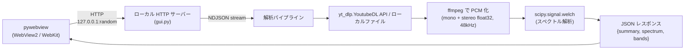

# analyze-spectrum

YouTube 動画またはローカル音声ファイルの周波数スペクトルを包括的に分析するツール。
レベル測定、スペクトル形状評価、帯域バランス解析、A/B 比較を統合的に提供する。
analyze-loudness と同一アーキテクチャ (pywebview + ローカル HTTP サーバー) で構成。

## アーキテクチャ概要



## 解析処理

解析パイプライン:

1. **PCM 抽出**: mono (`pan=mono|c0=0.5*c0+0.5*c1`, レベル保持) + stereo (True Peak 用)
2. **Welch PSD**: `scipy.signal.welch(data, fs=48000, nperseg=4096, noverlap=2048)`
3. **1/3 オクターブバンド分析**: 25Hz-10kHz (27 bands), 低周波バンド (25-40Hz) は PSD 補間で推定
4. **帯域エネルギー**: Sub (20-80Hz), Low (80-200Hz), Low-Mid (200-500Hz), Mid (500-2kHz), Presence (2-5kHz), Air (5-10kHz)
5. **レベル指標**: RMS (dBFS), True Peak (dBTP, ITU-R BS.1770 4x oversampling), Crest Factor
6. **Low/Intelligibility 比**: `10*log10(E[20-200Hz] / E[1-5kHz])`
7. **スペクトル重心**: `Σ(f * Pxx) / Σ(Pxx)` (80-8kHz)
8. **Spectral Tilt**: log2(freq) vs PSD dB の線形回帰 (dB/octave)
9. **Presence/Mid Ratio**: Presence(2-5kHz) / Mid(500-2kHz) エネルギー比
10. **Brightness**: Air(5-10kHz) / (Mid+Presence 500-5kHz) エネルギー比
11. **HPF -3dB 推定**: passband (300-600Hz) 平均から -3dB 交差点を探索
12. **HF Rolloff**: Mid-band 平均から -10dB 下回る周波数を検出
13. **Transfer Function**: 2 ファイル間の PSD 差分 (dB)

### 参照規格

- **ITU-R BS.1770**: True Peak — 4x オーバーサンプリング、チャンネル別に測定
- **ANSI S3.5-1997**: SII band importance function (1-5kHz が明瞭度の約 72%)
- **IEC 60268-16:2020**: STI — Ed.5 で 125/250Hz 帯を大幅削減
- **Upward spread of masking**: 低域が高域をマスクする非対称性

### PCM 変換 (モノラルダウンミックス)

ffmpeg のデフォルト `-ac 1` は `sqrt(2)/2 * L + sqrt(2)/2 * R` の係数を使用し、
相関したステレオ信号に +3 dB のゲインを付加する。本ツールでは
`pan=mono|c0=0.5*c0+0.5*c1` を使用してチャンネルあたりのレベルを保持する。
True Peak は ITU-R BS.1770 に従いステレオ PCM で各チャンネル個別に測定する。

## ディレクトリ構成

```mermaid
graph LR
    root["analyze-spectrum/"]
    root --> wf[".github/workflows/"]
    wf --> wf_ci["ci.yaml<br>PR / push"]
    wf --> wf_rel["release.yaml<br>v* タグ"]
    wf --> wf_chk["workflow-checks.yml<br>全 PR で uses: の SHA 固定と同一リポジトリ参照の規則を検査"]
    wf --> wf_chkt["workflow-checks-test.yml<br>検査のフィクスチャテストを実行"]
    root --> ght[".github/tests/"]
    ght --> ght_sh["workflow-checks-test.sh<br>workflow-checks.yml を偽の gh とフィクスチャの git tree で実行するテスト"]
    root --> r_claude["CLAUDE.md"]
    root --> r_readme["README.md"]
    root --> r_pyproj["pyproject.toml"]
    root --> src["src/analyze_spectrum/"]
    src --> src_init["__init__.py<br>vendor への sys.path 注入、SCHEMA_VERSION、make_meta()"]
    src --> src_main["__main__.py"]
    src --> src_ana["analysis.py<br>スペクトル解析の本体"]
    src --> src_cli["cli.py<br>argparse と CLI の処理の流れ"]
    src --> src_gui["gui.py<br>pywebview とローカル HTTP サーバー"]
    src --> src_dl["download.py<br>yt_dlp.YoutubeDL API、ffprobe による長さの取得"]
    src --> src_pcm["pcm.py<br>ffmpeg による PCM 変換 (mono + stereo)"]
    root --> fe["frontend/"]
    fe --> fe_idx["index.html"]
    fe --> fe_main["main.js<br>fetch、NDJSON の進捗、DOM 描画、テーマ切替"]
    fe --> fe_i18n["i18n.js<br>en/ja の DICT と window.i18n.t / setLang"]
    fe --> fe_css["style.css"]
    fe --> ch["charts/"]
    ch --> ch_spec["spectrum.js<br>PSD の重ね描き (対数周波数、複数トラック)"]
    ch --> ch_oct["octave.js<br>1/3 オクターブのグループ棒グラフ"]
    ch --> ch_tf["transfer.js<br>transfer function (Δ dB)"]
    ch --> ch_low["lowend.js<br>低域の詳細 (20-500Hz、線形)"]
    ch --> ch_mh["midhigh.js<br>中高域の詳細 (500Hz-20kHz、対数)"]
    fe --> fe_vendor["vendor/<br>uPlot (同梱)"]
    root --> t["tests/"]
    t --> t_init["__init__.py"]
    t --> t_conf["conftest.py<br>共有 WAV フィクスチャ (_make_wav_bytes, wav_file, wav_file_b)"]
    t --> t_ana["test_analysis.py"]
    t --> t_pcm["test_pcm.py"]
    t --> t_cli["test_cli.py"]
    t --> t_gui["test_gui.py"]
    t --> t_int["test_integration.py<br>HTTP 統合テスト (実 HTTPServer、pywebview なし)"]
    t --> t_dlg["test_dialog_busy.py<br>ネイティブダイアログの排他 (_dialog_lock)"]
    t --> t_fe["test_frontend.py<br>Playwright headless Chromium の実行役"]
    t --> tf["frontend/"]
    tf --> tf_html["test_ui.html<br>テストハーネスのページ"]
    tf --> tf_js["test_ui.js<br>ブラウザ上の UI 状態テスト"]
    root --> docs["docs/"]
    docs --> docs_arch["architecture.md"]
    docs --> docs_shot["screenshot.png"]
    docs --> docs_sec["security-audit.md"]
    root --> vend["vendor/py-analyze-common/<br>git submodule (sys.path 注入で利用)"]
    root --> r_build["build.py"]
    root --> r_spec["analyze-spectrum.spec"]
    root --> r_iss["installer.iss"]
    root --> r_lic["THIRD_PARTY_LICENSES.txt"]
    root --> ba["build_assets/bin/<br>ffmpeg, ffprobe, deno (git 管理外)"]
```



## CLI の使い方

```
python3 -m venv .venv            # Windows: python -m venv .venv
source .venv/bin/activate        # Windows: .venv\Scripts\activate
pip install -e ".[dev]"

# Single file analysis
analyze-spectrum "https://www.youtube.com/watch?v=XXXXX"
analyze-spectrum ./recording.m4a

# A/B comparison
analyze-spectrum original.m4a eq_v1.m4a eq_v2.m4a

# Duration limit (middle extraction)
analyze-spectrum "https://..." --duration 2
```

### CLI の依存

- `yt-dlp` — URL のダウンロード (Python API 経由)
- `ffmpeg` / `ffprobe` — PCM 変換・長さの取得・チャンネル数の検出
- `numpy`, `scipy` — スペクトル解析
- `matplotlib` — CLI のプロット出力 (任意)
- `pytest` — 開発用の依存

## GUI の使い方

### 開発時の起動

```
pip install -e ".[gui]"
analyze-spectrum-gui
```

### ビルドと配布

```bash
# Windows
.venv/Scripts/python build.py              # download assets + PyInstaller bundle
.venv/Scripts/python build.py --installer  # + Inno Setup installer (.exe)

# macOS (要 create-dmg: brew install create-dmg)
.venv/bin/python build.py
.venv/bin/python build.py --installer      # + DMG
```

フラグ: `--skip-download` (外部アセット取得をスキップ) / `--skip-build` (PyInstaller をスキップ、`dist/` がある前提) / `--update-checksums` (アセットを取得して `checksums.json` を更新)。

> **注意**: 必ずプロジェクト固有の venv の python (`.venv/bin/python` / `.venv/Scripts/python`) で実行すること (グローバル規約「開発環境」)。

### GUI の依存

- `pywebview` — 任意の依存 (`gui` extra)
- `numpy`, `scipy` — スペクトル解析
- `yt-dlp` — Python ライブラリとしてバンドル (PyInstaller が自動的に含める)
- ffmpeg, ffprobe, deno — `build_assets/bin/` に同梱
- `py-analyze-common` — git submodule (`vendor/py-analyze-common`)。OS 判定・subprocess kwargs・ダークモード検出・ffmpeg/ffprobe ラッパー・yt-dlp ダウンロード・JSON 安全化を提供。pyproject.toml には記載せず `sys.path` 注入で利用

## テスト

```bash
pytest -q                                          # 全テスト
python -m playwright install --with-deps chromium  # 初回のみ (test_frontend.py が使う)
```

## GUI エンドポイント

| エンドポイント | メソッド | 説明 |
|----------|--------|-------------|
| `/analyze` | POST | URL またはローカルファイルのスペクトル解析。NDJSON ストリーム。結果はキャッシュに保存、同一ソース+duration はキャッシュから返却 |
| `/compare` | POST | 複数トラック比較分析。NDJSON ストリーム。各トラックを個別キャッシュ、未キャッシュ分のみ解析。Transfer function は `_transfer_functions_from_dicts()` で再計算 |
| `/save` | POST | 単体分析結果 JSON をネイティブダイアログで保存。`source` + `duration` パラメータ指定時はキャッシュファイルから直接コピー (再シリアライズ不要)。比較モードでは JSON 保存なし (画像のみ) |
| `/save-image` | POST | チャートの合成 PNG (base64) を保存 |
| `/load` | POST | 単体解析 JSON 読み込み (compare JSON は拒否)。複数ファイル選択対応 (`allow_multiple=True`)。スキーマバージョンチェック: 旧スキーマは `schema_outdated` フラグを返却。現行スキーマのみキャッシュ登録 |
| `/browse` | POST | ネイティブダイアログでローカル音声ファイル選択 |
| `/upload` | POST | ドラッグ & ドロップしたファイルを一時保存 (octet-stream、最大 500MB) |

## レスポンス形式 (GUI NDJSON)

### 単体解析の結果

```json
{
  "type": "result",
  "data": {
    "meta": {
      "version": "X.Y.Z",
      "schema_version": 1,
      "analyzed_at": "2026-04-03T12:34:56+00:00",
      "source": "recording.m4a"
    },
    "label": "original",
    "sample_rate": 48000,
    "duration_sec": 6.23,
    "rms_dbfs": -14.4,
    "peak_dbfs": -2.8,
    "true_peak_dbtp": -2.7,
    "spectrum": {
      "freqs": [5.86, 11.72, "..."],
      "psd_db": [-68.3, -65.1, "..."]
    },
    "bands": {
      "centers": [25, 31.5, 40, "...", 10000],
      "energy_db": [-55.6, -56.4, "..."]
    },
    "summary": {
      "crest_factor_db": 12.0,
      "low_intel_ratio_db": 5.2,
      "spectral_centroid_hz": 635,
      "spectral_tilt_db_oct": -4.2,
      "presence_mid_ratio_db": -1.8,
      "brightness_db": -10.5,
      "hpf_3db_hz": null,
      "hf_rolloff_hz": 12500,
      "band_energy": {
        "sub_20_80": -45.0,
        "low_80_200": -18.0,
        "low_mid_200_500": -18.8,
        "mid_500_2k": -23.5,
        "presence_2k_5k": -25.3,
        "air_5k_10k": -40.4
      }
    }
  }
}
```

### 比較の結果 (NDJSON レスポンスのみ、JSON 保存・読み込みは非対応)

```json
{
  "type": "compare_result",
  "data": {
    "tracks": ["/* array of single analysis results */"],
    "transfer_functions": [
      {
        "label": "v3 - original",
        "freqs": ["..."],
        "delta_db": ["..."]
      }
    ]
  }
}
```

## 解析パラメータ

| パラメータ | 値 | 根拠 |
|-----------|-------|-----------|
| サンプルレート | 48000 Hz | 音声制作の標準 |
| モノラルダウンミックス | `0.5*L + 0.5*R` | チャンネルあたりのレベルを保持 (ffmpeg 既定の `sqrt(2)/2` は使わない) |
| True Peak | ステレオ、チャンネル別 | ITU-R BS.1770 準拠 |
| PCM 形式 | float32 | numpy でそのまま扱え、量子化が無い |
| Welch nperseg | 4096 | 窓長 約 85ms、周波数分解能 11.7 Hz |
| Welch オーバーラップ | 50% (2048) | Welch 法の標準 |
| 1/3 オクターブ範囲 | 25 Hz - 10 kHz | 声と音楽の帯域を覆う |
| Low/Intel 帯域 | 20-200 / 1-5k Hz | ANSI S3.5 の重要度関数による重み付け |
| 重心の範囲 | 80 - 8000 Hz | 声に関わる帯域 |
| HPF passband 基準 | 300 - 600 Hz | 一般的な HPF より上、声のフォルマントより下 |
| HF Rolloff しきい値 | -10 dB | Mid 帯域 (500-2kHz) の基準からの低下量 |
| True Peak オーバーサンプリング | 4x | ITU-R BS.1770。メモリ節約のため 30 秒単位で分割処理 |

## 設計判断

### アクセントカラー

analyze-spectrum はブルー系 (`--accent: #1565C0`)、analyze-loudness はパープル系 (`--accent: #9C27B0`)。ドメインで色を分離: ブルー = 周波数スペクトル、パープル = ラウドネス (音量)。CSS 変数名は両プロジェクトで異なる (`--text` vs `--fg`, `--bg-card` vs `--surface`, `--text-secondary` vs `--fg-muted`)。

### yt-dlp は Python API で利用 (バイナリは同梱しない)

`yt_dlp.YoutubeDL` を Python ライブラリとして直接呼び出し、`FFmpegExtractAudio` postprocessor で音声抽出。バイナリ同梱を避けることで、macOS 向けの codesign 再署名で発生する Team ID 不一致問題 (onefile バイナリ内部の Python.framework が再署名できず hardened runtime で拒否される) を根本的に回避している。

### yt-dlp のバージョン固定

`pyproject.toml` で `yt-dlp==<version>` の完全一致ピンを持つ。ピン値は analyze-loudness / analyze-spectrum / py-analyze-common の 3 つの `pyproject.toml` が持つミラーで、必ず同時に更新する。

固定する理由: 出荷物は PyInstaller が yt-dlp を PYZ に焼き込むため、インストール後に更新できない。無指定にするとビルドした時点の解決結果で版が決まり、出荷物に入った版を事後に特定できない。

ピンの更新はリリース作業の一部として行う:

1. `pip install -U yt-dlp` で候補版を入れる
2. **全長ダウンロード**で確認する。`--test` (先頭 10 KiB のみ取得) では 403 を検出できない:
   `.venv/bin/python -m yt_dlp -f bestaudio -o <tmpdir>/%(id)s.%(ext)s <URL>`
   通常動画・ライブアーカイブ・Shorts の 3 種で確認する
3. 通った版を 3 つの `pyproject.toml` に書く。py-analyze-common を先にコミットし、submodule ポインタを更新する
4. 出荷物を再ビルドする

この節は analyze-loudness の CLAUDE.md と同一内容のミラー。

### macOS は Apple Silicon (arm64) 専用 (v1.3.0+)

ffmpeg / ffprobe は osxexperts.net の arm64 ネイティブビルドを SHA256 ハードコード検証付きで取得する (`build.py` の `_OSXEXPERTS_ARM64`)。evermeet.cx (x86_64) は (a) bundle に Intel Mach-O が混入すると macOS 26 で「Intel プロセッサ用アプリの対応は終了します」警告が出る、(b) GitHub Actions macos runner から接続タイムアウトが発生するため不採用。Intel Mac サポートは v1.2.0 までで打ち切り。osxexperts URL はバージョン埋め込み (`ffmpeg81arm.zip` 等) のため ffmpeg メジャー更新時は URL + SHA256 を更新する。

### PCM 変換方式

analyze-loudness は ebur128 filter の stderr パースだが、本ツールは PCM 生データを
numpy に読み込んで scipy.signal.welch で処理。メモリ制約は以下で対処:

- 48kHz mono float32 = 192 KB/s → 10分 = 115 MB (許容範囲)
- 長尺は `--duration` で中盤抽出 (analyze-loudness と同じ方式)

### 比較モード

GUI で複数ファイルを追加し、自動で transfer function を計算。
analyze-loudness に未実装だった比較機能をコア仕様として取り込む。

### フロントエンドチャート

uPlot (対数周波数の PSD 重ね描き) + Canvas 自前描画 (1/3 オクターブ棒グラフ、transfer function、
低域の詳細、中高域の詳細)。analyze-loudness と同じ vendor 構成。

### 結果キャッシュ (GUI)

セッション内キャッシュにより同一ソースの再解析を回避する。

- **保存先**: `tempfile.mkdtemp()` に作成した `_cache_dir` (セッション終了時に削除)
- **キャッシュキー**: URL or ファイルパス + duration。ローカルファイルは mtime を含む
- **単体分析**: `/analyze` の結果を temp JSON として保存。再リクエスト時はキャッシュから返却
- **比較分析**: `/compare` はトラック単位でキャッシュ参照。未キャッシュ分のみ解析を実行し、transfer function は全トラックの dict から `_transfer_functions_from_dicts()` で再計算
- **Save 最適化**: `/save` でフロントエンドから `source` + `duration` を受信した場合、キャッシュファイルを直接コピー (再シリアライズ回避)
- **Load → キャッシュ登録**: `/load` で読み込んだデータ (現行スキーマのみ) をキャッシュに登録し、後続の Save や Compare で再利用
- **フロントエンド状態追跡**: `lastSource`, `lastDuration` で直近の分析コンテキストを保持し、Save 時のキャッシュ参照に使用

### ホワイトフラッシュ防止

ページロード時のちらつきを防ぐ 2 段構成:

- **フロントエンド** (`frontend/index.html`): `<head>` 内インライン `<script>` で CSS ペイント前に `localStorage` からテーマを解決し、`<html>` に `data-theme` 属性を付与
- **バックエンド** (`gui.py` の `_resolve_background_color()`): localStorage プロファイル (Windows は WebView2 の LevelDB、macOS は WebKit の `WebsiteData/LocalStorage`) を読み取り、未解決時は OS のダークモード設定 (`analyze_common.theme.is_dark_mode()`: Windows はレジストリの `AppsUseLightTheme`、macOS は `AppleInterfaceStyle`) にフォールバックして pywebview の `background_color` を設定

### Load JSON 保留ソース保持

`/load` 処理前に `urlInput` の値を `compareSources` に保存し、ロード後も消失しないようにする:

- 単一ロード + 保留あり → 両方を Compare モードに追加
- 複数ロード + 保留あり → 保留トラックをロード済みトラックにマージ
- 旧スキーマ承認 + 保留あり → 保留 + ソースをトラックリストに追加 (次回 Submit で再解析)

### スキーマバージョン管理

唯一の定義元は `src/analyze_spectrum/__init__.py` の `SCHEMA_VERSION` (整数)。`gui.py` は `_SCHEMA_VERSION` として別名 import し、`meta` は同ファイルの `make_meta()` が組み立てる。

- `meta.version`: アプリバージョン (表示用)
- `meta.schema_version`: スキーマバージョン (互換性判定用)
- `/load` 時にスキーマバージョンを比較し、旧スキーマの場合は `schema_outdated` フラグを返却
- 旧スキーマデータはキャッシュに登録しない (再解析時に最新スキーマで再取得)
- Compare JSON の保存・読み込みは廃止 (単体解析結果のみ)

### フロントエンド状態管理

Submit 時に `urlInput` の pending 値と `compareSources` を統合してモード判定する:

- `_effectiveTrackCount()`: compareSources + urlInput pending を含む実効トラック数
- Submit ボタンラベルは `urlInput` の `input` イベントで動的更新
- Remove Track 時は urlInput に既存値がある場合 collapse しない (値の保持)

### ダークモード

CSS 変数 + `[data-theme]` でライト / ダーク / auto の 3 ステート。選択は `localStorage("spectrum-theme")` に保存し、保存値が `light` / `dark` 以外のときは auto として扱う。トグルは light -> dark -> auto の順に巡回し、アイコンは太陽 / 三日月 / 半分を塗った円の SVG (`_createThemeIcon()` が生成)。auto では `prefers-color-scheme` の変化を購読して再適用する。初期適用はペイント前 ([ホワイトフラッシュ防止](#ホワイトフラッシュ防止))。

### i18n (多言語)

`frontend/i18n.js` で en / ja を管理。初期言語は `navigator.language` (`ja*` -> ja、他は en)、選択は `localStorage("spectrum-lang")` に保存。静的マークアップは `data-i18n*` 属性を DOMContentLoaded で置換し、`main.js` が動的に作る文字列は `window.i18n.t(key)` を直接呼ぶ。

### ウィンドウアイコン

PyInstaller の `EXE(icon=...)` は EXE ファイル自体のアイコン (エクスプローラー表示用) のみ。pywebview のウィンドウアイコン (タイトルバー・タスクバー) には `webview.start(icon=...)` で明示指定が必要 (pywebview 6.x で `create_window` から `start` に移動)。`build_assets/icon.ico` を PyInstaller の `datas` でバンドルし、`_ICON_PATH` で解決する。

### pywebview file_types 制約

pywebview 6.x の `parse_file_type()` は `file_types` の description 部分を `[\w ]+` で検証する。スラッシュ (`/`) やハイフン (`-`) 等を含むと `ValueError` になるため、description はスペース区切りの英数字のみで記述する (例: "Audio Video Files")。

### WebView2 のドラッグ & ドロップ

`AllowExternalDrop = False` を pywebview の `shown` + `loaded` イベントで設定。
JavaScript 側は window capture フェーズで `stopImmediatePropagation` により
WebView2 ネイティブハンドラへの伝播を遮断。

## リリース手順

1. `src/analyze_spectrum/__init__.py` の `__version__` を上げる PR を出す (版上げは他の変更を含めない)
2. マージ後、master の HEAD に `vX.Y.Z` タグを打って push する
3. `release.yaml` が Windows インストーラー (`SpectrumAnalyzer-X.Y.Z-setup.exe`) と macOS DMG (`Spectrum-Analyzer.dmg`) をビルドし、Release を作成する (`draft: true`)
4. Release の publish は人が行う

タグ push が唯一のリリーストリガー (他に `workflow_dispatch`)。マージだけではリリースされない。

## バージョン管理

唯一の定義元は `src/analyze_spectrum/__init__.py` の `__version__`。他のファイルはすべてここから動的に取得する:

| ファイル | 取得方式 |
|----------|----------|
| `pyproject.toml` | `[tool.setuptools.dynamic]` `attr` (AST 抽出、import なし) |
| `analyze-spectrum.spec` | `_read_version()` で regex 読み取り |
| `installer.iss` | `build.py` の `_build_inno()` が `/DMyAppVersion=` で注入 |

バージョンバンプ時は `__init__.py` の `__version__` のみ変更する。

## 既知の制約

- 比較は最大 6 トラック (チャートの可読性)
- リアルタイム入力 (マイク) は対象外
