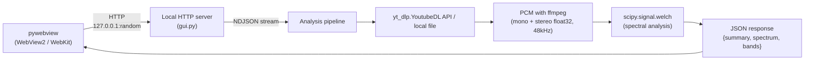

# analyze-spectrum

A tool that comprehensively analyzes the frequency spectrum of a YouTube video or a local audio file.
It combines level measurement, spectral shape evaluation, band balance analysis and A/B comparison.
Built on the same architecture as analyze-loudness (pywebview + a local HTTP server).

## Documentation languages

- **Override of the global CLAUDE.md's 「ドキュメント」 language rule**: this file is written entirely in English, and the documents are maintained in both English and Japanese — English at `README.md` and `docs/<name>.md`, Japanese at `README.ja.md` and `docs/<name>.ja.md`. The decision records under `docs/decisions/` are pairs of the same form (`<subject>.md` and `<subject>.ja.md`)

## Architecture overview



## Analysis

The analysis pipeline:

1. **PCM extraction**: mono (`pan=mono|c0=0.5*c0+0.5*c1`, level-preserving) + stereo (for True Peak)
2. **Welch PSD**: `scipy.signal.welch(data, fs=48000, nperseg=4096, noverlap=2048)`
3. **1/3-octave band analysis**: 25Hz-10kHz (27 bands); a band with no FFT bin (40Hz with these parameters) is estimated by PSD interpolation
4. **Band energy**: Sub (20-80Hz), Low (80-200Hz), Low-Mid (200-500Hz), Mid (500-2kHz), Presence (2-5kHz), Air (5-10kHz)
5. **Level metrics**: RMS (dBFS), True Peak (dBTP, ITU-R BS.1770 4x oversampling), Crest Factor
6. **Low/Intelligibility ratio**: `10*log10(E[20-200Hz] / E[1-5kHz])`
7. **Spectral centroid**: `Σ(f * Pxx) / Σ(Pxx)` (80-8kHz)
8. **Spectral Tilt**: linear regression of PSD dB against log2(freq) (dB/octave)
9. **Presence/Mid Ratio**: Presence(2-5kHz) / Mid(500-2kHz) energy ratio
10. **Brightness**: Air(5-10kHz) / (Mid+Presence 500-5kHz) energy ratio
11. **HPF -3dB estimation**: searches for the -3dB crossing point from the passband (300-600Hz) average
12. **HF Rolloff**: detects the frequency that falls -10dB below the mid-band average
13. **Transfer Function**: the PSD difference (dB) between 2 files
14. **EQ estimation**: fits a preamp gain and up to N peaking filters (RBJ biquad) to the Transfer Function (`estimate_parametric_eq()`). Applying this EQ to the reference track brings it close to the compared track. On the difference smoothed by 1/6 octave and placed on a log-frequency grid at 1/24-octave steps, it adds bands one at a time at the point of the largest residual and refits all parameters by least squares. It stops adding when the largest residual falls below 0.5 dB

### Reference standards

- **ITU-R BS.1770**: True Peak — 4x oversampling, measured per channel
- **ANSI S3.5-1997**: SII band importance function (1-5kHz carries about 72% of intelligibility)
- **IEC 60268-16:2020**: STI — Ed.5 greatly reduced the 125/250Hz bands
- **Upward spread of masking**: the asymmetry in which low frequencies mask high frequencies

### PCM conversion (mono downmix)

ffmpeg's default `-ac 1` uses the coefficients `sqrt(2)/2 * L + sqrt(2)/2 * R`,
which adds +3 dB of gain to a correlated stereo signal. This tool uses
`pan=mono|c0=0.5*c0+0.5*c1` to preserve the per-channel level.
True Peak is measured on the stereo PCM for each channel separately, following ITU-R BS.1770.

## Directory layout

```mermaid
graph LR
    root["analyze-spectrum/"]
    root --> wf[".github/workflows/"]
    wf --> wf_ci["ci.yaml<br>PR / push<br>runs pytest with the coverage of the Python package and of frontend/*.js and uploads both to Codecov<br>caches the apt package files and the Playwright browsers, saved only by the runs that are not PRs"]
    wf --> wf_rel["release.yaml<br>v* tag / workflow_dispatch on a tag"]
    wf --> wf_tag["tag-release.yml<br>after CI succeeds on a push to master, or on a workflow_dispatch given a commit: if it is a version bump, tags that commit and starts release.yaml"]
    wf --> wf_ffw["ffmpeg-watch.yml<br>daily, detects a new ffmpeg on osxexperts.net, and creates PRs for the pinned-value update and the version bump<br>with a GitHub App's token and merges them without review<br>when detect cannot connect, dispatches itself to run detect again on another runner, up to 3 attempts"]
    wf --> wf_chk["workflow-checks.yml<br>on every PR, checks the SHA pinning of uses: and the same-repository reference rules"]
    wf --> wf_chkt["workflow-checks-test.yml<br>runs the check's fixture tests, and the tests of dependabot-auto-merge.yml's<br>trigger, conditions and auto-merge decision, tag-release.yml's tag stage and ffmpeg-watch.yml's land stage and retry of detect"]
    wf --> wf_dam["dependabot-auto-merge.yml<br>on a Dependabot PR that is one commit at the head, written by Dependabot alone, committed by GitHub (web-flow) and with a verified signature, schedules an auto-merge for an update of the Python dependencies (uv) or of the submodule,<br>and for a semver patch or minor update of a GitHub Action. Required check auto-merge"]
    root --> ght[".github/tests/"]
    ght --> ght_sh["workflow-checks-test.sh<br>a test that runs workflow-checks.yml with a fake gh and fixture git trees"]
    ght --> ght_am["dependabot-auto-merge-test.sh<br>a test that dependabot-auto-merge.yml runs on every PR, with only its stages limited to Dependabot PRs,<br>and of which updates and commits (their authors, how many, whether the last is the head, who committed it, whether its signature is verified)<br>its stage schedules or turns off an auto-merge for, with a fake gh"]
    ght --> ght_tag["tag-release-test.sh<br>a test that runs tag-release.yml's check and tag stages with a fake gh and a fixture repository"]
    ght --> ght_land["ffmpeg-watch-land-test.sh<br>a test that runs ffmpeg-watch.yml's land stage with a fake gh that answers by the token of each call and a fixture repository,<br>its detect step with a fake CLI, and the dispatch of the next attempt of detect"]
    root --> r_dep[".github/dependabot.yml<br>version updates every day at 00:00 JST of the GitHub Actions, the py-analyze-common submodule<br>(without Dependabot's default three-day cooldown) and the Python dependencies (uv;<br>yt-dlp and yt-dlp-ejs in one pull request, pyobjc-core and pyobjc-framework-* in another)"]
    root --> r_claude["CLAUDE.md"]
    root --> r_readme["README.md"]
    root --> r_readme_ja["README.ja.md"]
    root --> r_pyproj["pyproject.toml"]
    root --> req["requirements/<br>release.txt, release-build.txt, sign-manifest.txt: the hash-pinned packages the release jobs install,<br>generated by uv from pyproject.toml and the .in files (Pinned release dependencies)"]
    root --> src["src/analyze_spectrum/"]
    src --> src_init["__init__.py<br>sys.path injection into vendor, SCHEMA_VERSION, make_meta(), make_compare_meta()"]
    src --> src_main["__main__.py"]
    src --> src_ana["analysis.py<br>the spectral analysis itself"]
    src --> src_cli["cli.py<br>argparse and the CLI flow"]
    src --> src_gui["gui.py<br>pywebview and the local HTTP server"]
    src --> src_dl["download.py<br>yt_dlp.YoutubeDL API, getting the duration with ffprobe"]
    src --> src_pcm["pcm.py<br>PCM conversion with ffmpeg (mono + stereo)"]
    src --> src_upd["update.py<br>UPDATE_CONFIG, which represents this app in auto-update (public key, mutex name)"]
    root --> fe["frontend/"]
    fe --> fe_idx["index.html"]
    fe --> fe_main["main.js<br>fetch, NDJSON progress, DOM rendering, theme switching"]
    fe --> fe_i18n["i18n.js<br>the en/ja DICT, which py-analyze-common's /common/i18n.js turns into window.i18n.t / setLang"]
    fe --> fe_css["style.css"]
    fe --> ch["charts/"]
    ch --> ch_spec["spectrum.js<br>PSD overlay (log frequency, multiple tracks)"]
    ch --> ch_oct["octave.js<br>1/3-octave grouped bar chart"]
    ch --> ch_tf["transfer.js<br>transfer function (Δ dB)"]
    ch --> ch_low["lowend.js<br>low-end detail (20-500Hz, linear)"]
    ch --> ch_mh["midhigh.js<br>mid-high detail (500Hz-20kHz, log)"]
    fe --> fe_vendor["vendor/<br>uPlot (bundled)"]
    root --> t["tests/"]
    t --> t_init["__init__.py"]
    t --> t_conf["conftest.py<br>shared WAV fixtures (_make_wav_bytes, wav_file, wav_file_b),<br>_isolated_settings, which points the settings file at a temporary folder,<br>and points py-analyze-common's analyze_common.testing at this repository and package"]
    t --> t_ana["test_analysis.py"]
    t --> t_pcm["test_pcm.py"]
    t --> t_cli["test_cli.py"]
    t --> t_gui["test_gui.py"]
    t --> t_int["test_integration.py<br>HTTP integration tests (real HTTPServer, no pywebview)"]
    t --> t_cache["test_cache_failures.py<br>cache fallback and failed analyses through the real HTTP handler"]
    t --> t_dlg["test_dialog_busy.py<br>mutual exclusion of native dialogs (_dialog_lock)"]
    t --> t_ffb["test_ffmpeg_binary.py<br>checks the ffmpeg / ffprobe on PATH with the app's PCM conversion and ffprobe reading<br>(EXPECT_FFMPEG_DIR selects the bundled binaries)"]
    t --> t_rwf["test_release_workflow.py<br>that release.yaml runs test_ffmpeg_binary.py on the ffmpeg / ffprobe in the distributed files,<br>that only create-release can write and it runs no Python, that the job holding the update signing key<br>has a read-only token and installs only the hash-pinned yt-dlp, that the Developer ID identity<br>is imported right before codesign and deleted when codesign ends, that the release jobs install<br>packages only from requirements/*.txt and build tools only after a SHA256 check,<br>that requirements/release.txt satisfies pyproject.toml, and that every requirements/*.txt resolves, with its own pins as constraints,<br>to exactly the packages it pins under the same environment markers<br>(runs py-analyze-common's analyze_common.testing.release_workflow)"]
    t --> t_tpl["test_third_party_licenses.py<br>the full GPL texts that THIRD_PARTY_LICENSES.txt points at,<br>and the spec / installer.iss that bundle them (runs analyze_common.testing.third_party_licenses)"]
    t --> t_font["test_chart_font.py<br>no script names a font of its own (runs analyze_common.testing.chart_font)"]
    t --> t_ejs["test_yt_dlp_ejs.py<br>the installed yt-dlp-ejs has the version (major.minor) and script hashes<br>the installed yt-dlp accepts (runs analyze_common.testing.yt_dlp_ejs)"]
    t --> t_fe["test_frontend.py<br>the Playwright headless Chromium runner"]
    t --> t_chart["test_chart_rendering.py<br>renders the comparison charts and their PNG export with the real browser scripts"]
    t --> t_ops["test_browser_operations.py<br>context menu editing and keyboard navigation, track ordering, file drops, saving results and file selection<br>through the app's page, with clipboard and HTTP responses controlled by the tests"]
    t --> t_jsc["js_coverage.py<br>with --js-coverage, the V8 coverage of frontend/*.js that the Playwright tests run,<br>written as LCOV (the same file as analyze-loudness's)"]
    t --> t_jsct["test_js_coverage.py<br>js_coverage.py: matching V8 ranges to lines, and the LCOV it writes<br>(the same file as analyze-loudness's)"]
    t --> tf["frontend/"]
    tf --> tf_html["test_ui.html<br>the test harness page"]
    tf --> tf_js["test_ui.js<br>UI state tests in the browser"]
    root --> docs["docs/"]
    docs --> docs_arch["architecture.md"]
    docs --> docs_arch_ja["architecture.ja.md"]
    docs --> docs_dec["decisions/<br>closed decisions: what was chosen, why, and when to decide again;<br>each record is an English .md and a Japanese .ja.md"]
    docs_dec --> docs_dec_test["testing.md, testing.ja.md<br>the accept queue of the test page's server"]
    docs --> docs_shot["screenshot.png"]
    root --> vend["vendor/py-analyze-common/<br>git submodule (used through sys.path injection)"]
    root --> r_build["build.py<br>py-analyze-common's analyze_common.build with this app's names"]
    root --> r_spec["analyze-spectrum.spec"]
    root --> r_iss["installer.iss"]
    root --> r_lic["THIRD_PARTY_LICENSES.txt"]
    root --> r_gpl["licenses/<br>the full texts of GPL v2 / v3 (pointed at by the FFmpeg section of THIRD_PARTY_LICENSES.txt.<br>The spec bundles them at the same level)"]
    root --> ba_pin["build_assets/ffmpeg.json<br>the series of the bundled ffmpeg / ffprobe, and the URL and SHA256 of the macOS builds"]
    root --> ba_sum["build_assets/checksums.json<br>the version and SHA256 of the bundled uPlot files"]
    root --> ba_icon["build_assets/icon_draft.svg<br>the source of icon.ico / icon.png / icon.iconset (PYTHONPATH=vendor/py-analyze-common/src python -m analyze_common.icons build_assets)"]
    root --> ba["build_assets/bin/<br>ffmpeg, ffprobe, deno (not tracked by git)"]
```



## CLI usage

```
python3 -m venv .venv            # Windows: python -m venv .venv
source .venv/bin/activate        # Windows: .venv\Scripts\activate
pip install -e ".[dev]"

# Single file analysis
analyze-spectrum "https://www.youtube.com/watch?v=XXXXX"
analyze-spectrum ./recording.m4a

# A/B comparison
analyze-spectrum original.m4a eq_v1.m4a eq_v2.m4a

# Duration limit (middle extraction)
analyze-spectrum "https://..." --duration 2

# Estimated EQ: up to 3 peaking bands per transfer function (default 5)
analyze-spectrum original.m4a eq_v1.m4a --eq-bands 3
```

### CLI dependencies

- `yt-dlp` — downloading URLs (through the Python API)
- `ffmpeg` / `ffprobe` — PCM conversion, getting the duration, detecting the channel count
- `numpy`, `scipy` — spectral analysis
- `pytest`, `pytest-cov` — development dependencies

## GUI usage

### Launching during development

```
pip install -e ".[gui]"
analyze-spectrum-gui
```

### Build and distribution

```bash
# Windows
.venv/Scripts/python build.py              # download assets + PyInstaller bundle
.venv/Scripts/python build.py --installer  # + Inno Setup installer (.exe)

# macOS (requires create-dmg: brew install create-dmg)
.venv/bin/python build.py
.venv/bin/python build.py --installer      # + DMG
```

The flags are in the "Building a consumer" section of `vendor/py-analyze-common/README.md`.

> **Note**: run it with the python of this project's venv: `.venv/bin/python` (macOS) / `.venv/Scripts/python` (Windows).

### GUI dependencies

- `pywebview` — an optional dependency (`gui` extra)
- `numpy`, `scipy` — spectral analysis
- `yt-dlp` — bundled as a Python library (PyInstaller includes it automatically)
- `yt-dlp-ejs` — the YouTube challenge solver scripts yt-dlp runs on deno, pinned to the version of yt-dlp's `pin` extra. yt-dlp's own PyInstaller hook (`yt_dlp/__pyinstaller/hook-yt_dlp.py`) bundles their `.js` files; without them yt-dlp warns `n challenge solving failed: Some formats may be missing`; `tests/test_yt_dlp_ejs.py` fails when its version or scripts are not the ones the installed yt-dlp accepts, and Dependabot moves yt-dlp and yt-dlp-ejs in one pull request (the `yt-dlp` group of `.github/dependabot.yml`)
- `certifi` — the CA certificates that auto-update's HTTPS connections use (`gui` extra. In the frozen macOS app, the CA path that the bundled OpenSSL points at does not exist on the user's Mac). PyInstaller goes ahead with only a warning when certifi is missing, so `check_prerequisites()` of py-analyze-common's `analyze_common/build.py` (which `build.py` runs) stops the build when certifi cannot be imported
- ffmpeg, ffprobe, deno — bundled from `build_assets/bin/`
- `py-analyze-common` — git submodule (`vendor/py-analyze-common`). Provides OS detection, subprocess kwargs, dark mode detection, ffmpeg/ffprobe wrappers, yt-dlp download, JSON sanitizing, auto-update, and saving the theme and language. Not listed in pyproject.toml; used through `sys.path` injection

## Tests

```bash
pytest -q                                          # all tests
pytest -q --cov --cov-report=term-missing          # with line and branch coverage of src/analyze_spectrum, without __main__.py ([tool.coverage.run] in pyproject.toml)
pytest -q --js-coverage=coverage-js.lcov           # with the line coverage of frontend/*.js that the Playwright tests run, as LCOV (tests/js_coverage.py)
python -m playwright install --with-deps chromium  # first time only (used by test_frontend.py)
python build.py --ffmpeg-only && EXPECT_FFMPEG_DIR=build_assets/bin pytest -q tests/test_ffmpeg_binary.py  # with the bundled ffmpeg / ffprobe
```

The procedures this app shares with analyze-loudness (running the tests from a git worktree, test runs for each commit of a pull request, probing the real app on macOS) are in `vendor/py-analyze-common/docs/development.md`.

CI (`.github/workflows/ci.yaml`) runs `pytest -q --cov --cov-report=xml --js-coverage=coverage-js.lcov` and uploads `coverage.xml` and `coverage-js.lcov` to Codecov with `codecov/codecov-action`. The job's `id-token: write` lets the upload authenticate with GitHub's OIDC token (`use_oidc: true`), so the repository holds no Codecov token. On a pull request a failed upload fails `Test 🧪` (`fail_ci_if_error: true`); on a push to master the step's `continue-on-error` leaves the run green ([.github/workflows/ci.yaml:127](https://github.com/semnil/analyze-spectrum/blob/b1c8aecc3e72cc931936d52c057dadf17cd86c4d/.github/workflows/ci.yaml#L127)). `codecov/project` is a required check of master, reported by Codecov once the upload has arrived, after the run; `ffmpeg-watch.yml`'s land therefore hands its merges to auto-merge, which waits for it. `codecov/patch` is not required. `vendor/py-analyze-common` is not measured here (`source_pkgs` names this package only); py-analyze-common's own CI uploads its coverage.

With `--js-coverage=PATH`, `tests/js_coverage.py` starts V8's precise coverage on every Chromium page the tests open, before the page loads anything, and takes it before each navigation the test starts (`goto`, `reload`, `go_back`, `go_forward`), which leaves the scripts of the document behind, and when the page, its context or its browser is closed; each take adds the counts since the previous one. It counts the scripts of `frontend/` outside `frontend/vendor/`, served either from the project root (`/frontend/main.js`, `tests/frontend/test_ui.html`) or by the app's handler (`/main.js`), and writes every one of them to PATH as LCOV, a script no test loaded with zero hits. A line's hit count is the count of the innermost V8 range that contains all of its code, summed over pages; blank lines and lines that start a comment are not counted. It fails the test whose page ran a script of another length than the file on disk. py-analyze-common's scripts (`/common/*.js`) are not counted.

`tests/test_browser_operations.py` exercises the app's page in headless Chromium: context menu editing and keyboard navigation, track ordering with and without rendered results, file drops, saving results and file selection. It checks input values, track data and rows, request bodies, PNG contents and the status of successful, cancelled and failed operations. Clipboard access and HTTP responses are controlled by the tests; native clipboard integration and file dialogs are not exercised by these tests.

## GUI endpoints

| Endpoint | Method | Description |
|----------|--------|-------------|
| `/analyze` | POST | Spectral analysis of a URL or a local file. NDJSON stream. The result is saved in the cache, and the same source + duration is returned from the cache |
| `/compare` | POST | Multi-track comparison analysis. NDJSON stream. Each track is cached individually, and only the uncached ones are analyzed. The transfer functions are recomputed with `_transfer_functions_from_dicts()` |
| `/save` | POST | Saves the single-analysis result JSON through a native dialog. With the `source` + `duration` parameters, copies directly from the cache file (no re-serialization needed). No JSON save in comparison mode (image only) |
| `/save-image` | POST | Saves the composite PNG (base64) of the charts |
| `/load` | POST | Loads single-analysis JSON (compare JSON is rejected). Supports selecting multiple files (`allow_multiple=True`). A single file missing fields needed for drawing (`missing_result_fields()`) returns the `schema_outdated` flag. Only the ones with all fields present and no `meta.duration_min` are registered in the cache. 400 if `meta.schema_version` is not an integer |
| `/browse` | POST | Selects a local audio file through a native dialog |
| `/upload` | POST | Temporarily saves a dragged-and-dropped file (octet-stream, up to 500MB) |
| `/common/settings.js` | GET | Returns py-analyze-common's `settings.js` preceded by the theme and language saved in the settings file (`window.analyzeSettingsStored`). Reads the settings file on every load (`Cache-Control: no-store`) |
| `/settings` | POST | Saves exactly one of the theme or the language to the settings file (`{"theme": "light" \| "dark" \| "auto"}` or `{"lang": "en" \| "ja"}`). Anything else is 400, and a failed save is 500. The response is `{"theme", "lang"}` after the save |
| `/update/status` | POST | The current version, whether this build can update itself, and the check-at-launch setting (`{"current", "supported", "launch_check"}`) |
| `/update/settings` | POST | Saves the check-at-launch setting (`{"launch_check": true \| false}`; anything other than a boolean is 400, and a failed save is 500) |
| `/update/check` | POST | Reads the latest release's `latest.json`, and returns `{"available": true, "version"}` if there is a newer version and `{"available": false}` otherwise. A failed fetch or parse is 502 |
| `/update/install` | POST | Downloads, verifies and applies `{"version"}` (accepts only the version the previous check found). On success, returns `{"restarting": true}` and then quits the app. When only the restart after the install fails, returns `{"installed": true, "restart_error"}` and keeps running. A failure is 500 |

After the Host validation, POST checks the Content-Type and returns 415 unless it is `application/octet-stream` for `/upload` and `application/json` for everything else (the charset etc. after `;` is ignored). Browsers send a cross-origin request with these types only after a CORS preflight, which this server does not answer. The Host and Content-Type checks, `/browse`, `/save-image`, `/settings`, `/update/*` and the `/common/*` files come from py-analyze-common's `GuiHandler` (`analyze_common/server.py`), which `AnalyzeHandler` extends with this app's state (`updater()`, `ui_settings()`, `window()`, `dialog_lock()`, `exit_for_update()`).

## Response format (GUI NDJSON)

### Single analysis result

```json
{
  "type": "result",
  "data": {
    "meta": {
      "version": "X.Y.Z",
      "schema_version": 2,
      "analyzed_at": "2026-04-03T12:34:56+00:00",
      "source": "recording.m4a"
    },
    "label": "original",
    "sample_rate": 48000,
    "duration_sec": 6.23,
    "rms_dbfs": -14.4,
    "peak_dbfs": -2.8,
    "true_peak_dbtp": -2.7,
    "spectrum": {
      "freqs": [5.86, 11.72, "..."],
      "psd_db": [-68.3, -65.1, "..."]
    },
    "bands": {
      "centers": [25, 31.5, 40, "...", 10000],
      "energy_db": [-55.6, -56.4, "..."]
    },
    "summary": {
      "crest_factor_db": 12.0,
      "low_intel_ratio_db": 5.2,
      "spectral_centroid_hz": 635,
      "spectral_tilt_db_oct": -4.2,
      "presence_mid_ratio_db": -1.8,
      "brightness_db": -10.5,
      "hpf_3db_hz": null,
      "hf_rolloff_hz": 12500,
      "band_energy": {
        "sub_20_80": -45.0,
        "low_80_200": -18.0,
        "low_mid_200_500": -18.8,
        "mid_500_2k": -23.5,
        "presence_2k_5k": -25.3,
        "air_5k_10k": -40.4
      }
    }
  }
}
```

### Comparison result (NDJSON response only; saving and loading as JSON are not supported)

```json
{
  "type": "compare_result",
  "data": {
    "tracks": ["/* array of single analysis results */"],
    "transfer_functions": [
      {
        "label": "v3 - original",
        "freqs": ["..."],
        "delta_db": ["..."],
        "eq": {
          "preamp_db": -2.0,
          "bands": [{"freq_hz": 89.7, "gain_db": 4.9, "q": 0.87}],
          "residual_rms_db": 0.06,
          "fit_range_hz": [20.0, 16000.0]
        }
      }
    ]
  }
}
```

## Analysis parameters

| Parameter | Value | Rationale |
|-----------|-------|-----------|
| Sample rate | 48000 Hz | The standard in audio production |
| Mono downmix | `0.5*L + 0.5*R` | Preserves the per-channel level (ffmpeg's default `sqrt(2)/2` is not used) |
| True Peak | Stereo, per channel | Compliant with ITU-R BS.1770 |
| PCM format | float32 | numpy handles it as is, and there is no quantization |
| Welch nperseg | 4096 | Window length about 85ms, frequency resolution 11.7 Hz |
| Welch overlap | 50% (2048) | The standard for Welch's method |
| 1/3-octave range | 25 Hz - 10 kHz | Covers the voice and music bands |
| Low/Intel bands | 20-200 / 1-5k Hz | Weighting by the ANSI S3.5 importance function |
| Centroid range | 80 - 8000 Hz | The bands relevant to voice |
| HPF passband reference | 300 - 600 Hz | Above typical HPFs, below the voice formants |
| HF Rolloff threshold | -10 dB | The drop from the Mid band (500-2kHz) reference |
| True Peak oversampling | 4x | ITU-R BS.1770. Processed in 30-second pieces to save memory |
| EQ estimation range | 20 Hz - 16 kHz (the upper limit also does not exceed 0.45 × sample rate) | `EQ_FIT_RANGE` |
| Number of EQ estimation bands | Default 5 (CLI `--eq-bands`) | `EQ_BANDS_DEFAULT` |
| EQ gain / Q range | ±24 dB / 0.3 - 10 | `EQ_GAIN_LIMIT_DB` / `EQ_Q_RANGE` |

## Design decisions

### Accent color

analyze-spectrum uses blues (`--accent: #1565C0`), analyze-loudness purples (`--accent: #9C27B0`). The colors are separated by domain: blue = frequency spectrum, purple = loudness (volume). The CSS variable names are shared by both projects (`--text` / `--bg-card` / `--text-secondary` / `--text-muted`, etc.). The CSS variables and rules that are the same in both apps live in py-analyze-common's `analyze_common/web/common.css`, which `gui.py` serves as `/common/common.css` (the PyInstaller spec bundles it in `analyze_common/web`). `index.html` loads it before `style.css`, and `style.css` holds the remaining variables (the accent color, etc.) and the app's own rules. The `h1` in `@media (max-width: 480px)` for narrow screens has to come after the `h1` in each `style.css`, so it stays in `style.css`.

### yt-dlp is used through the Python API (no binary is bundled)

`yt_dlp.YoutubeDL` is called directly as a Python library, and the audio is extracted with the `FFmpegExtractAudio` postprocessor. Not bundling the binary fundamentally avoids the Team ID mismatch that occurs when re-signing with codesign for macOS (the Python.framework inside the onefile binary cannot be re-signed and is rejected by the hardened runtime).

### yt-dlp version pin

`pyproject.toml` has an exact pin `yt-dlp==<version>`. Who updates it, why it is pinned and the check before a release are in the "yt-dlp version pin" section of `vendor/py-analyze-common/CLAUDE.md`.

### macOS is Apple Silicon (arm64) only (v1.3.0+)

The reason is in the "Building a consumer (build)" section of `vendor/py-analyze-common/CLAUDE.md`.

### Bundled ffmpeg pin

`build_assets/ffmpeg.json` holds the pin. How each OS bundles it, how it is updated and how the release build checks the distributed copies are in the "Bundled ffmpeg pin (ffmpeg_release)" section of `vendor/py-analyze-common/CLAUDE.md`.

`tests/test_ffmpeg_binary.py` here reads a 48 kHz 16-bit stereo WAV written with numpy (a different sine wave on left and right) with the ffmpeg / ffprobe on PATH and the app's `extract_audio()` / `probe_info()`, and checks that the returned float32 PCM matches the written samples times 1/32768 (including a cut from the middle), and the channel count and length.

### Starting ffmpeg / ffprobe by absolute path

`extract_audio()` in `src/analyze_spectrum/pcm.py`, and py-analyze-common's `probe_info()` / `download_audio()`, start ffmpeg / ffprobe (and yt-dlp's deno) by the absolute path that py-analyze-common's `find_executable()` returns. It searches only the absolute entries of PATH, in order; the frozen app puts the bundled `bin` folder at the front of PATH (`main()` in `src/analyze_spectrum/gui.py`). The reason is in the "Programs start by absolute path (find_executable)" section of `vendor/py-analyze-common/CLAUDE.md`. When the program they run is not on PATH (ffmpeg for `extract_audio()` / `download_audio()`, ffprobe for `probe_info()`), they raise `FileNotFoundError` without starting a process. `tests/test_ffmpeg_binary.py` checks `EXPECT_FFMPEG_DIR` with the same `find_executable()`.

### PCM conversion approach

analyze-loudness parses the stderr of the ebur128 filter, but this tool reads the raw PCM data
into numpy and processes it with scipy.signal.welch. The memory constraints are handled as follows:

- 48kHz mono float32 = 192 KB/s → 10 minutes = 115 MB (acceptable)
- Long files extract the middle with `--duration` (the same approach as analyze-loudness)

### Comparison mode

Add multiple files in the GUI, and the transfer functions are computed automatically.
The comparison feature, which analyze-loudness did not have, is taken in as a core feature.

### Frontend charts

uPlot (the log-frequency PSD overlay) + our own Canvas drawing (the 1/3-octave bar chart, the transfer function,
the low-end detail, the mid-high detail). The same vendor layout as analyze-loudness. The text of our own Canvas drawing and of the PNG export in `frontend/main.js` uses `CHART_FONT_FAMILY`, and the axes of the PSD overlay use `CHART_AXIS_FONTS`, both from py-analyze-common's `analyze_common/web/ui.js`, as analyze-loudness's charts do.

### Result cache (GUI)

A session-scoped cache avoids re-analyzing the same source.

- **Location**: `_cache_dir` created with `tempfile.mkdtemp()` (deleted at the end of the session)
- **Cache key**: URL or file path + duration. Local files include the mtime
- **Single analysis**: the `/analyze` result is saved as a temp JSON. A repeated request is answered from the cache
- **Comparison analysis**: `/compare` looks up the cache per track. Only the uncached ones are analyzed, and the transfer functions are recomputed from all tracks' dicts with `_transfer_functions_from_dicts()`
- **Save optimization**: when `/save` receives `source` + `duration` from the frontend, it copies the cache file directly (avoiding re-serialization)
- **Load → cache registration**: data loaded with `/load` (only the ones with all the fields needed for drawing and no `meta.duration_min`) is registered in the cache, in memory, and reused by a later analysis or Compare, at its own length unless the session has already analyzed the source. Save does not read it
- **Frontend state tracking**: `lastSource` and `lastDuration` keep the most recent analysis context, used for the cache lookup on Save. Showing a JSON from Load JSON empties them, so Save writes the JSON on screen

### White-flash prevention

A 3-part setup that prevents flicker on page load:

- **Frontend** (`frontend/index.html`): the `<head>` loads `common/settings.js`, `common/i18n.js` and `i18n.js`, and then py-analyze-common's `common/boot.js`, before the CSS paint, resolves the theme from `window.analyzeSettings.theme` and sets the `data-theme` attribute on `<html>`, and sets the `lang` attribute to the language `i18n.js` decided
- **Backend** (`gui.py`): `analyze_common.ui_settings.UiSettings.background_color()` decides pywebview's `background_color` from the theme in the settings file. auto (including when nothing is saved) follows the OS dark mode setting (`analyze_common.theme.is_dark_mode()`: the registry's `AppsUseLightTheme` on Windows, `AppleInterfaceStyle` on macOS)
- **macOS webview** (`gui.py` calls `analyze_common.ui_settings.show_window_color_until_paint()` right after `create_window()`): pywebview attaches the WKWebView to the window after the first load finishes, and the WKWebView draws white until its first paint. It turns off the WKWebView's background and shows the window's `background_color` until the page is drawn (the mechanism is in the "Theme and language settings" section of `vendor/py-analyze-common/CLAUDE.md`)

### Keeping the pending source on Load JSON

Before `/load` runs, the value of `urlInput` is saved into `compareSources`, so that it does not disappear after the load:

- Single load + a pending value → both are added in Compare mode
- Multiple load + a pending value → the pending track is merged into the loaded tracks
- Old schema accepted + a pending value → the pending value + the source are added to the track list (re-analyzed on the next Submit)

### Schema versioning

The single source of truth is `SCHEMA_VERSION` (an integer) in `src/analyze_spectrum/__init__.py`. It is raised independently of `__version__` (the app version). `meta` is assembled by `make_meta()` (a single result) and `make_compare_meta()` (a comparison) in the same file.

| ver | Added |
|-----|------|
| 1 | Initial version |
| 2 | `meta.duration_min` |

- `meta.version`: the app version (for display)
- `meta.schema_version`: the schema version. `/load` only validates that it is an integer (it may be absent), and does not judge compatibility by its value
- `meta.duration_min`: the minutes `--duration` cut out of the middle. Absent when the whole source was analyzed, which includes a source ffprobe estimates to be no longer than those minutes; ffmpeg then reads to the end of the source (py-analyze-common's `compute_middle()`). A comparison has it when any of its tracks was cut. `/load` keeps a result that has it out of the cache ([Result cache (GUI)](#result-cache-gui))
- Compatibility is **judged by whether fields exist, not by the version number**. The single source of truth for the list of fields needed for drawing is `missing_result_fields()` in `analysis.py`, which looks at `spectrum.freqs` / `spectrum.psd_db` / `bands.centers` / `bands.energy_db` / each band of `summary.band_energy`. Missing numeric metrics are not covered (the screen shows them as `?`)
- A single file with missing fields returns the `schema_outdated` flag and is not registered in the cache (re-analysis gets the latest format). In a multiple-file load too, the ones with missing fields are not registered in the cache
- Saving and loading Compare JSON has been removed (single analysis results only)

### Frontend state management

On Submit, the pending value of `urlInput` and `compareSources` are merged to decide the mode:

- `_effectiveTrackCount()`: the effective track count, including compareSources + the pending urlInput
- The Submit button label is updated dynamically on `urlInput`'s `input` event
- On Remove Track, it does not collapse when urlInput already has a value (the value is kept)
- Moving a row while a comparison is on screen runs `/compare` again in the new order (`_swapTracks()`, `_runAnalysis()`), because the first track is the reference of the transfer functions. The field's value is not added. The results stay until the new ones replace them, and a failed or cancelled run clears them. The focus goes back to where it was unless it went elsewhere during the run, and the scroll position stays through the replacement. The rows are disabled during the run. A move with a single result on screen clears it, and a move with nothing on screen runs nothing

### Dark mode

3 states, light / dark / auto, with CSS variables + `[data-theme]`. The choice is saved in `theme` of the settings file ([Saving the theme and language](#saving-the-theme-and-language)), and a saved value other than `light` / `dark` is treated as auto. The toggle cycles light -> dark -> auto, and the icon is an SVG of a sun / crescent moon / half-filled circle (generated by `_createThemeIcon()` of py-analyze-common's `analyze_common/web/ui.js`). In auto, it subscribes to changes of `prefers-color-scheme` and reapplies. The initial application happens before paint ([White-flash prevention](#white-flash-prevention)).

### i18n (languages)

`frontend/i18n.js` holds the en / ja dictionary, which py-analyze-common's `analyze_common/web/i18n.js` (`/common/i18n.js`, loaded before it) turns into `window.i18n`. The initial language is `navigator.language` (`ja*` -> ja, otherwise en), and the choice is saved in `lang` of the settings file ([Saving the theme and language](#saving-the-theme-and-language)). Static markup has its `data-i18n*` attributes replaced on DOMContentLoaded, and strings that `main.js` creates dynamically call `window.i18n.t(key)` directly. Elements whose text `main.js` writes according to the state (the theme button's `aria-label`, the submit button's text and `aria-label`) do not get `data-i18n*`; `main.js` writes them on load and on `window.i18n.onChange` (with it, they would go back to fixed text on DOMContentLoaded and on every language switch).

### Saving the theme and language

The theme and language choices are kept in the same settings file as auto-update's "Check at launch" (the location is in the "Settings" line of [Auto-update](#auto-update)). The reason for not using the webview's localStorage is in the "The 'Check at launch' setting" section of `vendor/py-analyze-common/docs/auto-update.md`.

- The mechanism itself lives in py-analyze-common and is shared with analyze-loudness: validating the values, the window's background color and the script passed to the page are `UiSettings` in `analyze_common/ui_settings.py`, and reading and writing on the page side is `analyze_common/web/settings.js` (`window.analyzeSettings`; bundled by the spec)
- `gui.py` creates only one `SettingsStore` for the settings file (`_settings`) and passes it to both `Updater` and `UiSettings`. They read and write the same file with the same lock
- The page receives the saved values through `/common/settings.js`. `main.js` saves to `/settings` with `window.analyzeSettings.save()` every time the theme or language is switched. Saves are sent one at a time in order, so even when switching quickly, the last chosen value is what remains
- When a save fails, the chosen theme / language stays in effect until the app is closed, and the status line shows the cause (`err.setting_save_failed`)

### Temp folders of a killed run

`gui.py` holds py-analyze-common's `InstanceLock` while it runs, and the CLI holds one while its work folder exists. When the GUI ends, `_cleanup_orphan_tempdirs()` removes the `spectrum_*` temp folders a killed run left behind, unless another instance runs (the "Temp folders a killed process left behind (tempdirs)" section of `vendor/py-analyze-common/CLAUDE.md`).

### Window icon

Why `webview.start(icon=...)` gets the icon only on Windows, and what the AppUserModelID does, are in the "Window icon" section of `vendor/py-analyze-common/CLAUDE.md`. `main()` sets `com.semnil.spectrum-analyzer` with `set_app_user_model_id()`.

### pywebview file_types constraint

pywebview 6.x's `parse_file_type()` validates the description part of `file_types` with `[\w ]+`. Including a slash (`/`), a hyphen (`-`) or the like raises `ValueError`, so descriptions are written only with space-separated alphanumerics (e.g. "Audio Video Files").

### WebView2 drag & drop

WebView2's `AllowExternalDrop` (whether files can be dropped into it) is left at its default, true, so dropped files reach the page; pywebview itself turns off WebView2's swipe navigation.
On the JavaScript side, `stopImmediatePropagation` in the window capture phase blocks
propagation to WebView2's native handler.

### Auto-update

How an update runs, what the user sees, what is verified, how each OS applies it and the signing key are in `vendor/py-analyze-common/docs/auto-update.md`.

What this app holds:

- `UPDATE_CONFIG` in `src/analyze_spectrum/update.py`: the product, the repository, the public key `PUBLIC_KEY`, the temporary directory prefix and the mutex name
- `_exit_for_update()` in `src/analyze_spectrum/gui.py`: on Windows it ends with `window.destroy()`, and on macOS it deletes the temporary directories atexit would delete and ends with `os._exit(0)`
- `_setUpdateLock()` in `frontend/main.js` stops the input field, each button, track operations, drops and saving results during the download (result buttons redrawn while locked are also created disabled)
- Settings: "Check at launch" is `update_check_at_launch` in the app's settings file (`~/Library/Application Support/analyze-spectrum/settings.json` on macOS, `%APPDATA%\analyze-spectrum\settings.json` on Windows). Tests point the settings file at a temporary folder with `_isolated_settings` in `tests/conftest.py`

## Release procedure

The steps are in the "Releasing a consumer" section of `vendor/py-analyze-common/CLAUDE.md`. In this app `__version__` is in `src/analyze_spectrum/__init__.py`, the Windows installer is `SpectrumAnalyzer-X.Y.Z-setup.exe` and the macOS DMG is `Spectrum-Analyzer.dmg`.

### Pinned release dependencies

What the release jobs install, the commands that regenerate `requirements/*.txt` and what fails when they are not regenerated are in the section of the same name in `vendor/py-analyze-common/CLAUDE.md`.

### Patch release for an ffmpeg update

What `.github/workflows/ffmpeg-watch.yml` does daily, and its prerequisite, are in the section of the same name in `vendor/py-analyze-common/CLAUDE.md`.

## Versioning

The single source of truth is `__version__` in `src/analyze_spectrum/__init__.py`. All other files read it from here dynamically:

| File | How it is read |
|----------|----------|
| `pyproject.toml` | `[tool.setuptools.dynamic]` `attr` (AST extraction, no import) |
| `analyze-spectrum.spec` | regex read in `_read_version()` |
| `installer.iss` | injected with `/DMyAppVersion=` by `_build_inno()` of py-analyze-common's `analyze_common/build.py` (run by `build.py`) |

On a version bump, change only `__version__` in `__init__.py`.

## Known constraints

- The GUI's comparison is limited to 6 tracks (chart readability); the CLI has no limit
- Real-time input (microphone) is out of scope
