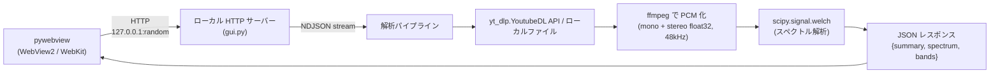

# analyze-spectrum

YouTube 動画またはローカル音声ファイルの周波数スペクトルを包括的に分析するツール。
レベル測定、スペクトル形状評価、帯域バランス解析、A/B 比較を統合的に提供する。
analyze-loudness と同一アーキテクチャ (pywebview + ローカル HTTP サーバー) で構成。

## アーキテクチャ概要



## 解析処理

解析パイプライン:

1. **PCM 抽出**: mono (`pan=mono|c0=0.5*c0+0.5*c1`, レベル保持) + stereo (True Peak 用)
2. **Welch PSD**: `scipy.signal.welch(data, fs=48000, nperseg=4096, noverlap=2048)`
3. **1/3 オクターブバンド分析**: 25Hz-10kHz (27 bands), 低周波バンド (25-40Hz) は PSD 補間で推定
4. **帯域エネルギー**: Sub (20-80Hz), Low (80-200Hz), Low-Mid (200-500Hz), Mid (500-2kHz), Presence (2-5kHz), Air (5-10kHz)
5. **レベル指標**: RMS (dBFS), True Peak (dBTP, ITU-R BS.1770 4x oversampling), Crest Factor
6. **Low/Intelligibility 比**: `10*log10(E[20-200Hz] / E[1-5kHz])`
7. **スペクトル重心**: `Σ(f * Pxx) / Σ(Pxx)` (80-8kHz)
8. **Spectral Tilt**: log2(freq) vs PSD dB の線形回帰 (dB/octave)
9. **Presence/Mid Ratio**: Presence(2-5kHz) / Mid(500-2kHz) エネルギー比
10. **Brightness**: Air(5-10kHz) / (Mid+Presence 500-5kHz) エネルギー比
11. **HPF -3dB 推定**: passband (300-600Hz) 平均から -3dB 交差点を探索
12. **HF Rolloff**: Mid-band 平均から -10dB 下回る周波数を検出
13. **Transfer Function**: 2 ファイル間の PSD 差分 (dB)
14. **EQ 推定**: Transfer Function にプリアンプのゲインと最大 N 個のピーキングフィルタ (RBJ biquad) を当てはめる (`estimate_parametric_eq()`)。基準トラックにこの EQ を掛けると比較トラックに近づく。1/6 オクターブで平滑化し 1/24 オクターブ刻みの対数周波数グリッドに載せた差分に対し、残差の最大点にバンドを 1 つずつ足して全パラメータを最小二乗で当てはめ直す。残差の最大値が 0.5 dB を下回ったら追加をやめる

### 参照規格

- **ITU-R BS.1770**: True Peak — 4x オーバーサンプリング、チャンネル別に測定
- **ANSI S3.5-1997**: SII band importance function (1-5kHz が明瞭度の約 72%)
- **IEC 60268-16:2020**: STI — Ed.5 で 125/250Hz 帯を大幅削減
- **Upward spread of masking**: 低域が高域をマスクする非対称性

### PCM 変換 (モノラルダウンミックス)

ffmpeg のデフォルト `-ac 1` は `sqrt(2)/2 * L + sqrt(2)/2 * R` の係数を使用し、
相関したステレオ信号に +3 dB のゲインを付加する。本ツールでは
`pan=mono|c0=0.5*c0+0.5*c1` を使用してチャンネルあたりのレベルを保持する。
True Peak は ITU-R BS.1770 に従いステレオ PCM で各チャンネル個別に測定する。

## ディレクトリ構成

```mermaid
graph LR
    root["analyze-spectrum/"]
    root --> wf[".github/workflows/"]
    wf --> wf_ci["ci.yaml<br>PR / push"]
    wf --> wf_rel["release.yaml<br>v* タグ / タグ上の workflow_dispatch"]
    wf --> wf_tag["tag-release.yml<br>master の push の CI の成功後か、コミットを渡す workflow_dispatch で、版上げならそのコミットにタグを打ち release.yaml を起動"]
    wf --> wf_ffw["ffmpeg-watch.yml<br>毎日 osxexperts.net の新しい ffmpeg を検出し、固定値の更新と版上げの PR を<br>GITHUB_TOKEN で作ってレビューなしでマージする"]
    wf --> wf_chk["workflow-checks.yml<br>全 PR で uses: の SHA 固定と同一リポジトリ参照の規則を検査。<br>PR 番号を渡す workflow_dispatch でも同じ検査を行い、<br>結果を PR の head commit に action-pins の check run として載せる"]
    wf --> wf_chkt["workflow-checks-test.yml<br>検査のフィクスチャテストと、dependabot-auto-merge.yml の<br>workflow_dispatch の入口と tag-release.yml のタグの段のテストを実行"]
    wf --> wf_dam["dependabot-auto-merge.yml<br>Dependabot の PR で更新が semver の patch なら自動マージを予約。必須チェック auto-merge。<br>workflow_dispatch では起動したブランチの head commit に auto-merge を報告する (dependabot/ のブランチと、dependabot[bot] が作った PR に含まれるコミットでは失敗する)"]
    root --> ght[".github/tests/"]
    ght --> ght_sh["workflow-checks-test.sh<br>workflow-checks.yml を偽の gh とフィクスチャの git tree で実行するテスト"]
    ght --> ght_am["dependabot-auto-merge-test.sh<br>dependabot-auto-merge.yml の両トリガーと、Dependabot のコミットへの dispatch を断る段のテスト"]
    ght --> ght_tag["tag-release-test.sh<br>tag-release.yml の検査とタグの段を偽の gh とフィクスチャのリポジトリで実行するテスト"]
    root --> r_claude["CLAUDE.md"]
    root --> r_readme["README.md"]
    root --> r_pyproj["pyproject.toml"]
    root --> src["src/analyze_spectrum/"]
    src --> src_init["__init__.py<br>vendor への sys.path 注入、SCHEMA_VERSION、make_meta()"]
    src --> src_main["__main__.py"]
    src --> src_ana["analysis.py<br>スペクトル解析の本体"]
    src --> src_cli["cli.py<br>argparse と CLI の処理の流れ"]
    src --> src_gui["gui.py<br>pywebview とローカル HTTP サーバー"]
    src --> src_dl["download.py<br>yt_dlp.YoutubeDL API、ffprobe による長さの取得"]
    src --> src_pcm["pcm.py<br>ffmpeg による PCM 変換 (mono + stereo)"]
    src --> src_upd["update.py<br>自動更新でこのアプリを表す UPDATE_CONFIG (公開鍵・mutex 名)"]
    root --> fe["frontend/"]
    fe --> fe_idx["index.html"]
    fe --> fe_main["main.js<br>fetch、NDJSON の進捗、DOM 描画、テーマ切替"]
    fe --> fe_i18n["i18n.js<br>en/ja の DICT と window.i18n.t / setLang"]
    fe --> fe_css["style.css"]
    fe --> ch["charts/"]
    ch --> ch_spec["spectrum.js<br>PSD の重ね描き (対数周波数、複数トラック)"]
    ch --> ch_oct["octave.js<br>1/3 オクターブのグループ棒グラフ"]
    ch --> ch_tf["transfer.js<br>transfer function (Δ dB)"]
    ch --> ch_low["lowend.js<br>低域の詳細 (20-500Hz、線形)"]
    ch --> ch_mh["midhigh.js<br>中高域の詳細 (500Hz-20kHz、対数)"]
    fe --> fe_vendor["vendor/<br>uPlot (同梱)"]
    root --> t["tests/"]
    t --> t_init["__init__.py"]
    t --> t_conf["conftest.py<br>共有 WAV フィクスチャ (_make_wav_bytes, wav_file, wav_file_b)、<br>設定ファイルを一時フォルダーへ向ける _isolated_settings"]
    t --> t_ana["test_analysis.py"]
    t --> t_pcm["test_pcm.py"]
    t --> t_cli["test_cli.py"]
    t --> t_gui["test_gui.py"]
    t --> t_int["test_integration.py<br>HTTP 統合テスト (実 HTTPServer、pywebview なし)"]
    t --> t_dlg["test_dialog_busy.py<br>ネイティブダイアログの排他 (_dialog_lock)"]
    t --> t_ffb["test_ffmpeg_binary.py<br>PATH の ffmpeg / ffprobe をアプリの PCM 変換と ffprobe の読み取りで確かめる<br>(EXPECT_FFMPEG_DIR で同梱バイナリを指定)"]
    t --> t_rwf["test_release_workflow.py<br>release.yaml が配布物に入った ffmpeg / ffprobe に<br>test_ffmpeg_binary.py を通すこと"]
    t --> t_fe["test_frontend.py<br>Playwright headless Chromium の実行役"]
    t --> tf["frontend/"]
    tf --> tf_html["test_ui.html<br>テストハーネスのページ"]
    tf --> tf_js["test_ui.js<br>ブラウザ上の UI 状態テスト"]
    root --> docs["docs/"]
    docs --> docs_arch["architecture.md"]
    docs --> docs_shot["screenshot.png"]
    docs --> docs_sec["security-audit.md"]
    root --> vend["vendor/py-analyze-common/<br>git submodule (sys.path 注入で利用)"]
    root --> r_build["build.py"]
    root --> r_spec["analyze-spectrum.spec"]
    root --> r_iss["installer.iss"]
    root --> r_lic["THIRD_PARTY_LICENSES.txt"]
    root --> ba_pin["build_assets/ffmpeg.json<br>同梱する ffmpeg / ffprobe の系列と、macOS のビルドの URL・SHA256"]
    root --> ba["build_assets/bin/<br>ffmpeg, ffprobe, deno (git 管理外)"]
```



## CLI の使い方

```
python3 -m venv .venv            # Windows: python -m venv .venv
source .venv/bin/activate        # Windows: .venv\Scripts\activate
pip install -e ".[dev]"

# Single file analysis
analyze-spectrum "https://www.youtube.com/watch?v=XXXXX"
analyze-spectrum ./recording.m4a

# A/B comparison
analyze-spectrum original.m4a eq_v1.m4a eq_v2.m4a

# Duration limit (middle extraction)
analyze-spectrum "https://..." --duration 2

# Estimated EQ: up to 3 peaking bands per transfer function (default 5)
analyze-spectrum original.m4a eq_v1.m4a --eq-bands 3
```

### CLI の依存

- `yt-dlp` — URL のダウンロード (Python API 経由)
- `ffmpeg` / `ffprobe` — PCM 変換・長さの取得・チャンネル数の検出
- `numpy`, `scipy` — スペクトル解析
- `matplotlib` — CLI のプロット出力 (任意)
- `pytest` — 開発用の依存

## GUI の使い方

### 開発時の起動

```
pip install -e ".[gui]"
analyze-spectrum-gui
```

### ビルドと配布

```bash
# Windows
.venv/Scripts/python build.py              # download assets + PyInstaller bundle
.venv/Scripts/python build.py --installer  # + Inno Setup installer (.exe)

# macOS (要 create-dmg: brew install create-dmg)
.venv/bin/python build.py
.venv/bin/python build.py --installer      # + DMG
```

フラグ: `--skip-download` (外部アセット取得をスキップ) / `--skip-build` (PyInstaller をスキップ、`dist/` がある前提) / `--update-checksums` (アセットを取得して `checksums.json` を更新) / `--ffmpeg-only` (ffmpeg / ffprobe だけを `build_assets/bin/` に取得して終わる)。

> **注意**: 必ずプロジェクト固有の venv の python (`.venv/bin/python` / `.venv/Scripts/python`) で実行すること (グローバル規約「開発環境」)。

### GUI の依存

- `pywebview` — 任意の依存 (`gui` extra)
- `numpy`, `scipy` — スペクトル解析
- `yt-dlp` — Python ライブラリとしてバンドル (PyInstaller が自動的に含める)
- `certifi` — 自動更新の HTTPS 接続が使う CA 証明書 (`gui` extra。macOS の frozen のアプリは、同梱の OpenSSL が指す CA のパスが利用者の Mac に無い)。PyInstaller は certifi が無くても警告だけで先へ進むため、`build.py` の `check_prerequisites()` が certifi を import できないときはビルドを止める
- ffmpeg, ffprobe, deno — `build_assets/bin/` に同梱
- `py-analyze-common` — git submodule (`vendor/py-analyze-common`)。OS 判定・subprocess kwargs・ダークモード検出・ffmpeg/ffprobe ラッパー・yt-dlp ダウンロード・JSON 安全化・自動更新・テーマと言語の保存を提供。pyproject.toml には記載せず `sys.path` 注入で利用

## テスト

```bash
pytest -q                                          # 全テスト
python -m playwright install --with-deps chromium  # 初回のみ (test_frontend.py が使う)
python build.py --ffmpeg-only && EXPECT_FFMPEG_DIR=build_assets/bin pytest -q tests/test_ffmpeg_binary.py  # 同梱する ffmpeg / ffprobe で
```

## GUI エンドポイント

| エンドポイント | メソッド | 説明 |
|----------|--------|-------------|
| `/analyze` | POST | URL またはローカルファイルのスペクトル解析。NDJSON ストリーム。結果はキャッシュに保存、同一ソース+duration はキャッシュから返却 |
| `/compare` | POST | 複数トラック比較分析。NDJSON ストリーム。各トラックを個別キャッシュ、未キャッシュ分のみ解析。Transfer function は `_transfer_functions_from_dicts()` で再計算 |
| `/save` | POST | 単体分析結果 JSON をネイティブダイアログで保存。`source` + `duration` パラメータ指定時はキャッシュファイルから直接コピー (再シリアライズ不要)。比較モードでは JSON 保存なし (画像のみ) |
| `/save-image` | POST | チャートの合成 PNG (base64) を保存 |
| `/load` | POST | 単体解析 JSON 読み込み (compare JSON は拒否)。複数ファイル選択対応 (`allow_multiple=True`)。描画に要る項目 (`missing_result_fields()`) が欠けた単一ファイルは `schema_outdated` フラグを返却。項目が揃ったものだけキャッシュ登録。`meta.schema_version` が整数でなければ 400 |
| `/browse` | POST | ネイティブダイアログでローカル音声ファイル選択 |
| `/upload` | POST | ドラッグ & ドロップしたファイルを一時保存 (octet-stream、最大 500MB) |
| `/common/settings.js` | GET | py-analyze-common の `settings.js` の前に、設定ファイルに保存したテーマと言語 (`window.analyzeSettingsStored`) を付けて返す。読み込みのたびに設定ファイルを読む (`Cache-Control: no-store`) |
| `/settings` | POST | テーマか言語のどちらか 1 つを設定ファイルに保存する (`{"theme": "light" \| "dark" \| "auto"}` か `{"lang": "en" \| "ja"}`)。それ以外は 400、保存の失敗は 500。応答は保存後の `{"theme", "lang"}` |
| `/update/status` | POST | 今の版と、このビルドが自分を更新できるかと、起動時の確認の設定 (`{"current", "supported", "launch_check"}`) |
| `/update/settings` | POST | 起動時の確認の設定を保存する (`{"launch_check": true \| false}`、真偽値以外は 400、保存の失敗は 500) |
| `/update/check` | POST | 最新リリースの `latest.json` を読み、新しい版があれば `{"available": true, "version"}`、無ければ `{"available": false}`。取得・解析の失敗は 502 |
| `/update/install` | POST | `{"version"}` (直前の確認が見つけた版だけを受け付ける) をダウンロード・検証して適用する。成功は `{"restarting": true}` を返してからアプリを終える。インストール後に再起動だけができなかったときは `{"installed": true, "restart_error"}` を返して動き続ける。失敗は 500 |

POST は Host 検証の後に Content-Type を確かめ、`/upload` は `application/octet-stream`、それ以外は `application/json` (`;` より後の charset 等は無視) でなければ 415 を返す (`docs/security-audit.md` の SEC-23)。

## レスポンス形式 (GUI NDJSON)

### 単体解析の結果

```json
{
  "type": "result",
  "data": {
    "meta": {
      "version": "X.Y.Z",
      "schema_version": 1,
      "analyzed_at": "2026-04-03T12:34:56+00:00",
      "source": "recording.m4a"
    },
    "label": "original",
    "sample_rate": 48000,
    "duration_sec": 6.23,
    "rms_dbfs": -14.4,
    "peak_dbfs": -2.8,
    "true_peak_dbtp": -2.7,
    "spectrum": {
      "freqs": [5.86, 11.72, "..."],
      "psd_db": [-68.3, -65.1, "..."]
    },
    "bands": {
      "centers": [25, 31.5, 40, "...", 10000],
      "energy_db": [-55.6, -56.4, "..."]
    },
    "summary": {
      "crest_factor_db": 12.0,
      "low_intel_ratio_db": 5.2,
      "spectral_centroid_hz": 635,
      "spectral_tilt_db_oct": -4.2,
      "presence_mid_ratio_db": -1.8,
      "brightness_db": -10.5,
      "hpf_3db_hz": null,
      "hf_rolloff_hz": 12500,
      "band_energy": {
        "sub_20_80": -45.0,
        "low_80_200": -18.0,
        "low_mid_200_500": -18.8,
        "mid_500_2k": -23.5,
        "presence_2k_5k": -25.3,
        "air_5k_10k": -40.4
      }
    }
  }
}
```

### 比較の結果 (NDJSON レスポンスのみ、JSON 保存・読み込みは非対応)

```json
{
  "type": "compare_result",
  "data": {
    "tracks": ["/* array of single analysis results */"],
    "transfer_functions": [
      {
        "label": "v3 - original",
        "freqs": ["..."],
        "delta_db": ["..."],
        "eq": {
          "preamp_db": -2.0,
          "bands": [{"freq_hz": 89.7, "gain_db": 4.9, "q": 0.87}],
          "residual_rms_db": 0.06,
          "fit_range_hz": [20.0, 16000.0]
        }
      }
    ]
  }
}
```

## 解析パラメータ

| パラメータ | 値 | 根拠 |
|-----------|-------|-----------|
| サンプルレート | 48000 Hz | 音声制作の標準 |
| モノラルダウンミックス | `0.5*L + 0.5*R` | チャンネルあたりのレベルを保持 (ffmpeg 既定の `sqrt(2)/2` は使わない) |
| True Peak | ステレオ、チャンネル別 | ITU-R BS.1770 準拠 |
| PCM 形式 | float32 | numpy でそのまま扱え、量子化が無い |
| Welch nperseg | 4096 | 窓長 約 85ms、周波数分解能 11.7 Hz |
| Welch オーバーラップ | 50% (2048) | Welch 法の標準 |
| 1/3 オクターブ範囲 | 25 Hz - 10 kHz | 声と音楽の帯域を覆う |
| Low/Intel 帯域 | 20-200 / 1-5k Hz | ANSI S3.5 の重要度関数による重み付け |
| 重心の範囲 | 80 - 8000 Hz | 声に関わる帯域 |
| HPF passband 基準 | 300 - 600 Hz | 一般的な HPF より上、声のフォルマントより下 |
| HF Rolloff しきい値 | -10 dB | Mid 帯域 (500-2kHz) の基準からの低下量 |
| True Peak オーバーサンプリング | 4x | ITU-R BS.1770。メモリ節約のため 30 秒単位で分割処理 |
| EQ 推定の範囲 | 20 Hz - 16 kHz (上限は 0.45 × sample rate も超えない) | `EQ_FIT_RANGE` |
| EQ 推定のバンド数 | 既定 5 (CLI `--eq-bands`) | `EQ_BANDS_DEFAULT` |
| EQ のゲイン / Q の範囲 | ±24 dB / 0.3 - 10 | `EQ_GAIN_LIMIT_DB` / `EQ_Q_RANGE` |

## 設計判断

### アクセントカラー

analyze-spectrum はブルー系 (`--accent: #1565C0`)、analyze-loudness はパープル系 (`--accent: #9C27B0`)。ドメインで色を分離: ブルー = 周波数スペクトル、パープル = ラウドネス (音量)。CSS 変数名は両プロジェクトで共通 (`--text` / `--bg-card` / `--text-secondary` / `--text-muted` 等)。両アプリで同じ CSS 変数と規則は py-analyze-common の `analyze_common/web/common.css` に置き、`gui.py` が `/common/common.css` として配信する (PyInstaller の spec が `analyze_common/web` に同梱)。`index.html` はこれを `style.css` より先に読み込み、`style.css` は残りの変数 (アクセントカラー等) と固有の規則を持つ。狭い画面向けの `@media (max-width: 480px)` の `h1` は各 `style.css` の `h1` より後に置く必要があるため、`style.css` に残す。

### yt-dlp は Python API で利用 (バイナリは同梱しない)

`yt_dlp.YoutubeDL` を Python ライブラリとして直接呼び出し、`FFmpegExtractAudio` postprocessor で音声抽出。バイナリ同梱を避けることで、macOS 向けの codesign 再署名で発生する Team ID 不一致問題 (onefile バイナリ内部の Python.framework が再署名できず hardened runtime で拒否される) を根本的に回避している。

### yt-dlp のバージョン固定

`pyproject.toml` で `yt-dlp==<version>` の完全一致ピンを持つ。同じピンを analyze-loudness / analyze-spectrum / py-analyze-common の 3 つの `pyproject.toml` が持ち、手で版を上げるときは 3 つを同時に更新する。Dependabot の更新が semver の patch のときはリポジトリごとに自動でマージされる (`.github/workflows/dependabot-auto-merge.yml`) ので、3 つの値は揃わないことがある。出荷物に入るのはこのリポジトリの `pyproject.toml` のピンで、py-analyze-common の `pyproject.toml` は出荷物のビルドに使われない (submodule を `sys.path` 注入で読むため)。

固定する理由: 出荷物は PyInstaller が yt-dlp を PYZ に焼き込むため、インストール後に更新できない。無指定にするとビルドした時点の解決結果で版が決まり、出荷物に入った版を事後に特定できない。

ピンの版は、[リリース手順](#リリース手順) の版上げ PR を出す前に確かめる。Dependabot の自動マージで変わったピンは、この確認を経ずに master に入っている:

1. このリポジトリの `pyproject.toml` のピンの版を入れた `.venv` で、**全長ダウンロード**を確認する。`--test` (先頭 10 KiB のみ取得) では 403 を検出できない:
   `.venv/bin/python -m yt_dlp -f bestaudio -o <tmpdir>/%(id)s.%(ext)s <URL>`
   通常動画・ライブアーカイブ・Shorts の 3 種で確認する
2. 通らなければ `pip install -U yt-dlp` で候補版を入れて同じ確認をし、通った版を 3 つの `pyproject.toml` に書く。py-analyze-common を先にコミットし、submodule ポインタを更新する

この節は analyze-loudness の CLAUDE.md と同一内容のミラー。

### macOS は Apple Silicon (arm64) 専用 (v1.3.0+)

ffmpeg / ffprobe は osxexperts.net の arm64 ネイティブビルドを取得する。evermeet.cx (x86_64) は (a) bundle に Intel Mach-O が混入すると macOS 26 で「Intel プロセッサ用アプリの対応は終了します」警告が出る、(b) GitHub Actions macos runner から接続タイムアウトが発生するため不採用。Intel Mac サポートは v1.2.0 までで打ち切り。

### 同梱する ffmpeg の固定

`build_assets/ffmpeg.json` が、両 OS で同梱する ffmpeg / ffprobe の系列 (`series`、例 `8.1`) と、macOS のビルドの URL と SHA256 を持つ。読み書きと検証は py-analyze-common の `analyze_common/ffmpeg_release.py` が行い、`build.py` はそれを呼ぶ。

- macOS: `build.py` が osxexperts.net の zip を取得し、中のバイナリを固定値の SHA256 と照合する (不一致でビルドを止める)。この SHA256 は osxexperts.net のページがダウンロードの横に載せる値と同じもの
- Windows: BtbN/FFmpeg-Builds の `latest` にある同じ系列のビルド (`ffmpeg-n{series}-latest-win64-lgpl-{series}.zip`、無ければ `gpl`)。中身は日ごとに入れ替わるので SHA256 は固定しない。系列が `latest` から無くなるとビルドが止まる
- 更新: `.github/workflows/ffmpeg-watch.yml` が毎日行い、patch リリースまで進める ([リリース手順](#リリース手順)の「ffmpeg の更新による patch リリース」)。osxexperts.net の URL は版から決まらない (`ffmpeg81arm.zip` / `ffmpeg9arm.zip`) ので、固定値はページのリンクから取る。手で行うときは、次のコマンドが、ページに別のビルドがあるときだけ、BtbN に同じ系列があることと、両ファイルがページの SHA256 と一致することを確かめてから、新しい固定値を `--candidate` に書く。`pin_update=true` なら、その中身を `build_assets/ffmpeg.json` に写す

  ```bash
  PYTHONPATH=vendor/py-analyze-common/src .venv/bin/python -m analyze_common.ffmpeg_release detect \
    --pin build_assets/ffmpeg.json --version-file src/analyze_spectrum/__init__.py --candidate <tmpdir>/ffmpeg.json
  ```

- 確認: `tests/test_ffmpeg_binary.py` が、numpy で書いた 48 kHz の 16-bit ステレオ WAV (左右で別の正弦波) を PATH の ffmpeg / ffprobe とアプリの `extract_audio()` / `probe_info()` で読み、返る float32 の PCM が書いたサンプルの 1/32768 倍と一致すること (中盤の切り出しを含む) と、チャンネル数・長さを確かめる。`EXPECT_FFMPEG_DIR` に同梱バイナリのディレクトリを渡すと、そこの ffmpeg / ffprobe が先に見つかることを確かめ、見つからなければ skip せずに失敗する ([テスト](#テスト)の最後の行)。リリースのビルド (`.github/workflows/release.yaml`) は、配布物に入ったコピー (Windows は PyInstaller が集めた `dist/analyze-spectrum/_internal/bin`、macOS は署名した後の `.app` の `Contents/Frameworks/bin`) をこのテストに通し、失敗すると成果物のアップロードと Draft Release の作成へ進まない (`tests/test_release_workflow.py` が、その段の位置と渡すディレクトリを spec・`installer.iss` と照らして確かめる)

### PCM 変換方式

analyze-loudness は ebur128 filter の stderr パースだが、本ツールは PCM 生データを
numpy に読み込んで scipy.signal.welch で処理。メモリ制約は以下で対処:

- 48kHz mono float32 = 192 KB/s → 10分 = 115 MB (許容範囲)
- 長尺は `--duration` で中盤抽出 (analyze-loudness と同じ方式)

### 比較モード

GUI で複数ファイルを追加し、自動で transfer function を計算。
analyze-loudness に未実装だった比較機能をコア仕様として取り込む。

### フロントエンドチャート

uPlot (対数周波数の PSD 重ね描き) + Canvas 自前描画 (1/3 オクターブ棒グラフ、transfer function、
低域の詳細、中高域の詳細)。analyze-loudness と同じ vendor 構成。

### 結果キャッシュ (GUI)

セッション内キャッシュにより同一ソースの再解析を回避する。

- **保存先**: `tempfile.mkdtemp()` に作成した `_cache_dir` (セッション終了時に削除)
- **キャッシュキー**: URL or ファイルパス + duration。ローカルファイルは mtime を含む
- **単体分析**: `/analyze` の結果を temp JSON として保存。再リクエスト時はキャッシュから返却
- **比較分析**: `/compare` はトラック単位でキャッシュ参照。未キャッシュ分のみ解析を実行し、transfer function は全トラックの dict から `_transfer_functions_from_dicts()` で再計算
- **Save 最適化**: `/save` でフロントエンドから `source` + `duration` を受信した場合、キャッシュファイルを直接コピー (再シリアライズ回避)
- **Load → キャッシュ登録**: `/load` で読み込んだデータ (描画に要る項目が揃ったもののみ) をキャッシュに登録し、後続の Save や Compare で再利用
- **フロントエンド状態追跡**: `lastSource`, `lastDuration` で直近の分析コンテキストを保持し、Save 時のキャッシュ参照に使用

### ホワイトフラッシュ防止

ページロード時のちらつきを防ぐ 2 段構成:

- **フロントエンド** (`frontend/index.html`): `<head>` で `common/settings.js` と `i18n.js` を読み、続くインライン `<script>` が CSS ペイント前に `window.analyzeSettings.theme` からテーマを解決して `<html>` に `data-theme` 属性を、`i18n.js` が決めた言語を `lang` 属性を付与
- **バックエンド** (`gui.py`): `analyze_common.ui_settings.UiSettings.background_color()` が設定ファイルのテーマから pywebview の `background_color` を決める。auto (保存が無いときを含む) は OS のダークモード設定 (`analyze_common.theme.is_dark_mode()`: Windows はレジストリの `AppsUseLightTheme`、macOS は `AppleInterfaceStyle`) に従う

### Load JSON 保留ソース保持

`/load` 処理前に `urlInput` の値を `compareSources` に保存し、ロード後も消失しないようにする:

- 単一ロード + 保留あり → 両方を Compare モードに追加
- 複数ロード + 保留あり → 保留トラックをロード済みトラックにマージ
- 旧スキーマ承認 + 保留あり → 保留 + ソースをトラックリストに追加 (次回 Submit で再解析)

### スキーマバージョン管理

唯一の定義元は `src/analyze_spectrum/__init__.py` の `SCHEMA_VERSION` (整数)。`gui.py` は `_SCHEMA_VERSION` として別名 import し、`meta` は同ファイルの `make_meta()` が組み立てる。

- `meta.version`: アプリバージョン (表示用)
- `meta.schema_version`: スキーマバージョン。`/load` は整数であること (無くてもよい) だけを検証し、値では互換性を判定しない
- 互換性は**バージョン番号ではなく項目の有無で判定する**。描画に要る項目の一覧は `analysis.py` の `missing_result_fields()` が唯一の定義元で、`spectrum.freqs` / `spectrum.psd_db` / `bands.centers` / `bands.energy_db` / `summary.band_energy` の各帯域を見る。数値指標の欠落は対象外 (画面では `?` と表示する)
- 項目が欠けた単一ファイルは `schema_outdated` フラグを返却し、キャッシュに登録しない (再解析で最新の形式を取得)。複数ファイルの読み込みでも、項目が欠けたものはキャッシュに登録しない
- Compare JSON の保存・読み込みは廃止 (単体解析結果のみ)

### フロントエンド状態管理

Submit 時に `urlInput` の pending 値と `compareSources` を統合してモード判定する:

- `_effectiveTrackCount()`: compareSources + urlInput pending を含む実効トラック数
- Submit ボタンラベルは `urlInput` の `input` イベントで動的更新
- Remove Track 時は urlInput に既存値がある場合 collapse しない (値の保持)

### ダークモード

CSS 変数 + `[data-theme]` でライト / ダーク / auto の 3 ステート。選択は設定ファイルの `theme` に保存し ([テーマと言語の保存](#テーマと言語の保存))、保存値が `light` / `dark` 以外のときは auto として扱う。トグルは light -> dark -> auto の順に巡回し、アイコンは太陽 / 三日月 / 半分を塗った円の SVG (`_createThemeIcon()` が生成)。auto では `prefers-color-scheme` の変化を購読して再適用する。初期適用はペイント前 ([ホワイトフラッシュ防止](#ホワイトフラッシュ防止))。

### i18n (多言語)

`frontend/i18n.js` で en / ja を管理。初期言語は `navigator.language` (`ja*` -> ja、他は en)、選択は設定ファイルの `lang` に保存 ([テーマと言語の保存](#テーマと言語の保存))。静的マークアップは `data-i18n*` 属性を DOMContentLoaded で置換し、`main.js` が動的に作る文字列は `window.i18n.t(key)` を直接呼ぶ。`main.js` が状態に合わせて書く文字 (テーマボタンの `aria-label`、送信ボタンの文字と `aria-label`) を持つ要素には `data-i18n*` を付けず、`main.js` が読み込み時と `window.i18n.onChange` で書く (付けると DOMContentLoaded と言語の切り替えのたびに固定の文に戻る)。

### テーマと言語の保存

テーマと言語の選択は、自動更新の「起動時に確認」と同じ設定ファイル (場所は [自動更新](#自動更新) の「設定」の行) に置く。webview の localStorage を使わない理由も同じ行にある。

- 仕組みの本体は py-analyze-common にあり、analyze-loudness と共通: 値の検証・ウィンドウの背景色・ページへ渡すスクリプトは `analyze_common/ui_settings.py` の `UiSettings`、ページ側の読み書きは `analyze_common/web/settings.js` (`window.analyzeSettings`。spec が同梱する)
- `gui.py` は設定ファイルの `SettingsStore` を 1 つだけ作り (`_settings`)、`Updater` と `UiSettings` の両方に渡す。同じファイルを同じロックで読み書きする
- ページは `/common/settings.js` で保存した値を受け取る。`main.js` はテーマと言語を切り替えるたびに `window.analyzeSettings.save()` で `/settings` に保存する。保存は 1 つずつ順に送るので、すばやく切り替えても最後に選んだ値が残る
- 保存に失敗すると、選んだテーマ・言語はアプリを閉じるまで有効なままで、ステータス行に原因 (`err.setting_save_failed`) を出す

### ウィンドウアイコン

PyInstaller の `EXE(icon=...)` は EXE ファイル自体のアイコン (エクスプローラー表示用) のみ。pywebview のウィンドウアイコン (タイトルバー・タスクバー) には `webview.start(icon=...)` で明示指定が必要 (pywebview 6.x で `create_window` から `start` に移動)。`build_assets/icon.ico` を PyInstaller の `datas` でバンドルし、`_ICON_PATH` で解決する。

### pywebview file_types 制約

pywebview 6.x の `parse_file_type()` は `file_types` の description 部分を `[\w ]+` で検証する。スラッシュ (`/`) やハイフン (`-`) 等を含むと `ValueError` になるため、description はスペース区切りの英数字のみで記述する (例: "Audio Video Files")。

### WebView2 のドラッグ & ドロップ

`AllowExternalDrop = False` を pywebview の `shown` + `loaded` イベントで設定。
JavaScript 側は window capture フェーズで `stopImmediatePropagation` により
WebView2 ネイティブハンドラへの伝播を遮断。

### 自動更新

インストールしたアプリは、起動時に最新リリースの `latest.json` を読み、今の版より新しい版があれば確認ダイアログ (`window.confirm`) を出す。OK のときだけインストーラーをダウンロードし、署名を確かめてから適用し、アプリを起動し直す。キャンセルでは何もダウンロードしない。起動時の確認は、新しい版が無いときと確認に失敗したときは何も表示しない。分析中は確認ダイアログを出さずに断る。

- 仕組みの本体は py-analyze-common にあり、analyze-loudness と共通: 取得・検証・適用は `analyze_common/update.py`、設定ボタン・設定ダイアログ・起動時の確認は `analyze_common/web/update.js` (`gui.py` が `/common/update.js` として配信し、spec が同梱する)、Windows インストーラーの更新時の動作は `installer/auto_update.iss`。マニフェストの形式・署名の対象・各 OS での適用の手順は `analyze_common/update.py` の docstring が正
- このアプリ固有の値は `src/analyze_spectrum/update.py` の `UPDATE_CONFIG` (product・repo・公開鍵 `PUBLIC_KEY`・一時ディレクトリの接頭辞・mutex 名)
- 設定: ツールバーの設定ボタンが開くダイアログに「起動時に確認」と「今すぐ確認」と版を出す。起動時の確認の ON/OFF は、アプリの設定ファイル (macOS は `~/Library/Application Support/analyze-spectrum/settings.json`、Windows は `%APPDATA%\analyze-spectrum\settings.json`) の `update_check_at_launch` に `/update/settings` が保存する (既定は ON)。webview の localStorage は起動し直すと消えるので使わない (pywebview は private モードで起動し、ローカルサーバーのポート = ページの origin も起動ごとに変わる)。テストは `tests/conftest.py` の `_isolated_settings` で設定ファイルを一時フォルダーへ向ける。「今すぐ確認」は、起動時の確認が表示しない結果 (最新・失敗) もダイアログ内に出す
- `/update/install` が成功すると、応答を返してからアプリを終える (`_exit_for_update()`)。Windows はインストーラーが起動済みなので `window.destroy()` で普通に終わる。macOS は `.app` を入れ替え済みなので、atexit が消す一時ディレクトリを先に消して `os._exit(0)` で終わる (入れ替えた後に import が走ると新しい版のファイルを読むため)
- ダウンロード中は main.js の `_setUpdateLock()` が入力欄・各ボタン・トラック操作・ドロップ・結果の保存 (Save JSON / Save Image。ロック中に描き直した結果のボタンも無効で作る) を止める
- Windows: 起動中は `hold_instance_mutex(UPDATE_CONFIG.mutex_name)` で名前付き mutex を持ち、更新のインストーラーはそれが消えるのを待ってからファイルを置き換える。UAC の確認はアプリが終わった後にインストーラーが出す (理由は `vendor/py-analyze-common/CLAUDE.md` の「自動更新」節の Windows の行) ので、UAC を拒否するとインストールされず、アプリは閉じたままになる (もう一度起動すると旧版が起動し、起動時の確認が ON なら同じ更新をもう一度勧める)。`installer.iss` は同じ名前を `build.py` から `/DMyAppMutex=` で受け取る (`mutex_name` が唯一の定義元。`build.py` の `_read_mutex_name()` が読む)
- frozen でない起動 (`analyze-spectrum-gui`) は更新できない。設定ダイアログはボタンを無効にして「インストールしたアプリでのみ使えます」と出す

#### 署名の鍵 (初回のみ)

更新の署名は Ed25519 で、macOS のコード署名とは別の鍵を使う。秘密鍵は git に入れず、GitHub の secret `UPDATE_SIGNING_KEY` に登録する。`release.yaml` の Create Release ジョブが `python -m analyze_common.update_manifest sign` で `latest.json` を作る。このとき各インストーラーの署名を `PUBLIC_KEY` で検証してから書き出すので、secret が無いときと、鍵が `PUBLIC_KEY` と合わないときはジョブが失敗し、Release は作られない。

```bash
openssl genpkey -algorithm ed25519 -out ~/.analyze-update/analyze-spectrum-update.pem
PYTHONPATH=vendor/py-analyze-common/src .venv/bin/python -m analyze_common.update_manifest public-key ~/.analyze-update/analyze-spectrum-update.pem
gh secret set UPDATE_SIGNING_KEY --repo semnil/analyze-spectrum < ~/.analyze-update/analyze-spectrum-update.pem
```

2 行目が出力する公開鍵を `src/analyze_spectrum/update.py` の `PUBLIC_KEY` に書く。鍵を作り直すと、`PUBLIC_KEY` を書き換える前の版のアプリは新しい鍵で署名した更新を受け付けない (その版の利用者は新しいインストーラーを手で入れ直す)。

## リリース手順

版上げ PR を出す前に、yt-dlp のピンの版を全長ダウンロードで確かめる ([yt-dlp のバージョン固定](#yt-dlp-のバージョン固定))。

1. `src/analyze_spectrum/__init__.py` の `__version__` を上げる PR を出す (版上げは他の変更を含めない)
2. マージ後、master への push で走った CI が成功すると、`tag-release.yml` が `__version__` の変化を検出してマージコミットに `vX.Y.Z` タグを打ち、そのタグ上で `release.yaml` を `workflow_dispatch` で起動する (ffmpeg-watch.yml のマージでは、ffmpeg-watch.yml がマージコミットを渡して `tag-release.yml` を起動する。[ffmpeg の更新による patch リリース](#ffmpeg-の更新による-patch-リリース)の 3)
3. `release.yaml` が Windows インストーラー (`SpectrumAnalyzer-X.Y.Z-setup.exe`) と macOS DMG (`Spectrum-Analyzer.dmg`) をビルドし、署名した更新用マニフェスト (`latest.json`、[自動更新](#自動更新)) と合わせて Release を作成する (`draft: true`)。ビルドは成果物をアップロードする前に、配布物に入った ffmpeg / ffprobe を `tests/test_ffmpeg_binary.py` に通す ([同梱する ffmpeg の固定](#同梱する-ffmpeg-の固定)の「確認」)
4. Release の publish は人が行う。publish した Release が `releases/latest` になり、インストール済みのアプリの更新確認に出る (プレリリースは `latest` にならないので出ない)

版上げ PR のマージがリリースの起点。`tag-release.yml` は `__version__` が変わらない push では何もせず、同名のタグが別のコミットに既にあるときはタグを動かさない。`tag-release.yml` の `workflow_dispatch` は入力 `sha` のコミットを扱い、master 上にあり、そのコミットか tree が同じ親コミット (master の先端を含んだ状態でマージした PR の先端) で CI が成功しているときだけタグを打つ。`release.yaml` はタグの push と、タグ上の `workflow_dispatch` でもビルドとリリースを行う (ブランチ上の `workflow_dispatch` はビルドのみ)。

### ffmpeg の更新による patch リリース

`.github/workflows/ffmpeg-watch.yml` が毎日 (と `workflow_dispatch` で) 次を行い、Draft Release の作成まで人の手を通さない。PR は bot がレビューなしでマージする。

1. detect: `build_assets/ffmpeg.json` と osxexperts.net のページを比べる ([同梱する ffmpeg の固定](#同梱する-ffmpeg-の固定))。ページに別のビルドがあれば、BtbN に同じ系列があることと両ファイルの SHA256 を確かめて新しい固定値を作る。`__version__` が最新の `vX.Y.Z` タグと同じで、固定値が今回変わるか、今の固定値がそのタグの出した固定値 (タグにある固定値のファイル、タグに無ければタグの後で最初にそのファイルを足したときの固定値) と違うときは patch リリースを行う
2. smoke: macOS と Windows のランナーで、`build.py --ffmpeg-only` で取得した固定値のバイナリに `tests/test_ffmpeg_binary.py` を通す
3. land: GITHUB_TOKEN で、固定値の PR (`ffmpeg-watch/pin-<series>-<run id>-<attempt>`) と、版上げだけの PR (`ffmpeg-watch/bump-v<version>-<run id>-<attempt>`、`chore: バージョンを vX.Y.Z に更新`) を順に作る。GITHUB_TOKEN が作った PR では `pull_request_target` が走らず、`pull_request` の run は承認待ちになるので、各 PR の必須チェックを自分で `workflow_dispatch` する: CI (`Test 🧪`) と `dependabot-auto-merge.yml` (`auto-merge`) をそのブランチで、`workflow-checks.yml` (`action-pins`) を master で PR 番号を渡して。3 つの成功と `gh pr checks --required` を待ってからマージする。GITHUB_TOKEN のマージでは master の push の CI も走らないので、版上げのマージ後に、そのマージコミットを渡して `tag-release.yml` を `workflow_dispatch` で起動する。マージコミットの tree は CI が通った PR の先端と同じで、`tag-release.yml` はそれを確かめてからタグを打つ。版上げの後に別のマージが入っても、タグを打つコミットは変わらない
4. Release の publish は人が行う ([リリース手順](#リリース手順)の 4)

- 前提: リポジトリの設定「Allow GitHub Actions to create and approve pull requests」(Settings → Actions → General) が on であること。off だと land の `gh pr create` が失敗する
- 前回の実行の PR (head が `ffmpeg-watch/` の open な PR) が残っていると、land は何も変えずに失敗する。その PR を閉じるかマージしてから再実行する。ブランチ名は実行 (run id と attempt) ごとに違うので、PR を作る前に失敗した実行が push したブランチは、次の実行の push と衝突しない (そのブランチは PR の無いまま残る)。固定値の PR だけがマージされて版上げが残ったときは、次の実行の detect が「今の固定値が最新のタグの出した固定値と違う」として版上げから再開する。版上げがマージされたのにタグが無いとき (版上げのマージの後で止まった実行) は、次の実行の detect が `__version__` をその値にした master のコミット (`release_sha`) を報告し、land がそのコミットを渡して `tag-release.yml` を起動する。タグが既にあれば何もしない
- smoke か、各 PR で dispatch した必須チェック (CI・auto-merge・action-pins) のどれかが失敗すると、その時点で止まり、マージしない

## バージョン管理

唯一の定義元は `src/analyze_spectrum/__init__.py` の `__version__`。他のファイルはすべてここから動的に取得する:

| ファイル | 取得方式 |
|----------|----------|
| `pyproject.toml` | `[tool.setuptools.dynamic]` `attr` (AST 抽出、import なし) |
| `analyze-spectrum.spec` | `_read_version()` で regex 読み取り |
| `installer.iss` | `build.py` の `_build_inno()` が `/DMyAppVersion=` で注入 |

バージョンバンプ時は `__init__.py` の `__version__` のみ変更する。

## 既知の制約

- 比較は最大 6 トラック (チャートの可読性)
- リアルタイム入力 (マイク) は対象外
