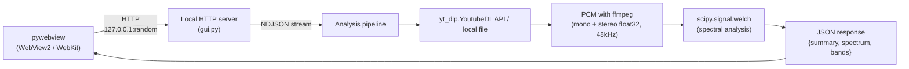

# analyze-spectrum

A tool that comprehensively analyzes the frequency spectrum of a YouTube video or a local audio file.
It combines level measurement, spectral shape evaluation, band balance analysis and A/B comparison.
Built on the same architecture as analyze-loudness (pywebview + a local HTTP server).

## Documentation languages

- **Override of the global CLAUDE.md's 「ドキュメント」 language rule**: this file is written entirely in English, and the documents are maintained in both English and Japanese — English at `README.md` and `docs/<name>.md`, Japanese at `README.ja.md` and `docs/<name>.ja.md`

## Architecture overview



## Analysis

The analysis pipeline:

1. **PCM extraction**: mono (`pan=mono|c0=0.5*c0+0.5*c1`, level-preserving) + stereo (for True Peak)
2. **Welch PSD**: `scipy.signal.welch(data, fs=48000, nperseg=4096, noverlap=2048)`
3. **1/3-octave band analysis**: 25Hz-10kHz (27 bands); the low-frequency bands (25-40Hz) are estimated by PSD interpolation
4. **Band energy**: Sub (20-80Hz), Low (80-200Hz), Low-Mid (200-500Hz), Mid (500-2kHz), Presence (2-5kHz), Air (5-10kHz)
5. **Level metrics**: RMS (dBFS), True Peak (dBTP, ITU-R BS.1770 4x oversampling), Crest Factor
6. **Low/Intelligibility ratio**: `10*log10(E[20-200Hz] / E[1-5kHz])`
7. **Spectral centroid**: `Σ(f * Pxx) / Σ(Pxx)` (80-8kHz)
8. **Spectral Tilt**: linear regression of PSD dB against log2(freq) (dB/octave)
9. **Presence/Mid Ratio**: Presence(2-5kHz) / Mid(500-2kHz) energy ratio
10. **Brightness**: Air(5-10kHz) / (Mid+Presence 500-5kHz) energy ratio
11. **HPF -3dB estimation**: searches for the -3dB crossing point from the passband (300-600Hz) average
12. **HF Rolloff**: detects the frequency that falls -10dB below the mid-band average
13. **Transfer Function**: the PSD difference (dB) between 2 files
14. **EQ estimation**: fits a preamp gain and up to N peaking filters (RBJ biquad) to the Transfer Function (`estimate_parametric_eq()`). Applying this EQ to the reference track brings it close to the compared track. On the difference smoothed by 1/6 octave and placed on a log-frequency grid at 1/24-octave steps, it adds bands one at a time at the point of the largest residual and refits all parameters by least squares. It stops adding when the largest residual falls below 0.5 dB

### Reference standards

- **ITU-R BS.1770**: True Peak — 4x oversampling, measured per channel
- **ANSI S3.5-1997**: SII band importance function (1-5kHz carries about 72% of intelligibility)
- **IEC 60268-16:2020**: STI — Ed.5 greatly reduced the 125/250Hz bands
- **Upward spread of masking**: the asymmetry in which low frequencies mask high frequencies

### PCM conversion (mono downmix)

ffmpeg's default `-ac 1` uses the coefficients `sqrt(2)/2 * L + sqrt(2)/2 * R`,
which adds +3 dB of gain to a correlated stereo signal. This tool uses
`pan=mono|c0=0.5*c0+0.5*c1` to preserve the per-channel level.
True Peak is measured on the stereo PCM for each channel separately, following ITU-R BS.1770.

## Directory layout

```mermaid
graph LR
    root["analyze-spectrum/"]
    root --> wf[".github/workflows/"]
    wf --> wf_ci["ci.yaml<br>PR / push"]
    wf --> wf_rel["release.yaml<br>v* tag / workflow_dispatch on a tag"]
    wf --> wf_tag["tag-release.yml<br>after CI succeeds on a push to master, or on a workflow_dispatch given a commit: if it is a version bump, tags that commit and starts release.yaml"]
    wf --> wf_ffw["ffmpeg-watch.yml<br>daily, detects a new ffmpeg on osxexperts.net, and creates PRs for the pinned-value update and the version bump<br>with a GitHub App's token and merges them without review"]
    wf --> wf_chk["workflow-checks.yml<br>on every PR, checks the SHA pinning of uses: and the same-repository reference rules"]
    wf --> wf_chkt["workflow-checks-test.yml<br>runs the check's fixture tests, and the tests of dependabot-auto-merge.yml's<br>trigger and conditions, tag-release.yml's tag stage and ffmpeg-watch.yml's land stage"]
    wf --> wf_dam["dependabot-auto-merge.yml<br>on a Dependabot PR whose update is a semver patch, schedules an auto-merge. Required check auto-merge"]
    root --> ght[".github/tests/"]
    ght --> ght_sh["workflow-checks-test.sh<br>a test that runs workflow-checks.yml with a fake gh and fixture git trees"]
    ght --> ght_am["dependabot-auto-merge-test.sh<br>a test that dependabot-auto-merge.yml runs on every PR, with only its stages limited to Dependabot PRs"]
    ght --> ght_tag["tag-release-test.sh<br>a test that runs tag-release.yml's check and tag stages with a fake gh and a fixture repository"]
    ght --> ght_land["ffmpeg-watch-land-test.sh<br>a test that runs ffmpeg-watch.yml's land stage with a fake gh that answers by the token of each call and a fixture repository"]
    root --> r_claude["CLAUDE.md"]
    root --> r_readme["README.md"]
    root --> r_readme_ja["README.ja.md"]
    root --> r_pyproj["pyproject.toml"]
    root --> req["requirements/<br>release.txt, release-build.txt, sign-manifest.txt: the hash-pinned packages the release jobs install,<br>generated by uv from pyproject.toml and the .in files (Pinned release dependencies)"]
    root --> src["src/analyze_spectrum/"]
    src --> src_init["__init__.py<br>sys.path injection into vendor, SCHEMA_VERSION, make_meta()"]
    src --> src_main["__main__.py"]
    src --> src_ana["analysis.py<br>the spectral analysis itself"]
    src --> src_cli["cli.py<br>argparse and the CLI flow"]
    src --> src_gui["gui.py<br>pywebview and the local HTTP server"]
    src --> src_dl["download.py<br>yt_dlp.YoutubeDL API, getting the duration with ffprobe"]
    src --> src_pcm["pcm.py<br>PCM conversion with ffmpeg (mono + stereo)"]
    src --> src_upd["update.py<br>UPDATE_CONFIG, which represents this app in auto-update (public key, mutex name)"]
    root --> fe["frontend/"]
    fe --> fe_idx["index.html"]
    fe --> fe_main["main.js<br>fetch, NDJSON progress, DOM rendering, theme switching"]
    fe --> fe_i18n["i18n.js<br>the en/ja DICT and window.i18n.t / setLang"]
    fe --> fe_css["style.css"]
    fe --> ch["charts/"]
    ch --> ch_spec["spectrum.js<br>PSD overlay (log frequency, multiple tracks)"]
    ch --> ch_oct["octave.js<br>1/3-octave grouped bar chart"]
    ch --> ch_tf["transfer.js<br>transfer function (Δ dB)"]
    ch --> ch_low["lowend.js<br>low-end detail (20-500Hz, linear)"]
    ch --> ch_mh["midhigh.js<br>mid-high detail (500Hz-20kHz, log)"]
    fe --> fe_vendor["vendor/<br>uPlot (bundled)"]
    root --> t["tests/"]
    t --> t_init["__init__.py"]
    t --> t_conf["conftest.py<br>shared WAV fixtures (_make_wav_bytes, wav_file, wav_file_b),<br>_isolated_settings, which points the settings file at a temporary folder"]
    t --> t_ana["test_analysis.py"]
    t --> t_pcm["test_pcm.py"]
    t --> t_cli["test_cli.py"]
    t --> t_gui["test_gui.py"]
    t --> t_int["test_integration.py<br>HTTP integration tests (real HTTPServer, no pywebview)"]
    t --> t_dlg["test_dialog_busy.py<br>mutual exclusion of native dialogs (_dialog_lock)"]
    t --> t_ffb["test_ffmpeg_binary.py<br>checks the ffmpeg / ffprobe on PATH with the app's PCM conversion and ffprobe reading<br>(EXPECT_FFMPEG_DIR selects the bundled binaries)"]
    t --> t_rwf["test_release_workflow.py<br>that release.yaml runs test_ffmpeg_binary.py on the ffmpeg / ffprobe in the distributed files,<br>that only create-release can write and it runs no Python, that the job holding the update signing key<br>has a read-only token and installs only the hash-pinned yt-dlp, that the Developer ID identity<br>is imported right before codesign and deleted when codesign ends, that the release jobs install<br>packages only from requirements/*.txt and build tools only after a SHA256 check,<br>and that requirements/release.txt satisfies pyproject.toml (a mirror of analyze-loudness's)"]
    t --> t_tpl["test_third_party_licenses.py<br>the full GPL texts that THIRD_PARTY_LICENSES.txt points at,<br>and the spec / installer.iss that bundle them"]
    t --> t_fe["test_frontend.py<br>the Playwright headless Chromium runner"]
    t --> tf["frontend/"]
    tf --> tf_html["test_ui.html<br>the test harness page"]
    tf --> tf_js["test_ui.js<br>UI state tests in the browser"]
    root --> docs["docs/"]
    docs --> docs_arch["architecture.md"]
    docs --> docs_arch_ja["architecture.ja.md"]
    docs --> docs_shot["screenshot.png"]
    root --> vend["vendor/py-analyze-common/<br>git submodule (used through sys.path injection)"]
    root --> r_build["build.py"]
    root --> r_spec["analyze-spectrum.spec"]
    root --> r_iss["installer.iss"]
    root --> r_lic["THIRD_PARTY_LICENSES.txt"]
    root --> r_gpl["licenses/<br>the full texts of GPL v2 / v3 (pointed at by the FFmpeg section of THIRD_PARTY_LICENSES.txt.<br>The spec bundles them at the same level)"]
    root --> ba_pin["build_assets/ffmpeg.json<br>the series of the bundled ffmpeg / ffprobe, and the URL and SHA256 of the macOS builds"]
    root --> ba["build_assets/bin/<br>ffmpeg, ffprobe, deno (not tracked by git)"]
```



## CLI usage

```
python3 -m venv .venv            # Windows: python -m venv .venv
source .venv/bin/activate        # Windows: .venv\Scripts\activate
pip install -e ".[dev]"

# Single file analysis
analyze-spectrum "https://www.youtube.com/watch?v=XXXXX"
analyze-spectrum ./recording.m4a

# A/B comparison
analyze-spectrum original.m4a eq_v1.m4a eq_v2.m4a

# Duration limit (middle extraction)
analyze-spectrum "https://..." --duration 2

# Estimated EQ: up to 3 peaking bands per transfer function (default 5)
analyze-spectrum original.m4a eq_v1.m4a --eq-bands 3
```

### CLI dependencies

- `yt-dlp` — downloading URLs (through the Python API)
- `ffmpeg` / `ffprobe` — PCM conversion, getting the duration, detecting the channel count
- `numpy`, `scipy` — spectral analysis
- `matplotlib` — the CLI's plot output (optional)
- `pytest` — a development dependency

## GUI usage

### Launching during development

```
pip install -e ".[gui]"
analyze-spectrum-gui
```

### Build and distribution

```bash
# Windows
.venv/Scripts/python build.py              # download assets + PyInstaller bundle
.venv/Scripts/python build.py --installer  # + Inno Setup installer (.exe)

# macOS (requires create-dmg: brew install create-dmg)
.venv/bin/python build.py
.venv/bin/python build.py --installer      # + DMG
```

Flags: `--skip-download` (skip fetching external assets) / `--skip-build` (skip PyInstaller; assumes `dist/` exists) / `--update-checksums` (fetch the assets and update `checksums.json`) / `--ffmpeg-only` (fetch only ffmpeg / ffprobe into `build_assets/bin/` and stop).

> **Note**: always run it with the python of the project's own venv (`.venv/bin/python` / `.venv/Scripts/python`) (the global rules' 「開発環境」 section).

### GUI dependencies

- `pywebview` — an optional dependency (`gui` extra)
- `numpy`, `scipy` — spectral analysis
- `yt-dlp` — bundled as a Python library (PyInstaller includes it automatically)
- `certifi` — the CA certificates that auto-update's HTTPS connections use (`gui` extra. In the frozen macOS app, the CA path that the bundled OpenSSL points at does not exist on the user's Mac). PyInstaller goes ahead with only a warning when certifi is missing, so `check_prerequisites()` in `build.py` stops the build when certifi cannot be imported
- ffmpeg, ffprobe, deno — bundled from `build_assets/bin/`
- `py-analyze-common` — git submodule (`vendor/py-analyze-common`). Provides OS detection, subprocess kwargs, dark mode detection, ffmpeg/ffprobe wrappers, yt-dlp download, JSON sanitizing, auto-update, and saving the theme and language. Not listed in pyproject.toml; used through `sys.path` injection

## Tests

```bash
pytest -q                                          # all tests
python -m playwright install --with-deps chromium  # first time only (used by test_frontend.py)
python build.py --ffmpeg-only && EXPECT_FFMPEG_DIR=build_assets/bin pytest -q tests/test_ffmpeg_binary.py  # with the bundled ffmpeg / ffprobe
```

## GUI endpoints

| Endpoint | Method | Description |
|----------|--------|-------------|
| `/analyze` | POST | Spectral analysis of a URL or a local file. NDJSON stream. The result is saved in the cache, and the same source + duration is returned from the cache |
| `/compare` | POST | Multi-track comparison analysis. NDJSON stream. Each track is cached individually, and only the uncached ones are analyzed. The transfer functions are recomputed with `_transfer_functions_from_dicts()` |
| `/save` | POST | Saves the single-analysis result JSON through a native dialog. With the `source` + `duration` parameters, copies directly from the cache file (no re-serialization needed). No JSON save in comparison mode (image only) |
| `/save-image` | POST | Saves the composite PNG (base64) of the charts |
| `/load` | POST | Loads single-analysis JSON (compare JSON is rejected). Supports selecting multiple files (`allow_multiple=True`). A single file missing fields needed for drawing (`missing_result_fields()`) returns the `schema_outdated` flag. Only the ones with all fields present are registered in the cache. 400 if `meta.schema_version` is not an integer |
| `/browse` | POST | Selects a local audio file through a native dialog |
| `/upload` | POST | Temporarily saves a dragged-and-dropped file (octet-stream, up to 500MB) |
| `/common/settings.js` | GET | Returns py-analyze-common's `settings.js` preceded by the theme and language saved in the settings file (`window.analyzeSettingsStored`). Reads the settings file on every load (`Cache-Control: no-store`) |
| `/settings` | POST | Saves exactly one of the theme or the language to the settings file (`{"theme": "light" \| "dark" \| "auto"}` or `{"lang": "en" \| "ja"}`). Anything else is 400, and a failed save is 500. The response is `{"theme", "lang"}` after the save |
| `/update/status` | POST | The current version, whether this build can update itself, and the check-at-launch setting (`{"current", "supported", "launch_check"}`) |
| `/update/settings` | POST | Saves the check-at-launch setting (`{"launch_check": true \| false}`; anything other than a boolean is 400, and a failed save is 500) |
| `/update/check` | POST | Reads the latest release's `latest.json`, and returns `{"available": true, "version"}` if there is a newer version and `{"available": false}` otherwise. A failed fetch or parse is 502 |
| `/update/install` | POST | Downloads, verifies and applies `{"version"}` (accepts only the version the previous check found). On success, returns `{"restarting": true}` and then quits the app. When only the restart after the install fails, returns `{"installed": true, "restart_error"}` and keeps running. A failure is 500 |

After the Host validation, POST checks the Content-Type and returns 415 unless it is `application/octet-stream` for `/upload` and `application/json` for everything else (the charset etc. after `;` is ignored). Browsers send a cross-origin request with these types only after a CORS preflight, which this server does not answer.

## Response format (GUI NDJSON)

### Single analysis result

```json
{
  "type": "result",
  "data": {
    "meta": {
      "version": "X.Y.Z",
      "schema_version": 1,
      "analyzed_at": "2026-04-03T12:34:56+00:00",
      "source": "recording.m4a"
    },
    "label": "original",
    "sample_rate": 48000,
    "duration_sec": 6.23,
    "rms_dbfs": -14.4,
    "peak_dbfs": -2.8,
    "true_peak_dbtp": -2.7,
    "spectrum": {
      "freqs": [5.86, 11.72, "..."],
      "psd_db": [-68.3, -65.1, "..."]
    },
    "bands": {
      "centers": [25, 31.5, 40, "...", 10000],
      "energy_db": [-55.6, -56.4, "..."]
    },
    "summary": {
      "crest_factor_db": 12.0,
      "low_intel_ratio_db": 5.2,
      "spectral_centroid_hz": 635,
      "spectral_tilt_db_oct": -4.2,
      "presence_mid_ratio_db": -1.8,
      "brightness_db": -10.5,
      "hpf_3db_hz": null,
      "hf_rolloff_hz": 12500,
      "band_energy": {
        "sub_20_80": -45.0,
        "low_80_200": -18.0,
        "low_mid_200_500": -18.8,
        "mid_500_2k": -23.5,
        "presence_2k_5k": -25.3,
        "air_5k_10k": -40.4
      }
    }
  }
}
```

### Comparison result (NDJSON response only; saving and loading as JSON are not supported)

```json
{
  "type": "compare_result",
  "data": {
    "tracks": ["/* array of single analysis results */"],
    "transfer_functions": [
      {
        "label": "v3 - original",
        "freqs": ["..."],
        "delta_db": ["..."],
        "eq": {
          "preamp_db": -2.0,
          "bands": [{"freq_hz": 89.7, "gain_db": 4.9, "q": 0.87}],
          "residual_rms_db": 0.06,
          "fit_range_hz": [20.0, 16000.0]
        }
      }
    ]
  }
}
```

## Analysis parameters

| Parameter | Value | Rationale |
|-----------|-------|-----------|
| Sample rate | 48000 Hz | The standard in audio production |
| Mono downmix | `0.5*L + 0.5*R` | Preserves the per-channel level (ffmpeg's default `sqrt(2)/2` is not used) |
| True Peak | Stereo, per channel | Compliant with ITU-R BS.1770 |
| PCM format | float32 | numpy handles it as is, and there is no quantization |
| Welch nperseg | 4096 | Window length about 85ms, frequency resolution 11.7 Hz |
| Welch overlap | 50% (2048) | The standard for Welch's method |
| 1/3-octave range | 25 Hz - 10 kHz | Covers the voice and music bands |
| Low/Intel bands | 20-200 / 1-5k Hz | Weighting by the ANSI S3.5 importance function |
| Centroid range | 80 - 8000 Hz | The bands relevant to voice |
| HPF passband reference | 300 - 600 Hz | Above typical HPFs, below the voice formants |
| HF Rolloff threshold | -10 dB | The drop from the Mid band (500-2kHz) reference |
| True Peak oversampling | 4x | ITU-R BS.1770. Processed in 30-second pieces to save memory |
| EQ estimation range | 20 Hz - 16 kHz (the upper limit also does not exceed 0.45 × sample rate) | `EQ_FIT_RANGE` |
| Number of EQ estimation bands | Default 5 (CLI `--eq-bands`) | `EQ_BANDS_DEFAULT` |
| EQ gain / Q range | ±24 dB / 0.3 - 10 | `EQ_GAIN_LIMIT_DB` / `EQ_Q_RANGE` |

## Design decisions

### Accent color

analyze-spectrum uses blues (`--accent: #1565C0`), analyze-loudness purples (`--accent: #9C27B0`). The colors are separated by domain: blue = frequency spectrum, purple = loudness (volume). The CSS variable names are shared by both projects (`--text` / `--bg-card` / `--text-secondary` / `--text-muted`, etc.). The CSS variables and rules that are the same in both apps live in py-analyze-common's `analyze_common/web/common.css`, which `gui.py` serves as `/common/common.css` (the PyInstaller spec bundles it in `analyze_common/web`). `index.html` loads it before `style.css`, and `style.css` holds the remaining variables (the accent color, etc.) and the app's own rules. The `h1` in `@media (max-width: 480px)` for narrow screens has to come after the `h1` in each `style.css`, so it stays in `style.css`.

### yt-dlp is used through the Python API (no binary is bundled)

`yt_dlp.YoutubeDL` is called directly as a Python library, and the audio is extracted with the `FFmpegExtractAudio` postprocessor. Not bundling the binary fundamentally avoids the Team ID mismatch that occurs when re-signing with codesign for macOS (the Python.framework inside the onefile binary cannot be re-signed and is rejected by the hardened runtime).

### yt-dlp version pin

`pyproject.toml` has an exact pin `yt-dlp==<version>`. The three `pyproject.toml` files of analyze-loudness / analyze-spectrum / py-analyze-common have the same pin, and a manual version change updates all three at the same time. When a Dependabot update is a semver patch, it is merged automatically per repository once its required checks pass (`.github/workflows/dependabot-auto-merge.yml`), so the three values can differ. In analyze-loudness and analyze-spectrum the checks pass only when the update also keeps `requirements/release.txt` in step with `pyproject.toml` ([Pinned release dependencies](#pinned-release-dependencies)). What goes into the shipped app is the pin in this repository's `pyproject.toml`; py-analyze-common's `pyproject.toml` is not used to build the shipped app (the submodule is read through `sys.path` injection).

Why pin: the shipped app has yt-dlp baked into the PYZ by PyInstaller, so it cannot be updated after installation. Leaving it unpinned makes the version depend on the resolution at build time, and the version inside a shipped app cannot be identified afterwards.

Check the pinned version before opening the version bump PR of the [Release procedure](#release-procedure). A pin changed by a Dependabot auto-merge reached master without this check:

1. In a `.venv` with the version pinned in this repository's `pyproject.toml`, confirm a **full-length download**. `--test` (fetches only the first 10 KiB) cannot detect a 403:
   `.venv/bin/python -m yt_dlp -f bestaudio -o <tmpdir>/%(id)s.%(ext)s <URL>`
   Confirm with three kinds: a normal video, a live archive and a Short
2. If it fails, install a candidate version with `pip install -U yt-dlp`, run the same check, and write the version that passes into the three `pyproject.toml` files. Commit py-analyze-common first, then update the submodule pointer. In analyze-loudness and analyze-spectrum, regenerate `requirements/*.txt` in the same commit as the `pyproject.toml` change ([Pinned release dependencies](#pinned-release-dependencies))

This section is a mirror with the same content as the one in analyze-loudness's CLAUDE.md.

### macOS is Apple Silicon (arm64) only (v1.3.0+)

ffmpeg / ffprobe are the arm64 native builds from osxexperts.net. evermeet.cx (x86_64) is not used because (a) an Intel Mach-O in the bundle makes macOS 26 show a warning that support for apps for Intel processors is ending, and (b) connections from the GitHub Actions macos runner time out. Intel Mac support ended with v1.2.0.

### Bundled ffmpeg pin

`build_assets/ffmpeg.json` holds the series of ffmpeg / ffprobe bundled on both OSes (`series`, e.g. `8.1`), and the URL and SHA256 of the macOS builds. py-analyze-common's `analyze_common/ffmpeg_release.py` reads, writes and verifies it, and `build.py` calls it.

- macOS: `build.py` fetches the zip from osxexperts.net and checks the binaries inside against the pinned SHA256 (stops the build on a mismatch). This SHA256 is the same value that osxexperts.net's page shows next to the download
- Windows: the build of the same series in BtbN/FFmpeg-Builds' `latest` (`ffmpeg-n{series}-latest-win64-gpl-{series}.zip`; the lgpl builds are not used). Its contents change day by day, so the SHA256 is not pinned. The build stops when the series disappears from `latest`
- Updating: `.github/workflows/ffmpeg-watch.yml` does it daily and carries it through to a patch release ("Patch release for an ffmpeg update" in the [Release procedure](#release-procedure)). The osxexperts.net URL is not derived from the version (`ffmpeg81arm.zip` / `ffmpeg9arm.zip`), so the pinned values are taken from the page's links. To do it by hand: the following command, only when the page has a different build, confirms that BtbN has the same series and that both files match the page's SHA256, and then writes the new pinned values to `--candidate`. If `pin_update=true`, copy its contents into `build_assets/ffmpeg.json`

  ```bash
  PYTHONPATH=vendor/py-analyze-common/src .venv/bin/python -m analyze_common.ffmpeg_release detect \
    --pin build_assets/ffmpeg.json --version-file src/analyze_spectrum/__init__.py --candidate <tmpdir>/ffmpeg.json
  ```

- Checking: `tests/test_ffmpeg_binary.py` reads a 48 kHz 16-bit stereo WAV written with numpy (a different sine wave on left and right) with the ffmpeg / ffprobe on PATH and the app's `extract_audio()` / `probe_info()`, and checks that the returned float32 PCM matches the written samples times 1/32768 (including a cut from the middle), and the channel count and length. When the directory of the bundled binaries is passed in `EXPECT_FFMPEG_DIR`, it checks that the ffmpeg / ffprobe there are found first, and fails instead of skipping when they are not found (the last line of [Tests](#tests)). The release build (`.github/workflows/release.yaml`) runs this test on the copies in the distributed files (on Windows `dist/analyze-spectrum/_internal/bin` gathered by PyInstaller, on macOS `Contents/Frameworks/bin` of the `.app` after signing), and on failure does not go on to uploading the artifacts and creating the Draft Release (`tests/test_release_workflow.py` checks the position of that stage and the directories it passes against the spec and `installer.iss`)

### Starting ffmpeg / ffprobe by absolute path

`extract_audio()` in `src/analyze_spectrum/pcm.py`, and py-analyze-common's `probe_info()` / `download_audio()`, start ffmpeg / ffprobe (and yt-dlp's deno) by the absolute path that py-analyze-common's `find_executable()` returns. It searches only the absolute entries of PATH, in order; the frozen app puts the bundled `bin` folder at the front of PATH (`main()` in `src/analyze_spectrum/gui.py`). The reason is in the "Programs start by absolute path" section of `vendor/py-analyze-common/CLAUDE.md`. When the program they run is not on PATH (ffmpeg for `extract_audio()` / `download_audio()`, ffprobe for `probe_info()`), they raise `FileNotFoundError` without starting a process. `tests/test_ffmpeg_binary.py` checks `EXPECT_FFMPEG_DIR` with the same `find_executable()`.

### PCM conversion approach

analyze-loudness parses the stderr of the ebur128 filter, but this tool reads the raw PCM data
into numpy and processes it with scipy.signal.welch. The memory constraints are handled as follows:

- 48kHz mono float32 = 192 KB/s → 10 minutes = 115 MB (acceptable)
- Long files extract the middle with `--duration` (the same approach as analyze-loudness)

### Comparison mode

Add multiple files in the GUI, and the transfer functions are computed automatically.
The comparison feature, which analyze-loudness did not have, is taken in as a core feature.

### Frontend charts

uPlot (the log-frequency PSD overlay) + our own Canvas drawing (the 1/3-octave bar chart, the transfer function,
the low-end detail, the mid-high detail). The same vendor layout as analyze-loudness.

### Result cache (GUI)

A session-scoped cache avoids re-analyzing the same source.

- **Location**: `_cache_dir` created with `tempfile.mkdtemp()` (deleted at the end of the session)
- **Cache key**: URL or file path + duration. Local files include the mtime
- **Single analysis**: the `/analyze` result is saved as a temp JSON. A repeated request is answered from the cache
- **Comparison analysis**: `/compare` looks up the cache per track. Only the uncached ones are analyzed, and the transfer functions are recomputed from all tracks' dicts with `_transfer_functions_from_dicts()`
- **Save optimization**: when `/save` receives `source` + `duration` from the frontend, it copies the cache file directly (avoiding re-serialization)
- **Load → cache registration**: data loaded with `/load` (only the ones with all the fields needed for drawing) is registered in the cache and reused by a later Save or Compare
- **Frontend state tracking**: `lastSource` and `lastDuration` keep the most recent analysis context, used for the cache lookup on Save

### White-flash prevention

A 3-part setup that prevents flicker on page load:

- **Frontend** (`frontend/index.html`): the `<head>` loads `common/settings.js` and `i18n.js`, and the following inline `<script>`, before the CSS paint, resolves the theme from `window.analyzeSettings.theme` and sets the `data-theme` attribute on `<html>`, and sets the `lang` attribute to the language `i18n.js` decided
- **Backend** (`gui.py`): `analyze_common.ui_settings.UiSettings.background_color()` decides pywebview's `background_color` from the theme in the settings file. auto (including when nothing is saved) follows the OS dark mode setting (`analyze_common.theme.is_dark_mode()`: the registry's `AppsUseLightTheme` on Windows, `AppleInterfaceStyle` on macOS)
- **macOS webview** (`gui.py` calls `analyze_common.ui_settings.show_window_color_until_paint()` right after `create_window()`): pywebview attaches the WKWebView to the window after the first load finishes, and the WKWebView draws white until its first paint. It turns off the WKWebView's background and shows the window's `background_color` until the page is drawn (the mechanism is in the "Theme and language settings" section of `vendor/py-analyze-common/CLAUDE.md`)

### Keeping the pending source on Load JSON

Before `/load` runs, the value of `urlInput` is saved into `compareSources`, so that it does not disappear after the load:

- Single load + a pending value → both are added in Compare mode
- Multiple load + a pending value → the pending track is merged into the loaded tracks
- Old schema accepted + a pending value → the pending value + the source are added to the track list (re-analyzed on the next Submit)

### Schema versioning

The single source of truth is `SCHEMA_VERSION` (an integer) in `src/analyze_spectrum/__init__.py`. `gui.py` imports it under the alias `_SCHEMA_VERSION`, and `meta` is assembled by `make_meta()` in the same file.

- `meta.version`: the app version (for display)
- `meta.schema_version`: the schema version. `/load` only validates that it is an integer (it may be absent), and does not judge compatibility by its value
- Compatibility is **judged by whether fields exist, not by the version number**. The single source of truth for the list of fields needed for drawing is `missing_result_fields()` in `analysis.py`, which looks at `spectrum.freqs` / `spectrum.psd_db` / `bands.centers` / `bands.energy_db` / each band of `summary.band_energy`. Missing numeric metrics are not covered (the screen shows them as `?`)
- A single file with missing fields returns the `schema_outdated` flag and is not registered in the cache (re-analysis gets the latest format). In a multiple-file load too, the ones with missing fields are not registered in the cache
- Saving and loading Compare JSON has been removed (single analysis results only)

### Frontend state management

On Submit, the pending value of `urlInput` and `compareSources` are merged to decide the mode:

- `_effectiveTrackCount()`: the effective track count, including compareSources + the pending urlInput
- The Submit button label is updated dynamically on `urlInput`'s `input` event
- On Remove Track, it does not collapse when urlInput already has a value (the value is kept)

### Dark mode

3 states, light / dark / auto, with CSS variables + `[data-theme]`. The choice is saved in `theme` of the settings file ([Saving the theme and language](#saving-the-theme-and-language)), and a saved value other than `light` / `dark` is treated as auto. The toggle cycles light -> dark -> auto, and the icon is an SVG of a sun / crescent moon / half-filled circle (generated by `_createThemeIcon()`). In auto, it subscribes to changes of `prefers-color-scheme` and reapplies. The initial application happens before paint ([White-flash prevention](#white-flash-prevention)).

### i18n (languages)

`frontend/i18n.js` manages en / ja. The initial language is `navigator.language` (`ja*` -> ja, otherwise en), and the choice is saved in `lang` of the settings file ([Saving the theme and language](#saving-the-theme-and-language)). Static markup has its `data-i18n*` attributes replaced on DOMContentLoaded, and strings that `main.js` creates dynamically call `window.i18n.t(key)` directly. Elements whose text `main.js` writes according to the state (the theme button's `aria-label`, the submit button's text and `aria-label`) do not get `data-i18n*`; `main.js` writes them on load and on `window.i18n.onChange` (with it, they would go back to fixed text on DOMContentLoaded and on every language switch).

### Saving the theme and language

The theme and language choices are kept in the same settings file as auto-update's "Check at launch" (the location is in the "Settings" line of [Auto-update](#auto-update)). The reason for not using the webview's localStorage is in the same line.

- The mechanism itself lives in py-analyze-common and is shared with analyze-loudness: validating the values, the window's background color and the script passed to the page are `UiSettings` in `analyze_common/ui_settings.py`, and reading and writing on the page side is `analyze_common/web/settings.js` (`window.analyzeSettings`; bundled by the spec)
- `gui.py` creates only one `SettingsStore` for the settings file (`_settings`) and passes it to both `Updater` and `UiSettings`. They read and write the same file with the same lock
- The page receives the saved values through `/common/settings.js`. `main.js` saves to `/settings` with `window.analyzeSettings.save()` every time the theme or language is switched. Saves are sent one at a time in order, so even when switching quickly, the last chosen value is what remains
- When a save fails, the chosen theme / language stays in effect until the app is closed, and the status line shows the cause (`err.setting_save_failed`)

### Window icon

PyInstaller's `EXE(icon=...)` is only the icon of the EXE file itself (for display in Explorer). pywebview's window icon (title bar, taskbar) has to be set explicitly with `webview.start(icon=...)` (moved from `create_window` to `start` in pywebview 6.x). `build_assets/icon.ico` is bundled with PyInstaller's `datas` and resolved with `_ICON_PATH`.

### pywebview file_types constraint

pywebview 6.x's `parse_file_type()` validates the description part of `file_types` with `[\w ]+`. Including a slash (`/`), a hyphen (`-`) or the like raises `ValueError`, so descriptions are written only with space-separated alphanumerics (e.g. "Audio Video Files").

### WebView2 drag & drop

`AllowExternalDrop = False` is set on pywebview's `shown` + `loaded` events.
On the JavaScript side, `stopImmediatePropagation` in the window capture phase blocks
propagation to WebView2's native handler.

### Auto-update

At launch, the installed app reads the latest release's `latest.json`, and if there is a version newer than the current one, shows a confirmation dialog (`window.confirm`). Only on OK does it download the installer, check its signature, apply it and restart the app. Cancel downloads nothing. The check at launch shows nothing when there is no newer version or when the check fails. During an analysis it declines without showing the confirmation dialog.

- The mechanism itself lives in py-analyze-common and is shared with analyze-loudness: fetching, verifying and applying are `analyze_common/update.py`; the settings button, the settings dialog and the check at launch are `analyze_common/web/update.js` (`gui.py` serves it as `/common/update.js`, and the spec bundles it); the Windows installer's behavior during an update is `installer/auto_update.iss`. The docstring of `analyze_common/update.py` is authoritative for the manifest format, what is signed, and the apply procedure on each OS
- This app's own values are `UPDATE_CONFIG` in `src/analyze_spectrum/update.py` (product, repo, the public key `PUBLIC_KEY`, the temporary directory prefix, the mutex name)
- Settings: the dialog that the toolbar's settings button opens shows "Check at launch", "Check now" and the version. `/update/settings` saves the check-at-launch ON/OFF into `update_check_at_launch` of the app's settings file (`~/Library/Application Support/analyze-spectrum/settings.json` on macOS, `%APPDATA%\analyze-spectrum\settings.json` on Windows) (the default is ON). The webview's localStorage is cleared when the app restarts, so it is not used (pywebview starts in private mode, and the local server's port = the page's origin also changes on every launch). Tests point the settings file at a temporary folder with `_isolated_settings` in `tests/conftest.py`. "Check now" also shows inside the dialog the results that the check at launch does not show (up to date, failed)
- When `/update/install` succeeds, it returns the response and then quits the app (`_exit_for_update()`). On Windows the installer has already started, so it ends normally with `window.destroy()`. On macOS the `.app` has already been replaced, so it first deletes the temporary directories that atexit would delete and ends with `os._exit(0)` (because an import running after the replacement would read the new version's files)
- During the download, `_setUpdateLock()` in main.js stops the input field, each button, track operations, drops and saving results (Save JSON / Save Image; result buttons redrawn while locked are also created disabled)
- Windows: while running, it holds a named mutex with `hold_instance_mutex(UPDATE_CONFIG.mutex_name)`, and the update installer waits for it to disappear before replacing the files. The installer shows the UAC prompt after the app has exited (the reason is in the Windows line of the "Auto-update" section of `vendor/py-analyze-common/CLAUDE.md`), so if UAC is declined, nothing is installed and the app stays closed (launching it again starts the old version, and if the check at launch is ON it offers the same update again). `installer.iss` receives the same name from `build.py` with `/DMyAppMutex=` (`mutex_name` is the single source of truth; `_read_mutex_name()` in `build.py` reads it)
- A non-frozen launch (`analyze-spectrum-gui`) cannot update. The settings dialog disables the button and shows "Available in the installed app only."

#### Signing key (first time only)

Updates are signed with Ed25519, using a key separate from macOS code signing. The private key is not put in git; it is registered as the GitHub secret `UPDATE_SIGNING_KEY`. The `sign-manifest` job of `release.yaml` (a read-only token; it installs only `requirements/sign-manifest.txt`) creates `latest.json` with `python -m analyze_common.update_manifest sign`, and the `create-release` job attaches it to the Release. It verifies each installer's signature with `PUBLIC_KEY` before writing it out, so when the secret is missing, or when the key does not match `PUBLIC_KEY`, the job fails and no Release is created.

```bash
openssl genpkey -algorithm ed25519 -out ~/.analyze-update/analyze-spectrum-update.pem
PYTHONPATH=vendor/py-analyze-common/src .venv/bin/python -m analyze_common.update_manifest public-key ~/.analyze-update/analyze-spectrum-update.pem
gh secret set UPDATE_SIGNING_KEY --repo semnil/analyze-spectrum < ~/.analyze-update/analyze-spectrum-update.pem
```

Write the public key that the 2nd line outputs into `PUBLIC_KEY` in `src/analyze_spectrum/update.py`. If the key is recreated, app versions from before `PUBLIC_KEY` was rewritten do not accept updates signed with the new key (users of those versions reinstall the new installer by hand).

## Release procedure

Before opening the version bump PR, check the pinned yt-dlp version with a full-length download ([yt-dlp version pin](#yt-dlp-version-pin)).

1. Open a PR that raises `__version__` in `src/analyze_spectrum/__init__.py` (a version bump contains no other changes)
2. After the merge, when the CI run on the push to master succeeds, `tag-release.yml` detects the change of `__version__`, tags the merge commit `vX.Y.Z`, and starts `release.yaml` on that tag with `workflow_dispatch`
3. `release.yaml` builds the Windows installer (`SpectrumAnalyzer-X.Y.Z-setup.exe`) and the macOS DMG (`Spectrum-Analyzer.dmg`), and creates the Release (`draft: true`) together with the signed update manifest (`latest.json`, [Auto-update](#auto-update)). Before uploading the artifacts, the build runs the ffmpeg / ffprobe in the distributed files through `tests/test_ffmpeg_binary.py` ("Checking" in [Bundled ffmpeg pin](#bundled-ffmpeg-pin))
4. Publishing the Release is done by a person. The published Release becomes `releases/latest` and shows up in the installed apps' update check (a prerelease does not become `latest`, so it does not show up)

The merge of the version bump PR is the starting point of a release. `tag-release.yml` does nothing on a push where `__version__` does not change, and does not move a tag when a tag with the same name already exists on another commit. `tag-release.yml`'s `workflow_dispatch` handles the commit in the input `sha`, and tags it only when it is on master and CI succeeded on that commit or on a parent commit with the same tree (the tip of a PR merged while containing the tip of master). `release.yaml` also builds and releases on a tag push and on a `workflow_dispatch` on a tag (a `workflow_dispatch` on a branch only builds).

### Pinned release dependencies

The release jobs install nothing that is resolved at build time:

- Python packages: `requirements/release.txt` (the dependencies of `pyproject.toml` and its `gui` and `dev` extras), installed with `--require-hashes --no-deps --no-build-isolation` after `requirements/release-build.txt` (the pip that installs it, and the build backends of its source distributions and of this project). The `sign-manifest` job installs only `requirements/sign-manifest.txt` (yt-dlp, which analyze_common imports) as a wheel
- Build tools: Inno Setup (Windows) and create-dmg (macOS) are downloaded from their GitHub releases and checked against the SHA256 in `release.yaml` (`INNOSETUP_SHA256`, `CREATE_DMG_SHA256`)
- Not pinned: deno and the Windows ffmpeg / ffprobe, which `build.py` downloads ([Bundled ffmpeg pin](#bundled-ffmpeg-pin))

`requirements/*.txt` are generated by uv from `pyproject.toml` and `requirements/*.in` (uv is needed only to generate them, e.g. `pip install uv` in a separate venv). Run the following from the repository root after changing the dependencies of `pyproject.toml` (the yt-dlp pin included); add `--upgrade` to the first command to take newer versions:

```bash
uv pip compile pyproject.toml --extra gui --extra dev --universal --python-version 3.12 --generate-hashes -o requirements/release.txt
uv pip compile requirements/release-build.in -c requirements/release.txt --universal --python-version 3.12 --generate-hashes -o requirements/release-build.txt
uv pip compile requirements/sign-manifest.in -c requirements/release.txt --universal --python-version 3.12 --generate-hashes -o requirements/sign-manifest.txt
```

`--python-version` is the `python-version` of `release.yaml`. `tests/test_release_workflow.py` fails when `requirements/release.txt` does not satisfy `pyproject.toml` or a file was generated with other options, so a branch that changes `pyproject.toml` without regenerating these files does not pass CI, whoever opened it.

This section is a mirror with the same content as the one in analyze-loudness's CLAUDE.md.

### Patch release for an ffmpeg update

`.github/workflows/ffmpeg-watch.yml` does the following daily (and on `workflow_dispatch`), and nothing up to the creation of the Draft Release goes through a person's hands. The bot merges the PRs without review.

1. detect: compare `build_assets/ffmpeg.json` with the osxexperts.net page ([Bundled ffmpeg pin](#bundled-ffmpeg-pin)). If the page has a different build, confirm that BtbN has the same series and the SHA256 of both files, and create new pinned values. When `__version__` is the same as the latest `vX.Y.Z` tag, and either the pinned values change this time or the current pinned values differ from the ones that tag shipped (the pinned-value file in the tag, or, if the tag has none, the pinned values from when that file was first added after the tag), do a patch release
2. smoke: on macOS and Windows runners, run `tests/test_ffmpeg_binary.py` on the binaries of the pinned values fetched with `build.py --ffmpeg-only`
3. land: create in order the pinned-value PR (`ffmpeg-watch/pin-<series>-<run id>-<attempt>`) and a PR with only the version bump (`ffmpeg-watch/bump-v<version>-<run id>-<attempt>`, `chore: update the version to vX.Y.Z`), pushing, creating and merging them with the GitHub App's token (the prerequisite below) and reading the PRs and runs with GITHUB_TOKEN. Each PR starts its CI (`Test 🧪`) and `dependabot-auto-merge.yml` (`auto-merge`) runs of `pull_request` and its `workflow-checks.yml` (`action-pins`) run of `pull_request_target`; land merges the PR after the 3 runs on its head commit succeed and `gh pr checks --required` passes. The merge of the version bump runs the CI for the push to master, which starts `tag-release.yml` (step 2 of the [Release procedure](#release-procedure)). GITHUB_TOKEN is not used for these PRs: on a PR it creates, `pull_request_target` does not run and the `pull_request` runs wait for approval, and the checks of runs started with `workflow_dispatch` are not counted as the required checks of master's ruleset (the merge of such a PR was refused with `3 of 3 required status checks are expected.`)
4. Publishing the Release is done by a person (step 4 of the [Release procedure](#release-procedure))

- Prerequisite: a GitHub App installed on this repository with the repository permissions Contents (read and write) and Pull requests (read and write), its client ID in the repository variable `FFMPEG_WATCH_APP_CLIENT_ID`, and its private key (the contents of the `.pem`) in the repository secret `FFMPEG_WATCH_APP_PRIVATE_KEY`. The token land creates carries only those two permissions. Without the variable or the secret, land fails at its first step
- If a PR from a previous run (an open PR whose head is `ffmpeg-watch/`) remains, land fails without changing anything. Close or merge that PR, then run it again. Branch names differ per run (run id and attempt), so a branch pushed by a run that failed before creating its PR does not collide with the next run's push (that branch remains without a PR). When only the pinned-value PR was merged and the version bump is left, the next run's detect resumes from the version bump, judging that "the current pinned values differ from the ones the latest tag shipped". When the version bump was merged but there is no tag (for example, the CI run for that push failed), the next run's detect reports the master commit that set `__version__` to that value (`release_sha`), and land passes that commit and starts `tag-release.yml`. If the tag already exists, it does nothing
- If smoke, or any of the runs of a PR (CI, auto-merge, action-pins), fails, or a run does not start within three minutes, land stops at that point and does not merge

## Versioning

The single source of truth is `__version__` in `src/analyze_spectrum/__init__.py`. All other files read it from here dynamically:

| File | How it is read |
|----------|----------|
| `pyproject.toml` | `[tool.setuptools.dynamic]` `attr` (AST extraction, no import) |
| `analyze-spectrum.spec` | regex read in `_read_version()` |
| `installer.iss` | injected with `/DMyAppVersion=` by `_build_inno()` in `build.py` |

On a version bump, change only `__version__` in `__init__.py`.

## Known constraints

- Comparison is limited to 6 tracks (chart readability)
- Real-time input (microphone) is out of scope
