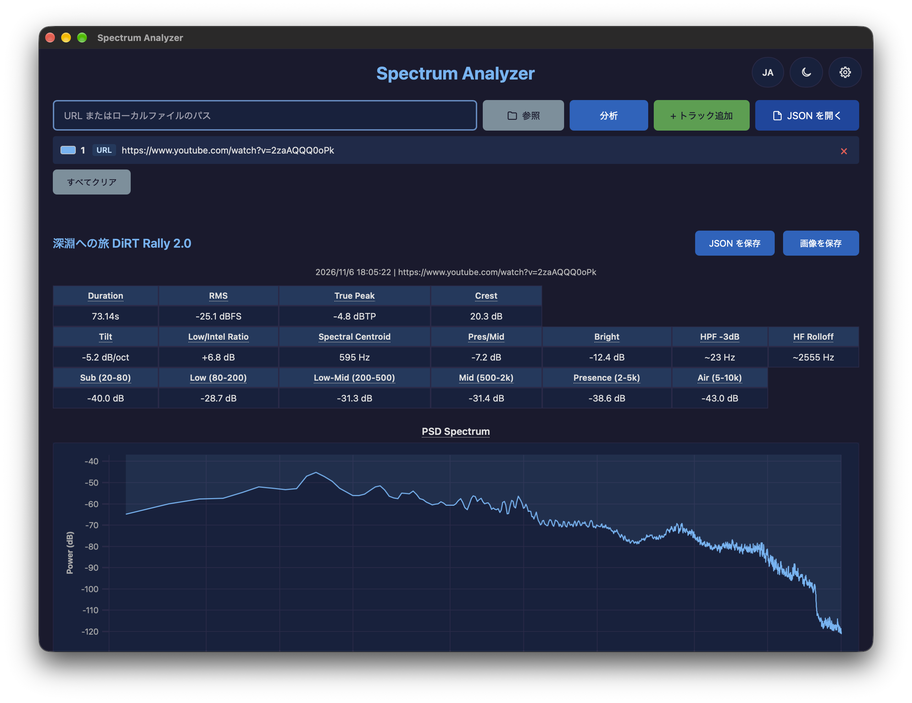
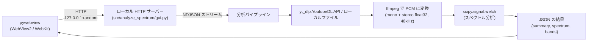
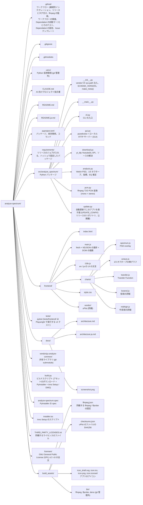

# analyze-spectrum

[](https://codecov.io/gh/semnil/analyze-spectrum)

> For the English version, see [README.md](README.md).

YouTube 動画またはローカル音声ファイルの周波数スペクトルを包括的に分析するツール。
コマンドライン (CLI) 版とグラフィカルな画面 (GUI) のアプリケーション版 (Windows / macOS) の 2 形態を持つ。



## 機能

- **Power Spectral Density (PSD、パワースペクトル密度) 分析**: Welch 法 (scipy.signal.welch) による推定
- **1/3 オクターブバンド分析**: 25Hz-10kHz (27 bands)
- **レベル指標**: Root Mean Square (RMS、実効値) のレベルをフルスケール基準のデシベル (dBFS) で、True Peak をトゥルーピークのデシベル (dBTP, ITU-R BS.1770) で。Crest Factor
- **スペクトル形状**: Spectral Tilt (dB/oct), Presence/Mid Ratio, Brightness, High-Frequency (HF、高域) Rolloff
- **Low/Intelligibility 比**: ANSI S3.5-1997 ベースの低域/明瞭度バランス評価
- **High-Pass Filter (HPF) 推定**: -3dB/-6dB ポイント + ロールオフ傾斜
- **A/B 比較**: 最初のトラックに対する各トラックの Transfer Function (PSD 差分) 計算。GUI では最大 6 トラック
- **イコライザー (EQ) 推定**: Transfer Function からプリアンプとピーキングフィルタ (周波数・ゲイン・Q) を推定して表で表示 (CLI は `--eq-bands` でバンド数の上限を指定)
- **GUI**: pywebview + ローカル HTTP サーバーによるデスクトップアプリ。単体分析を JSON と画像で、比較を画像で保存し、保存済みの単体分析の JSON を読み込む
- **5 種のチャート**: PSD overlay, 1/3 oct bars, Transfer function, Low-end detail, Mid-high detail
- インストール版 (Windows / macOS) のアプリの**自動更新** (確認してから更新する。起動時の確認は設定で止められる)

## 動作環境

配布するアプリは次の環境で動く。

- Windows (x64)
- macOS: **v1.3.0 以降は Apple Silicon (M1 以降) 専用**。Intel Mac (x86_64) は非対応 (macOS 26 で表示される「Intel プロセッサ用アプリの対応は終了します」警告への対応として、同梱する ffmpeg / ffprobe を Apple Silicon ネイティブビルドのみに切り替えたため)。Intel Mac をご利用の場合は [v1.2.0](../../releases/tag/v1.2.0) をご利用ください

## 使い方

### CLI

このリポジトリのクローンからインストールする (「開発」の「セットアップ」節)。そのあと次のように使う。

```bash
# 単体のファイルの分析
analyze-spectrum ./recording.m4a
analyze-spectrum "https://www.youtube.com/watch?v=XXXXX"

# A/B 比較 (最初のトラックが基準)
analyze-spectrum original.m4a eq_v1.m4a eq_v2.m4a

# 中盤の 2 分だけを分析
analyze-spectrum "https://..." --duration 2

# JSON の出力
analyze-spectrum ./recording.m4a --json --output-dir ./results
```

サマリーは標準出力へ、進捗は標準エラー出力へ出る。`--output-dir` は `analysis.json` を書き出す (同名のファイルがあるときは `analysis_1.json`, `analysis_2.json` …)。

#### オプション

| オプション | デフォルト | 説明 |
|---|---|---|
| `--duration` | なし (全尺) | 分析対象の長さ (分)。ソースの中央部分を切り出す |
| `--output-dir` | なし (ファイルを書かない) | 結果の JSON の出力ディレクトリ |
| `--eq-bands` | `5` | Transfer Function ごとの推定 EQ のピーキングバンド数の上限 (0 以上) |
| `--json` | オフ | 結果の JSON を標準出力へ出す |
| `--version` | | 版を表示して終了する |

#### 出力例

`analyze-spectrum recording.wav eq_v1.wav --eq-bands 2` の標準出力。`recording.wav` はピンクノイズ、`eq_v1.wav` は同じノイズに 120 Hz のハイパスフィルタを掛けたもの。

```
  [recording]
  Duration: 30.00s  RMS: -29.2 dBFS  Peak: -16.0 dBFS
  Low/Intel ratio: +2.0 dB
  Spectral centroid: 1710 Hz
  Band energy:
    sub_20_80           : -37.0 dB
    low_80_200          : -39.1 dB
    low_mid_200_500     : -39.5 dB
    mid_500_2k          : -37.6 dB
    presence_2k_5k      : -39.4 dB
    air_5k_10k          : -40.6 dB

  [eq_v1]
  Duration: 30.00s  RMS: -31.8 dBFS  Peak: -20.0 dBFS
  Low/Intel ratio: -4.6 dB
  Spectral centroid: 1894 Hz
  HPF -3dB: ~59 Hz  (21 dB/dec)
  Band energy:
    sub_20_80           : -53.0 dB
    low_80_200          : -41.9 dB
    low_mid_200_500     : -39.6 dB
    mid_500_2k          : -37.6 dB
    presence_2k_5k      : -39.4 dB
    air_5k_10k          : -40.6 dB

=== Transfer Functions ===
  eq_v1 − recording:
    Low (<200Hz):  -7.4 dB avg
    Mid (500-2k):  -0.0 dB avg
    Pres (2-5k):   -0.0 dB avg
    Estimated EQ (20-16000 Hz, residual 0.42 dB rms):
      Preamp: +0.2 dB
      Peak     20.7 Hz  -23.2 dB  Q 0.92
      Peak     35.2 Hz  -10.5 dB  Q 0.71
```

### GUI

```bash
pip install -e ".[gui]"
analyze-spectrum-gui
```

GUI では URL かローカルファイルのパスを入れるか、「参照」またはドラッグ & ドロップでローカルファイルを読み込み、「分析」を押す。入力した内容は入力欄からトラックの待ち行列へ移る。

比較するときは、次の URL かローカルファイルのパスを入れて「比較」を押す (待ち行列と入力欄を合わせて 2 本以上あるとき、ボタンは「比較」になる)。先に「+ トラック追加」で並べてもよい。別の音源を単体で分析するときは、先に「すべてクリア」を押す。「すべてクリア」は表示中の結果も消し、トラックの追加、削除、移動も、待ち行列にトラックが残るときは表示中の結果を消す。動かした順番の比較を見るには、もう一度「比較」を押す。待ち行列にある音源は二重に追加されない。待ち行列が 1 行のときは、「分析」でその行を分析する。

「JSON を開く」は保存済みの単体分析の JSON を開く (複数のファイルを一度に選べる)。待ち行列と入力欄が空のときの 1 ファイルは保存した結果を表示し、それ以外はファイルの音源を待ち行列に加える。読み込んだ JSON の音源をあとで分析すると、起動してからその音源を分析していなければ、その JSON の結果が保存時の長さのまま返る ([結果キャッシュ](docs/architecture.ja.md#結果キャッシュ))。単体分析は「JSON を保存」と「画像を保存」、比較は「画像を保存」で保存する。

ダークモード対応 (ライト / ダーク / 自動の 3 段階切替、デフォルトは OS 設定に追従)。選んだテーマと表示言語 (EN / JA) は、アプリを起動し直しても残る。

### アプリの更新

インストール版のアプリ (Windows のインストーラー版、macOS のディスクイメージ (DMG) 版) は、起動時に [GitHub の Releases](../../releases) で新しい版があるかを確認する (分析で取得する音声を除くと、アプリが自分から行う通信はこれだけ)。新しい版があれば「バージョン {version} が利用可能です。今すぐ更新しますか?」と確認し (`{version}` のところに新しい版が入る)、OK を押したときだけ更新を取得し、改ざんされていないことをアプリに組み込んだ公開鍵と署名で確かめてからインストールし、アプリを再起動する。キャンセルすると何もしない。再起動すると、保存していない分析結果は消える。起動時の確認は、新しい版が無いときと確認に失敗したときは何も表示しない。

- 右上の歯車ボタンの設定で、起動時の確認を止められる (「起動時に確認」)。「今すぐ確認」で手動でも確認できる
- Windows: インストーラーが動くときに、ユーザーアカウント制御 (UAC) の確認が出る。そのときアプリはもう閉じているので、「いいえ」を選ぶと更新はされず、アプリは閉じたままになる。もう一度起動すると、更新の確認がまた出る (起動時の確認を止めていないとき)
- macOS: アプリを「アプリケーション」フォルダに入れて使う。フォルダに書き込む権限が無いときは管理者のパスワードを求める。同じアプリを 2 つ起動しているときは、片方を終了してから更新する
- 分析中は更新しない。分析が終わってから「今すぐ確認」を押す
- 更新の確認とダウンロードの接続先は github.com のリリースと、GitHub がリリースのファイルの取得をリダイレクトする配信先 (release-assets.githubusercontent.com)。リクエストの User-Agent はアプリ名と版 (`analyze-spectrum/<version>`)

## 解析指標

| 指標 | 説明 |
|--------|-------------|
| RMS | 実効値 (Root Mean Square) のレベル (dBFS) |
| True Peak | ITU-R BS.1770 の True Peak (dBTP、4 倍オーバーサンプリング、チャンネル別) |
| Crest Factor | True Peak - RMS (dB) |
| Low/Intel Ratio | `10*log10(E[20-200Hz] / E[1-5kHz])` -- 低域と明瞭度帯域のエネルギー比 |
| Spectral Centroid | エネルギー重み付き平均周波数 (80-8kHz) |
| Spectral Tilt | log2(freq) vs PSD dB の線形回帰 (dB/octave) |
| Presence/Mid Ratio | Presence(2-5kHz) / Mid(500-2kHz) エネルギー比 |
| Brightness | Air(5-10kHz) / (Mid+Presence 500-5kHz) エネルギー比 |
| HPF -3dB | パスバンド (300-600Hz) 基準からの -3dB 交差点 |
| HF Rolloff | Mid-band 平均から -10dB 下回る周波数 |
| Band Energy | Sub / Low / Low-Mid / Mid / Presence / Air の帯域別エネルギー |

## アーキテクチャ

GUI は pywebview (Windows: WebView2 / macOS: WebKit) + ローカル HTTP サーバーで構成し、サーバーは進捗と結果を改行区切りの JSON (NDJSON) で流す。ffmpeg は分析のために音声をパルス符号変調 (PCM) のサンプルに変換する。



詳細は [docs/architecture.ja.md](docs/architecture.ja.md) 参照。

## 開発

### セットアップ

前提条件:

- Python 3.12 以降
- `PATH` 上の ffmpeg / ffprobe

```bash
git clone --recurse-submodules https://github.com/semnil/analyze-spectrum.git
cd analyze-spectrum

python3 -m venv .venv            # Windows: python -m venv .venv
source .venv/bin/activate        # Windows: .venv\Scripts\activate
pip install -e ".[dev]"
```

`--recurse-submodules` を付けずにクローンしたときは `git submodule update --init` を実行する。

### テスト

```bash
source .venv/bin/activate        # Windows: .venv\Scripts\activate
python -m pytest tests/ -v

# カバレッジ付き
python -m pytest tests/ --cov=analyze_spectrum --cov-report=html
```

UI テスト (`tests/test_frontend.py`、`tests/test_browser_operations.py`、`tests/test_chart_rendering.py`) は Playwright の Chromium を使う。初回は `python -m playwright install --with-deps chromium` を実行する。

### ビルドと配布

```bash
python build.py              # アセットのダウンロード + PyInstaller バンドル
python build.py --installer  # + Inno Setup インストーラー (.exe) / DMG (macOS)
```

バンドルは `dist/analyze-spectrum/` (macOS は `dist/Spectrum Analyzer.app`)、インストーラーは `installer_output/` に出力する。

前提条件:

- PyInstaller (`pip install pyinstaller`、または `dev` extra) と certifi (`pip install -e ".[gui]"`)。無いとビルドは止まる
- Inno Setup 6 (Windows のインストーラーを生成するときのみ)
- create-dmg (macOS の DMG を生成するときのみ: `brew install create-dmg`)

`build.py` が以下を自動ダウンロード:

- ffmpeg / ffprobe (Windows: BtbN/FFmpeg-Builds、macOS: osxexperts.net。系列と macOS の URL と SHA256 は `build_assets/ffmpeg.json`)
- deno (GitHub の最新リリース。yt-dlp の YouTube JavaScript 抽出に必要)
- uPlot (jsDelivr CDN)

yt-dlp は Python 依存 (`pyproject.toml`) として管理され、PyInstaller が自動的にバンドルする。

uPlot は `build_assets/checksums.json` の SHA256 と照合し (`python build.py --update-checksums` で更新)、macOS の ffmpeg / ffprobe は `build_assets/ffmpeg.json` の SHA256 と照合する。deno と Windows の ffmpeg / ffprobe は固定しない。

| フラグ | 説明 |
|---|---|
| `--installer` | インストーラー (Inno Setup / DMG) も作る |
| `--skip-download` | アセットのダウンロードを省く |
| `--skip-build` | PyInstaller を省く (`dist/` がある前提) |
| `--update-checksums` | アセットをダウンロードし、`build_assets/checksums.json` を更新して止まる |
| `--ffmpeg-only` | ffmpeg / ffprobe だけを `build_assets/bin/` にダウンロードして止まる |

## プロジェクト構成



## 依存関係

### 実行時

- numpy >= 1.26
- scipy >= 1.12
- yt-dlp (`pyproject.toml` で 1 つの版に固定)
- yt-dlp-ejs (`pyproject.toml` で 1 つの版に固定。yt-dlp が読む YouTube のチャレンジを解くスクリプト)
- pywebview >= 5.0 (GUI のみ)
- certifi (GUI のみ。更新の確認に使う認証局 (CA) の証明書)
- py-analyze-common (`vendor/py-analyze-common` の git submodule。`pyproject.toml` には載せない)

### 外部ツール

- ffmpeg / ffprobe
- deno (ビルドしたアプリには同梱する。ソースから動かすときは yt-dlp が `PATH` 上のものを使い、無いときは JavaScript の実行環境なしで動く)

## ライセンス

同梱するサードパーティソフトウェアのライセンスは [THIRD_PARTY_LICENSES.txt](THIRD_PARTY_LICENSES.txt) を参照。`licenses/` には、そのファイルが指す GPL v2 / v3 の全文がある。
