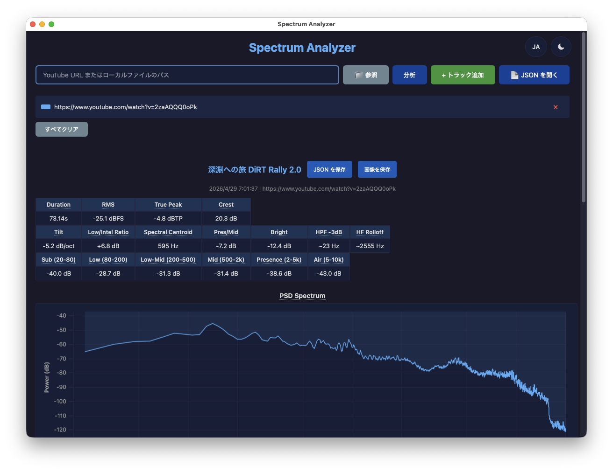

# analyze-spectrum

YouTube 動画またはローカル音声ファイルの周波数スペクトルを包括的に分析するツール。



## Features

- **Welch PSD 分析**: scipy.signal.welch による Power Spectral Density 推定
- **1/3 オクターブバンド分析**: 25Hz-10kHz (27 bands)
- **Level metrics**: RMS (dBFS), True Peak (dBTP, ITU-R BS.1770), Crest Factor
- **Spectral shape**: Spectral Tilt (dB/oct), Presence/Mid Ratio, Brightness, HF Rolloff
- **Low/Intelligibility 比**: ANSI S3.5-1997 ベースの低域/明瞭度バランス評価
- **HPF 推定**: High-Pass Filter の -3dB/-6dB ポイント + ロールオフ傾斜
- **A/B 比較**: 最大 6 トラックの Transfer Function (PSD 差分) 計算
- **EQ 推定**: Transfer Function からプリアンプとピーキングフィルタ (周波数・ゲイン・Q) を推定して表で表示 (CLI は `--eq-bands` でバンド数を指定)
- **GUI**: pywebview + ローカル HTTP サーバーによるデスクトップアプリ
- **5 種のチャート**: PSD overlay, 1/3 oct bars, Transfer function, Low-end detail, Mid-high detail

## Quick Start

### CLI

```bash
python3 -m venv .venv            # Windows: python -m venv .venv
source .venv/bin/activate        # Windows: .venv\Scripts\activate
pip install -e ".[dev]"

# Single file analysis
analyze-spectrum ./recording.m4a
analyze-spectrum "https://www.youtube.com/watch?v=XXXXX"

# A/B comparison (first track = reference)
analyze-spectrum original.m4a eq_v1.m4a eq_v2.m4a

# Analyze only 2 minutes from the middle
analyze-spectrum "https://..." --duration 2

# JSON output
analyze-spectrum ./recording.m4a --json --output-dir ./results
```

### GUI

```bash
pip install -e ".[gui]"
analyze-spectrum-gui
```

GUI では URL 入力、Browse ボタン、またはドラッグ & ドロップでローカルファイルを読み込み、
Analyze ボタンで単体分析、"+ Add Track" で複数トラックを登録して Compare で比較分析を実行できる。
ダークモード対応 (Light / Dark / Auto の 3 段階切替、デフォルトは OS 設定に追従)。

### 自動更新

インストールしたアプリ (Windows のインストーラー版、macOS の DMG 版) は、起動時に GitHub の最新リリースに新しい版があるかを確かめる。
新しい版があると「今すぐ更新しますか?」と確認し、OK を選んだときだけダウンロードする。
ダウンロードしたインストーラーは、アプリに組み込んだ公開鍵で署名を確かめてから適用し、そのあとアプリを起動し直す。キャンセルすると何もしない。

ツールバーの設定ボタンから開く設定ダイアログで、起動時の確認を止められる。同じダイアログの「今すぐ確認」で、手動でも確かめられる。
起動時の確認は、新しい版が無いときと確認に失敗したときは何も表示しない。

- Windows: インストーラーが動くときに、ユーザーアカウント制御 (UAC) の確認が出る。そのときアプリはもう閉じているので、「いいえ」を選ぶと更新はされず、アプリは閉じたままになる。もう一度起動すると、更新の確認がまた出る

更新の確認とダウンロードの接続先は github.com のリリースと、GitHub がリリースのファイルの取得をリダイレクトする配信先 (release-assets.githubusercontent.com)。リクエストの User-Agent はアプリ名と版 (例: `analyze-spectrum/1.3.1`)。

## Architecture

```
pywebview (WebView2) ──HTTP──> Local HTTP Server (gui.py)
                                  │
                                  ├── yt_dlp.YoutubeDL API (URL download)
                                  ├── ffmpeg → PCM (mono + stereo float32, 48kHz)
                                  └── scipy.signal.welch → analysis results
```

詳細は [docs/architecture.md](docs/architecture.md) 参照。

## Analysis Metrics

| Metric | Description |
|--------|-------------|
| RMS | Root Mean Square level (dBFS) |
| True Peak | ITU-R BS.1770 True Peak (dBTP, 4x oversampling, per-channel) |
| Crest Factor | True Peak - RMS (dB) |
| Low/Intel Ratio | `10*log10(E[20-200Hz] / E[1-5kHz])` -- 低域と明瞭度帯域のエネルギー比 |
| Spectral Centroid | エネルギー重み付き平均周波数 (80-8kHz) |
| Spectral Tilt | log2(freq) vs PSD dB の線形回帰 (dB/octave) |
| Presence/Mid Ratio | Presence(2-5kHz) / Mid(500-2kHz) エネルギー比 |
| Brightness | Air(5-10kHz) / (Mid+Presence 500-5kHz) エネルギー比 |
| HPF -3dB | パスバンド (300-600Hz) 基準からの -3dB 交差点 |
| HF Rolloff | Mid-band 平均から -10dB 下回る周波数 |
| Band Energy | Sub / Low / Low-Mid / Mid / Presence / Air の帯域別エネルギー |

## 動作環境

- Windows (x64)
- macOS: **v1.3.0 以降は Apple Silicon (M1 以降) 専用**。Intel Mac (x86_64) は非対応 (macOS 26 で表示される「Intel プロセッサ用アプリの対応は終了します」警告への対応として、同梱する ffmpeg / ffprobe を Apple Silicon ネイティブビルドのみに切り替えたため)。Intel Mac をご利用の場合は [v1.2.0](../../releases/tag/v1.2.0) をご利用ください

## Build & Distribution

```bash
# Download assets + PyInstaller bundle
python build.py

# + Inno Setup installer (.exe)
python build.py --installer
```

### Prerequisites

- Python 3.12+
- PyInstaller (`pip install pyinstaller`)
- Inno Setup 6 (installer 生成時のみ)

### Build Assets

`build.py` が以下を自動ダウンロード:

- ffmpeg / ffprobe (Windows: BtbN/FFmpeg-Builds、macOS: osxexperts.net。系列と macOS の SHA256 は `build_assets/ffmpeg.json`)
- deno (GitHub Releases, yt-dlp の YouTube JS 抽出に必要)
- uPlot (jsDelivr CDN)

yt-dlp は Python 依存 (`pyproject.toml`) として管理され、PyInstaller が自動的にバンドルする。

SHA256 チェックサム検証あり (`python build.py --update-checksums` で更新)。

## Project Structure

```
analyze-spectrum/
├── src/analyze_spectrum/
│   ├── analysis.py        # Welch PSD, 1/3 oct, metrics
│   ├── cli.py             # CLI entry point
│   ├── gui.py             # pywebview + HTTP server
│   ├── download.py        # yt_dlp.YoutubeDL API, source resolution
│   ├── pcm.py             # ffmpeg → PCM (mono + stereo)
│   └── update.py          # auto-update config (release repo, public key)
├── frontend/
│   ├── index.html
│   ├── main.js
│   ├── style.css
│   └── charts/            # spectrum, octave, transfer, lowend, midhigh
├── tests/
├── docs/
│   └── architecture.md
├── build.py
├── analyze-spectrum.spec
└── installer.iss
```

## Dependencies

### Runtime

- numpy >= 1.26
- scipy >= 1.12
- yt-dlp
- pywebview >= 5.0 (GUI only)
- certifi (GUI only, CA bundle for the update check)

### External Tools

- ffmpeg / ffprobe

## Testing

```bash
pip install -e ".[dev]"
pytest tests/ -v

# With coverage
pytest tests/ --cov=analyze_spectrum --cov-report=html
```

## License

See [THIRD_PARTY_LICENSES.txt](THIRD_PARTY_LICENSES.txt) for bundled third-party software licenses.
