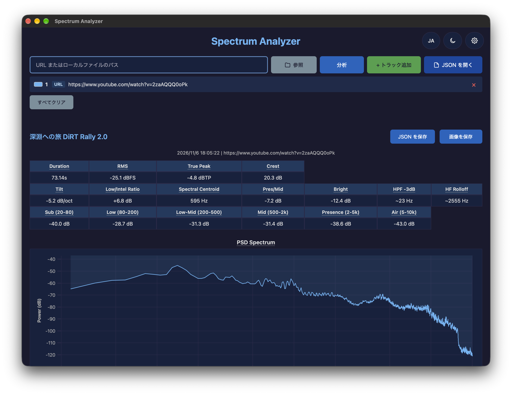
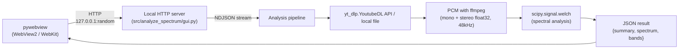

# analyze-spectrum

[](https://codecov.io/gh/semnil/analyze-spectrum)

> 日本語版は [README.ja.md](README.ja.md) を参照してください.

A tool that comprehensively analyzes the frequency spectrum of a YouTube video or a local audio file.
It comes in two forms: a command-line interface (CLI) version and a graphical user interface (GUI) application version (Windows / macOS).



## Features

- **Power Spectral Density (PSD) analysis**: estimation with Welch's method (scipy.signal.welch)
- **1/3-octave band analysis**: 25Hz-10kHz (27 bands)
- **Level metrics**: Root Mean Square (RMS) level in decibels relative to full scale (dBFS), True Peak in decibels true peak (dBTP, ITU-R BS.1770), Crest Factor
- **Spectral shape**: Spectral Tilt (dB/oct), Presence/Mid Ratio, Brightness, High-Frequency (HF) Rolloff
- **Low/Intelligibility ratio**: low-end / intelligibility balance evaluation based on ANSI S3.5-1997
- **High-Pass Filter (HPF) estimation**: the -3dB/-6dB points + the rolloff slope
- **A/B comparison**: Transfer Function (PSD difference) of each track against the first track, up to 6 tracks in the GUI
- **Equalizer (EQ) estimation**: estimates a preamp and peaking filters (frequency, gain, Q) from the Transfer Function and shows them in a table (in the CLI, `--eq-bands` sets the maximum number of bands)
- **GUI**: a desktop app built on pywebview + a local HTTP server. Saves a single analysis as JSON and as an image, saves a comparison as an image, and loads saved single-analysis JSON
- **5 kinds of charts**: PSD overlay, 1/3 oct bars, Transfer function, Low-end detail, Mid-high detail
- **Auto-update** of the installed app (Windows / macOS) (it asks before updating; the check at launch can be turned off in the settings)

## Requirements

The distributed app runs on:

- Windows (x64)
- macOS: **v1.3.0 and later are Apple Silicon (M1 or later) only**. Intel Macs (x86_64) are not supported (to stop the warning macOS 26 shows that support for apps for Intel processors is ending, the bundled ffmpeg / ffprobe were switched to Apple Silicon native builds only). If you use an Intel Mac, please use [v1.2.0](../../releases/tag/v1.2.0)

## Usage

### CLI

Install it from a clone of this repository (the "Setup" section under "Development"), then:

```bash
# Single file analysis
analyze-spectrum ./recording.m4a
analyze-spectrum "https://www.youtube.com/watch?v=XXXXX"

# A/B comparison (first track = reference)
analyze-spectrum original.m4a eq_v1.m4a eq_v2.m4a

# Analyze only 2 minutes from the middle
analyze-spectrum "https://..." --duration 2

# JSON output
analyze-spectrum ./recording.m4a --json --output-dir ./results
```

The summary goes to standard output and the progress to standard error. `--output-dir` writes `analysis.json` (when a file with the same name exists, `analysis_1.json`, `analysis_2.json` …).

#### Options

| Option | Default | Description |
|---|---|---|
| `--duration` | none (full length) | Length to analyze in minutes, cut out of the middle of the source. The JSON records it as `meta.duration_min` when the source was cut |
| `--output-dir` | none (writes no file) | Output directory of the result JSON |
| `--eq-bands` | `5` | Maximum number of peaking bands in the estimated EQ per Transfer Function (0 or greater) |
| `--json` | off | Prints the result JSON to standard output |
| `--version` | | Prints the version and exits |

#### Output example

The standard output of `analyze-spectrum recording.wav eq_v1.wav --eq-bands 2`, where `recording.wav` is pink noise and `eq_v1.wav` is the same noise through a 120 Hz high-pass filter:

```
  [recording]
  Duration: 30.00s  RMS: -29.2 dBFS  Peak: -16.0 dBFS
  Low/Intel ratio: +2.0 dB
  Spectral centroid: 1710 Hz
  Band energy:
    sub_20_80           : -37.0 dB
    low_80_200          : -39.1 dB
    low_mid_200_500     : -39.5 dB
    mid_500_2k          : -37.6 dB
    presence_2k_5k      : -39.4 dB
    air_5k_10k          : -40.6 dB

  [eq_v1]
  Duration: 30.00s  RMS: -31.8 dBFS  Peak: -20.0 dBFS
  Low/Intel ratio: -4.6 dB
  Spectral centroid: 1894 Hz
  HPF -3dB: ~59 Hz  (21 dB/dec)
  Band energy:
    sub_20_80           : -53.0 dB
    low_80_200          : -41.9 dB
    low_mid_200_500     : -39.6 dB
    mid_500_2k          : -37.6 dB
    presence_2k_5k      : -39.4 dB
    air_5k_10k          : -40.6 dB

=== Transfer Functions ===
  eq_v1 − recording:
    Low (<200Hz):  -7.4 dB avg
    Mid (500-2k):  -0.0 dB avg
    Pres (2-5k):   -0.0 dB avg
    Estimated EQ (20-16000 Hz, residual 0.42 dB rms):
      Preamp: +0.2 dB
      Peak     20.7 Hz  -23.2 dB  Q 0.92
      Peak     35.2 Hz  -10.5 dB  Q 0.71
```

### GUI

```bash
pip install -e ".[gui]"
analyze-spectrum-gui
```

In the GUI, enter a URL or a local file path, or load a local file with "Browse" or drag & drop, and press "Analyze". The source moves from the input field to the queue of tracks.

To compare, enter the next URL or local file path and press "Compare" (the button reads "Compare" while the queue and the field hold two or more sources), or queue sources first with "+ Add Track". To analyze another source on its own, press "Clear All" first. "Clear All" also clears the result on screen, and adding or removing a track clears it while tracks stay in the queue. Moving a track while a comparison is on screen runs the comparison again in the new order. A source already in the queue is not added twice. With one row in the queue, "Analyze" analyzes that row.

"Load JSON" opens saved single-analysis JSON (several files can be chosen at once): one file, with the queue and the field empty, is shown as saved, and otherwise the sources of the files join the queue. A later analysis of a loaded JSON's source reuses that JSON, unless the app has already analyzed the source since it started. A JSON that records the CLI's `--duration` is not reused; one saved by a version that did not record it is, at its shorter length ([Result cache](docs/architecture.md#result-cache)). A single analysis is saved with "Save JSON" and "Save Image", a comparison with "Save Image".

Dark mode is supported (a 3-way switch Light / Dark / Auto; the default follows the OS setting). The chosen theme and display language (EN / JA) are kept when the app is restarted.

### App updates

The installed app (the installer version on Windows, the disk image (DMG) version on macOS) checks [GitHub Releases](../../releases) at launch for a newer version (apart from the audio fetched for analysis, this is the only network access the app makes on its own). If a newer version exists, it asks "Version {version} is available. Update now?" with the new version in place of `{version}`, and only when you press OK does it download the update, verify with its signature and the public key built into the app that it has not been tampered with, install it, and restart the app. Cancel does nothing. Restarting clears analysis results that are not saved. The check at launch shows nothing when there is no newer version or when the check fails.

- The check at launch can be turned off in the settings of the gear button at the top right ("Check at launch"). "Check now" checks manually as well
- Windows: a User Account Control (UAC) prompt appears when the installer runs. The app is already closed at that point, so choosing "No" leaves the app not updated and closed. Launching it again shows the update prompt again (when the check at launch is on)
- macOS: keep the app in the "Applications" folder. If you lack permission to write to that folder, it asks for an administrator password. When two copies of the same app are running, quit one before updating
- It does not update during an analysis. Press "Check now" after the analysis finishes
- The update check and the download connect to the releases on github.com and to the delivery host that GitHub redirects release file downloads to (release-assets.githubusercontent.com). The User-Agent of the requests is the app name and version (`analyze-spectrum/<version>`)

## Analysis metrics

| Metric | Description |
|--------|-------------|
| RMS | Root Mean Square level (dBFS) |
| True Peak | ITU-R BS.1770 True Peak (dBTP, 4x oversampling, per-channel) |
| Crest Factor | True Peak - RMS (dB) |
| Low/Intel Ratio | `10*log10(E[20-200Hz] / E[1-5kHz])` -- energy ratio between the low band and the intelligibility band |
| Spectral Centroid | Energy-weighted mean frequency (80-8kHz) |
| Spectral Tilt | Linear regression of PSD dB against log2(freq) (dB/octave) |
| Presence/Mid Ratio | Presence(2-5kHz) / Mid(500-2kHz) energy ratio |
| Brightness | Air(5-10kHz) / (Mid+Presence 500-5kHz) energy ratio |
| HPF -3dB | The -3dB crossing point from the passband (300-600Hz) reference |
| HF Rolloff | The frequency where the level falls 10dB below the mid-band average |
| Band Energy | Energy per band: Sub / Low / Low-Mid / Mid / Presence / Air |

## Architecture

The GUI consists of pywebview (Windows: WebView2 / macOS: WebKit) + a local HTTP server, which streams progress and results as newline-delimited JSON (NDJSON). ffmpeg converts the audio to pulse-code modulation (PCM) samples for the analysis.



See [docs/architecture.md](docs/architecture.md) for details.

## Development

### Setup

Prerequisites:

- Python 3.12 or later
- ffmpeg / ffprobe on `PATH`

```bash
git clone --recurse-submodules https://github.com/semnil/analyze-spectrum.git
cd analyze-spectrum

python3 -m venv .venv            # Windows: python -m venv .venv
source .venv/bin/activate        # Windows: .venv\Scripts\activate
pip install -e ".[dev]"
```

In a clone made without `--recurse-submodules`, run `git submodule update --init`.

### Tests

```bash
source .venv/bin/activate        # Windows: .venv\Scripts\activate
python -m pytest tests/ -v

# With coverage
python -m pytest tests/ --cov=analyze_spectrum --cov-report=html
```

The UI tests (`tests/test_frontend.py`, `tests/test_browser_operations.py`, `tests/test_chart_rendering.py`) use Playwright's Chromium. Run `python -m playwright install --with-deps chromium` the first time.

### Build & distribution

```bash
python build.py              # download assets + PyInstaller bundle
python build.py --installer  # + Inno Setup installer (.exe) / DMG (macOS)
```

The bundle is written to `dist/analyze-spectrum/` (`dist/Spectrum Analyzer.app` on macOS) and the installer to `installer_output/`.

Prerequisites:

- PyInstaller (`pip install pyinstaller`, or the `dev` extra) and certifi (`pip install -e ".[gui]"`). The build stops without them
- Inno Setup 6 (only when generating the Windows installer)
- create-dmg (only when generating the macOS DMG: `brew install create-dmg`)

`build.py` downloads the following automatically:

- ffmpeg / ffprobe (Windows: BtbN/FFmpeg-Builds, macOS: osxexperts.net. The series and the macOS URL and SHA256 are in `build_assets/ffmpeg.json`)
- deno (the latest GitHub release, needed for yt-dlp's YouTube JavaScript extraction)
- uPlot (jsDelivr CDN)

yt-dlp is managed as a Python dependency (`pyproject.toml`), and PyInstaller bundles it automatically.

uPlot is checked against the SHA256 in `build_assets/checksums.json` (`python build.py --update-checksums` updates that file), and the macOS ffmpeg / ffprobe against the SHA256 in `build_assets/ffmpeg.json`. deno and the Windows ffmpeg / ffprobe are not pinned.

| Flag | Description |
|---|---|
| `--installer` | Also builds the installer (Inno Setup / DMG) |
| `--skip-download` | Skips downloading the assets |
| `--skip-build` | Skips PyInstaller (assumes `dist/` exists) |
| `--update-checksums` | Downloads the assets, updates `build_assets/checksums.json` and stops |
| `--ffmpeg-only` | Downloads only ffmpeg / ffprobe into `build_assets/bin/` and stops |

## Project layout

```mermaid
graph LR
    root["analyze-spectrum/"]
    root --> gh[".github/<br>workflows (continuous integration, release and tagging, ffmpeg watch,<br>workflow checks, Dependabot auto-merge) and their tests,<br>Dependabot settings, issue templates"]
    root --> r_ignore[".gitignore"]
    root --> r_mod[".gitmodules"]
    root --> r_venv[".venv/<br>Python virtual environment (not tracked by git)"]
    root --> r_claude["CLAUDE.md<br>project instructions for AI"]
    root --> r_readme["README.md"]
    root --> r_readme_ja["README.ja.md"]
    root --> r_pyproj["pyproject.toml<br>package, dependencies, commands"]
    root --> req["requirements/<br>hash-pinned packages the release jobs install"]
    root --> src["src/analyze_spectrum/<br>Python package"]
    src --> src_init["__init__.py<br>sys.path injection of vendor/, SCHEMA_VERSION, make_meta(), make_compare_meta()"]
    src --> src_main["__main__.py"]
    src --> src_cli["cli.py<br>CLI entry point"]
    src --> src_gui["gui.py<br>pywebview + local HTTP server (GUI)"]
    src --> src_dl["download.py<br>yt_dlp.YoutubeDL API, source resolution"]
    src --> src_ana["analysis.py<br>Welch PSD, 1/3 oct, metrics, EQ estimation"]
    src --> src_pcm["pcm.py<br>PCM conversion with ffmpeg (mono + stereo)"]
    src --> src_upd["update.py<br>auto-update identity (UPDATE_CONFIG: release repository, public key)"]
    root --> fe["frontend/"]
    fe --> fe_idx["index.html"]
    fe --> fe_main["main.js<br>fetch + NDJSON progress + DOM rendering"]
    fe --> fe_i18n["i18n.js<br>en / ja UI strings"]
    fe --> ch["charts/"]
    ch --> ch_spec["spectrum.js<br>PSD overlay"]
    ch --> ch_oct["octave.js<br>1/3-octave bars"]
    ch --> ch_tf["transfer.js<br>Transfer Function"]
    ch --> ch_low["lowend.js<br>low-end detail"]
    ch --> ch_mh["midhigh.js<br>mid-high detail"]
    fe --> fe_css["style.css"]
    fe --> fe_vendor["vendor/<br>uPlot (bundled)"]
    root --> t["tests/<br>pytest (tests/frontend/ holds the UI tests run with Playwright)"]
    root --> docs["docs/"]
    docs --> docs_arch["architecture.md"]
    docs --> docs_arch_ja["architecture.ja.md"]
    docs --> docs_shot["screenshot.png"]
    root --> vend["vendor/py-analyze-common/<br>shared library (git submodule)"]
    root --> r_build["build.py<br>build script (asset download + PyInstaller + Inno Setup / DMG)"]
    root --> r_spec["analyze-spectrum.spec<br>PyInstaller spec"]
    root --> r_iss["installer.iss<br>Inno Setup script"]
    root --> r_tpl["THIRD_PARTY_LICENSES.txt<br>bundled license file"]
    root --> r_gpl["licenses/<br>full texts of the GNU General Public License (GPL) v2 / v3"]
    root --> ba["build_assets/"]
    ba --> ba_pin["ffmpeg.json<br>pinned ffmpeg / ffprobe builds"]
    ba --> ba_sum["checksums.json<br>SHA256 of the uPlot files"]
    ba --> ba_icon["icon_draft.svg, icon.ico, icon.png, icon.iconset/<br>app icon"]
    ba --> ba_bin["bin/<br>ffmpeg, ffprobe, deno (not tracked by git)"]
```



## Dependencies

### Runtime

- numpy >= 1.26
- scipy >= 1.12
- yt-dlp (pinned to one version in `pyproject.toml`)
- yt-dlp-ejs (pinned to one version in `pyproject.toml`; the YouTube challenge solver scripts yt-dlp reads)
- pywebview >= 5.0 (GUI only)
- certifi (GUI only, certificate authority (CA) bundle for the update check)
- py-analyze-common (the git submodule at `vendor/py-analyze-common`, not listed in `pyproject.toml`)

### External tools

- ffmpeg / ffprobe
- deno (the built app bundles it. Run from source, yt-dlp uses the one on `PATH`, and runs with no JavaScript runtime when there is none)

## License

See [THIRD_PARTY_LICENSES.txt](THIRD_PARTY_LICENSES.txt) for bundled third-party software licenses. `licenses/` holds the full texts of the GPL v2 / v3 that file points at.
