# アーキテクチャ

> For the English version, see [architecture.md](architecture.md).

## 概要

analyze-spectrum は YouTube 動画またはローカル音声ファイルの周波数スペクトルを分析し、
イコライザー (EQ) 処理の妥当性を検証するデスクトップツールである。
コマンドラインインターフェース (CLI) のツールと、Windows / macOS のグラフィカルユーザーインターフェース (GUI) アプリケーションとして動く。

GUI は pywebview (WebView2 / WebKit) + ローカルの Hypertext Transfer Protocol (HTTP) サーバーの構成で、サーバーは進捗と結果を、1 行に 1 つの JavaScript Object Notation (JSON) を置いた形式 (NDJSON、newline-delimited JSON) でストリーミングする。
姉妹ツール analyze-loudness と py-analyze-common (`vendor/py-analyze-common`) を共有する。
Uniform Resource Locator (URL) の音声は yt-dlp の Python のアプリケーションプログラミングインターフェース (API) で取得し、どのソースも ffmpeg で pulse-code modulation (PCM) のサンプルにする。

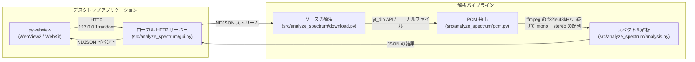

## モジュール

`src/analyze_spectrum/analysis.py` は Welch 法でパワースペクトル密度 (PSD) を求める。

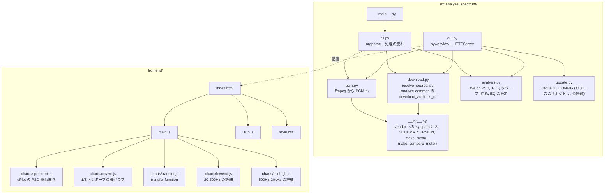

## ディレクトリ構成

```mermaid
graph LR
    root["analyze-spectrum/"]
    root --> wf[".github/workflows/"]
    wf --> wf_ci["ci.yaml<br>PR / push<br>Python パッケージと frontend/*.js のカバレッジ付きで pytest を走らせ、両方を Codecov へ送る<br>apt のパッケージファイルと Playwright のブラウザーをキャッシュし、保存するのは PR でない実行だけ"]
    wf --> wf_rel["release.yaml<br>v* タグ / タグを指定した workflow_dispatch"]
    wf --> wf_tag["tag-release.yml<br>master への push の CI が成功した後、またはコミットを指定した workflow_dispatch で: そのコミットが版上げなら、タグを付けて release.yaml を起動する"]
    wf --> wf_ffw["ffmpeg-watch.yml<br>毎日、osxexperts.net の新しい ffmpeg を検出し、固定値の更新と版上げの PR を<br>GitHub App のトークンで作り、レビューなしでマージする<br>detect が接続できないときは、自分自身を dispatch して別のランナーで detect をやり直す (3 回まで)"]
    wf --> wf_chk["workflow-checks.yml<br>すべての PR で、uses: の SHA 固定と、同じリポジトリを参照するときの規則を確かめる"]
    wf --> wf_chkt["workflow-checks-test.yml<br>その検査の fixture テストと、dependabot-auto-merge.yml の<br>トリガー・条件・自動マージの判定、tag-release.yml の tag 段、ffmpeg-watch.yml の land 段と detect のやり直しのテストを走らせる"]
    wf --> wf_dam["dependabot-auto-merge.yml<br>先頭が 1 コミットで、Dependabot だけが書き、GitHub (web-flow) がコミットし、署名が検証済みの Dependabot の PR について、Python の依存 (uv) か submodule の更新と、<br>GitHub Action の semver の patch か minor の更新に、自動マージを予約する。必須チェックは auto-merge"]
    root --> ght[".github/tests/"]
    ght --> ght_sh["workflow-checks-test.sh<br>偽の gh と fixture の git ツリーで workflow-checks.yml を動かすテスト"]
    ght --> ght_am["dependabot-auto-merge-test.sh<br>dependabot-auto-merge.yml がすべての PR で走り、その段だけが Dependabot の PR に限られることと、<br>その段がどの更新とコミット (書いた人、数、最後が先頭か、誰がコミットしたか、署名が検証済みか) に<br>自動マージを予約し、または取り消すかを、偽の gh で確かめるテスト"]
    ght --> ght_tag["tag-release-test.sh<br>偽の gh と fixture のリポジトリで tag-release.yml の check 段と tag 段を動かすテスト"]
    ght --> ght_land["ffmpeg-watch-land-test.sh<br>呼び出しごとのトークンで答えを変える偽の gh と fixture のリポジトリで ffmpeg-watch.yml の land 段を、<br>偽の CLI で detect のステップを、そして detect の次の試行の dispatch を動かすテスト"]
    root --> r_dep[".github/dependabot.yml<br>毎日 00:00 JST に、GitHub Actions、py-analyze-common の submodule<br>(Dependabot の既定の 3 日の cooldown なし)、Python の依存 (uv。<br>yt-dlp と yt-dlp-ejs は 1 つのプルリクエスト、pyobjc-core と pyobjc-framework-* は別の 1 つ) の版を更新する"]
    root --> r_claude["AGENTS.md"]
    root --> r_readme["README.md"]
    root --> r_readme_ja["README.ja.md"]
    root --> r_pyproj["pyproject.toml"]
    root --> req["requirements/<br>release.txt, release-build.txt, sign-manifest.txt: リリースのジョブが入れる、ハッシュで固定したパッケージ。<br>uv が pyproject.toml と .in ファイルから生成する (Pinned release dependencies)"]
    root --> src["src/analyze_spectrum/"]
    src --> src_init["__init__.py<br>vendor への sys.path 注入, SCHEMA_VERSION, make_meta(), make_compare_meta()"]
    src --> src_main["__main__.py"]
    src --> src_ana["analysis.py<br>スペクトル解析の本体"]
    src --> src_cli["cli.py<br>argparse と CLI の流れ"]
    src --> src_gui["gui.py<br>pywebview とローカル HTTP サーバー"]
    src --> src_dl["download.py<br>yt_dlp.YoutubeDL API、ffprobe での長さの取得"]
    src --> src_pcm["pcm.py<br>ffmpeg での PCM 変換 (mono + stereo)"]
    src --> src_upd["update.py<br>自動更新でこのアプリを表す UPDATE_CONFIG (公開鍵、mutex の名前)"]
    root --> fe["frontend/"]
    fe --> fe_idx["index.html"]
    fe --> fe_main["main.js<br>fetch、NDJSON の進捗、DOM の描画、テーマの切り替え"]
    fe --> fe_i18n["i18n.js<br>en/ja の DICT。py-analyze-common の /common/i18n.js がこれを window.i18n.t / setLang にする"]
    fe --> fe_css["style.css"]
    fe --> ch["charts/"]
    ch --> ch_spec["spectrum.js<br>PSD の重ね描き (対数周波数、複数トラック)"]
    ch --> ch_oct["octave.js<br>1/3 オクターブのグループ化した棒グラフ"]
    ch --> ch_tf["transfer.js<br>transfer function (Δ dB)"]
    ch --> ch_low["lowend.js<br>低域の詳細 (20-500Hz、線形)"]
    ch --> ch_mh["midhigh.js<br>中高域の詳細 (500Hz-20kHz、対数)"]
    fe --> fe_vendor["vendor/<br>uPlot (同梱)"]
    root --> t["tests/"]
    t --> t_init["__init__.py"]
    t --> t_conf["conftest.py<br>共有の WAV の fixture (_make_wav_bytes, wav_file, wav_file_b)、<br>設定ファイルを一時フォルダーへ向ける _isolated_settings、<br>py-analyze-common の analyze_common.testing にこのリポジトリとパッケージを指定する"]
    t --> t_ana["test_analysis.py"]
    t --> t_pcm["test_pcm.py"]
    t --> t_cli["test_cli.py"]
    t --> t_gui["test_gui.py"]
    t --> t_int["test_integration.py<br>HTTP の統合テスト (実際の HTTPServer、pywebview なし)"]
    t --> t_cache["test_cache_failures.py<br>実際の HTTP ハンドラーを通したキャッシュのフォールバックと解析の失敗"]
    t --> t_dlg["test_dialog_busy.py<br>ネイティブダイアログの排他 (_dialog_lock)"]
    t --> t_ffb["test_ffmpeg_binary.py<br>PATH の ffmpeg / ffprobe をアプリの PCM 変換と ffprobe の読み取りで確かめる<br>(EXPECT_FFMPEG_DIR で同梱バイナリを指定)"]
    t --> t_rwf["test_release_workflow.py<br>release.yaml が配布物に入った ffmpeg / ffprobe に test_ffmpeg_binary.py を通すこと、<br>書き込めるのは create-release だけでそこでは Python を動かさないこと、更新用の署名鍵を持つジョブは<br>読み取り権限だけでハッシュで固定した yt-dlp だけを入れること、Developer ID の署名 ID を<br>codesign の直前に取り込み、codesign の終わりに消すこと、リリースのジョブがパッケージを<br>requirements/*.txt からだけ入れ、ビルドの道具を SHA256 を照合してから入れること、<br>requirements/release.txt が pyproject.toml を満たすこと、各 requirements/*.txt を自分の固定値を制約にして解き直すと、<br>ちょうどそのファイルが固定しているパッケージに、同じ環境マーカーでなること<br>(py-analyze-common の analyze_common.testing.release_workflow を動かす)"]
    t --> t_tpl["test_third_party_licenses.py<br>THIRD_PARTY_LICENSES.txt が指す GPL の全文と、<br>それを同梱する spec / installer.iss (analyze_common.testing.third_party_licenses を動かす)"]
    t --> t_font["test_chart_font.py<br>スクリプトが自分でフォントを名指ししないこと (analyze_common.testing.chart_font を動かす)"]
    t --> t_ejs["test_yt_dlp_ejs.py<br>入っている yt-dlp-ejs の版 (major.minor) とスクリプトのハッシュが、<br>入っている yt-dlp の受け付けるものであること (analyze_common.testing.yt_dlp_ejs を動かす)"]
    t --> t_fe["test_frontend.py<br>Playwright の headless Chromium の runner"]
    t --> t_chart["test_chart_rendering.py<br>実際のブラウザーのスクリプトで比較チャートとその PNG の書き出しを描く"]
    t --> t_ops["test_browser_operations.py<br>アプリのページを通したコンテキストメニューの編集とキーボード操作、トラックの並べ替え、ファイルのドロップ、結果の保存、ファイルの選択。<br>クリップボードと HTTP のレスポンスはテストが制御する"]
    t --> t_jsc["js_coverage.py<br>--js-coverage を付けたとき、Playwright のテストが動かした frontend/*.js の V8 のカバレッジを<br>LCOV で書き出す (analyze-loudness のものと同じファイル)"]
    t --> t_jsct["test_js_coverage.py<br>js_coverage.py が V8 の範囲を行に対応させる方法と、書き出す LCOV<br>(analyze-loudness のものと同じファイル)"]
    t --> tf["frontend/"]
    tf --> tf_html["test_ui.html<br>テスト用のページ"]
    tf --> tf_js["test_ui.js<br>ブラウザーでの UI の状態のテスト"]
    root --> docs["docs/"]
    docs --> docs_arch["architecture.md"]
    docs --> docs_arch_ja["architecture.ja.md"]
    docs --> docs_dec["decisions/<br>閉じた判断: 何を選んだか、理由、決め直す条件。<br>各記録は英語の .md と日本語の .ja.md"]
    docs_dec --> docs_dec_test["testing.md, testing.ja.md<br>テスト用ページのサーバーの accept の待ち列"]
    docs --> docs_shot["screenshot.png"]
    root --> vend["vendor/py-analyze-common/<br>git submodule (sys.path 注入で使う)"]
    root --> r_build["build.py<br>py-analyze-common の analyze_common.build をこのアプリの名前で動かす"]
    root --> r_spec["analyze-spectrum.spec"]
    root --> r_iss["installer.iss"]
    root --> r_lic["THIRD_PARTY_LICENSES.txt"]
    root --> r_gpl["licenses/<br>GPL v2 / v3 の全文 (THIRD_PARTY_LICENSES.txt の FFmpeg の節が指す。<br>spec が同じ階層に同梱する)"]
    root --> ba_pin["build_assets/ffmpeg.json<br>同梱する ffmpeg / ffprobe の系列と、macOS のビルドの URL と SHA256"]
    root --> ba_sum["build_assets/checksums.json<br>同梱する uPlot のファイルの版と SHA256"]
    root --> ba_icon["build_assets/icon_draft.svg<br>icon.ico / icon.png / icon.iconset の元 (PYTHONPATH=vendor/py-analyze-common/src python -m analyze_common.icons build_assets)"]
    root --> ba["build_assets/bin/<br>ffmpeg, ffprobe, deno (git で追跡しない)"]
```

## データの流れ

### 解析パイプライン

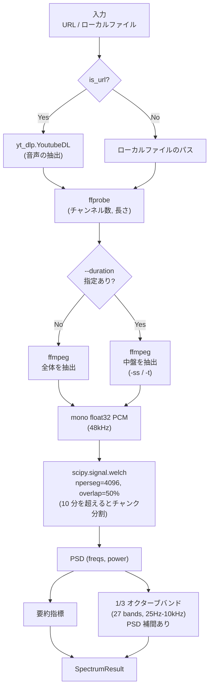

解析パイプラインの各段:

1. **PCM 抽出**: mono (`pan=mono|c0=0.5*c0+0.5*c1`、レベルを保つ) + stereo (True Peak 用)
2. **Welch PSD**: `scipy.signal.welch(data, fs=48000, nperseg=4096, noverlap=2048)`
3. **1/3 オクターブバンド解析**: 25Hz-10kHz (27 バンド)。FFT ビンの無いバンド (このパラメータでは 40Hz) は PSD の補間で推定する
4. **Band energy**: Sub (20-80Hz), Low (80-200Hz), Low-Mid (200-500Hz), Mid (500-2kHz), Presence (2-5kHz), Air (5-10kHz)
5. **レベルの指標**: RMS (dBFS)、True Peak (dBTP、ITU-R BS.1770 の 4 倍オーバーサンプリング)、Crest Factor
6. **Low/Intelligibility ratio**: `10*log10(E[20-200Hz] / E[1-5kHz])`
7. **Spectral centroid**: `Σ(f * Pxx) / Σ(Pxx)` (80-8kHz)
8. **Spectral Tilt**: log2(freq) に対する PSD の dB の線形回帰 (dB/octave)
9. **Presence/Mid Ratio**: Presence(2-5kHz) / Mid(500-2kHz) のエネルギー比
10. **Brightness**: Air(5-10kHz) / (Mid+Presence 500-5kHz) のエネルギー比
11. **HPF -3dB の推定**: passband (300-600Hz) の平均から -3dB と交わる点を探す
12. **HF Rolloff**: 中域の平均から -10dB 下がる周波数を検出する
13. **Transfer Function**: 2 つのファイルの PSD の差 (dB)
14. **EQ の推定**: プリアンプのゲインと最大 N 個のピーキングフィルター (RBJ biquad) を Transfer Function に当てはめる (`estimate_parametric_eq()`)。この EQ を基準トラックに掛けると、比較するトラックに近づく。1/6 オクターブで平滑化し、1/24 オクターブ刻みの対数周波数の格子に置いた差の上で、残差が最大の点にバンドを 1 つずつ足し、全パラメータを最小二乗で当てはめ直す。残差の最大が 0.5 dB を下回ったら足すのをやめる

### PCM 変換 (モノラルへのダウンミックス)

ffmpeg の既定の `-ac 1` は `sqrt(2)/2 * L + sqrt(2)/2 * R` の係数を使い、
相関のあるステレオ信号に +3 dB のゲインを足す。このツールは
`pan=mono|c0=0.5*c0+0.5*c1` を使い、チャンネルごとのレベルを保つ。
True Peak は ITU-R BS.1770 に従い、ステレオの PCM でチャンネルごとに別々に測る。

### 解析パラメータ

| パラメータ | 値 | 根拠 |
|-----------|-------|-----------|
| サンプルレート | 48000 Hz | 音声制作の標準 |
| モノラルへのダウンミックス | `0.5*L + 0.5*R` | チャンネルごとのレベルを保つ (ffmpeg の既定の `sqrt(2)/2` は使わない) |
| True Peak | ステレオ、チャンネルごと | ITU-R BS.1770 に準拠 |
| PCM の形式 | float32 | numpy がそのまま扱え、量子化が無い |
| Welch の nperseg | 4096 | 窓の長さ約 85ms、周波数分解能 11.7 Hz |
| Welch の overlap | 50% (2048) | Welch 法の標準 |
| 1/3 オクターブの範囲 | 25 Hz - 10 kHz | 音声と音楽の帯域を覆う |
| Low/Intel の帯域 | 20-200 / 1-5k Hz | ANSI S3.5 の重要度関数による重み付け |
| Centroid の範囲 | 80 - 8000 Hz | 音声に関わる帯域 |
| HPF の passband の基準 | 300 - 600 Hz | 典型的な HPF より上、音声のフォルマントより下 |
| HF Rolloff のしきい値 | -10 dB | Mid 帯域 (500-2kHz) の基準からの落ち込み |
| True Peak のオーバーサンプリング | 4 倍 | ITU-R BS.1770。メモリを節約するため 30 秒ずつ処理する |
| EQ 推定の範囲 | 20 Hz - 16 kHz (上限は 0.45 × サンプルレートも超えない) | `EQ_FIT_RANGE` |
| EQ 推定のバンド数 | 既定 5 (CLI の `--eq-bands`) | `EQ_BANDS_DEFAULT` |
| EQ のゲイン / Q の範囲 | ±24 dB / 0.3 - 10 | `EQ_GAIN_LIMIT_DB` / `EQ_Q_RANGE` |

### 要約指標

`analyze_track()` は Welch PSD から要約を求める。ハイパスフィルター (HPF) の推定もその 1 つである。

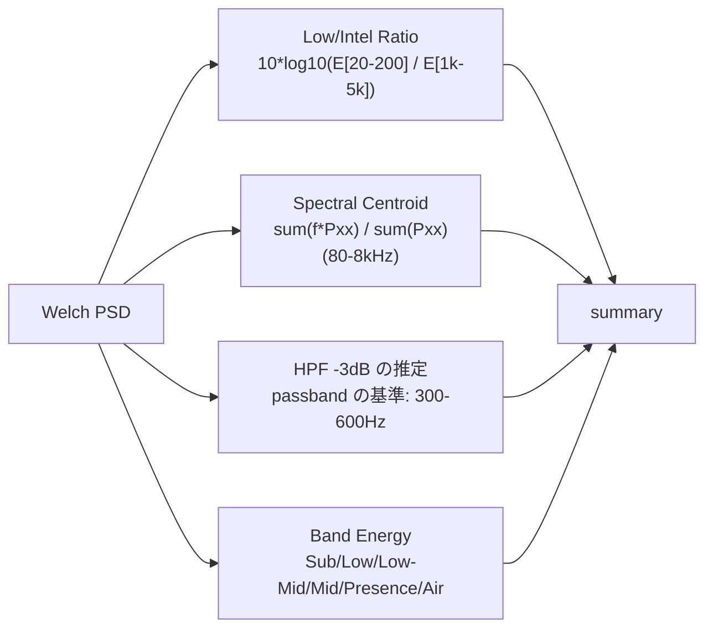

`summary` は `hpf_6db_hz`、`rolloff_db_per_decade`、`crest_factor_db`、`spectral_tilt_db_oct`、`presence_mid_ratio_db`、`brightness_db`、`hf_rolloff_hz` も持つ (`src/analyze_spectrum/analysis.py` の `SpectrumResult.to_dict()`)。

### 比較モード

CLI は `compare_tracks()` で比較する。GUI のトラックはキャッシュのものを含めてシリアライズした dict で ([結果キャッシュ](#結果キャッシュ))、`_transfer_functions_from_dicts()` がそこから transfer function を求める。

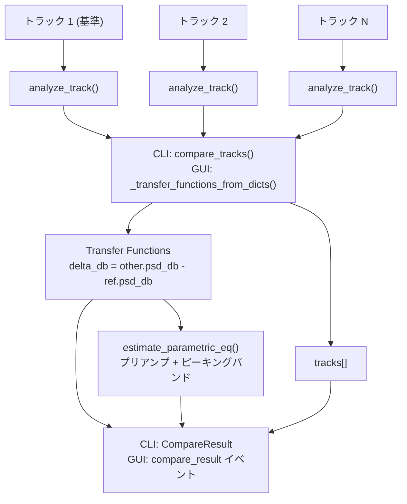

GUI で複数のファイルを追加すると、transfer function が自動で計算される。
analyze-loudness には無かった比較の機能を、中核の機能として取り込んでいる。

## GUI

### 通信モデル

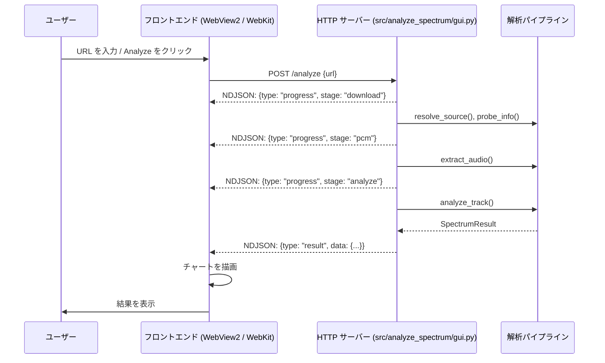

### 比較の流れ

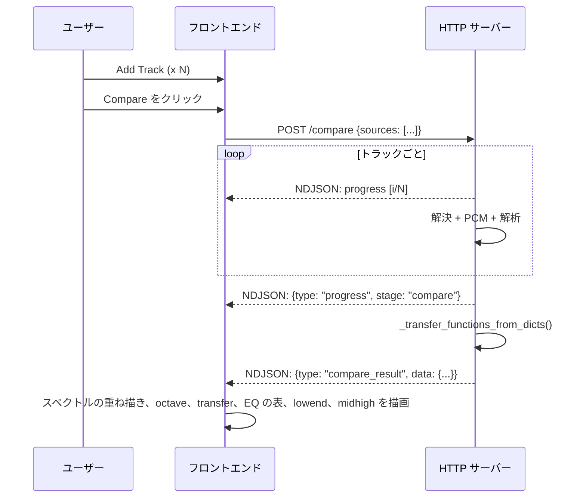

### GUI のエンドポイント

| エンドポイント | メソッド | 説明 |
|----------|--------|-------------|
| `/analyze` | POST | URL またはローカルファイルのスペクトル解析。NDJSON ストリーム。結果はキャッシュに保存し、同じ source + duration にはキャッシュから返す |
| `/compare` | POST | 複数トラックの比較解析。NDJSON ストリーム。トラックごとに個別にキャッシュし、キャッシュに無いものだけを解析する。transfer function は `_transfer_functions_from_dicts()` で計算し直す |
| `/save` | POST | 単体解析の結果の JSON をネイティブダイアログで保存する。`source` + `duration` パラメータがあれば、キャッシュファイルから直接コピーする (再シリアライズ不要)。比較モードでは JSON を保存しない (画像のみ) |
| `/save-image` | POST | チャートを合成した PNG (base64) を保存する |
| `/load` | POST | 単体解析の JSON を読み込む (比較の JSON は拒否する)。複数ファイルの選択に対応する (`allow_multiple=True`)。描画に必要なフィールドが欠けた単一ファイル (`missing_result_fields()`) には `schema_outdated` フラグを返す。フィールドがすべてそろい、`meta.duration_min` の無いものだけをキャッシュに登録する。`meta.schema_version` が整数でなければ 400 |
| `/browse` | POST | ローカルの音声ファイルをネイティブダイアログで選ぶ |
| `/upload` | POST | ドラッグ & ドロップされたファイルを一時的に保存する (octet-stream、最大 500MB) |
| `/common/settings.js` | GET | py-analyze-common の `settings.js` の前に、設定ファイルに保存したテーマと言語 (`window.analyzeSettingsStored`) を付けて返す。読み込みのたびに設定ファイルを読む (`Cache-Control: no-store`) |
| `/settings` | POST | テーマか言語のどちらか 1 つだけを設定ファイルに保存する (`{"theme": "light" \| "dark" \| "auto"}` または `{"lang": "en" \| "ja"}`)。それ以外は 400、保存の失敗は 500。レスポンスは保存後の `{"theme", "lang"}` |
| `/update/status` | POST | 現在の版、このビルドが自分を更新できるか、起動時の確認の設定 (`{"current", "supported", "launch_check"}`) |
| `/update/settings` | POST | 起動時の確認の設定を保存する (`{"launch_check": true \| false}`。真偽値以外は 400、保存の失敗は 500) |
| `/update/check` | POST | 最新リリースの `latest.json` を読み、新しい版があれば `{"available": true, "version"}`、無ければ `{"available": false}` を返す。取得または解釈の失敗は 502 |
| `/update/install` | POST | `{"version"}` をダウンロードし、検証し、適用する (直前の確認が見つけた版だけを受け付ける)。成功すると `{"restarting": true}` を返してからアプリを終了する。インストール後の再起動だけが失敗したときは `{"installed": true, "restart_error"}` を返して動き続ける。失敗は 500 |

Host の検証の後、POST は Content-Type を確かめ、`/upload` では `application/octet-stream`、それ以外では `application/json` でなければ 415 を返す (`;` の後の charset などは無視する)。ブラウザーは、これらの型のクロスオリジンのリクエストを CORS のプリフライトの後にだけ送り、このサーバーはプリフライトに答えない。Host と Content-Type の検査、`/browse`、`/save-image`、`/settings`、`/update/*`、`/common/*` のファイルは py-analyze-common の `GuiHandler` (`analyze_common/server.py`) のもので、`AnalyzeHandler` がこのアプリの状態 (`updater()`、`ui_settings()`、`window()`、`dialog_lock()`、`exit_for_update()`) を足して拡張する。

### レスポンスの形式 (GUI の NDJSON)

#### 単体解析の結果

```json
{
  "type": "result",
  "data": {
    "meta": {
      "version": "X.Y.Z",
      "schema_version": 2,
      "analyzed_at": "2026-04-03T12:34:56+00:00",
      "source": "recording.m4a"
    },
    "label": "original",
    "sample_rate": 48000,
    "duration_sec": 6.23,
    "rms_dbfs": -14.4,
    "peak_dbfs": -2.8,
    "true_peak_dbtp": -2.7,
    "spectrum": {
      "freqs": [5.86, 11.72, "..."],
      "psd_db": [-68.3, -65.1, "..."]
    },
    "bands": {
      "centers": [25, 31.5, 40, "...", 10000],
      "energy_db": [-55.6, -56.4, "..."]
    },
    "summary": {
      "crest_factor_db": 12.0,
      "low_intel_ratio_db": 5.2,
      "spectral_centroid_hz": 635,
      "spectral_tilt_db_oct": -4.2,
      "presence_mid_ratio_db": -1.8,
      "brightness_db": -10.5,
      "hpf_3db_hz": null,
      "hf_rolloff_hz": 12500,
      "band_energy": {
        "sub_20_80": -45.0,
        "low_80_200": -18.0,
        "low_mid_200_500": -18.8,
        "mid_500_2k": -23.5,
        "presence_2k_5k": -25.3,
        "air_5k_10k": -40.4
      }
    }
  }
}
```

#### 比較の結果 (NDJSON のレスポンスのみ。JSON での保存と読み込みには対応しない)

```json
{
  "type": "compare_result",
  "data": {
    "tracks": ["/* array of single analysis results */"],
    "transfer_functions": [
      {
        "label": "v3 - original",
        "freqs": ["..."],
        "delta_db": ["..."],
        "eq": {
          "preamp_db": -2.0,
          "bands": [{"freq_hz": 89.7, "gain_db": 4.9, "q": 0.87}],
          "residual_rms_db": 0.06,
          "fit_range_hz": [20.0, 16000.0]
        }
      }
    ]
  }
}
```

### 結果キャッシュ

セッション内キャッシュにより同一ソースの再解析を回避する。
キャッシュは `tempfile.mkdtemp()` に作成し、プロセス終了時に削除 (session-only)。

- **場所**: `tempfile.mkdtemp()` で作る `_cache_dir` (セッションの終わりに削除)
- **キャッシュキー**: URL またはファイルパス + duration。ローカルファイルは mtime を含む
- **単体解析**: `/analyze` の結果を一時 JSON として保存する。同じリクエストにはキャッシュから答える
- **比較解析**: `/compare` はトラックごとにキャッシュを引く。キャッシュに無いものだけを解析し、transfer function は全トラックの dict から `_transfer_functions_from_dicts()` で計算し直す
- **Save の最適化**: `/save` がフロントエンドから `source` + `duration` を受け取ると、キャッシュファイルを直接コピーする (再シリアライズを避ける)
- **Load → キャッシュ登録**: `/load` で読み込んだデータ (描画に必要なフィールドがすべてあり、`meta.duration_min` の無いものだけ) はメモリ上のキャッシュに登録され、あとの解析や Compare で、セッションがその音源をまだ解析していなければ、そのデータ自身の長さのまま再利用される。Save はこれを読まない
- **フロントエンドの状態の追跡**: `lastSource` と `lastDuration` が直近の解析の文脈を保ち、Save でのキャッシュの参照に使う。Load JSON で JSON を表示するとこれらは空になり、Save は画面の JSON を書き出す

Load JSON で読んだ JSON は、音源をキーに、長さの指定なしでメモリ上のキャッシュに入る (`_cache_loaded()`)。同じ起動の間に自分で分析した結果を先に探す。`meta.duration_min` (CLI の `--duration`) を記録した JSON はキャッシュに入らないので、あとの分析と比較のトラックは全尺になる。ffprobe が `--duration` 以下の長さと見積もった音源は末尾まで分析して何も記録しないので、その JSON はキャッシュに入る。これを記録しない版で保存した JSON は、`duration_sec` によらずキャッシュに入り、その音源をまだ分析していなければ、短い範囲のまま答える。

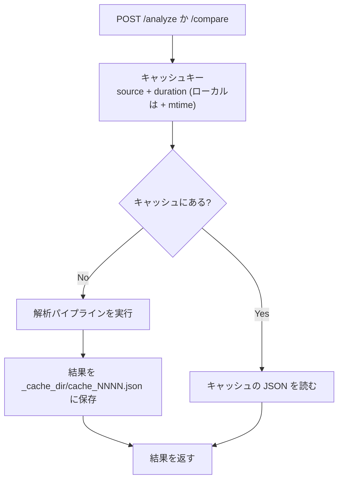

比較モードでは各トラックを個別にキャッシュ参照する:

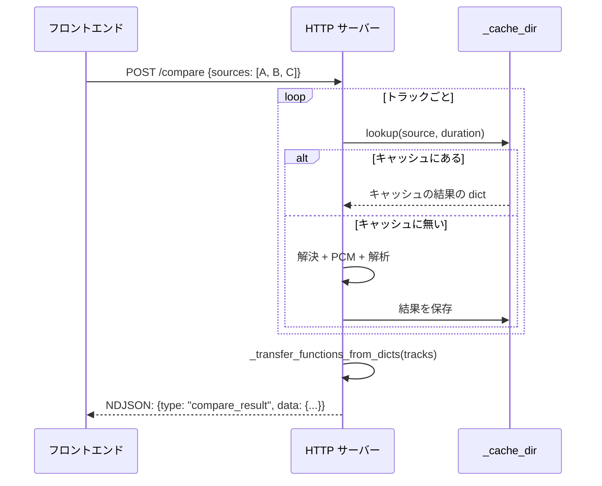

Save 最適化: `/save` に `source` + `duration` パラメータが含まれる場合、
キャッシュファイルを直接コピーし再シリアライズを回避する。

### ファイルの入力

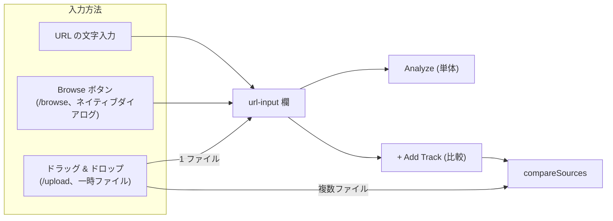

- **Browse**: `/browse` (POST) が pywebview の `OPEN_DIALOG` を開き、ファイルパスを返す
- **ドラッグ & ドロップ**: `/upload` (POST、octet-stream、X-Filename ヘッダー) がファイルを一時ディレクトリに保存し、パスを返す

### WebView2 のドラッグ & ドロップ

WebView2 の `AllowExternalDrop` (ファイルをドロップできるかどうか) は既定の true のままにするので、ドロップしたファイルはページに届く。pywebview 自身は WebView2 のスワイプでのナビゲーションを切る。
JavaScript の側では、window のキャプチャフェーズの `stopImmediatePropagation` が、
WebView2 のネイティブのハンドラーへの伝播を止める。

### 状態遷移

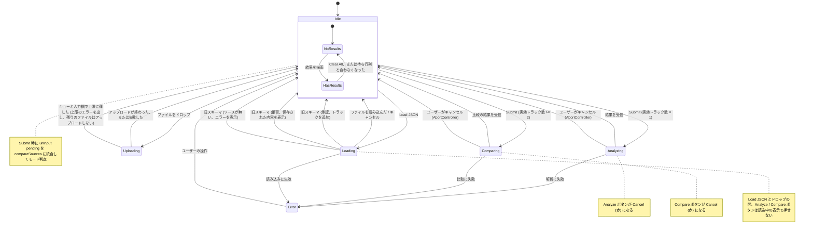

### フロントエンドの状態管理

Submit では、`urlInput` の保留中の値と `compareSources` を統合してモードを決める:

- `_effectiveTrackCount()`: compareSources + 保留中の urlInput を含めた実効トラック数
- Submit ボタンのラベルは `urlInput` の `input` イベントで動的に更新する
- Remove Track では、urlInput に値があるときは折りたたまない (値は保たれる)
- 比較が画面にある間に行を動かすと、新しい順序で `/compare` をやり直す (`_swapTracks()`、`_runAnalysis()`)。最初のトラックが transfer function の基準だからである。入力欄の値は追加しない。結果は新しいものに置き換わるまで残り、失敗またはキャンセルした実行は結果を消す。フォーカスは、実行の間にほかへ移っていなければ元の場所へ戻り、スクロール位置は置き換えの間も変わらない。実行の間、行は無効になる。単体の結果が画面にあるときに動かすと結果を消し、画面に何も無いときに動かしても何も走らせない

### Load JSON での保留ソースの保持

`/load` を走らせる前に `urlInput` の値を `compareSources` に保存し、読み込みの後に消えないようにする:

- 単一の読み込み + 保留中の値 → 両方が Compare モードで追加される
- 複数の読み込み + 保留中の値 → 保留中のトラックが読み込んだトラックに統合される
- 旧スキーマを承認 + 保留中の値 → 保留中の値 + ソースがトラックの一覧に追加される (次の Submit で解析し直す)

### キャンセル

分析または比較の間にユーザーが Cancel ボタンをクリックすると:

1. **フロントエンド**: `AbortController.abort()` が fetch の `signal` 経由でストリーム読み取りを中断
2. **バックエンド**: 次の `_send_event()` 呼び出しが `BrokenPipeError` か別の `OSError` を受けて `_ClientDisconnected` を上げ、処理が終わる
3. **ユーザーインターフェース (UI)**: ステータスに "キャンセルされました。" を表示、ボタンを Analyze / Compare に復帰

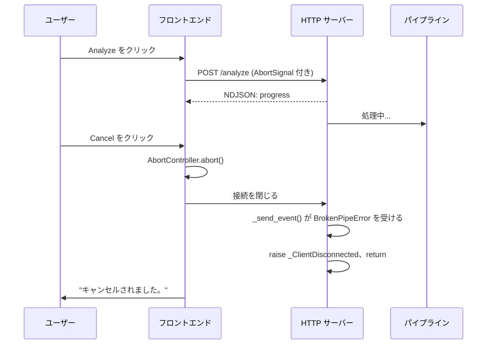

**キャンセル時の挙動**:

py-analyze-common の `GuiHandler` (`vendor/py-analyze-common/src/analyze_common/server.py`) の `_send_event()` は書き込みに失敗すると `ClientDisconnected` を上げるので、キャンセルは次の NDJSON イベント送信タイミングでのみ検知される。
すなわち以下のような長時間ブロックする同期処理は、キャンセル後も
**そのステージが完了するまで継続**する:

- `ffmpeg` / `ffprobe` の子プロセス (py-analyze-common の `analyze_common/ffmpeg.py` の
  `run_ffmpeg()` / `subprocess.run`): キャンセルではプロセスにシグナルを送らないため、
  PCM 抽出・長さの取得が最後まで走る。アプリを終えると、走っている `ffmpeg` は止まる
- `scipy.signal.welch` / `resample_poly`: NumPy/SciPy の C ループは
  Python シグナルを受け取らない
- `yt_dlp.YoutubeDL.extract_info(download=True)`: ダウンロードと音声の抽出が
  最後まで走る (止められる進捗フックを持たない)

キャンセル直後のユーザー体感は即座に "キャンセルされました。" だが、バックグラウンドの
プロセッサー / ネットワーク使用率はステージ完了まで残る。この挙動を改善するには
子プロセスに `Popen` + `terminate()` を介したキャンセル伝播を実装する
必要があり、複雑度とメモリ解放タイミングのトレードオフから
採用していない。

### テーマ

3 段階テーマ切替 (Light、Dark、Auto、また Light の順):

- **Light**: 常にライトテーマ
- **Dark**: 常にダークテーマ
- **Auto**: オペレーティングシステム (OS) の `prefers-color-scheme` に追従 (デフォルト)

Cascading Style Sheets (CSS) カスタムプロパティ (`--bg`, `--text`, `--accent` 等) で全色を管理。
Canvas チャートは `getThemeColors()` で描画時にテーマカラーを取得。
テーマ切替時はチャートを再描画。選択は言語の選択と一緒にアプリの設定ファイル (`settings.json`) に保存し、次の起動でも使う (読み込みは[ホワイトフラッシュ防止](#ホワイトフラッシュ防止)の図、保存は `POST /settings`)。

light / dark / auto の 3 状態を、CSS 変数 + `[data-theme]` で持つ。選択は設定ファイルの `theme` に保存し ([テーマと言語の保存](#テーマと言語の保存))、保存された値が `light` / `dark` 以外なら auto として扱う。トグルは light -> dark -> auto の順に回り、アイコンは太陽 / 三日月 / 半分塗った円の SVG である (py-analyze-common の `analyze_common/web/ui.js` の `_createThemeIcon()` が生成する)。auto では `prefers-color-scheme` の変化を購読して適用し直す。最初の適用は描画の前に行う ([ホワイトフラッシュ防止](#ホワイトフラッシュ防止))。

### アクセントカラー

analyze-spectrum は青 (`--accent: #1565C0`)、analyze-loudness は紫 (`--accent: #9C27B0`) を使う。色は領域で分ける: 青 = 周波数スペクトル、紫 = ラウドネス (音量)。CSS 変数の名前は両方のプロジェクトで共通である (`--text` / `--bg-card` / `--text-secondary` / `--text-muted` など)。両方のアプリで同じ CSS 変数と規則は py-analyze-common の `analyze_common/web/common.css` にあり、`gui.py` が `/common/common.css` として配信する (PyInstaller の spec が `analyze_common/web` に同梱する)。`index.html` はそれを `style.css` の前に読み込み、`style.css` は残りの変数 (アクセントカラーなど) とアプリ自身の規則を持つ。狭い画面向けの `@media (max-width: 480px)` の中の `h1` は、各 `style.css` の `h1` より後に来なければならないので、`style.css` に残す。

### i18n (言語)

`frontend/i18n.js` が en / ja の辞書を持ち、py-analyze-common の `analyze_common/web/i18n.js` (`/common/i18n.js`、これより前に読み込む) がそれを `window.i18n` にする。最初の言語は `navigator.language` で決め (`ja*` -> ja、それ以外は en)、選択は設定ファイルの `lang` に保存する ([テーマと言語の保存](#テーマと言語の保存))。静的なマークアップは DOMContentLoaded で `data-i18n*` 属性を置き換え、`main.js` が動的に作る文字列は `window.i18n.t(key)` を直接呼ぶ。`main.js` が状態に応じて文言を書く要素 (テーマボタンの `aria-label`、submit ボタンの文言と `aria-label`) には `data-i18n*` を付けない。`main.js` が読み込み時と `window.i18n.onChange` で書く (付けると、DOMContentLoaded と言語の切り替えのたびに固定の文言へ戻る)。

### テーマと言語の保存

テーマと言語の選択は、自動更新の「Check at launch」と同じ設定ファイルに持つ (場所は[自動更新](#自動更新)の「設定」の行)。webview の localStorage を使わない理由は `vendor/py-analyze-common/docs/auto-update.ja.md` の「The "Check at launch" setting」の節にある。

- 仕組みそのものは py-analyze-common にあり、analyze-loudness と共有する: 値の検証、ウィンドウの背景色、ページへ渡すスクリプトは `analyze_common/ui_settings.py` の `UiSettings`、ページ側の読み書きは `analyze_common/web/settings.js` (`window.analyzeSettings`。spec が同梱する)
- `gui.py` は設定ファイルの `SettingsStore` を 1 つだけ作り (`_settings`)、`Updater` と `UiSettings` の両方へ渡す。両者は同じファイルを同じロックで読み書きする
- ページは保存された値を `/common/settings.js` で受け取る。`main.js` はテーマか言語を切り替えるたびに `window.analyzeSettings.save()` で `/settings` へ保存する。保存は 1 つずつ順に送るので、すばやく切り替えても、最後に選んだ値が残る
- 保存に失敗したとき、選んだテーマ / 言語はアプリを閉じるまで有効で、ステータス行に原因を出す (`err.setting_save_failed`)

### ホワイトフラッシュ防止

ウィンドウとページは最初の描画の前にテーマを受け取る:

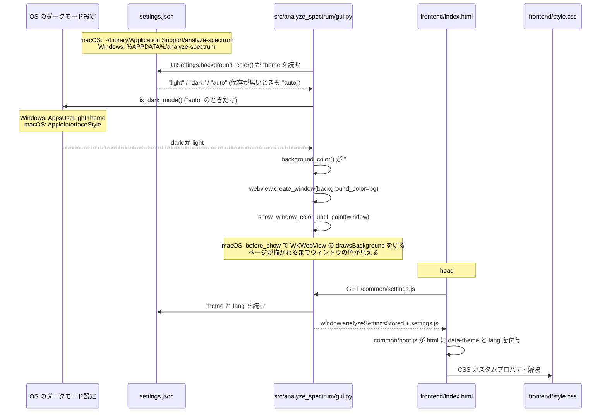

### 自動更新

更新の流れ、利用者に見えること、検証するもの、OS ごとの適用は [py-analyze-common の自動更新の文書](https://github.com/semnil/py-analyze-common/blob/main/docs/auto-update.ja.md) にある。このアプリが持つのは `src/analyze_spectrum/update.py` の `UPDATE_CONFIG`、`src/analyze_spectrum/gui.py` の終了処理 (`_exit_for_update()`)、`frontend/main.js` のダウンロード中の操作の停止 (`_setUpdateLock()`) である。

このアプリが持つもの:

- `src/analyze_spectrum/update.py` の `UPDATE_CONFIG`: 製品、リポジトリ、公開鍵 `PUBLIC_KEY`、一時ディレクトリの接頭辞、mutex の名前
- `src/analyze_spectrum/gui.py` の `_exit_for_update()`: Windows では `window.destroy()` で終わり、macOS では atexit が消すはずの一時ディレクトリを消して `os._exit(0)` で終わる
- `frontend/main.js` の `_setUpdateLock()` は、ダウンロードの間、入力欄、各ボタン、トラックの操作、ドロップ、結果の保存を止める (ロック中に描き直した結果のボタンも無効の状態で作る)
- 設定: 「Check at launch」はアプリの設定ファイルの `update_check_at_launch` である (macOS は `~/Library/Application Support/analyze-spectrum/settings.json`、Windows は `%APPDATA%\analyze-spectrum\settings.json`)。テストは `tests/conftest.py` の `_isolated_settings` で設定ファイルを一時フォルダーへ向ける

## チャート

### チャートの種類

| チャート | ライブラリ | X 軸 | Y 軸 | モード |
|-------|---------|--------|--------|------|
| PSD Spectrum | uPlot | log(freq) Hz | Power dB | 単体 / 複数トラックの重ね描き |
| 1/3 Octave | Canvas | バンド中心 Hz | Energy dB | 単体 / グループ化した棒 |
| Transfer Function | Canvas | log(freq) Hz | Delta dB | 複数トラックのみ |
| Estimated EQ | HyperText Markup Language (HTML) の表 | - | - | 複数トラックのみ (transfer function ごとに 1 表) |
| Low-End Detail | Canvas | 線形の周波数 20-500Hz | Power dB | 単体 / 複数トラックの重ね描き |
| Mid-High Detail | Canvas | log(freq) 500Hz-20kHz | Power dB | 単体 / 複数トラックの重ね描き |

uPlot (対数周波数の PSD の重ね描き) + 自前の Canvas 描画 (1/3 オクターブの棒グラフ、transfer function、
低域の詳細、中高域の詳細)。vendor の配置は analyze-loudness と同じである。自前の Canvas 描画の文字と `frontend/main.js` の PNG の書き出しの文字は `CHART_FONT_FAMILY` を、PSD の重ね描きの軸は `CHART_AXIS_FONTS` を使う。どちらも py-analyze-common の `analyze_common/web/ui.js` のもので、analyze-loudness のチャートと同じである。

### チャートのデータの流れ

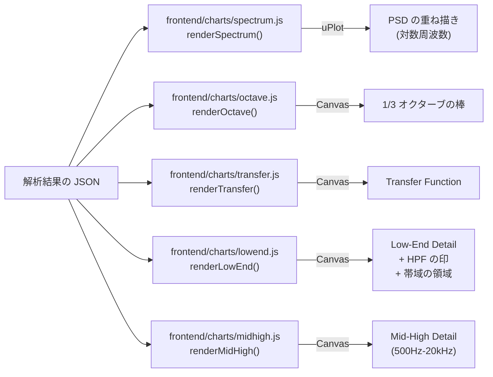

## ビルドと配布

### ビルドの流れ

`python build.py` は py-analyze-common の `analyze_common.build` をこのアプリの名前で動かす。uPlot を `build_assets/checksums.json` の Secure Hash Algorithm 256 (SHA-256) の値と、macOS の ffmpeg / ffprobe を `build_assets/ffmpeg.json` と照合する。

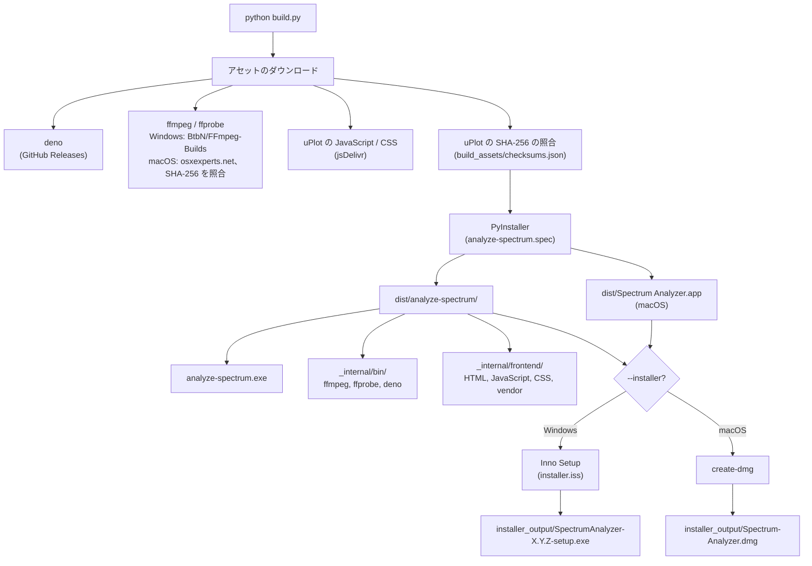

### バンドルの構成

Windows のバンドル (`analyze-spectrum.spec`)。macOS では同じファイルが `dist/Spectrum Analyzer.app` にあり、バイナリは `Contents/Frameworks/bin` にある。

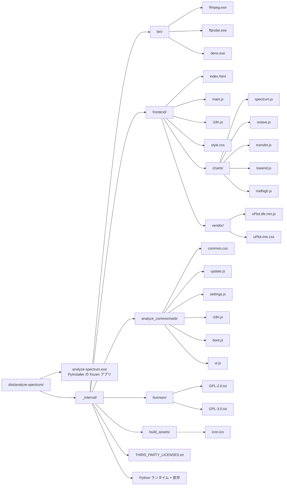

### 依存

#### CLI の依存

- `yt-dlp` — URL のダウンロード (Python API 経由)
- `ffmpeg` / `ffprobe` — PCM 変換、長さの取得、チャンネル数の検出
- `numpy`, `scipy` — スペクトル解析
- `pytest`, `pytest-cov` — 開発用の依存

#### GUI の依存

- `pywebview` — 任意の依存 (`gui` extra)
- `numpy`, `scipy` — スペクトル解析
- `yt-dlp` — Python ライブラリとして同梱する (PyInstaller が自動で含める)
- `yt-dlp-ejs` — yt-dlp が deno で動かす、YouTube のチャレンジを解くスクリプト。yt-dlp の `pin` extra の版に固定する。yt-dlp 自身の PyInstaller フック (`yt_dlp/__pyinstaller/hook-yt_dlp.py`) がその `.js` ファイルを同梱する。これが無いと yt-dlp は `n challenge solving failed: Some formats may be missing` と警告する。`tests/test_yt_dlp_ejs.py` は、その版かスクリプトが、入っている yt-dlp の受け付けるものでないときに失敗し、Dependabot は yt-dlp と yt-dlp-ejs を 1 つのプルリクエストで動かす (`.github/dependabot.yml` の `yt-dlp` グループ)
- `certifi` — 自動更新の HTTPS 接続が使う CA 証明書 (`gui` extra。frozen の macOS アプリでは、同梱の OpenSSL が指す CA のパスが利用者の Mac に存在しない)。PyInstaller は certifi が無くても警告だけで先へ進むので、py-analyze-common の `analyze_common/build.py` の `check_prerequisites()` (`build.py` が動かす) が、certifi を import できないときにビルドを止める
- ffmpeg, ffprobe, deno — `build_assets/bin/` から同梱する
- `py-analyze-common` — git submodule (`vendor/py-analyze-common`)。OS の検出、subprocess の kwargs、ダークモードの検出、ffmpeg / ffprobe のラッパー、yt-dlp でのダウンロード、JSON のサニタイズ、自動更新、テーマと言語の保存を提供する。pyproject.toml には載せず、`sys.path` 注入で使う

## セキュリティ

### ネットワーク

- HTTP サーバーは `127.0.0.1` にバインド (外部アクセス不可)
- ポートはランダム割り当て (OS 指定)
- ドロップしたファイルは、ページのドロップ処理 (`frontend/main.js`、window のキャプチャフェーズ) が受け取って `/upload` に送る

### 入力検証

- subprocess は list 形式で実行 (shell injection 防止)
- yt-dlp は Python API (`yt_dlp.YoutubeDL`) 経由のため subprocess stdout のデコード不要。タイトルは `extract_info()` の戻り値 dict から取得 (Document Object Model (DOM) は `textContent` 経由で表示)
- POST body は 10MB 上限 (JSON)、50MB (base64 画像)、500MB (ファイルアップロード)
- アップロードファイル名は `sanitize_filename()` (`vendor/py-analyze-common/src/analyze_common/download.py`) を通す: `\/:*?"<>|` と制御文字 0x00-0x1F を `_` に置き換え、先頭と末尾の `.` と空白を除き、Windows の予約デバイス名には先頭に `_` を付け、200 文字で切る
- アップロード拡張子はホワイトリスト (`src/analyze_spectrum/gui.py` の `_ALLOWED_EXTENSIONS`。`.wav`, `.mp3`, `.m4a` 等)
- duration パラメータは 0.01 分以上 240 分以下の有限の数値のみ許可 (`_parse_duration()`)
- `/compare` の `sources` 配列は 2〜6 個の空でない文字列でなければならず、URL に見えるソース (`/analyze` の `url` も同じ) は http か https でなければならない (`_reject_bad_scheme()`)

### クロスサイトスクリプティング (XSS) 防止

- フロントエンドの DOM 操作は `textContent` ベース (ユーザー入力の HTML 解釈なし)
- `showError()` (`vendor/py-analyze-common/src/analyze_common/web/ui.js` の `_renderError()`) は `textContent = ""` でクリア後、`textContent` でメッセージを設定
- `/load` が古い JSON を報告したとき、`_confirmModal()` (`frontend/main.js`) はページ内にモーダルを描き、メッセージと JSON のソースを `textContent` で設定

### ファイルシステム

- アップロード一時ファイルは `tempfile.mkdtemp` + `atexit` で自動削除
- キャッシュファイルは `tempfile.mkdtemp` + `atexit` で自動削除
- `/save` のキャッシュコピーは `shutil.copy2` (ネイティブダイアログで選択されたパスのみ)

### ビルド・配布

- ビルド時アセット: uPlot と macOS の ffmpeg / ffprobe はリポジトリの SHA-256 (`build_assets/checksums.json`、`build_assets/ffmpeg.json`) と照合する
- リリースのジョブは Python パッケージをハッシュで固定した `requirements/*.txt` からだけ入れ、Inno Setup と create-dmg は `.github/workflows/release.yaml` の SHA-256 と照合したダウンロードから入れる
- Frozen build は `_MEIPASS/bin` を `PATH` の先頭に置く
- 自動更新の取得物は Ed25519 の署名をアプリに組み込んだ公開鍵で検証してから適用する ([自動更新](#自動更新))

## 設計判断

### 低周波の 1/3 オクターブバンドの補間

Welch PSD (nperseg=4096, 48kHz) の周波数分解能は 11.72 Hz。
低周波の 1/3 オクターブバンドはバンド幅がこれより狭いので、1 つのバンドが持つ高速フーリエ変換 (FFT) のビンは 1 つか 0 である:

| バンド中心 | バンド幅 | FFT ビン |
|-------------|-----------|----------|
| 25 Hz | 5.8 Hz | 1 (23.44 Hz) |
| 31.5 Hz | 7.3 Hz | 1 (35.16 Hz) |
| 40 Hz | 9.3 Hz | 0 |
| 50 Hz | 11.6 Hz | 1 (46.88 Hz) |

バンド内に FFT ビンが存在しない場合、`np.interp` でバンド中心周波数の
PSD を補間し、帯域幅を掛けてエネルギーを推定する。

### 長い信号のチャンク分割 Welch PSD

scipy.signal.welch は内部でセグメント数 × 周波数ビンの中間配列を確保する。
長尺ファイル (例: 約 4 時間で 350,058 セグメント × 2,049 ビン ≈ 5.3 GiB) では
メモリ不足となる。

10 分 (28,800,000 サンプル) 単位でチャンクに分割し、各チャンクの PSD を
平均して最終結果とする。周波数分解能は変わらない。

### yt-dlp は Python API で使う (バイナリは同梱しない)

`yt_dlp.YoutubeDL` を Python ライブラリとして直接呼び、音声は `FFmpegExtractAudio` のポストプロセッサーで抽出する。バイナリを同梱しないことで、macOS 向けに codesign で署名し直すときに起きる Team ID の不一致を根本から避ける (onefile のバイナリの中の Python.framework は署名し直せず、hardened runtime に拒否される)。

### PCM 変換の方式

analyze-loudness は ebur128 フィルターの stderr を解析するが、このツールは生の PCM データを
numpy に読み込み、scipy.signal.welch で処理する。メモリの制約には次のように対処する:

- 48kHz mono float32 = 192 KB/s → 10 分 = 115 MB (許容できる)
- 長いファイルは `--duration` で中盤を抽出する (analyze-loudness と同じやり方)

### スキーマのバージョン管理

唯一の定義元は `src/analyze_spectrum/__init__.py` の `SCHEMA_VERSION` (整数) である。`__version__` (アプリの版) とは独立に上げる。`meta` は同じファイルの `make_meta()` (単体の結果) と `make_compare_meta()` (比較) が組み立てる。

| ver | 追加 |
|-----|------|
| 1 | 最初の版 |
| 2 | `meta.duration_min` |

- `meta.version`: アプリの版 (表示用)
- `meta.schema_version`: スキーマの版。`/load` は整数であることだけを検証し (無くてもよい)、値で互換性を判定しない
- `meta.duration_min`: `--duration` が中盤から切り出した分数。音源の全体を解析したときは無い。ffprobe がその分数以下の長さと見積もった音源もこれに含まれ、そのとき ffmpeg は音源の末尾まで読む (py-analyze-common の `compute_middle()`)。比較は、トラックのどれかが切り出されていればこれを持つ。`/load` はこれを持つ結果をキャッシュに入れない ([結果キャッシュ](#結果キャッシュ))
- 互換性は**バージョン番号ではなく、フィールドがあるかどうかで判定する**。描画に必要なフィールドの一覧の唯一の定義元は `analysis.py` の `missing_result_fields()` で、`spectrum.freqs` / `spectrum.psd_db` / `bands.centers` / `bands.energy_db` / `summary.band_energy` の各バンドを見る。数値の指標の欠けは対象にしない (画面は `?` と表示する)
- フィールドの欠けた単一ファイルには `schema_outdated` フラグを返し、キャッシュに登録しない (解析し直すと最新の形式になる)。複数ファイルの読み込みでも、フィールドの欠けたものはキャッシュに登録しない
- Compare の JSON の保存と読み込みは削除した (単体解析の結果のみ)

## テスト

### テストの構成

| ファイル | 種別 | 主な対象 |
|----------|------|----------|
| `tests/conftest.py` | fixture | 共有 Waveform Audio File Format (WAV) バイト生成 (`_make_wav_bytes`, `wav_file`, `wav_file_b`)、設定ファイルを一時フォルダーへ向ける `_isolated_settings`、このリポジトリとパッケージを指定する `analyze_common.testing.configure()` |
| `tests/test_analysis.py` | unit | 解析コア (Welch PSD, 1/3 オクターブ, 指標) |
| `tests/test_pcm.py` | unit | ffmpeg から PCM への変換 |
| `tests/test_cli.py` | unit | argparse + CLI 統合 |
| `tests/test_gui.py` | unit | `src/analyze_spectrum/gui.py` (モック使用)。更新のエンドポイント・`UPDATE_CONFIG`・テーマと言語の保存 (`/settings`、`/common/settings.js`、ウィンドウの背景色) を含む |
| `tests/test_integration.py` | integration | HTTPServer + 解析パイプライン |
| `tests/test_cache_failures.py` | integration | 実際の HTTP ハンドラーを通したキャッシュのフォールバックと解析の失敗 |
| `tests/test_dialog_busy.py` | unit | ネイティブダイアログの排他 (`_dialog_lock`) |
| `tests/test_ffmpeg_binary.py` | integration | PATH の ffmpeg / ffprobe をアプリの PCM 変換と ffprobe の読み取りで確かめる (`EXPECT_FFMPEG_DIR` で同梱バイナリを指定) |
| `tests/test_release_workflow.py` | unit | `.github/workflows/release.yaml` が配布物に入った ffmpeg / ffprobe に `tests/test_ffmpeg_binary.py` を通すこと、書き込めるのは `create-release` だけでそこでは Python を動かさないこと、更新用の署名鍵を持つジョブは読み取り権限だけでハッシュで固定した yt-dlp だけを入れること、Developer ID の署名 ID を codesign の直前に取り込み、codesign の終わりに消すこと、リリースのジョブがパッケージを `requirements/*.txt` からだけ入れ、Inno Setup と create-dmg を SHA-256 を照合してから入れること、`requirements/release.txt` が `pyproject.toml` を満たすこと、各 `requirements/*.txt` を自分の固定値を制約にして解き直すと、ちょうどそのファイルが固定しているパッケージに、同じ環境マーカー (どの OS で入れるかの条件) でなること (テストは py-analyze-common の `analyze_common.testing.release_workflow`) |
| `tests/test_third_party_licenses.py` | unit | `THIRD_PARTY_LICENSES.txt` が指す GNU General Public License (GPL) の全文と、それを同梱する spec / `installer.iss` (`analyze_common.testing.third_party_licenses`) |
| `tests/test_chart_font.py` | unit | スクリプトが自分でフォントを名指ししないことと、スクリプトが `CHART_FONT_FAMILY` を使うこと (`analyze_common.testing.chart_font`) |
| `tests/test_yt_dlp_ejs.py` | unit | 入っている yt-dlp-ejs の版 (major.minor) とスクリプトのハッシュが、入っている yt-dlp の受け付けるものであること (`analyze_common.testing.yt_dlp_ejs`) |
| `tests/test_frontend.py` | end-to-end (e2e) | Playwright headless Chromium runner。実際の `frontend/index.html` で更新の確認・承認・失敗・設定の保存と、テーマと言語の保存・次の起動での復元を通す。`h1` の色、結果のタイトル行、最初の Tab、集計表の幅、長いトラック名、ステータス行も確かめる |
| `tests/test_chart_rendering.py` | e2e | 実際のブラウザーのスクリプトでの比較チャートと Portable Network Graphics (PNG) の書き出し |
| `tests/test_browser_operations.py` | e2e | アプリのページを通したコンテキストメニューの編集とキーボード操作、トラックの並べ替え、ファイルのドロップ、結果の保存、ファイルの選択 |
| `tests/frontend/test_ui.js` | browser | フロントエンド UI 状態テスト |
| `tests/js_coverage.py` | tool | `--js-coverage=PATH` を付けたとき、Playwright のテストが動かした `frontend/*.js` の V8 のカバレッジを LCOV で書き出す |
| `tests/test_js_coverage.py` | unit | `tests/js_coverage.py` が V8 の範囲を行に対応させる方法と、書き出す LCOV |

### 統合テスト

`tests/test_integration.py` は pywebview を使わず `HTTPServer` を直接起動し、
実解析パイプラインを通して各エンドポイントを検証する。

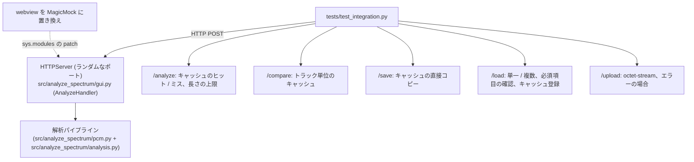

### フロントエンド UI テスト

`tests/test_frontend.py` は Playwright で headless Chromium を起動し、
`tests/frontend/test_ui.html` をローカル HTTP サーバー経由で開いて
`window._testResult` から合否を読み取る。

`tests/frontend/test_ui.js` は fetch をモックして DOM 状態を直接検証する:

- トラック追加 / 削除
- 待ち行列の行 (番号、種類、ボタンの名前、色)
- 重複トラック拒否
- 6 トラック上限
- Load JSON (単一 / 複数 / 旧スキーマ承認・拒否) + 保留ソース保持
- テーマトグル (Light、Dark、Auto)
- Clear All
- setBusy ボタン状態
- NDJSON ストリームの中断
- Submit ラベル (urlInput 入力による動的更新含む)
- Submit 時の pending urlInput 統合 (NDJSON ストリームモック)
- Submit 時の 6 トラック上限拒否
- 1 トラック + urlInput 空での単体解析
- Remove Track 時の urlInput 値保持
- 比較結果と Save Image の推定 EQ の表
- 確認モーダルがどの回答でも閉じること
- UI のソースとステータスのアイコンに絵文字が無いこと

`playwright>=1.40` は dev dependency (`pyproject.toml`) である。

`--js-coverage=PATH` を付けると、`tests/js_coverage.py` がこれらのテストの開く Chromium のページごとに `frontend/*.js` (`frontend/vendor/` を除く) の行カバレッジを取り、LCOV で書き出す。継続的インテグレーション (CI) はそれを Python のカバレッジと一緒に Codecov へ送る。

### JavaScript のカバレッジ

`--js-coverage=PATH` を付けると、`tests/js_coverage.py` は、テストが開く Chromium のページごとに、ページが何かを読み込む前に V8 の precise coverage を始め、テストが始めるナビゲーション (`goto`、`reload`、`go_back`、`go_forward`) の前 (ナビゲーションは文書のスクリプトを置き去りにする) と、ページ・そのコンテキスト・そのブラウザーが閉じられるときに取得する。各取得は前の取得からのカウントを足す。数えるのは `frontend/` の `frontend/vendor/` を除くスクリプトで、プロジェクトのルートから配信されたもの (`/frontend/main.js`、`tests/frontend/test_ui.html`) もアプリのハンドラーが配信したもの (`/main.js`) も数え、そのすべてを LCOV として PATH へ書き出す。どのテストも読み込まなかったスクリプトはヒット 0 で書く。行のヒット数は、その行のコードをすべて含むいちばん内側の V8 の範囲のカウントを、ページを通して合計したものである。空行とコメントで始まる行は数えない。ページが、ディスクのファイルと長さの違うスクリプトを動かしたときは、そのテストを失敗にする。py-analyze-common のスクリプト (`/common/*.js`) は数えない。

### ブラウザー操作のテスト

`tests/test_browser_operations.py` は headless Chromium でアプリのページを動かす: コンテキストメニューの編集とキーボード操作、結果を描いた状態と描いていない状態でのトラックの並べ替え、ファイルのドロップ、結果の保存、ファイルの選択。入力の値、トラックのデータと行、リクエストの本文、PNG の中身、成功・キャンセル・失敗した操作のステータスを確かめる。クリップボードへのアクセスと HTTP のレスポンスはテストが制御する。ネイティブのクリップボード連携とファイルダイアログは、これらのテストでは動かさない。

### ffmpeg / ffprobe のバイナリのテスト

ここの `tests/test_ffmpeg_binary.py` は、numpy で書いた 48 kHz 16-bit ステレオの WAV (左右で別の正弦波) を、PATH の ffmpeg / ffprobe とアプリの `extract_audio()` / `probe_info()` で読み、返ってきた float32 の PCM が書いたサンプルの 1/32768 倍と一致すること (中盤からの切り出しを含む)、チャンネル数と長さを確かめる。

## 既知の制限

- GUI の比較は最大 6 トラック (チャートの可読性)。CLI に上限は無い
- リアルタイム入力 (マイク) は対象外
- 48kHz mono float32 = 192 KB/s で、10 分で約 115 MB (メモリ制約)
- 長尺は CLI の `--duration` で中盤抽出で対処 (GUI の新しい分析は常に全尺。読み込んだ JSON は自分の長さのまま。[結果キャッシュ](#結果キャッシュ))
- キャンセルは動いているステージを止めない ([キャンセル](#キャンセル))

## 参照規格

| 規格 | 用途 |
|----------|-------|
| 米国規格協会 (ANSI) S3.5-1997 | Speech Intelligibility Index (SII) の帯域重要度関数 (Low/Intel ratio) |
| 国際電気標準会議 (IEC) 60268-16:2020 | Speech Transmission Index (STI) の参照 (明瞭度の帯域) |
| Upward spread of masking | 低域のマスキング解析の根拠 |

- **ITU-R BS.1770**: True Peak — 4 倍オーバーサンプリング、チャンネルごとに測る
- **ANSI S3.5-1997**: SII の帯域重要度関数 (1-5kHz が明瞭度の約 72% を担う)
- **IEC 60268-16:2020**: STI — 第 5 版で 125/250Hz 帯域が大きく減らされた
- **Upward spread of masking**: 低域が高域をマスクする非対称性
