# アーキテクチャ

> For the English version, see [architecture.md](architecture.md).

## 概要

analyze-spectrum は YouTube 動画またはローカル音声ファイルの周波数スペクトルを分析し、
イコライザー (EQ) 処理の妥当性を検証するデスクトップツールである。
コマンドラインインターフェース (CLI) のツールと、Windows / macOS のグラフィカルユーザーインターフェース (GUI) アプリケーションとして動く。

GUI は pywebview (WebView2 / WebKit) + ローカルの Hypertext Transfer Protocol (HTTP) サーバーの構成で、サーバーは進捗と結果を、1 行に 1 つの JavaScript Object Notation (JSON) を置いた形式 (NDJSON、newline-delimited JSON) でストリーミングする。
姉妹ツール analyze-loudness と py-analyze-common (`vendor/py-analyze-common`) を共有する。
Uniform Resource Locator (URL) の音声は yt-dlp の Python のアプリケーションプログラミングインターフェース (API) で取得し、どのソースも ffmpeg で pulse-code modulation (PCM) のサンプルにする。

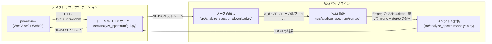

## モジュール

`src/analyze_spectrum/analysis.py` は Welch 法でパワースペクトル密度 (PSD) を求める。

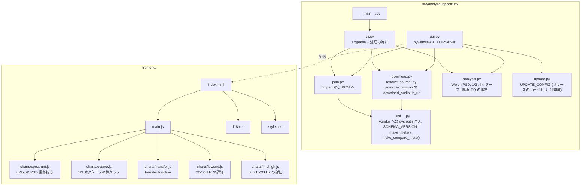

## データの流れ

### 解析パイプライン

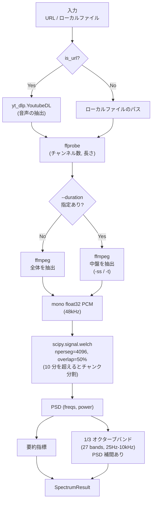

### 要約指標

`analyze_track()` は Welch PSD から要約を求める。ハイパスフィルター (HPF) の推定もその 1 つである。

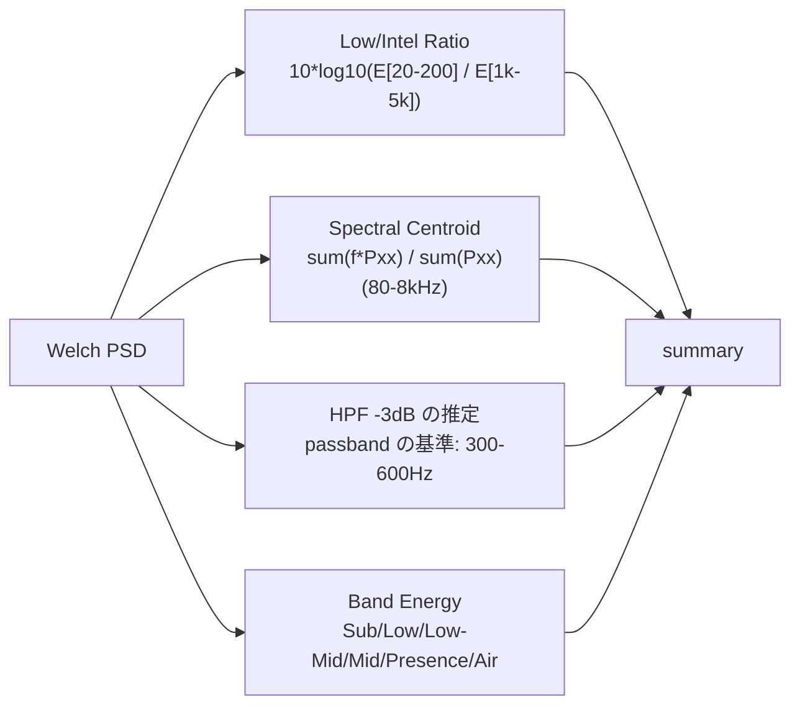

`summary` は `hpf_6db_hz`、`rolloff_db_per_decade`、`crest_factor_db`、`spectral_tilt_db_oct`、`presence_mid_ratio_db`、`brightness_db`、`hf_rolloff_hz` も持つ (`src/analyze_spectrum/analysis.py` の `SpectrumResult.to_dict()`)。

### 比較モード

CLI は `compare_tracks()` で比較する。GUI のトラックはキャッシュのものを含めてシリアライズした dict で ([結果キャッシュ](#結果キャッシュ))、`_transfer_functions_from_dicts()` がそこから transfer function を求める。

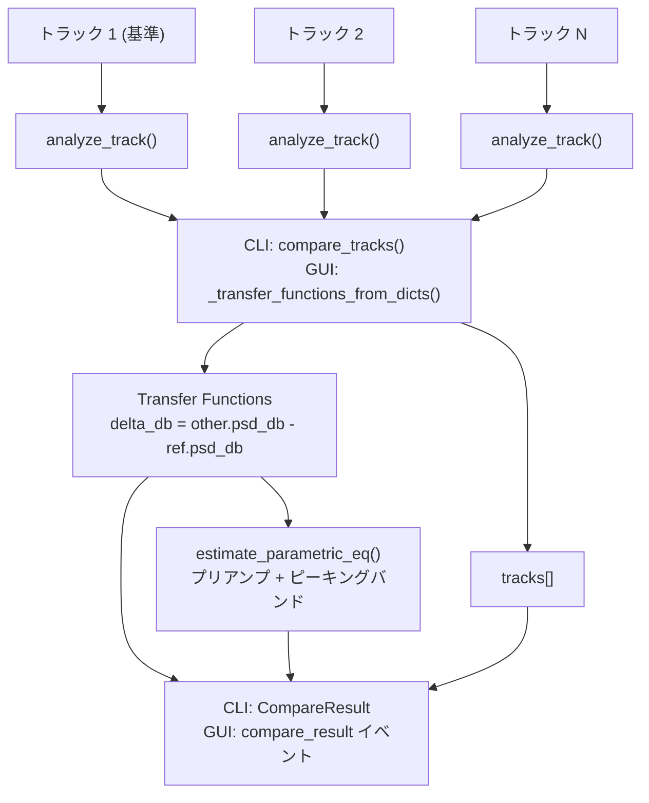

## GUI

### 通信モデル

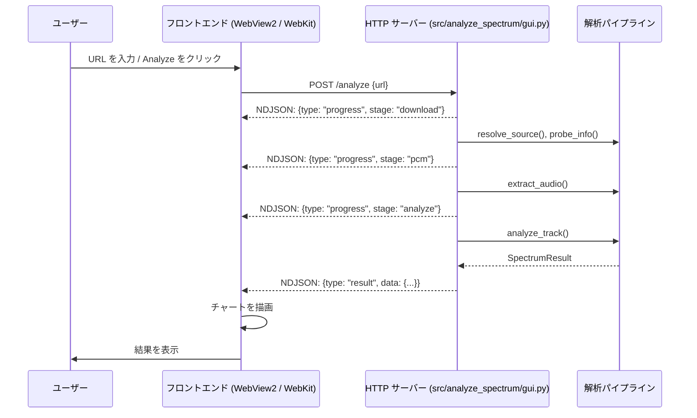

### 比較の流れ

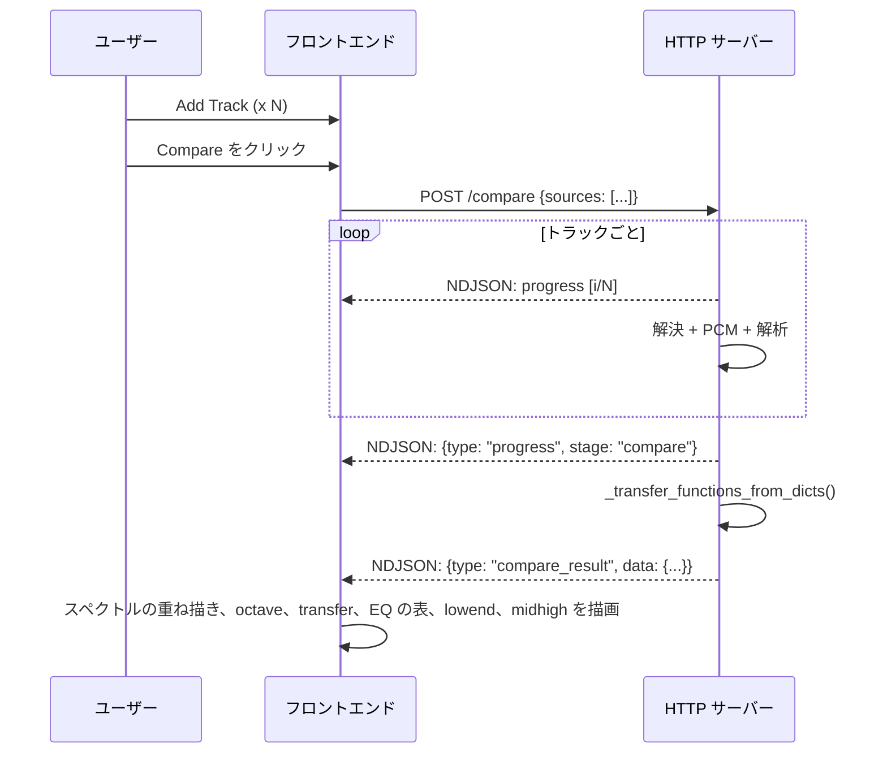

### 結果キャッシュ

セッション内キャッシュにより同一ソースの再解析を回避する。
キャッシュは `tempfile.mkdtemp()` に作成し、プロセス終了時に削除 (session-only)。

Load JSON で読んだ JSON は、音源をキーに、長さの指定なしでメモリ上のキャッシュに入る (`_cache_loaded()`)。同じ起動の間に自分で分析した結果を先に探す。`meta.duration_min` (CLI の `--duration`) を記録した JSON はキャッシュに入らないので、あとの分析と比較のトラックは全尺になる。ffprobe が `--duration` 以下の長さと見積もった音源は末尾まで分析して何も記録しないので、その JSON はキャッシュに入る。これを記録しない版で保存した JSON は、`duration_sec` によらずキャッシュに入り、その音源をまだ分析していなければ、短い範囲のまま答える。

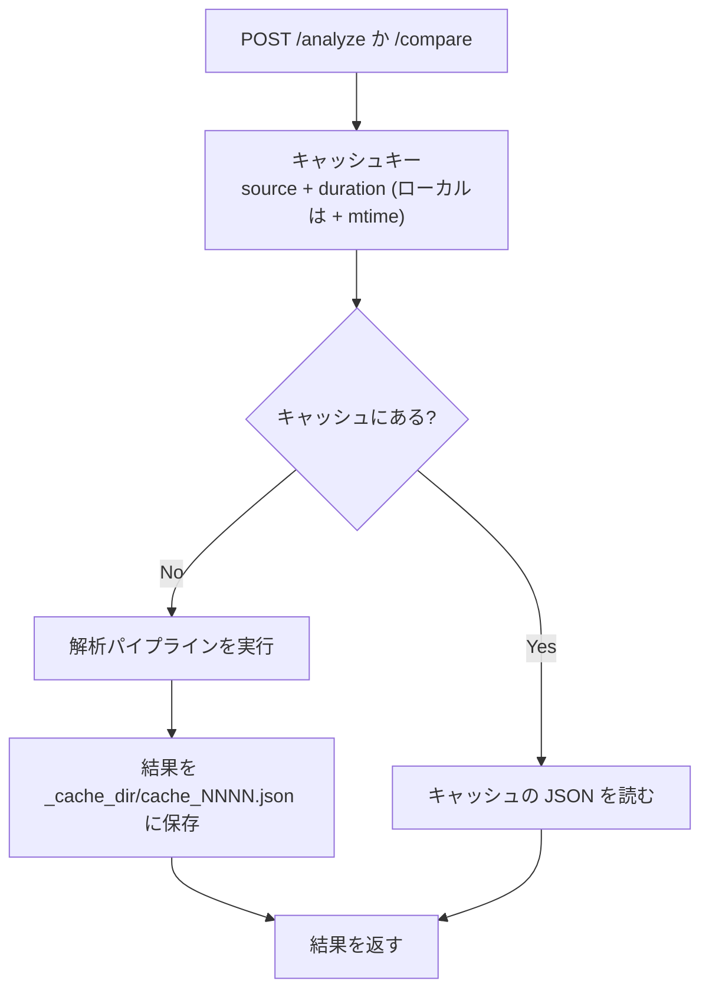

比較モードでは各トラックを個別にキャッシュ参照する:

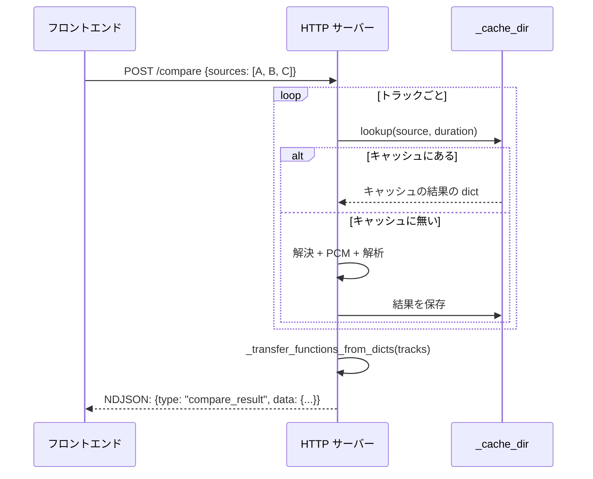

Save 最適化: `/save` に `source` + `duration` パラメータが含まれる場合、
キャッシュファイルを直接コピーし再シリアライズを回避する。

### ファイルの入力

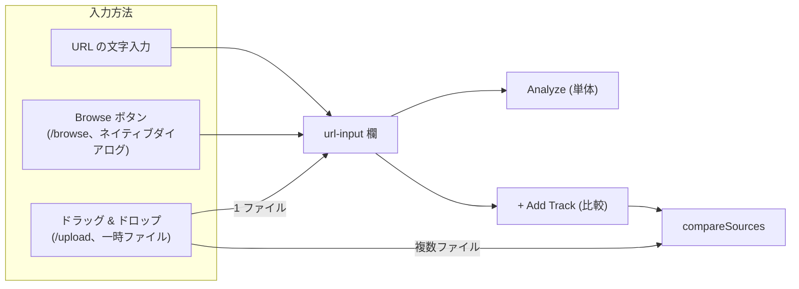

- **Browse**: `/browse` (POST) が pywebview の `OPEN_DIALOG` を開き、ファイルパスを返す
- **ドラッグ & ドロップ**: `/upload` (POST、octet-stream、X-Filename ヘッダー) がファイルを一時ディレクトリに保存し、パスを返す

### 状態遷移

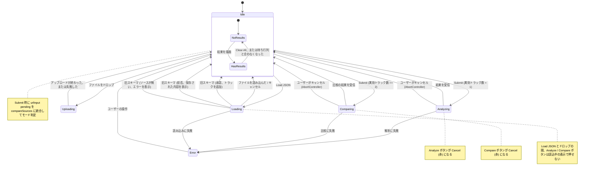

### キャンセル

分析または比較の間にユーザーが Cancel ボタンをクリックすると:

1. **フロントエンド**: `AbortController.abort()` が fetch の `signal` 経由でストリーム読み取りを中断
2. **バックエンド**: 次の `_send_event()` 呼び出しが `BrokenPipeError` か別の `OSError` を受けて `_ClientDisconnected` を上げ、処理が終わる
3. **ユーザーインターフェース (UI)**: ステータスに "キャンセルされました。" を表示、ボタンを Analyze / Compare に復帰

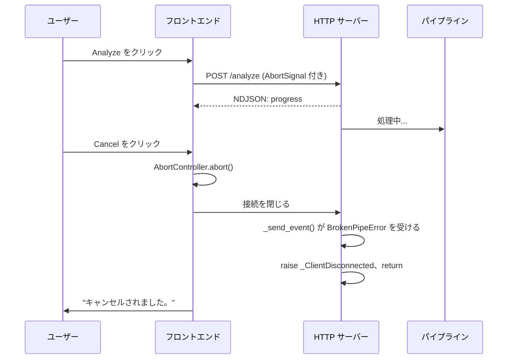

**キャンセル時の挙動**:

py-analyze-common の `GuiHandler` (`vendor/py-analyze-common/src/analyze_common/server.py`) の `_send_event()` は書き込みに失敗すると `ClientDisconnected` を上げるので、キャンセルは次の NDJSON イベント送信タイミングでのみ検知される。
すなわち以下のような長時間ブロックする同期処理は、キャンセル後も
**そのステージが完了するまで継続**する:

- `ffmpeg` / `ffprobe` の子プロセス (py-analyze-common の `analyze_common/ffmpeg.py` の
  `run_ffmpeg()` / `subprocess.run`): キャンセルではプロセスにシグナルを送らないため、
  PCM 抽出・長さの取得が最後まで走る。アプリを終えると、走っている `ffmpeg` は止まる
- `scipy.signal.welch` / `resample_poly`: NumPy/SciPy の C ループは
  Python シグナルを受け取らない
- `yt_dlp.YoutubeDL.extract_info(download=True)`: ダウンロードと音声の抽出が
  最後まで走る (止められる進捗フックを持たない)

キャンセル直後のユーザー体感は即座に "キャンセルされました。" だが、バックグラウンドの
プロセッサー / ネットワーク使用率はステージ完了まで残る。この挙動を改善するには
子プロセスに `Popen` + `terminate()` を介したキャンセル伝播を実装する
必要があり、複雑度とメモリ解放タイミングのトレードオフから
採用していない。

### テーマ

3 段階テーマ切替 (Light、Dark、Auto、また Light の順):

- **Light**: 常にライトテーマ
- **Dark**: 常にダークテーマ
- **Auto**: オペレーティングシステム (OS) の `prefers-color-scheme` に追従 (デフォルト)

Cascading Style Sheets (CSS) カスタムプロパティ (`--bg`, `--text`, `--accent` 等) で全色を管理。
Canvas チャートは `getThemeColors()` で描画時にテーマカラーを取得。
テーマ切替時はチャートを再描画。選択は言語の選択と一緒にアプリの設定ファイル (`settings.json`) に保存し、次の起動でも使う (読み込みは[ホワイトフラッシュ防止](#ホワイトフラッシュ防止)の図、保存は `POST /settings`)。

### ホワイトフラッシュ防止

ウィンドウとページは最初の描画の前にテーマを受け取る:

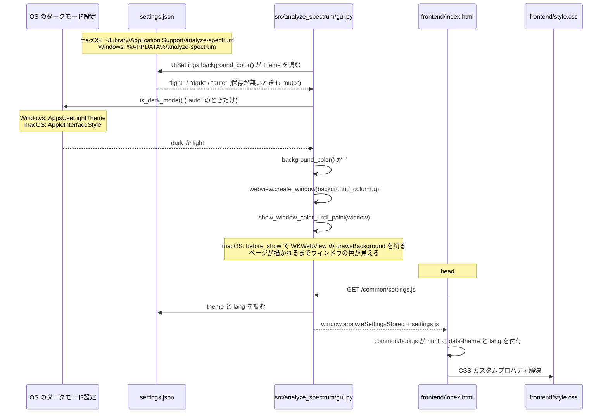

### 自動更新

インストールしたアプリは、起動時 (設定ダイアログの「起動時に確認」が ON のとき) と設定ダイアログの「今すぐ確認」で、最新リリースに新しい版があるかを確かめる。取得するのは Windows のインストーラーか macOS のディスクイメージ (DMG) である。
画面側 (設定ボタン・設定ダイアログ・確認ダイアログ) は `vendor/py-analyze-common/src/analyze_common/web/update.js`、取得・検証・適用は `vendor/py-analyze-common/src/analyze_common/update.py` が受け持ち、analyze-loudness と共通である。
`/update/*` のエンドポイントは `GuiHandler` (`vendor/py-analyze-common/src/analyze_common/server.py`) のものである。このアプリが持つのは `src/analyze_spectrum/update.py` の `UPDATE_CONFIG`、`src/analyze_spectrum/gui.py` の終了処理 (`_exit_for_update()`)、`frontend/main.js` のダウンロード中の操作の停止 (`_setUpdateLock()`) である。
署名の鍵と `.github/workflows/release.yaml` の手順はプロジェクトの `CLAUDE.md` の「Auto-update」節にある。

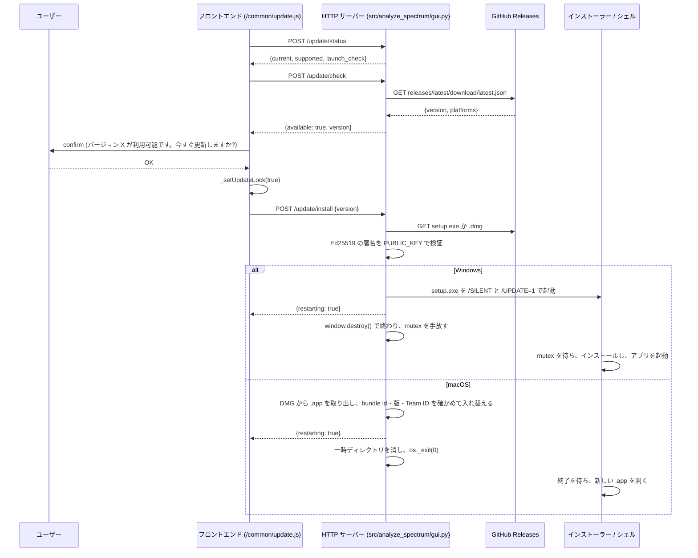

キャンセルすると何もダウンロードしない。起動時の確認は、新しい版が無いときと確認に失敗したときは何も表示しない (「今すぐ確認」はダイアログ内に結果を出す)。分析中は確認ダイアログを出さずに断る。
ダウンロード・検証・適用のどこかで失敗すると `_setUpdateLock(false)` で操作を戻し、ステータス欄に原因を出してアプリは動き続ける。
Windows ではユーザーアカウント制御 (UAC) の確認をインストーラーが出し、そのときアプリはもう終わっている。UAC を拒否するとインストールされず、アプリは閉じたままになる (もう一度起動すると旧版が起動し、起動時の確認が ON なら同じ更新をもう一度勧める)。

## チャート

### チャートの種類

| チャート | ライブラリ | X 軸 | Y 軸 | モード |
|-------|---------|--------|--------|------|
| PSD Spectrum | uPlot | log(freq) Hz | Power dB | 単体 / 複数トラックの重ね描き |
| 1/3 Octave | Canvas | バンド中心 Hz | Energy dB | 単体 / グループ化した棒 |
| Transfer Function | Canvas | log(freq) Hz | Delta dB | 複数トラックのみ |
| Estimated EQ | HyperText Markup Language (HTML) の表 | - | - | 複数トラックのみ (transfer function ごとに 1 表) |
| Low-End Detail | Canvas | 線形の周波数 20-500Hz | Power dB | 単体 / 複数トラックの重ね描き |
| Mid-High Detail | Canvas | log(freq) 500Hz-20kHz | Power dB | 単体 / 複数トラックの重ね描き |

### チャートのデータの流れ

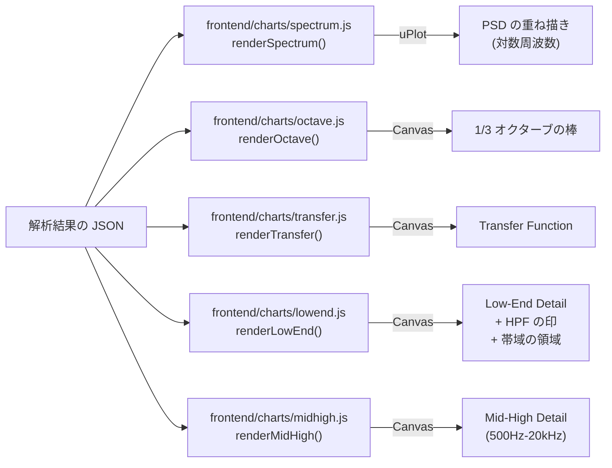

## ビルドと配布

### ビルドの流れ

`python build.py` は py-analyze-common の `analyze_common.build` をこのアプリの名前で動かす。uPlot を `build_assets/checksums.json` の Secure Hash Algorithm 256 (SHA-256) の値と、macOS の ffmpeg / ffprobe を `build_assets/ffmpeg.json` と照合する。

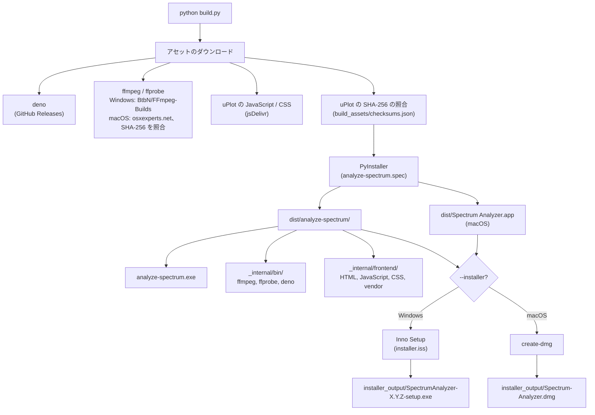

### バンドルの構成

Windows のバンドル (`analyze-spectrum.spec`)。macOS では同じファイルが `dist/Spectrum Analyzer.app` にあり、バイナリは `Contents/Frameworks/bin` にある。

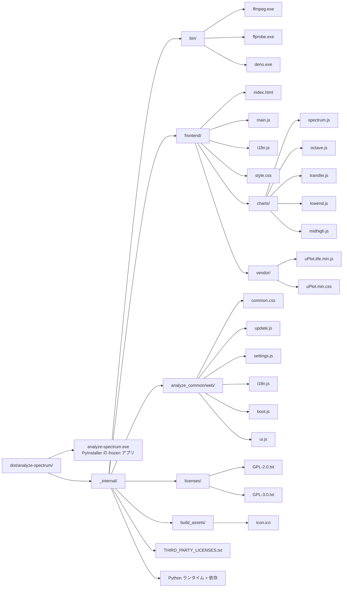

## セキュリティ

### ネットワーク

- HTTP サーバーは `127.0.0.1` にバインド (外部アクセス不可)
- ポートはランダム割り当て (OS 指定)
- ドロップしたファイルは、ページのドロップ処理 (`frontend/main.js`、window のキャプチャフェーズ) が受け取って `/upload` に送る

### 入力検証

- subprocess は list 形式で実行 (shell injection 防止)
- yt-dlp は Python API (`yt_dlp.YoutubeDL`) 経由のため subprocess stdout のデコード不要。タイトルは `extract_info()` の戻り値 dict から取得 (Document Object Model (DOM) は `textContent` 経由で表示)
- POST body は 10MB 上限 (JSON)、50MB (base64 画像)、500MB (ファイルアップロード)
- アップロードファイル名は `sanitize_filename()` (`vendor/py-analyze-common/src/analyze_common/download.py`) を通す: `\/:*?"<>|` と制御文字 0x00-0x1F を `_` に置き換え、先頭と末尾の `.` と空白を除き、Windows の予約デバイス名には先頭に `_` を付け、200 文字で切る
- アップロード拡張子はホワイトリスト (`src/analyze_spectrum/gui.py` の `_ALLOWED_EXTENSIONS`。`.wav`, `.mp3`, `.m4a` 等)
- duration パラメータは 0.01 分以上の有限の数値のみ許可 (`_parse_duration()`)
- `/compare` の `sources` 配列は 2〜6 個の空でない文字列でなければならず、URL に見えるソース (`/analyze` の `url` も同じ) は http か https でなければならない (`_reject_bad_scheme()`)

### クロスサイトスクリプティング (XSS) 防止

- フロントエンドの DOM 操作は `textContent` ベース (ユーザー入力の HTML 解釈なし)
- `showError()` (`vendor/py-analyze-common/src/analyze_common/web/ui.js` の `_renderError()`) は `textContent = ""` でクリア後、`textContent` でメッセージを設定
- `/load` が古い JSON を報告したとき、`_confirmModal()` (`frontend/main.js`) はページ内にモーダルを描き、メッセージと JSON のソースを `textContent` で設定

### ファイルシステム

- アップロード一時ファイルは `tempfile.mkdtemp` + `atexit` で自動削除
- キャッシュファイルは `tempfile.mkdtemp` + `atexit` で自動削除
- `/save` のキャッシュコピーは `shutil.copy2` (ネイティブダイアログで選択されたパスのみ)

### ビルド・配布

- ビルド時アセット: uPlot と macOS の ffmpeg / ffprobe はリポジトリの SHA-256 (`build_assets/checksums.json`、`build_assets/ffmpeg.json`) と照合する。Windows の ffmpeg / ffprobe (BtbN の `latest` にある固定した系列のビルド) と deno (最新リリース) は固定しない
- リリースのジョブは Python パッケージをハッシュで固定した `requirements/*.txt` からだけ入れ、Inno Setup と create-dmg は `.github/workflows/release.yaml` の SHA-256 と照合したダウンロードから入れる
- Frozen build は `_MEIPASS/bin` を `PATH` の先頭に置く
- 自動更新の取得物は Ed25519 の署名をアプリに組み込んだ公開鍵で検証してから適用する ([自動更新](#自動更新))

## 設計判断

### 低周波の 1/3 オクターブバンドの補間

Welch PSD (nperseg=4096, 48kHz) の周波数分解能は 11.72 Hz。
低周波の 1/3 オクターブバンドはバンド幅がこれより狭いので、1 つのバンドが持つ高速フーリエ変換 (FFT) のビンは 1 つか 0 である:

| バンド中心 | バンド幅 | FFT ビン |
|-------------|-----------|----------|
| 25 Hz | 5.8 Hz | 1 (23.44 Hz) |
| 31.5 Hz | 7.3 Hz | 1 (35.16 Hz) |
| 40 Hz | 9.3 Hz | 0 |
| 50 Hz | 11.6 Hz | 1 (46.88 Hz) |

バンド内に FFT ビンが存在しない場合、`np.interp` でバンド中心周波数の
PSD を補間し、帯域幅を掛けてエネルギーを推定する。

### 長い信号のチャンク分割 Welch PSD

scipy.signal.welch は内部でセグメント数 × 周波数ビンの中間配列を確保する。
長尺ファイル (例: 約 4 時間で 350,058 セグメント × 2,049 ビン ≈ 5.3 GiB) では
メモリ不足となる。

10 分 (28,800,000 サンプル) 単位でチャンクに分割し、各チャンクの PSD を
平均して最終結果とする。周波数分解能は変わらない。

## テスト

### テストの構成

| ファイル | 種別 | 主な対象 |
|----------|------|----------|
| `tests/conftest.py` | fixture | 共有 Waveform Audio File Format (WAV) バイト生成 (`_make_wav_bytes`, `wav_file`, `wav_file_b`)、設定ファイルを一時フォルダーへ向ける `_isolated_settings`、このリポジトリとパッケージを指定する `analyze_common.testing.configure()` |
| `tests/test_analysis.py` | unit | 解析コア (Welch PSD, 1/3 オクターブ, 指標) |
| `tests/test_pcm.py` | unit | ffmpeg から PCM への変換 |
| `tests/test_cli.py` | unit | argparse + CLI 統合 |
| `tests/test_gui.py` | unit | `src/analyze_spectrum/gui.py` (モック使用)。更新のエンドポイント・`UPDATE_CONFIG`・テーマと言語の保存 (`/settings`、`/common/settings.js`、ウィンドウの背景色) を含む |
| `tests/test_integration.py` | integration | HTTPServer + 解析パイプライン |
| `tests/test_cache_failures.py` | integration | 実際の HTTP ハンドラーを通したキャッシュのフォールバックと解析の失敗 |
| `tests/test_dialog_busy.py` | unit | ネイティブダイアログの排他 (`_dialog_lock`) |
| `tests/test_ffmpeg_binary.py` | integration | PATH の ffmpeg / ffprobe をアプリの PCM 変換と ffprobe の読み取りで確かめる (`EXPECT_FFMPEG_DIR` で同梱バイナリを指定) |
| `tests/test_release_workflow.py` | unit | `.github/workflows/release.yaml` が配布物に入った ffmpeg / ffprobe に `tests/test_ffmpeg_binary.py` を通すこと、書き込めるのは `create-release` だけでそこでは Python を動かさないこと、更新用の署名鍵を持つジョブは読み取り権限だけでハッシュで固定した yt-dlp だけを入れること、Developer ID の署名 ID を codesign の直前に取り込み、codesign の終わりに消すこと、リリースのジョブがパッケージを `requirements/*.txt` からだけ入れ、Inno Setup と create-dmg を SHA-256 を照合してから入れること、`requirements/release.txt` が `pyproject.toml` を満たすこと、各 `requirements/*.txt` を自分の固定値を制約にして解き直すと、ちょうどそのファイルが固定しているパッケージに、同じ環境マーカー (どの OS で入れるかの条件) でなること (テストは py-analyze-common の `analyze_common.testing.release_workflow`) |
| `tests/test_third_party_licenses.py` | unit | `THIRD_PARTY_LICENSES.txt` が指す GNU General Public License (GPL) の全文と、それを同梱する spec / `installer.iss` (`analyze_common.testing.third_party_licenses`) |
| `tests/test_yt_dlp_ejs.py` | unit | 入っている yt-dlp-ejs の版 (major.minor) とスクリプトのハッシュが、入っている yt-dlp の受け付けるものであること (`analyze_common.testing.yt_dlp_ejs`) |
| `tests/test_frontend.py` | end-to-end (e2e) | Playwright headless Chromium runner。実際の `frontend/index.html` で更新の確認・承認・失敗・設定の保存と、テーマと言語の保存・次の起動での復元を通す。`h1` の色、結果のタイトル行、最初の Tab、集計表の幅、長いトラック名、ステータス行も確かめる |
| `tests/test_chart_rendering.py` | e2e | 実際のブラウザーのスクリプトでの比較チャートと Portable Network Graphics (PNG) の書き出し |
| `tests/test_browser_operations.py` | e2e | アプリのページを通したコンテキストメニューの編集とキーボード操作、トラックの並べ替え、ファイルのドロップ、結果の保存、ファイルの選択 |
| `tests/frontend/test_ui.js` | browser | フロントエンド UI 状態テスト |
| `tests/js_coverage.py` | tool | `--js-coverage=PATH` を付けたとき、Playwright のテストが動かした `frontend/*.js` の V8 のカバレッジを LCOV で書き出す |
| `tests/test_js_coverage.py` | unit | `tests/js_coverage.py` が V8 の範囲を行に対応させる方法と、書き出す LCOV |

### 統合テスト

`tests/test_integration.py` は pywebview を使わず `HTTPServer` を直接起動し、
実解析パイプラインを通して各エンドポイントを検証する。

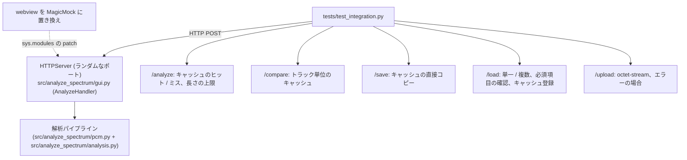

### フロントエンド UI テスト

`tests/test_frontend.py` は Playwright で headless Chromium を起動し、
`tests/frontend/test_ui.html` をローカル HTTP サーバー経由で開いて
`window._testResult` から合否を読み取る。

`tests/frontend/test_ui.js` は fetch をモックして DOM 状態を直接検証する:

- トラック追加 / 削除
- 待ち行列の行 (番号、種類、ボタンの名前、色)
- 重複トラック拒否
- 6 トラック上限
- Load JSON (単一 / 複数 / 旧スキーマ承認・拒否) + 保留ソース保持
- テーマトグル (Light、Dark、Auto)
- Clear All
- setBusy ボタン状態
- NDJSON ストリームの中断
- Submit ラベル (urlInput 入力による動的更新含む)
- Submit 時の pending urlInput 統合 (NDJSON ストリームモック)
- Submit 時の 6 トラック上限拒否
- 1 トラック + urlInput 空での単体解析
- Remove Track 時の urlInput 値保持
- 比較結果と Save Image の推定 EQ の表
- 確認モーダルがどの回答でも閉じること
- UI のソースとステータスのアイコンに絵文字が無いこと

`playwright>=1.40` は dev dependency (`pyproject.toml`) である。

`--js-coverage=PATH` を付けると、`tests/js_coverage.py` がこれらのテストの開く Chromium のページごとに `frontend/*.js` (`frontend/vendor/` を除く) の行カバレッジを取り、LCOV で書き出す。継続的インテグレーション (CI) はそれを Python のカバレッジと一緒に Codecov へ送る。

## 既知の制限

- GUI の比較は最大 6 トラック (チャートの可読性)。CLI に上限は無い
- リアルタイム入力 (マイク) は対象外
- 48kHz mono float32 = 192 KB/s で、10 分で約 115 MB (メモリ制約)
- 長尺は CLI の `--duration` で中盤抽出で対処 (GUI の新しい分析は常に全尺。読み込んだ JSON は自分の長さのまま。[結果キャッシュ](#結果キャッシュ))
- キャンセルは動いているステージを止めない ([キャンセル](#キャンセル))
- `/upload` のファイル名衝突回避は検査から使用までの間に競合が起こりうるパターン (time-of-check to time-of-use、TOCTOU) (単一ユーザーアプリとして許容)

## 参照規格

| 規格 | 用途 |
|----------|-------|
| 米国規格協会 (ANSI) S3.5-1997 | Speech Intelligibility Index (SII) の帯域重要度関数 (Low/Intel ratio) |
| 国際電気標準会議 (IEC) 60268-16:2020 | Speech Transmission Index (STI) の参照 (明瞭度の帯域) |
| Upward spread of masking | 低域のマスキング解析の根拠 |
