# アーキテクチャドキュメント

> For the English version, see [architecture.md](architecture.md).

## 1. システム概要

analyze-spectrum は YouTube 動画またはローカル音声ファイルの周波数スペクトルを分析し、
EQ 処理の妥当性を検証するデスクトップツールである。

pywebview (WebView2) + ローカル HTTP サーバーの構成で、
姉妹ツール analyze-loudness と同一アーキテクチャを採用する。

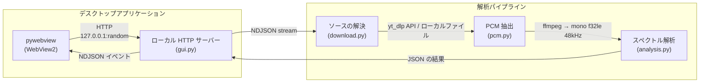

## 2. モジュール構成

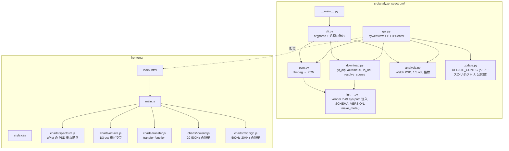

## 3. 解析パイプライン

### 3.1 データの流れ

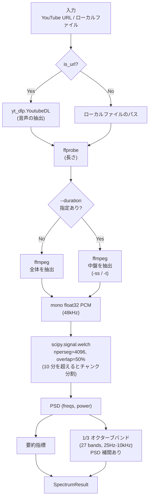

### 3.2 要約指標

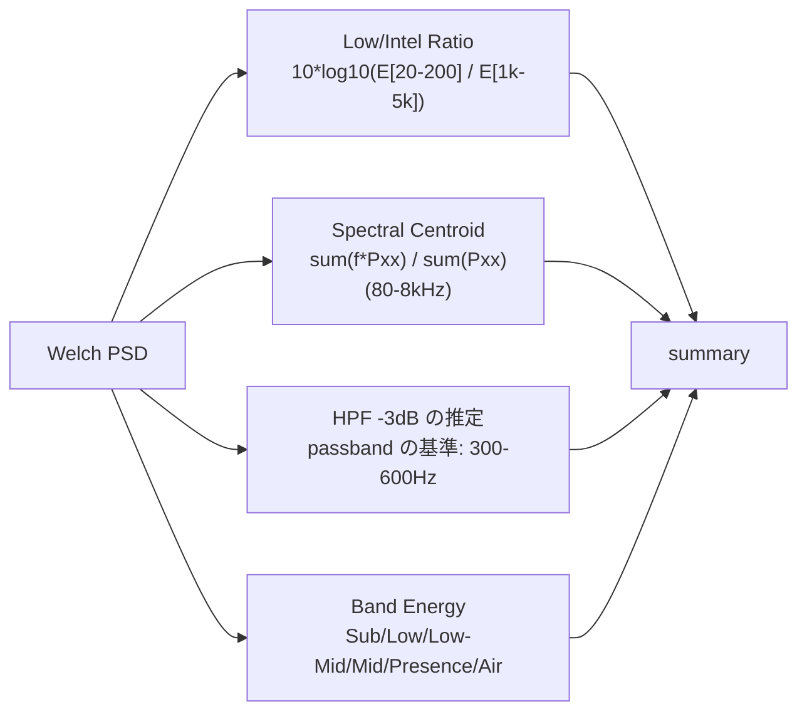

### 3.3 比較モード

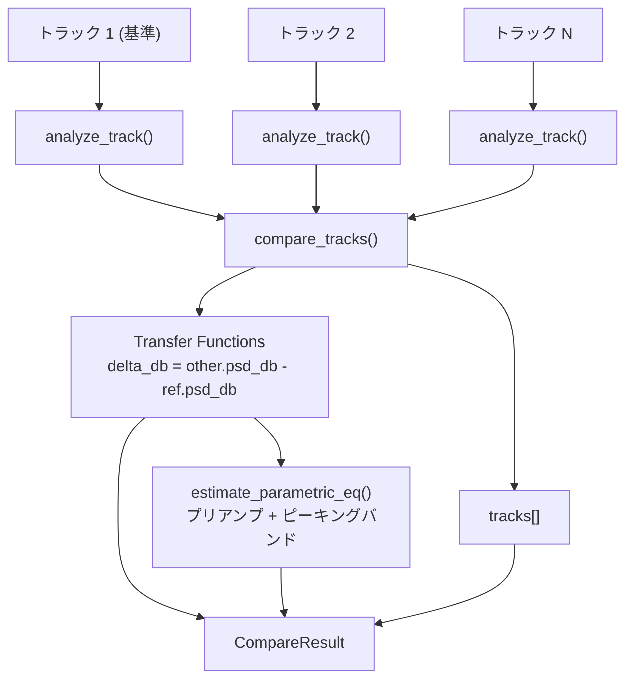

## 4. GUI アーキテクチャ

### 4.1 通信モデル

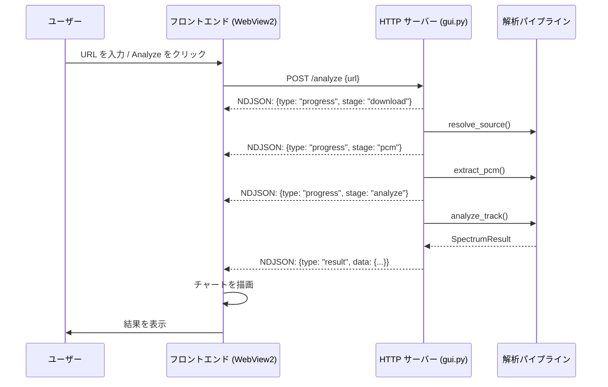

### 4.2 比較の流れ

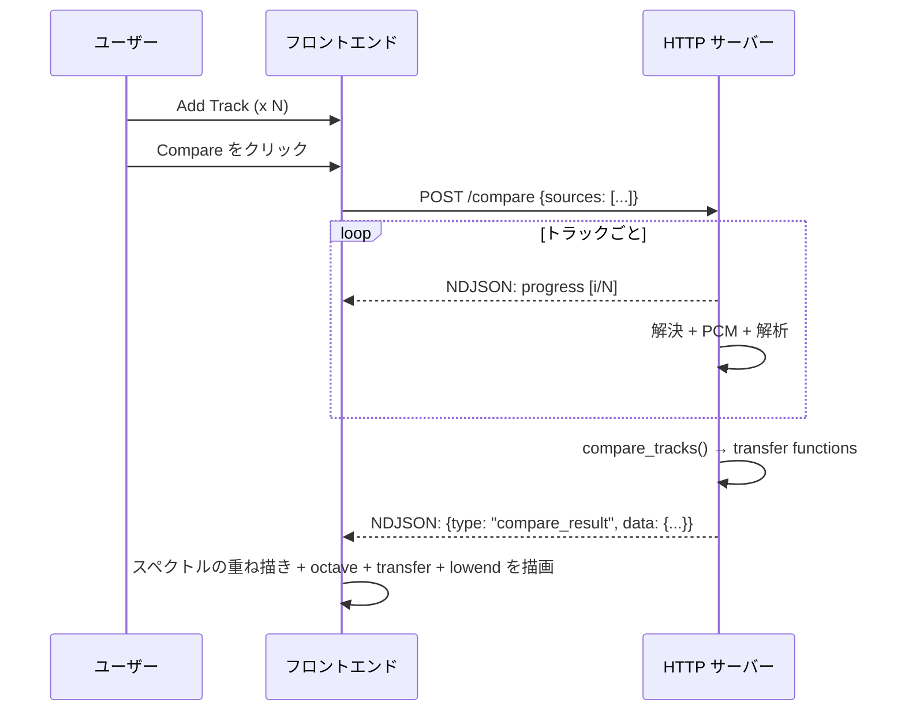

### 4.3 結果キャッシュ

セッション内キャッシュにより同一ソースの再解析を回避する。
キャッシュは `tempfile.mkdtemp()` に作成し、プロセス終了時に削除 (session-only)。

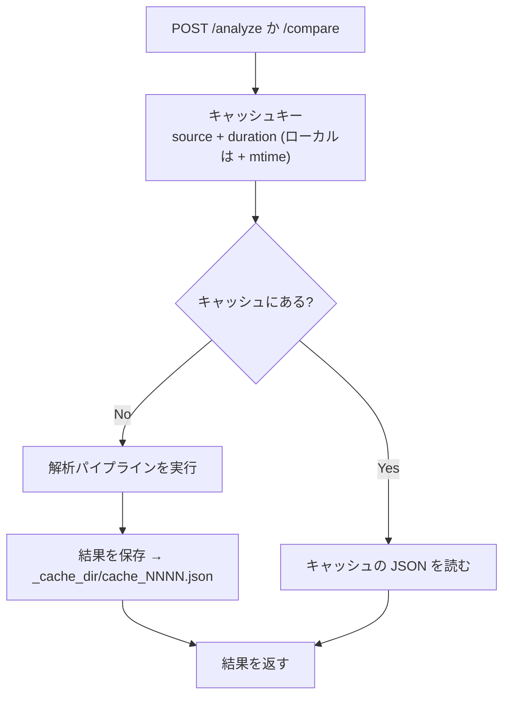

比較モードでは各トラックを個別にキャッシュ参照する:

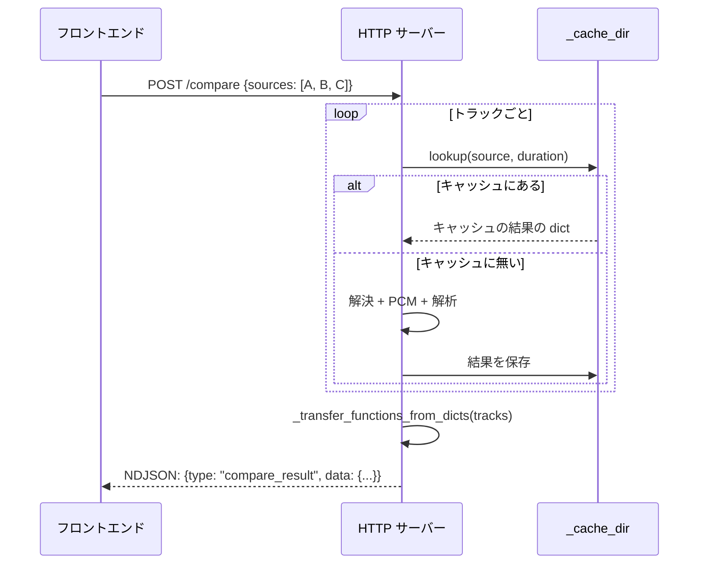

Save 最適化: `/save` に `source` + `duration` パラメータが含まれる場合、
キャッシュファイルを直接コピーし再シリアライズを回避する。

### 4.4 ファイルの入力方法

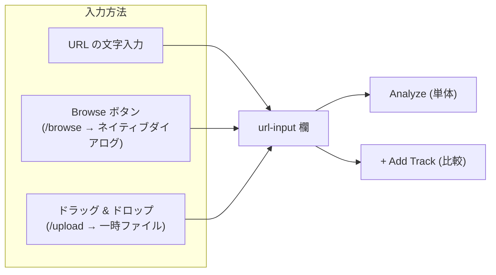

- **Browse**: `/browse` POST → pywebview `OPEN_DIALOG` → ファイルパスを返却
- **Drag & Drop**: `/upload` POST (octet-stream, X-Filename header) → 一時ディレクトリに保存 → パスを返却

### 4.5 フロントエンドの状態遷移

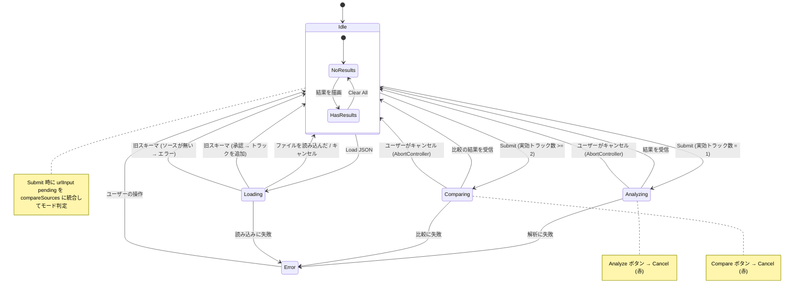

### 4.6 キャンセル (中断) の仕組み

処理中にユーザーが Cancel ボタンをクリックすると:

1. **Frontend**: `AbortController.abort()` → fetch の `signal` 経由でストリーム読み取り中断
2. **Backend**: 次の `_send_event()` 呼び出し時に `BrokenPipeError` を検知 → `_ClientDisconnected` 例外で処理ループを終了
3. **UI**: ステータスに "Cancelled." を表示、ボタンを Analyze / Compare に復帰

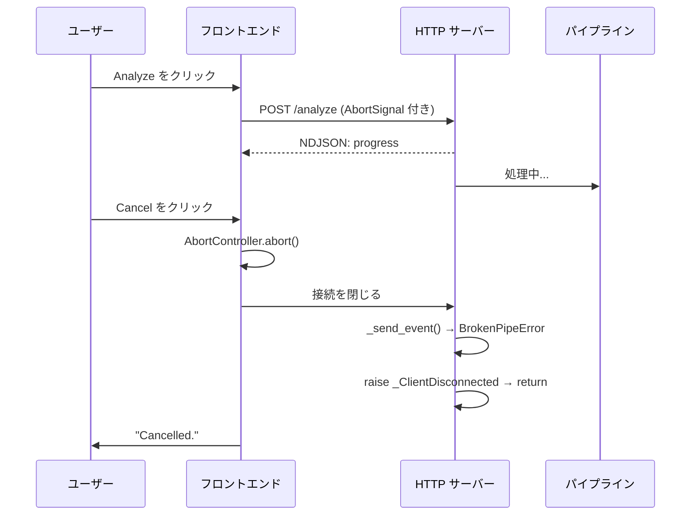

**キャンセル時の既知挙動** (既知の制限。キャンセルは `_send_event()` で検知する、[src/analyze_spectrum/gui.py:1034](https://github.com/semnil/analyze-spectrum/blob/b40e893132c4003ec4c86eff404c5d051c245267/src/analyze_spectrum/gui.py#L1034)):

キャンセルは次の NDJSON イベント送信タイミングでのみ検知される。
すなわち以下のような長時間ブロックする同期処理は、キャンセル後も
**そのステージが完了するまで継続**する:

- `ffmpeg` / `ffprobe` の子プロセス (`subprocess.run`) — プロセスに
  シグナルを送らないため、PCM 抽出・長さの取得が最後まで走る
- `scipy.signal.welch` / `resample_poly` — NumPy/SciPy の C ループは
  Python シグナルを受け取らない
- `yt_dlp.YoutubeDL.extract_info(download=True)` — 現在ダウンロード中の
  チャンクまで継続

キャンセル直後のユーザー体感は即座に "Cancelled." だが、バックグラウンドの
CPU / ネットワーク使用率はステージ完了まで残る。この挙動を改善するには
子プロセスに `Popen` + `terminate()` を介したキャンセル伝播を実装する
必要があり、複雑度とメモリ解放タイミングのトレードオフから現在は
採用していない。

### 4.7 テーマの仕組み

3 段階テーマ切替 (Light → Dark → Auto → Light):

- **Light**: 常にライトテーマ
- **Dark**: 常にダークテーマ
- **Auto**: OS の `prefers-color-scheme` に追従 (デフォルト)

CSS カスタムプロパティ (`--bg`, `--text`, `--accent` 等) で全色を管理。
Canvas チャートは `getThemeColors()` で描画時にテーマカラーを取得。
テーマ切替時はチャートを再描画。選択は言語の選択と一緒にアプリの設定ファイル (`settings.json`) に保存し、次の起動でも使う (読み込みは 10.4 の図、保存は `POST /settings`)。

### 4.8 自動更新

インストールしたアプリは、起動時 (設定ダイアログの「起動時に確認」が ON のとき) と設定ダイアログの「今すぐ確認」で、最新リリースに新しい版があるかを確かめる。
画面側 (設定ボタン・設定ダイアログ・確認ダイアログ) は py-analyze-common の `analyze_common/web/update.js`、取得・検証・適用は `analyze_common/update.py` が受け持ち、analyze-loudness と共通である。
このアプリが持つのは `src/analyze_spectrum/update.py` の `UPDATE_CONFIG`、`gui.py` の 4 つのエンドポイントと終了処理 (`_exit_for_update()`)、`main.js` のダウンロード中の操作の停止 (`_setUpdateLock()`) である。
署名の鍵と `release.yaml` の手順はプロジェクトの CLAUDE.md の「Auto-update」節にある。

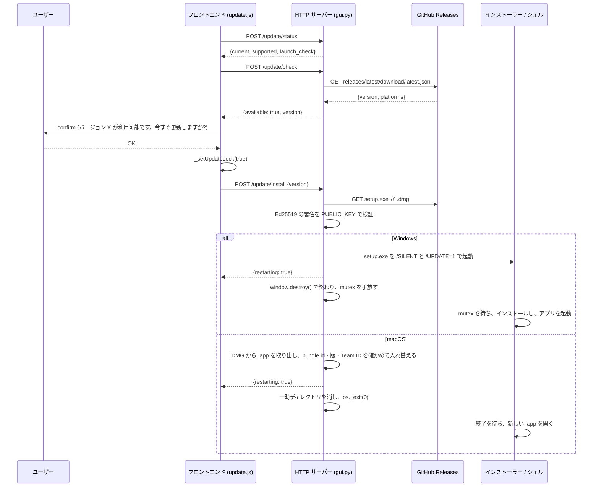

キャンセルすると何もダウンロードしない。起動時の確認は、新しい版が無いときと確認に失敗したときは何も表示しない (「今すぐ確認」はダイアログ内に結果を出す)。分析中は確認ダイアログを出さずに断る。
ダウンロード・検証・適用のどこかで失敗すると `_setUpdateLock(false)` で操作を戻し、ステータス欄に原因を出してアプリは動き続ける。
Windows では UAC の確認をインストーラーが出し、そのときアプリはもう終わっている。UAC を拒否するとインストールされず、アプリは閉じたままになる (もう一度起動すると旧版が起動し、起動時の確認が ON なら同じ更新をもう一度勧める)。

## 5. チャートの仕組み

### 5.1 チャートの種類

| チャート | ライブラリ | X 軸 | Y 軸 | モード |
|-------|---------|--------|--------|------|
| PSD Spectrum | uPlot | log(freq) Hz | Power dB | 単体 / 複数トラックの重ね描き |
| 1/3 Octave | Canvas | バンド中心 Hz | Energy dB | 単体 / グループ化した棒 |
| Transfer Function | Canvas | log(freq) Hz | Delta dB | 複数トラックのみ |
| Estimated EQ | HTML table | - | - | 複数トラックのみ (transfer function ごとに 1 表) |
| Low-End Detail | Canvas | 線形の周波数 20-500Hz | Power dB | 単体 / 複数トラックの重ね描き |
| Mid-High Detail | Canvas | log(freq) 500Hz-20kHz | Power dB | 単体 / 複数トラックの重ね描き |

### 5.2 チャートのデータの流れ

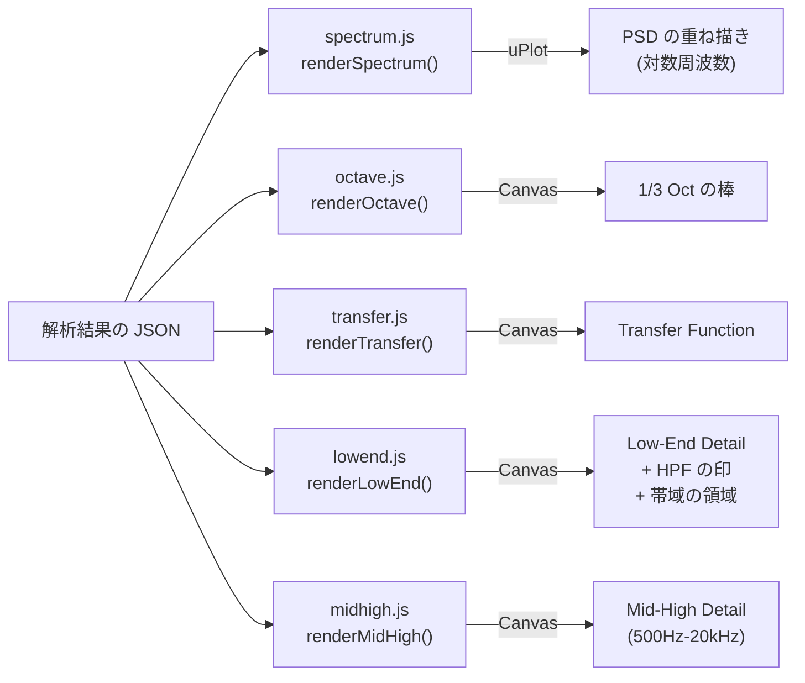

## 6. ビルドと配布

### 6.1 ビルドの流れ

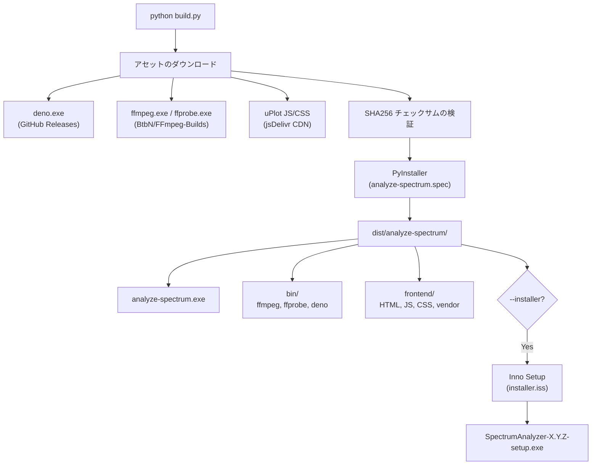

### 6.2 バンドルの構成

```
dist/analyze-spectrum/
├── analyze-spectrum.exe          # PyInstaller frozen app
├── bin/
│   ├── ffmpeg.exe
│   ├── ffprobe.exe
│   └── deno.exe
├── frontend/
│   ├── index.html
│   ├── main.js
│   ├── style.css
│   ├── charts/
│   │   ├── spectrum.js
│   │   ├── octave.js
│   │   ├── transfer.js
│   │   ├── lowend.js
│   │   └── midhigh.js
│   └── vendor/
│       ├── uPlot.iife.min.js
│       └── uPlot.min.css
├── THIRD_PARTY_LICENSES.txt
└── (Python runtime + dependencies)
```

## 7. セキュリティモデル

### 7.1 ネットワーク

- HTTP サーバーは `127.0.0.1` にバインド (外部アクセス不可)
- ポートはランダム割り当て (OS 指定)
- pywebview WebView2 の `AllowExternalDrop = False` で外部ドロップ無効化

### 7.2 入力検証

- subprocess は list 形式で実行 (shell injection 防止)
- yt-dlp は Python API (`yt_dlp.YoutubeDL`) 経由のため subprocess stdout のデコード不要。タイトルは `extract_info()` の戻り値 dict から取得 (DOM は `textContent` 経由で表示)
- POST body は 10MB 上限 (JSON)、50MB (base64 画像)、500MB (ファイルアップロード)
- アップロードファイル名は `sanitize_filename()` (定義は py-analyze-common の [analyze_common/download.py:22](https://github.com/semnil/py-analyze-common/blob/fab7f1f9845b90a1744a217cd8839b72b95109a7/src/analyze_common/download.py#L22)) で無害化 (`\/:*?"<>|` → `_`、先頭末尾の `.` 除去)
- アップロード拡張子はホワイトリスト (`.wav`, `.mp3`, `.m4a` 等 13 種)
- duration パラメータは正の数値のみ許可
- `/compare` の `sources` 配列は長さのみ検証 (要素の型チェックなし。非文字列は `resolve_source()` で実行時エラー)

### 7.3 XSS 防止

- フロントエンドの DOM 操作は `textContent` ベース (ユーザー入力の HTML 解釈なし)
- `showError()` は `innerHTML = ""` でクリア後、`textContent` で再設定
- `confirm()` に表示するメッセージはユーザー選択 JSON 由来のプレーンテキスト (ネイティブ OS ダイアログ、HTML 解釈なし)

### 7.4 ファイルシステム

- アップロード一時ファイルは `tempfile.mkdtemp` + `atexit` で自動削除
- キャッシュファイルは `tempfile.mkdtemp` + `atexit` で自動削除
- `/save` のキャッシュコピーは `shutil.copy2` (ネイティブダイアログで選択されたパスのみ)

### 7.5 ビルド・配布

- ビルド時アセット: uPlot と macOS の ffmpeg / ffprobe はリポジトリの SHA256 (`build_assets/checksums.json`、`build_assets/ffmpeg.json`) と照合する。Windows の ffmpeg / ffprobe (BtbN の `latest` にある固定した系列のビルド) と deno (最新リリース) は固定しない
- リリースのジョブは Python パッケージをハッシュで固定した `requirements/*.txt` からだけ入れ、Inno Setup と create-dmg は `release.yaml` の SHA256 と照合したアーカイブから入れる
- Frozen build は `_MEIPASS/bin` を `PATH` の先頭に置く
- 自動更新の取得物は Ed25519 の署名をアプリに組み込んだ公開鍵で検証してから適用する ([4.8](#48-自動更新))

### 7.6 既知の制限

- キャッシュ操作 (`_result_cache`, `_cache_seq`) はスレッドロック未保護 (CPython GIL に依存)
- `/upload` のファイル名衝突回避は TOCTOU パターン (単一ユーザーアプリとして許容)

## 8. 参照規格

| 規格 | 用途 |
|----------|-------|
| ANSI S3.5-1997 | SII の帯域重要度関数 (Low/Intel ratio) |
| IEC 60268-16:2020 | STI の参照 (明瞭度の帯域) |
| Upward spread of masking | 低域のマスキング解析の根拠 |

## 9. 設計メモ

### 9.1 低周波の 1/3 オクターブバンドの補間

Welch PSD (nperseg=4096, 48kHz) の周波数分解能は 11.72 Hz。
低周波の 1/3 オクターブバンドはバンド幅がこれより狭い:

| バンド中心 | バンド幅 | FFT ビン |
|-------------|-----------|----------|
| 25 Hz | 5.8 Hz | 0 |
| 31.5 Hz | 7.3 Hz | 0-1 |
| 40 Hz | 9.3 Hz | 0-1 |
| 50 Hz | 11.6 Hz | 1 |

バンド内に FFT ビンが存在しない場合、`np.interp` でバンド中心周波数の
PSD を補間し、帯域幅を掛けてエネルギーを推定する。

### 9.2 長い信号のチャンク分割 Welch PSD

scipy.signal.welch は内部でセグメント数 × 周波数ビンの中間配列を確保する。
長尺ファイル (例: 4 時間 → 350,058 セグメント × 2,049 ビン ≈ 5.3 GiB) では
メモリ不足となる。

10 分 (28,800,000 サンプル) 単位でチャンクに分割し、各チャンクの PSD を
平均して最終結果とする。周波数分解能は変わらない。

## 10. テストの構成

### 10.1 テスト構成

| ファイル | 種別 | 主な対象 |
|----------|------|----------|
| `tests/conftest.py` | fixture | 共有 WAV バイト生成 (`_make_wav_bytes`, `wav_file`, `wav_file_b`)、設定ファイルを一時フォルダーへ向ける `_isolated_settings` |
| `tests/test_analysis.py` | unit | 解析コア (Welch PSD, 1/3 oct, metrics) |
| `tests/test_pcm.py` | unit | ffmpeg → PCM 変換 |
| `tests/test_cli.py` | unit | argparse + CLI 統合 |
| `tests/test_gui.py` | unit | gui.py (モック使用)。更新のエンドポイント・`UPDATE_CONFIG`・テーマと言語の保存 (`/settings`、`/common/settings.js`、ウィンドウの背景色) を含む |
| `tests/test_integration.py` | integration | HTTPServer + 解析パイプライン |
| `tests/test_dialog_busy.py` | unit | ネイティブダイアログの排他 (`_dialog_lock`) |
| `tests/test_ffmpeg_binary.py` | integration | PATH の ffmpeg / ffprobe をアプリの PCM 変換と ffprobe の読み取りで確かめる (`EXPECT_FFMPEG_DIR` で同梱バイナリを指定) |
| `tests/test_release_workflow.py` | unit | `release.yaml` が配布物に入った ffmpeg / ffprobe に `test_ffmpeg_binary.py` を通すこと、書き込めるのは `create-release` だけでそこでは Python を動かさないこと、更新用の署名鍵を持つジョブは読み取り権限だけでハッシュで固定した yt-dlp だけを入れること、Developer ID の署名 ID を codesign の直前に取り込み、codesign の終わりに消すこと、リリースのジョブがパッケージを `requirements/*.txt` からだけ入れ、Inno Setup と create-dmg を SHA256 を照合してから入れること、`requirements/release.txt` が `pyproject.toml` を満たすこと |
| `tests/test_third_party_licenses.py` | unit | `THIRD_PARTY_LICENSES.txt` が指す GPL の全文と、それを同梱する spec / `installer.iss` |
| `tests/test_yt_dlp_ejs.py` | unit | 入っている yt-dlp-ejs の版 (major.minor) と台本のハッシュが、入っている yt-dlp の受け付けるものであること |
| `tests/test_frontend.py` | e2e | Playwright headless Chromium runner。実際の index.html で更新の確認・承認・失敗・設定の保存と、テーマと言語の保存・次の起動での復元を通す |
| `tests/frontend/test_ui.js` | browser | フロントエンド UI 状態テスト |

### 10.2 Integration テスト

`test_integration.py` は pywebview を使わず `HTTPServer` を直接起動し、
実解析パイプラインを通して各エンドポイントを検証する。

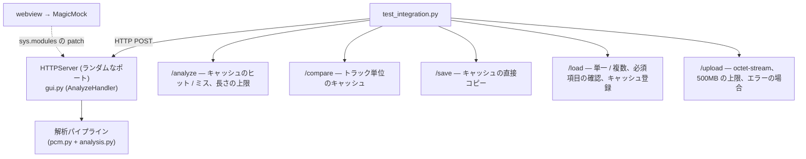

### 10.3 Frontend UI テスト

`test_frontend.py` は Playwright で headless Chromium を起動し、
`tests/frontend/test_ui.html` をローカル HTTP サーバー経由で開いて
`window._testResult` から合否を読み取る。

`test_ui.js` は fetch をモックして DOM 状態を直接検証する:

- トラック追加 / 削除
- 重複トラック拒否
- 6 トラック上限
- Load JSON (単一 / 複数 / 旧スキーマ承認・拒否) + 保留ソース保持
- テーマトグル (Light → Dark → Auto)
- Clear All
- setBusy ボタン状態
- Submit ラベル (urlInput 入力による動的更新含む)
- Submit 時の pending urlInput 統合 (NDJSON ストリームモック)
- Submit 時の 6 トラック上限拒否
- 1 トラック + urlInput 空での単体解析
- Remove Track 時の urlInput 値保持

`playwright>=1.40` が dev dependency として追加されている。

### 10.4 ホワイトフラッシュ防止

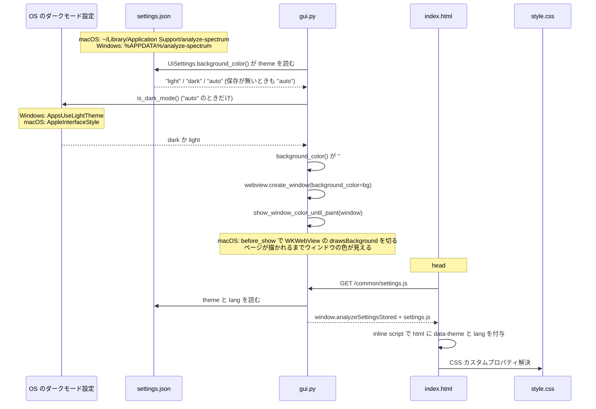

## 11. 既知の制約

- 比較は最大 6 トラック (チャートの可読性)
- リアルタイム入力 (マイク) は対象外
- 48kHz mono float32 = 192 KB/s → 10 分で約 115 MB (メモリ制約)
- 長尺は `--duration` で中盤抽出で対処
