# Architecture Document

> 日本語版は [architecture.ja.md](architecture.ja.md) を参照してください.

## 1. System Overview

analyze-spectrum is a desktop tool that analyzes the frequency spectrum of a YouTube video or a local audio file
and verifies whether EQ processing is appropriate.

It is built from pywebview (WebView2) + a local HTTP server,
the same architecture as its sister tool analyze-loudness.

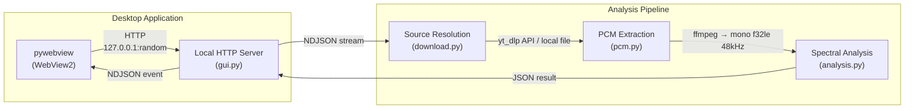

## 2. Module Structure

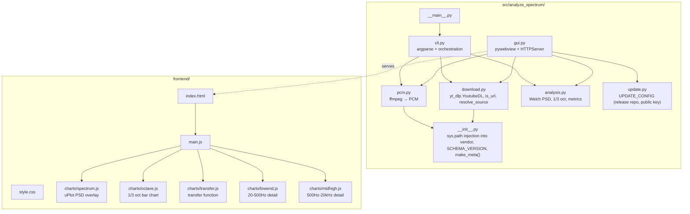

## 3. Analysis Pipeline

### 3.1 Data Flow

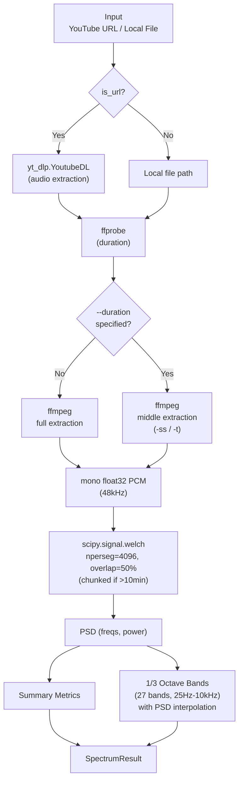

### 3.2 Summary Metrics

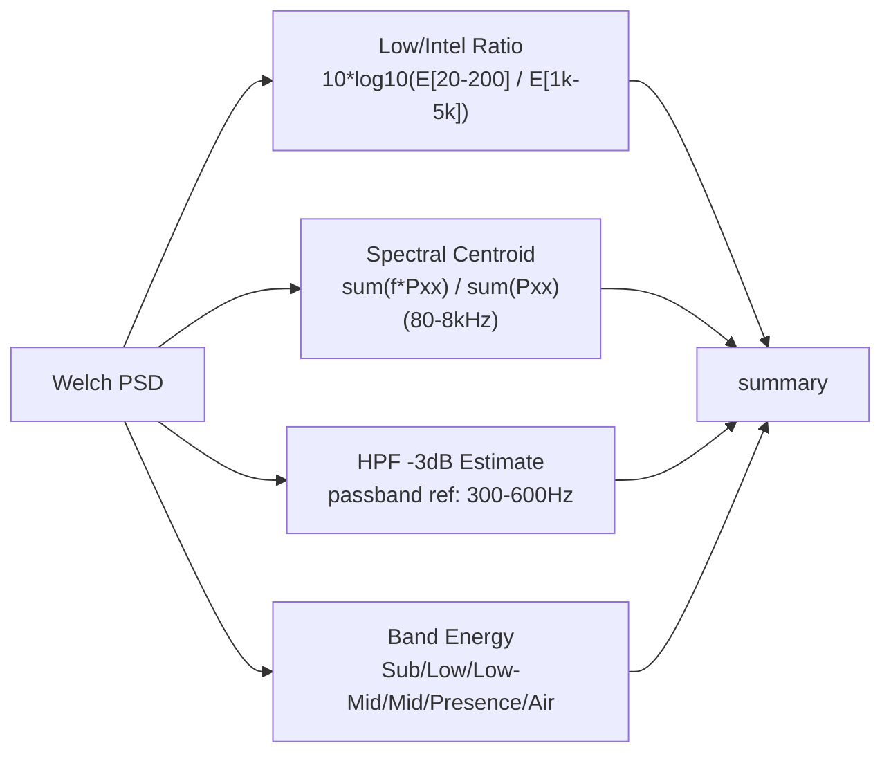

### 3.3 Comparison Mode

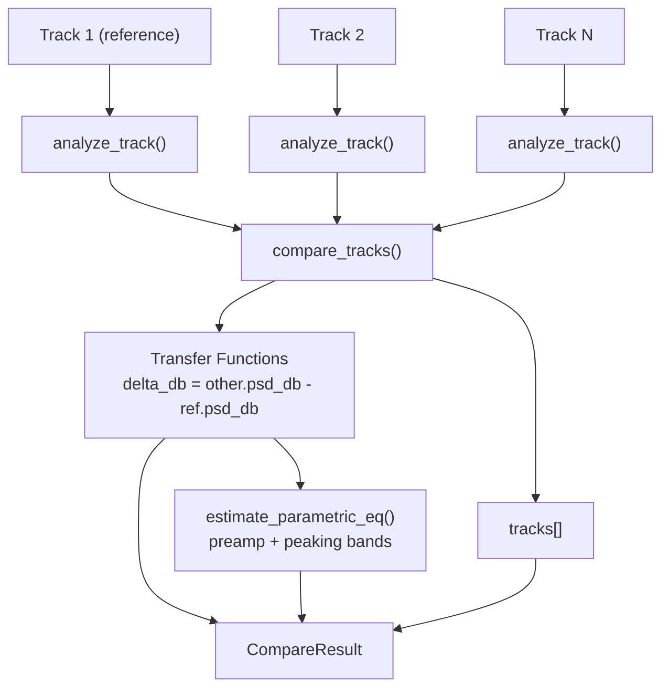

## 4. GUI Architecture

### 4.1 Communication Model

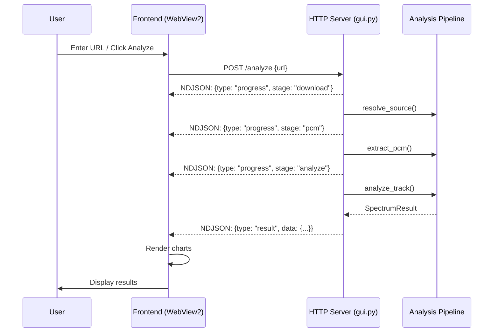

### 4.2 Compare Flow

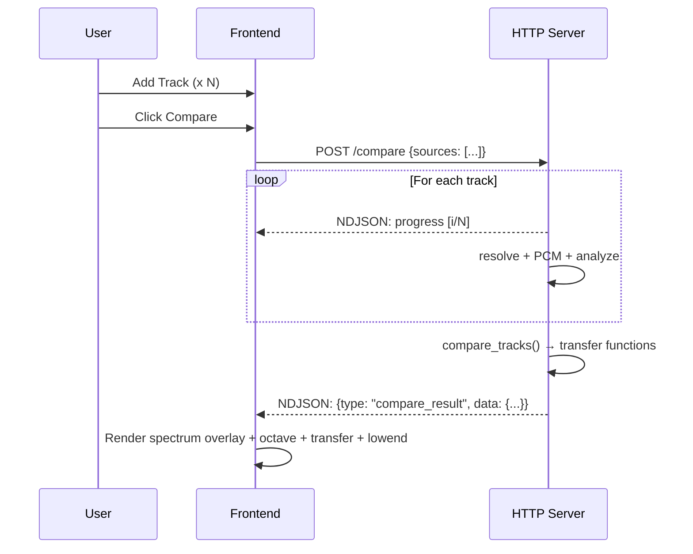

### 4.3 Result Cache

A session-scoped cache avoids re-analyzing the same source.
The cache is created with `tempfile.mkdtemp()` and deleted when the process exits (session-only).

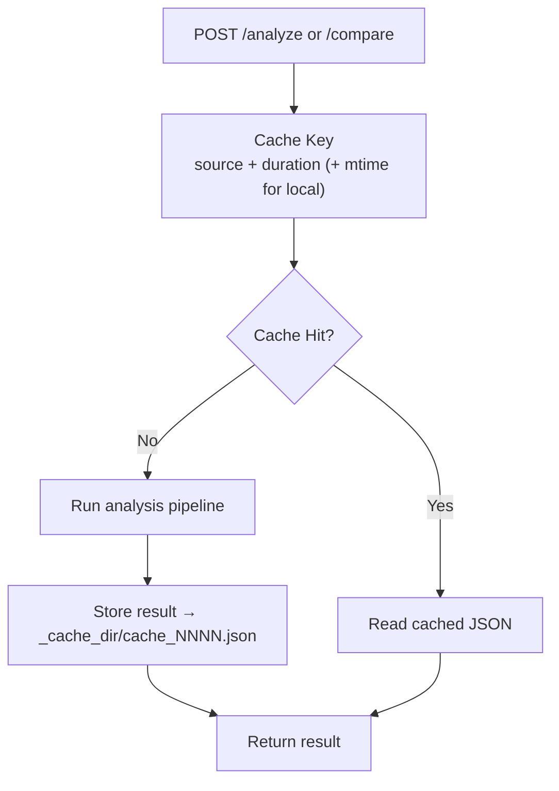

In comparison mode, each track is looked up in the cache individually:

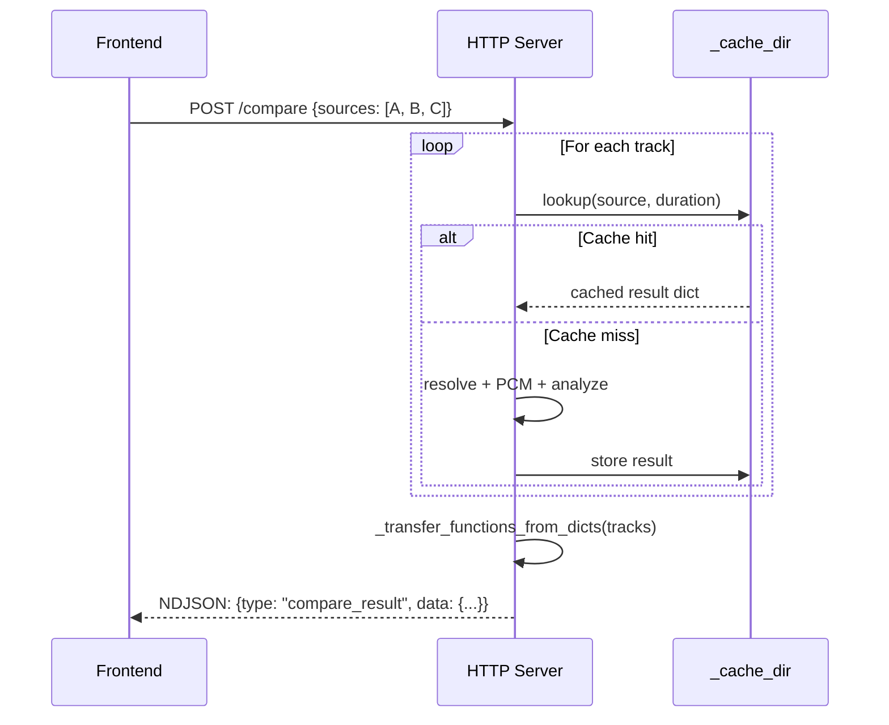

Save optimization: when `/save` includes the `source` + `duration` parameters,
it copies the cache file directly and avoids re-serializing.

### 4.4 File Input Methods

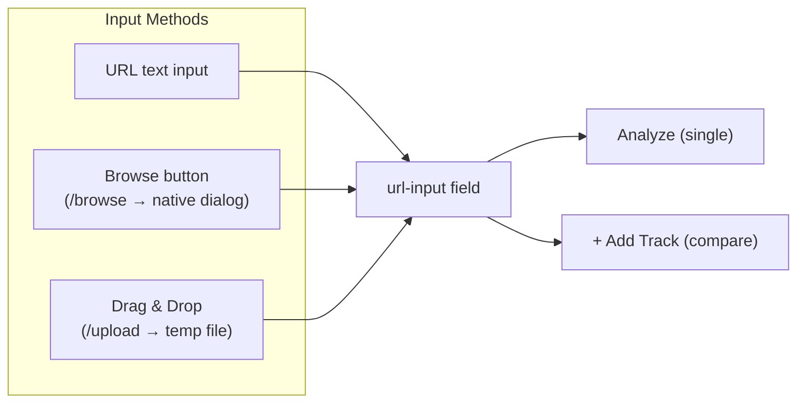

- **Browse**: `/browse` POST → pywebview `OPEN_DIALOG` → returns the file path
- **Drag & Drop**: `/upload` POST (octet-stream, X-Filename header) → saved in a temporary directory → returns the path

### 4.5 Frontend State Machine

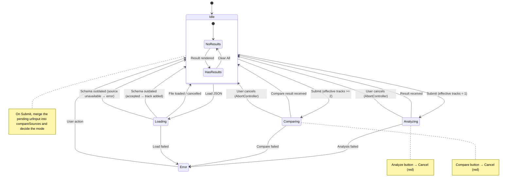

### 4.6 Cancel (Abort) Mechanism

When the user clicks the Cancel button during processing:

1. **Frontend**: `AbortController.abort()` → the stream read is aborted through fetch's `signal`
2. **Backend**: detects `BrokenPipeError` on the next `_send_event()` call → ends the processing loop with the `_ClientDisconnected` exception
3. **UI**: shows "Cancelled." in the status and puts the button back to Analyze / Compare

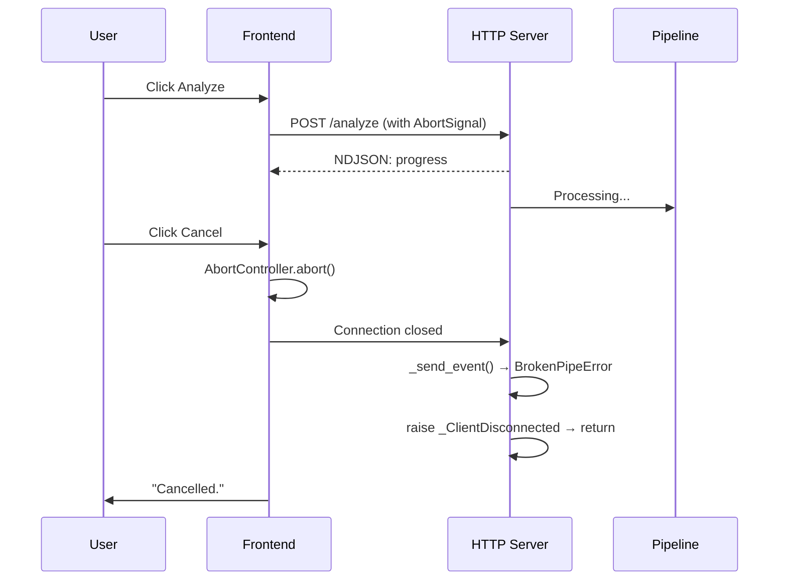

**Known behavior on cancel** (a known limitation; the cancel is detected in `_send_event()`, [src/analyze_spectrum/gui.py:1034](https://github.com/semnil/analyze-spectrum/blob/b40e893132c4003ec4c86eff404c5d051c245267/src/analyze_spectrum/gui.py#L1034)):

A cancel is detected only when the next NDJSON event is sent.
That is, long-blocking synchronous work like the following
**keeps running until that stage finishes** even after a cancel:

- `ffmpeg` / `ffprobe` child processes (`subprocess.run`) — no signal is
  sent to the process, so PCM extraction and getting the duration run to the end
- `scipy.signal.welch` / `resample_poly` — NumPy/SciPy's C loops do not
  receive Python signals
- `yt_dlp.YoutubeDL.extract_info(download=True)` — continues up to the
  chunk currently being downloaded

Right after a cancel the user immediately sees "Cancelled.", but background
CPU / network usage remains until the stage finishes. Improving this behavior would
require implementing cancel propagation to the child processes through `Popen` + `terminate()`,
and it is currently not adopted because of the trade-off between complexity and
when memory is released.

### 4.7 Theme System

A 3-way theme switch (Light → Dark → Auto → Light):

- **Light**: always the light theme
- **Dark**: always the dark theme
- **Auto**: follows the OS's `prefers-color-scheme` (default)

All colors are managed with CSS custom properties (`--bg`, `--text`, `--accent`, etc.).
The Canvas charts get the theme colors with `getThemeColors()` when drawing.
The charts are redrawn when the theme is switched. The choice is saved together with the language choice in the app's settings file (`settings.json`) and is used on the next launch too (reading is in the 10.4 diagram, saving is `POST /settings`).

### 4.8 Auto-Update

The installed app checks whether the latest release has a newer version at launch (when "Check at launch" in the settings dialog is ON) and from "Check now" in the settings dialog.
The screen side (the settings button, the settings dialog, the confirmation dialog) is handled by py-analyze-common's `analyze_common/web/update.js`, and fetching, verifying and applying by `analyze_common/update.py`; both are shared with analyze-loudness.
What this app owns is `UPDATE_CONFIG` in `src/analyze_spectrum/update.py`, the 4 endpoints and the exit handling (`_exit_for_update()`) in `gui.py`, and stopping operations during the download (`_setUpdateLock()`) in `main.js`.
The signing key and the `release.yaml` procedure are in the "Auto-update" section of the project's CLAUDE.md.

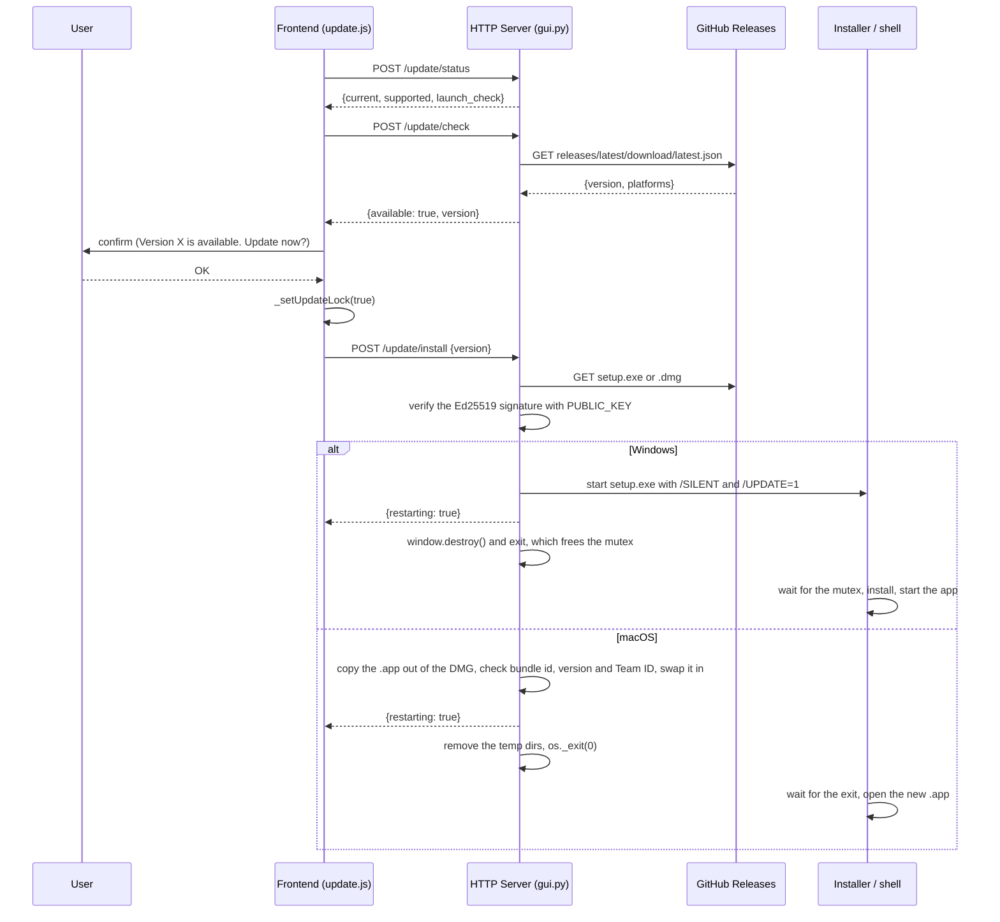

Cancel downloads nothing. The check at launch shows nothing when there is no newer version or when the check fails ("Check now" shows the result inside the dialog). During an analysis it declines without showing the confirmation dialog.
When any of the download, verification or apply fails, `_setUpdateLock(false)` gives the operations back, the status area shows the cause, and the app keeps running.
On Windows the installer shows the UAC prompt, and by then the app has already exited. If UAC is declined, nothing is installed and the app stays closed (launching it again starts the old version, and if the check at launch is ON it offers the same update again).

## 5. Chart System

### 5.1 Chart Types

| Chart | Library | X-axis | Y-axis | Mode |
|-------|---------|--------|--------|------|
| PSD Spectrum | uPlot | log(freq) Hz | Power dB | Single / Multi-track overlay |
| 1/3 Octave | Canvas | Band center Hz | Energy dB | Single / Grouped bars |
| Transfer Function | Canvas | log(freq) Hz | Delta dB | Multi-track only |
| Estimated EQ | HTML table | - | - | Multi-track only (1 table per transfer function) |
| Low-End Detail | Canvas | Linear freq 20-500Hz | Power dB | Single / Multi-track overlay |
| Mid-High Detail | Canvas | log(freq) 500Hz-20kHz | Power dB | Single / Multi-track overlay |

### 5.2 Chart Data Flow

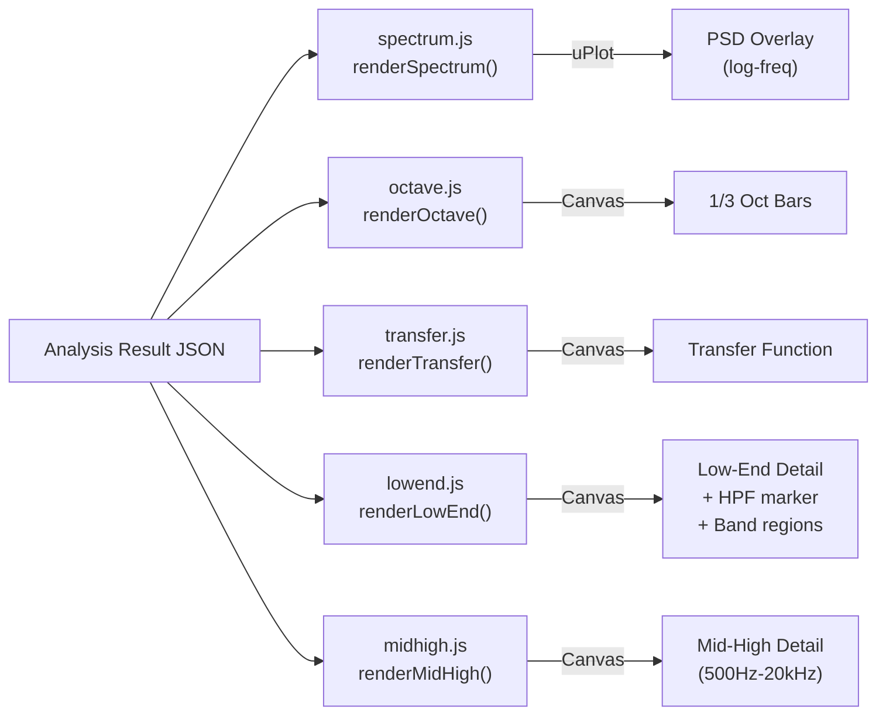

## 6. Build & Distribution

### 6.1 Build Pipeline

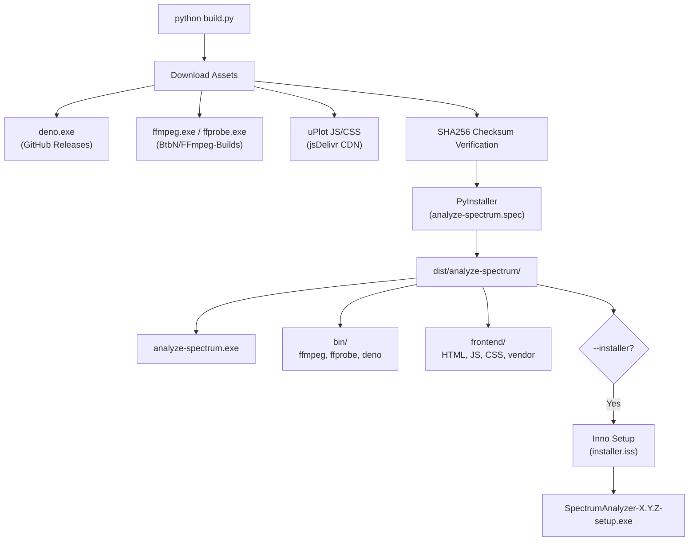

### 6.2 Bundle Structure

```
dist/analyze-spectrum/
├── analyze-spectrum.exe          # PyInstaller frozen app
├── bin/
│   ├── ffmpeg.exe
│   ├── ffprobe.exe
│   └── deno.exe
├── frontend/
│   ├── index.html
│   ├── main.js
│   ├── style.css
│   ├── charts/
│   │   ├── spectrum.js
│   │   ├── octave.js
│   │   ├── transfer.js
│   │   ├── lowend.js
│   │   └── midhigh.js
│   └── vendor/
│       ├── uPlot.iife.min.js
│       └── uPlot.min.css
├── THIRD_PARTY_LICENSES.txt
└── (Python runtime + dependencies)
```

## 7. Security Model

### 7.1 Network

- The HTTP server binds to `127.0.0.1` (no external access)
- The port is assigned at random (chosen by the OS)
- External drops are disabled with pywebview WebView2's `AllowExternalDrop = False`

### 7.2 Input Validation

- subprocess is run in list form (prevents shell injection)
- yt-dlp goes through the Python API (`yt_dlp.YoutubeDL`), so no subprocess stdout decoding is needed. The title is taken from the dict returned by `extract_info()` (the DOM shows it through `textContent`)
- POST bodies are limited to 10MB (JSON), 50MB (base64 image), 500MB (file upload)
- Upload file names are made harmless with `sanitize_filename()` (defined in py-analyze-common's [analyze_common/download.py:22](https://github.com/semnil/py-analyze-common/blob/fab7f1f9845b90a1744a217cd8839b72b95109a7/src/analyze_common/download.py#L22)) (`\/:*?"<>|` → `_`, leading and trailing `.` removed)
- Upload extensions are on an allowlist (13 kinds such as `.wav`, `.mp3`, `.m4a`)
- The duration parameter accepts only positive numbers
- The `sources` array of `/compare` is validated only for its length (no type check of the elements; a non-string is a runtime error in `resolve_source()`)

### 7.3 XSS Prevention

- The frontend's DOM operations are based on `textContent` (no HTML interpretation of user input)
- `showError()` clears with `innerHTML = ""` and then sets it again with `textContent`
- The message shown in `confirm()` is plain text from the JSON the user chose (a native OS dialog, no HTML interpretation)

### 7.4 File System

- Temporary upload files are deleted automatically with `tempfile.mkdtemp` + `atexit`
- Cache files are deleted automatically with `tempfile.mkdtemp` + `atexit`
- The cache copy of `/save` uses `shutil.copy2` (only to a path chosen in the native dialog)

### 7.5 Build and Distribution

- Build-time assets: uPlot and the macOS ffmpeg / ffprobe are checked against SHA256 values in the repository (`build_assets/checksums.json`, `build_assets/ffmpeg.json`). The Windows ffmpeg / ffprobe (the pinned series' build in BtbN's `latest`) and deno (its latest release) are not pinned
- The release jobs install Python packages only from the hash-pinned `requirements/*.txt`, and Inno Setup / create-dmg from archives checked against SHA256 in `release.yaml`
- The frozen build puts `_MEIPASS/bin` at the front of `PATH`
- What auto-update fetches is applied only after its Ed25519 signature is verified with the public key built into the app ([4.8](#48-auto-update))

### 7.6 Known Limitations

- Cache operations (`_result_cache`, `_cache_seq`) are not protected by a thread lock (relies on the CPython GIL)
- Avoiding upload file name collisions in `/upload` is a TOCTOU pattern (accepted for a single-user app)

## 8. Reference Standards

| Standard | Usage |
|----------|-------|
| ANSI S3.5-1997 | SII band importance function (Low/Intel ratio) |
| IEC 60268-16:2020 | STI reference (intelligibility bands) |
| Upward spread of masking | Low-end masking analysis rationale |

## 9. Design Notes

### 9.1 Low-Frequency 1/3 Octave Band Interpolation

The frequency resolution of the Welch PSD (nperseg=4096, 48kHz) is 11.72 Hz.
The low-frequency 1/3-octave bands are narrower than that:

| Band Center | Band Width | FFT bins |
|-------------|-----------|----------|
| 25 Hz | 5.8 Hz | 0 |
| 31.5 Hz | 7.3 Hz | 0-1 |
| 40 Hz | 9.3 Hz | 0-1 |
| 50 Hz | 11.6 Hz | 1 |

When a band contains no FFT bin, `np.interp` interpolates the PSD at the band's center
frequency, and the energy is estimated by multiplying it by the bandwidth.

### 9.2 Chunked Welch PSD for Long Signals

scipy.signal.welch internally allocates an intermediate array of segments × frequency bins.
For a long file (for example 4 hours → 350,058 segments × 2,049 bins ≈ 5.3 GiB)
it runs out of memory.

The signal is split into chunks of 10 minutes (28,800,000 samples), and the PSDs of the chunks
are averaged into the final result. The frequency resolution does not change.

## 10. Test Architecture

### 10.1 Test Layout

| File | Kind | Main target |
|----------|------|----------|
| `tests/conftest.py` | fixture | Shared WAV byte generation (`_make_wav_bytes`, `wav_file`, `wav_file_b`), and `_isolated_settings`, which points the settings file at a temporary folder |
| `tests/test_analysis.py` | unit | The analysis core (Welch PSD, 1/3 oct, metrics) |
| `tests/test_pcm.py` | unit | ffmpeg → PCM conversion |
| `tests/test_cli.py` | unit | argparse + CLI integration |
| `tests/test_gui.py` | unit | gui.py (with mocks). Includes the update endpoints, `UPDATE_CONFIG`, and saving the theme and language (`/settings`, `/common/settings.js`, the window's background color) |
| `tests/test_integration.py` | integration | HTTPServer + the analysis pipeline |
| `tests/test_dialog_busy.py` | unit | Mutual exclusion of native dialogs (`_dialog_lock`) |
| `tests/test_ffmpeg_binary.py` | integration | Checks the ffmpeg / ffprobe on PATH with the app's PCM conversion and ffprobe reading (`EXPECT_FFMPEG_DIR` selects the bundled binaries) |
| `tests/test_release_workflow.py` | unit | That `release.yaml` runs `test_ffmpeg_binary.py` on the ffmpeg / ffprobe in the distributed files, that only `create-release` can write and it runs no Python, that the job holding the update signing key has a read-only token and installs only the hash-pinned yt-dlp, that the Developer ID identity is imported right before codesign and deleted when codesign ends, that the release jobs install packages only from `requirements/*.txt` and Inno Setup / create-dmg only after a SHA256 check, that `requirements/release.txt` satisfies `pyproject.toml`, and that every `requirements/*.txt` resolves, with its own pins as constraints, to exactly the packages it pins under the same environment markers (the tests are py-analyze-common's `analyze_common.testing.release_workflow`) |
| `tests/test_third_party_licenses.py` | unit | The full GPL texts that `THIRD_PARTY_LICENSES.txt` points at, and the spec / `installer.iss` that bundle them (`analyze_common.testing.third_party_licenses`) |
| `tests/test_yt_dlp_ejs.py` | unit | That the installed yt-dlp-ejs has the version (major.minor) and the script hashes the installed yt-dlp accepts (`analyze_common.testing.yt_dlp_ejs`) |
| `tests/test_frontend.py` | e2e | Playwright headless Chromium runner. Runs the update check, approval, failure and settings save, and saving the theme and language and restoring them on the next launch, on the actual index.html |
| `tests/frontend/test_ui.js` | browser | Frontend UI state tests |
| `tests/js_coverage.py` | tool | With `--js-coverage=PATH`, the V8 coverage of `frontend/*.js` that the Playwright tests run, written as LCOV |
| `tests/test_js_coverage.py` | unit | `js_coverage.py`: matching V8 ranges to lines, and the LCOV it writes |

### 10.2 Integration Tests

`test_integration.py` starts `HTTPServer` directly without pywebview
and verifies each endpoint through the real analysis pipeline.

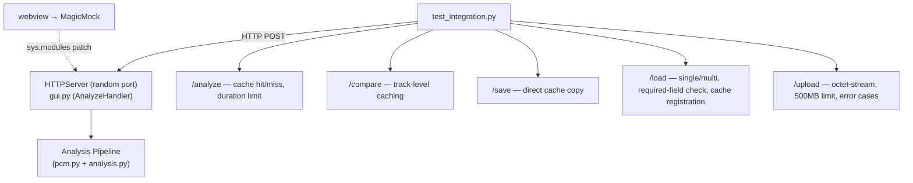

### 10.3 Frontend UI Tests

`test_frontend.py` starts headless Chromium with Playwright,
opens `tests/frontend/test_ui.html` through a local HTTP server,
and reads the result from `window._testResult`.

`test_ui.js` mocks fetch and verifies the DOM state directly:

- Adding / removing tracks
- Rejecting duplicate tracks
- The 6-track limit
- Load JSON (single / multiple / accepting and rejecting an old schema) + keeping the pending source
- The theme toggle (Light → Dark → Auto)
- Clear All
- The setBusy button state
- The Submit label (including the dynamic update from urlInput input)
- Merging the pending urlInput on Submit (NDJSON stream mock)
- Rejecting the 6-track limit on Submit
- Single analysis with 1 track + an empty urlInput
- Keeping the urlInput value on Remove Track

`playwright>=1.40` is added as a dev dependency.

With `--js-coverage=PATH`, `tests/js_coverage.py` records the line coverage of `frontend/*.js` (outside `frontend/vendor/`) on every Chromium page these tests open, and writes it as LCOV. CI uploads it to Codecov with the Python coverage.

### 10.4 White-Flash Prevention

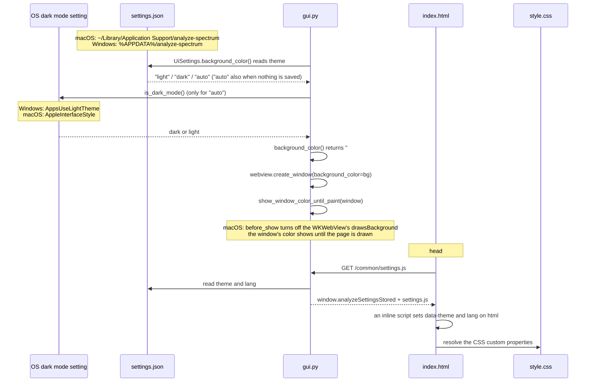

## 11. Known Limitations

- Comparison is limited to 6 tracks (chart readability)
- Real-time input (microphone) is out of scope
- 48kHz mono float32 = 192 KB/s → about 115 MB for 10 minutes (memory constraint)
- Long files are handled by extracting the middle with `--duration`
