# Architecture

> 日本語版は [architecture.ja.md](architecture.ja.md) を参照してください.

## Overview

analyze-spectrum is a desktop tool that analyzes the frequency spectrum of a YouTube video or a local audio file
and verifies whether equalizer (EQ) processing is appropriate.
It runs as a command-line interface (CLI) tool and as a Windows / macOS graphical user interface (GUI) application.

The GUI is built from pywebview (WebView2 / WebKit) + a local Hypertext Transfer Protocol (HTTP) server, which streams its progress and result as newline-delimited JavaScript Object Notation (JSON) lines (NDJSON).
It shares py-analyze-common (`vendor/py-analyze-common`) with its sister tool analyze-loudness.
The audio of a Uniform Resource Locator (URL) comes from yt-dlp's Python application programming interface (API), and ffmpeg turns every source into pulse-code modulation (PCM) samples.

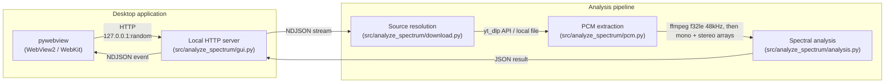

## Modules

`src/analyze_spectrum/analysis.py` computes the power spectral density (PSD) with Welch's method.

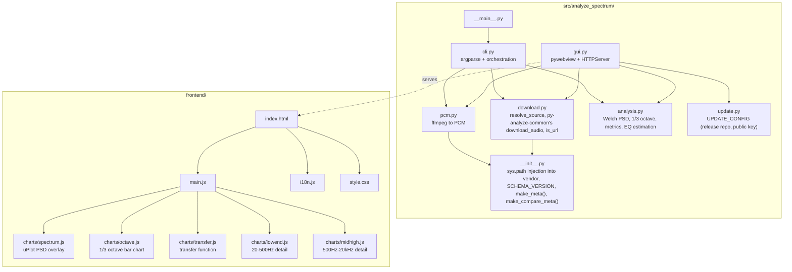

## Directory layout

```mermaid
graph LR
    root["analyze-spectrum/"]
    root --> wf[".github/workflows/"]
    wf --> wf_ci["ci.yaml<br>PR / push<br>runs pytest with the coverage of the Python package and of frontend/*.js and uploads both to Codecov<br>caches the apt package files and the Playwright browsers, saved only by the runs that are not PRs"]
    wf --> wf_rel["release.yaml<br>v* tag / workflow_dispatch on a tag"]
    wf --> wf_tag["tag-release.yml<br>after CI succeeds on a push to master, or on a workflow_dispatch given a commit: if it is a version bump, tags that commit and starts release.yaml"]
    wf --> wf_ffw["ffmpeg-watch.yml<br>daily, detects a new ffmpeg on osxexperts.net, and creates PRs for the pinned-value update and the version bump<br>with a GitHub App's token and merges them without review<br>when detect cannot connect, dispatches itself to run detect again on another runner, up to 3 attempts"]
    wf --> wf_chk["workflow-checks.yml<br>on every PR, checks the SHA pinning of uses: and the same-repository reference rules"]
    wf --> wf_chkt["workflow-checks-test.yml<br>runs the check's fixture tests, and the tests of dependabot-auto-merge.yml's<br>trigger, conditions and auto-merge decision, tag-release.yml's tag stage and ffmpeg-watch.yml's land stage and retry of detect"]
    wf --> wf_dam["dependabot-auto-merge.yml<br>on a Dependabot PR that is one commit at the head, written by Dependabot alone, committed by GitHub (web-flow) and with a verified signature, schedules an auto-merge for an update of the Python dependencies (uv) or of the submodule,<br>and for a semver patch or minor update of a GitHub Action. Required check auto-merge"]
    root --> ght[".github/tests/"]
    ght --> ght_sh["workflow-checks-test.sh<br>a test that runs workflow-checks.yml with a fake gh and fixture git trees"]
    ght --> ght_am["dependabot-auto-merge-test.sh<br>a test that dependabot-auto-merge.yml runs on every PR, with only its stages limited to Dependabot PRs,<br>and of which updates and commits (their authors, how many, whether the last is the head, who committed it, whether its signature is verified)<br>its stage schedules or turns off an auto-merge for, with a fake gh"]
    ght --> ght_tag["tag-release-test.sh<br>a test that runs tag-release.yml's check and tag stages with a fake gh and a fixture repository"]
    ght --> ght_land["ffmpeg-watch-land-test.sh<br>a test that runs ffmpeg-watch.yml's land stage with a fake gh that answers by the token of each call and a fixture repository,<br>its detect step with a fake CLI, and the dispatch of the next attempt of detect"]
    root --> r_dep[".github/dependabot.yml<br>version updates every day at 00:00 JST of the GitHub Actions, the py-analyze-common submodule<br>(without Dependabot's default three-day cooldown) and the Python dependencies (uv;<br>yt-dlp and yt-dlp-ejs in one pull request, pyobjc-core and pyobjc-framework-* in another)"]
    root --> r_claude["AGENTS.md"]
    root --> r_readme["README.md"]
    root --> r_readme_ja["README.ja.md"]
    root --> r_pyproj["pyproject.toml"]
    root --> req["requirements/<br>release.txt, release-build.txt, sign-manifest.txt: the hash-pinned packages the release jobs install,<br>generated by uv from pyproject.toml and the .in files (Pinned release dependencies)"]
    root --> src["src/analyze_spectrum/"]
    src --> src_init["__init__.py<br>sys.path injection into vendor, SCHEMA_VERSION, make_meta(), make_compare_meta()"]
    src --> src_main["__main__.py"]
    src --> src_ana["analysis.py<br>the spectral analysis itself"]
    src --> src_cli["cli.py<br>argparse and the CLI flow"]
    src --> src_gui["gui.py<br>pywebview and the local HTTP server"]
    src --> src_dl["download.py<br>yt_dlp.YoutubeDL API, getting the duration with ffprobe"]
    src --> src_pcm["pcm.py<br>PCM conversion with ffmpeg (mono + stereo)"]
    src --> src_upd["update.py<br>UPDATE_CONFIG, which represents this app in auto-update (public key, mutex name)"]
    root --> fe["frontend/"]
    fe --> fe_idx["index.html"]
    fe --> fe_main["main.js<br>fetch, NDJSON progress, DOM rendering, theme switching"]
    fe --> fe_i18n["i18n.js<br>the en/ja DICT, which py-analyze-common's /common/i18n.js turns into window.i18n.t / setLang"]
    fe --> fe_css["style.css"]
    fe --> ch["charts/"]
    ch --> ch_spec["spectrum.js<br>PSD overlay (log frequency, multiple tracks)"]
    ch --> ch_oct["octave.js<br>1/3-octave grouped bar chart"]
    ch --> ch_tf["transfer.js<br>transfer function (Δ dB)"]
    ch --> ch_low["lowend.js<br>low-end detail (20-500Hz, linear)"]
    ch --> ch_mh["midhigh.js<br>mid-high detail (500Hz-20kHz, log)"]
    fe --> fe_vendor["vendor/<br>uPlot (bundled)"]
    root --> t["tests/"]
    t --> t_init["__init__.py"]
    t --> t_conf["conftest.py<br>shared WAV fixtures (_make_wav_bytes, wav_file, wav_file_b),<br>_isolated_settings, which points the settings file at a temporary folder,<br>and points py-analyze-common's analyze_common.testing at this repository and package"]
    t --> t_ana["test_analysis.py"]
    t --> t_pcm["test_pcm.py"]
    t --> t_cli["test_cli.py"]
    t --> t_gui["test_gui.py"]
    t --> t_int["test_integration.py<br>HTTP integration tests (real HTTPServer, no pywebview)"]
    t --> t_cache["test_cache_failures.py<br>cache fallback and failed analyses through the real HTTP handler"]
    t --> t_dlg["test_dialog_busy.py<br>mutual exclusion of native dialogs (_dialog_lock)"]
    t --> t_ffb["test_ffmpeg_binary.py<br>checks the ffmpeg / ffprobe on PATH with the app's PCM conversion and ffprobe reading<br>(EXPECT_FFMPEG_DIR selects the bundled binaries)"]
    t --> t_rwf["test_release_workflow.py<br>that release.yaml runs test_ffmpeg_binary.py on the ffmpeg / ffprobe in the distributed files,<br>that only create-release can write and it runs no Python, that the job holding the update signing key<br>has a read-only token and installs only the hash-pinned yt-dlp, that the Developer ID identity<br>is imported right before codesign and deleted when codesign ends, that the release jobs install<br>packages only from requirements/*.txt and build tools only after a SHA256 check,<br>that requirements/release.txt satisfies pyproject.toml, and that every requirements/*.txt resolves, with its own pins as constraints,<br>to exactly the packages it pins under the same environment markers<br>(runs py-analyze-common's analyze_common.testing.release_workflow)"]
    t --> t_tpl["test_third_party_licenses.py<br>the full GPL texts that THIRD_PARTY_LICENSES.txt points at,<br>and the spec / installer.iss that bundle them (runs analyze_common.testing.third_party_licenses)"]
    t --> t_font["test_chart_font.py<br>no script names a font of its own (runs analyze_common.testing.chart_font)"]
    t --> t_ejs["test_yt_dlp_ejs.py<br>the installed yt-dlp-ejs has the version (major.minor) and script hashes<br>the installed yt-dlp accepts (runs analyze_common.testing.yt_dlp_ejs)"]
    t --> t_fe["test_frontend.py<br>the Playwright headless Chromium runner"]
    t --> t_chart["test_chart_rendering.py<br>renders the comparison charts and their PNG export with the real browser scripts"]
    t --> t_ops["test_browser_operations.py<br>context menu editing and keyboard navigation, track ordering, file drops, saving results and file selection<br>through the app's page, with clipboard and HTTP responses controlled by the tests"]
    t --> t_jsc["js_coverage.py<br>with --js-coverage, the V8 coverage of frontend/*.js that the Playwright tests run,<br>written as LCOV (the same file as analyze-loudness's)"]
    t --> t_jsct["test_js_coverage.py<br>js_coverage.py: matching V8 ranges to lines, and the LCOV it writes<br>(the same file as analyze-loudness's)"]
    t --> tf["frontend/"]
    tf --> tf_html["test_ui.html<br>the test harness page"]
    tf --> tf_js["test_ui.js<br>UI state tests in the browser"]
    root --> docs["docs/"]
    docs --> docs_arch["architecture.md"]
    docs --> docs_arch_ja["architecture.ja.md"]
    docs --> docs_dec["decisions/<br>closed decisions: what was chosen, why, and when to decide again;<br>each record is an English .md and a Japanese .ja.md"]
    docs_dec --> docs_dec_test["testing.md, testing.ja.md<br>the accept queue of the test page's server"]
    docs --> docs_shot["screenshot.png"]
    root --> vend["vendor/py-analyze-common/<br>git submodule (used through sys.path injection)"]
    root --> r_build["build.py<br>py-analyze-common's analyze_common.build with this app's names"]
    root --> r_spec["analyze-spectrum.spec"]
    root --> r_iss["installer.iss"]
    root --> r_lic["THIRD_PARTY_LICENSES.txt"]
    root --> r_gpl["licenses/<br>the full texts of GPL v2 / v3 (pointed at by the FFmpeg section of THIRD_PARTY_LICENSES.txt.<br>The spec bundles them at the same level)"]
    root --> ba_pin["build_assets/ffmpeg.json<br>the series of the bundled ffmpeg / ffprobe, and the URL and SHA256 of the macOS builds"]
    root --> ba_sum["build_assets/checksums.json<br>the version and SHA256 of the bundled uPlot files"]
    root --> ba_icon["build_assets/icon_draft.svg<br>the source of icon.ico / icon.png / icon.iconset (PYTHONPATH=vendor/py-analyze-common/src python -m analyze_common.icons build_assets)"]
    root --> ba["build_assets/bin/<br>ffmpeg, ffprobe, deno (not tracked by git)"]
```

## Data flow

### Analysis pipeline

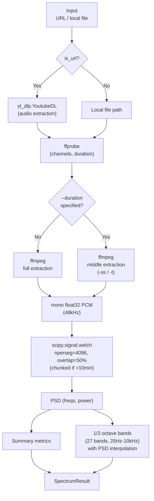

The analysis pipeline:

1. **PCM extraction**: mono (`pan=mono|c0=0.5*c0+0.5*c1`, level-preserving) + stereo (for True Peak)
2. **Welch PSD**: `scipy.signal.welch(data, fs=48000, nperseg=4096, noverlap=2048)`
3. **1/3-octave band analysis**: 25Hz-10kHz (27 bands); a band with no FFT bin (40Hz with these parameters) is estimated by PSD interpolation
4. **Band energy**: Sub (20-80Hz), Low (80-200Hz), Low-Mid (200-500Hz), Mid (500-2kHz), Presence (2-5kHz), Air (5-10kHz)
5. **Level metrics**: RMS (dBFS), True Peak (dBTP, ITU-R BS.1770 4x oversampling), Crest Factor
6. **Low/Intelligibility ratio**: `10*log10(E[20-200Hz] / E[1-5kHz])`
7. **Spectral centroid**: `Σ(f * Pxx) / Σ(Pxx)` (80-8kHz)
8. **Spectral Tilt**: linear regression of PSD dB against log2(freq) (dB/octave)
9. **Presence/Mid Ratio**: Presence(2-5kHz) / Mid(500-2kHz) energy ratio
10. **Brightness**: Air(5-10kHz) / (Mid+Presence 500-5kHz) energy ratio
11. **HPF -3dB estimation**: searches for the -3dB crossing point from the passband (300-600Hz) average
12. **HF Rolloff**: detects the frequency that falls -10dB below the mid-band average
13. **Transfer Function**: the PSD difference (dB) between 2 files
14. **EQ estimation**: fits a preamp gain and up to N peaking filters (RBJ biquad) to the Transfer Function (`estimate_parametric_eq()`). Applying this EQ to the reference track brings it close to the compared track. On the difference smoothed by 1/6 octave and placed on a log-frequency grid at 1/24-octave steps, it adds bands one at a time at the point of the largest residual and refits all parameters by least squares. It stops adding when the largest residual falls below 0.5 dB

### PCM conversion (mono downmix)

ffmpeg's default `-ac 1` uses the coefficients `sqrt(2)/2 * L + sqrt(2)/2 * R`,
which adds +3 dB of gain to a correlated stereo signal. This tool uses
`pan=mono|c0=0.5*c0+0.5*c1` to preserve the per-channel level.
True Peak is measured on the stereo PCM for each channel separately, following ITU-R BS.1770.

### Analysis parameters

| Parameter | Value | Rationale |
|-----------|-------|-----------|
| Sample rate | 48000 Hz | The standard in audio production |
| Mono downmix | `0.5*L + 0.5*R` | Preserves the per-channel level (ffmpeg's default `sqrt(2)/2` is not used) |
| True Peak | Stereo, per channel | Compliant with ITU-R BS.1770 |
| PCM format | float32 | numpy handles it as is, and there is no quantization |
| Welch nperseg | 4096 | Window length about 85ms, frequency resolution 11.7 Hz |
| Welch overlap | 50% (2048) | The standard for Welch's method |
| 1/3-octave range | 25 Hz - 10 kHz | Covers the voice and music bands |
| Low/Intel bands | 20-200 / 1-5k Hz | Weighting by the ANSI S3.5 importance function |
| Centroid range | 80 - 8000 Hz | The bands relevant to voice |
| HPF passband reference | 300 - 600 Hz | Above typical HPFs, below the voice formants |
| HF Rolloff threshold | -10 dB | The drop from the Mid band (500-2kHz) reference |
| True Peak oversampling | 4x | ITU-R BS.1770. Processed in 30-second pieces to save memory |
| EQ estimation range | 20 Hz - 16 kHz (the upper limit also does not exceed 0.45 × sample rate) | `EQ_FIT_RANGE` |
| Number of EQ estimation bands | Default 5 (CLI `--eq-bands`) | `EQ_BANDS_DEFAULT` |
| EQ gain / Q range | ±24 dB / 0.3 - 10 | `EQ_GAIN_LIMIT_DB` / `EQ_Q_RANGE` |

### Summary metrics

`analyze_track()` derives the summary from the Welch PSD, including the estimate of a high-pass filter (HPF).

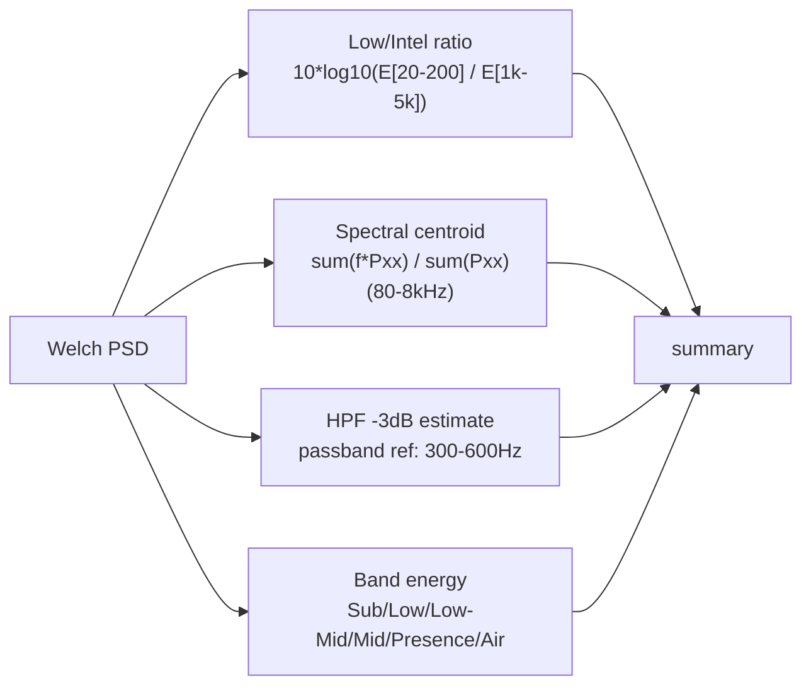

`summary` also holds `hpf_6db_hz`, `rolloff_db_per_decade`, `crest_factor_db`, `spectral_tilt_db_oct`, `presence_mid_ratio_db`, `brightness_db` and `hf_rolloff_hz` (`SpectrumResult.to_dict()` in `src/analyze_spectrum/analysis.py`).

### Comparison mode

The CLI compares with `compare_tracks()`. The GUI's tracks are serialized dicts, cached ones included ([Result cache](#result-cache)), and `_transfer_functions_from_dicts()` computes the transfer functions from them.

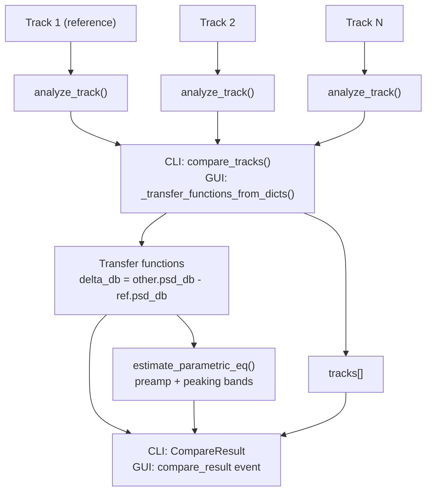

Add multiple files in the GUI, and the transfer functions are computed automatically.
The comparison feature, which analyze-loudness did not have, is taken in as a core feature.

## GUI

### Communication model

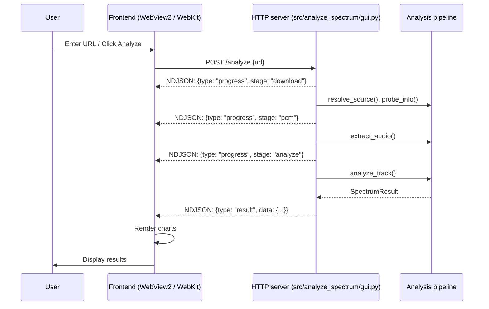

### Compare flow

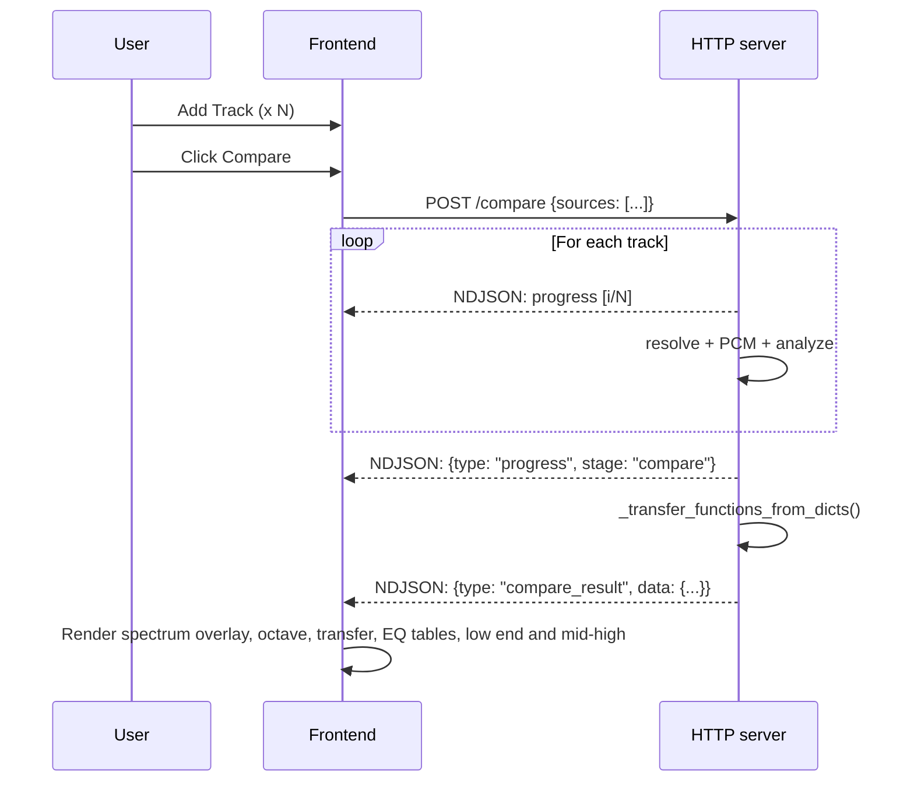

### GUI endpoints

| Endpoint | Method | Description |
|----------|--------|-------------|
| `/analyze` | POST | Spectral analysis of a URL or a local file. NDJSON stream. The result is saved in the cache, and the same source + duration is returned from the cache |
| `/compare` | POST | Multi-track comparison analysis. NDJSON stream. Each track is cached individually, and only the uncached ones are analyzed. The transfer functions are recomputed with `_transfer_functions_from_dicts()` |
| `/save` | POST | Saves the single-analysis result JSON through a native dialog. With the `source` + `duration` parameters, copies directly from the cache file (no re-serialization needed). No JSON save in comparison mode (image only) |
| `/save-image` | POST | Saves the composite PNG (base64) of the charts |
| `/load` | POST | Loads single-analysis JSON (compare JSON is rejected). Supports selecting multiple files (`allow_multiple=True`). A single file missing fields needed for drawing (`missing_result_fields()`) returns the `schema_outdated` flag. Only the ones with all fields present and no `meta.duration_min` are registered in the cache. 400 if `meta.schema_version` is not an integer |
| `/browse` | POST | Selects a local audio file through a native dialog |
| `/upload` | POST | Temporarily saves a dragged-and-dropped file (octet-stream, up to 500MB) |
| `/common/settings.js` | GET | Returns py-analyze-common's `settings.js` preceded by the theme and language saved in the settings file (`window.analyzeSettingsStored`). Reads the settings file on every load (`Cache-Control: no-store`) |
| `/settings` | POST | Saves exactly one of the theme or the language to the settings file (`{"theme": "light" \| "dark" \| "auto"}` or `{"lang": "en" \| "ja"}`). Anything else is 400, and a failed save is 500. The response is `{"theme", "lang"}` after the save |
| `/update/status` | POST | The current version, whether this build can update itself, and the check-at-launch setting (`{"current", "supported", "launch_check"}`) |
| `/update/settings` | POST | Saves the check-at-launch setting (`{"launch_check": true \| false}`; anything other than a boolean is 400, and a failed save is 500) |
| `/update/check` | POST | Reads the latest release's `latest.json`, and returns `{"available": true, "version"}` if there is a newer version and `{"available": false}` otherwise. A failed fetch or parse is 502 |
| `/update/install` | POST | Downloads, verifies and applies `{"version"}` (accepts only the version the previous check found). On success, returns `{"restarting": true}` and then quits the app. When only the restart after the install fails, returns `{"installed": true, "restart_error"}` and keeps running. A failure is 500 |

After the Host validation, POST checks the Content-Type and returns 415 unless it is `application/octet-stream` for `/upload` and `application/json` for everything else (the charset etc. after `;` is ignored). Browsers send a cross-origin request with these types only after a CORS preflight, which this server does not answer. The Host and Content-Type checks, `/browse`, `/save-image`, `/settings`, `/update/*` and the `/common/*` files come from py-analyze-common's `GuiHandler` (`analyze_common/server.py`), which `AnalyzeHandler` extends with this app's state (`updater()`, `ui_settings()`, `window()`, `dialog_lock()`, `exit_for_update()`).

### Response format (GUI NDJSON)

#### Single analysis result

```json
{
  "type": "result",
  "data": {
    "meta": {
      "version": "X.Y.Z",
      "schema_version": 2,
      "analyzed_at": "2026-04-03T12:34:56+00:00",
      "source": "recording.m4a"
    },
    "label": "original",
    "sample_rate": 48000,
    "duration_sec": 6.23,
    "rms_dbfs": -14.4,
    "peak_dbfs": -2.8,
    "true_peak_dbtp": -2.7,
    "spectrum": {
      "freqs": [5.86, 11.72, "..."],
      "psd_db": [-68.3, -65.1, "..."]
    },
    "bands": {
      "centers": [25, 31.5, 40, "...", 10000],
      "energy_db": [-55.6, -56.4, "..."]
    },
    "summary": {
      "crest_factor_db": 12.0,
      "low_intel_ratio_db": 5.2,
      "spectral_centroid_hz": 635,
      "spectral_tilt_db_oct": -4.2,
      "presence_mid_ratio_db": -1.8,
      "brightness_db": -10.5,
      "hpf_3db_hz": null,
      "hf_rolloff_hz": 12500,
      "band_energy": {
        "sub_20_80": -45.0,
        "low_80_200": -18.0,
        "low_mid_200_500": -18.8,
        "mid_500_2k": -23.5,
        "presence_2k_5k": -25.3,
        "air_5k_10k": -40.4
      }
    }
  }
}
```

#### Comparison result (NDJSON response only; saving and loading as JSON are not supported)

```json
{
  "type": "compare_result",
  "data": {
    "tracks": ["/* array of single analysis results */"],
    "transfer_functions": [
      {
        "label": "v3 - original",
        "freqs": ["..."],
        "delta_db": ["..."],
        "eq": {
          "preamp_db": -2.0,
          "bands": [{"freq_hz": 89.7, "gain_db": 4.9, "q": 0.87}],
          "residual_rms_db": 0.06,
          "fit_range_hz": [20.0, 16000.0]
        }
      }
    ]
  }
}
```

### Result cache

A session-scoped cache avoids re-analyzing the same source.
The cache is created with `tempfile.mkdtemp()` and deleted when the process exits (session-only).

- **Location**: `_cache_dir` created with `tempfile.mkdtemp()` (deleted at the end of the session)
- **Cache key**: URL or file path + duration. Local files include the mtime
- **Single analysis**: the `/analyze` result is saved as a temp JSON. A repeated request is answered from the cache
- **Comparison analysis**: `/compare` looks up the cache per track. Only the uncached ones are analyzed, and the transfer functions are recomputed from all tracks' dicts with `_transfer_functions_from_dicts()`
- **Save optimization**: when `/save` receives `source` + `duration` from the frontend, it copies the cache file directly (avoiding re-serialization)
- **Load → cache registration**: data loaded with `/load` (only the ones with all the fields needed for drawing and no `meta.duration_min`) is registered in the cache, in memory, and reused by a later analysis or Compare, at its own length unless the session has already analyzed the source. Save does not read it
- **Frontend state tracking**: `lastSource` and `lastDuration` keep the most recent analysis context, used for the cache lookup on Save. Showing a JSON from Load JSON empties them, so Save writes the JSON on screen

A JSON read with Load JSON joins the cache in memory under its source with no duration (`_cache_loaded()`), and results the session analyzed itself are looked up first. A JSON that records `meta.duration_min` (the CLI's `--duration`) stays out of the cache, so a later analysis of its source, and its track in a comparison, are of the full length. A source ffprobe estimates to be no longer than `--duration` is analyzed to its end and records nothing, so its JSON joins the cache. A JSON saved by a version that did not record it joins the cache whatever its `duration_sec`, and answers them with its shorter range unless the session has already analyzed the source.

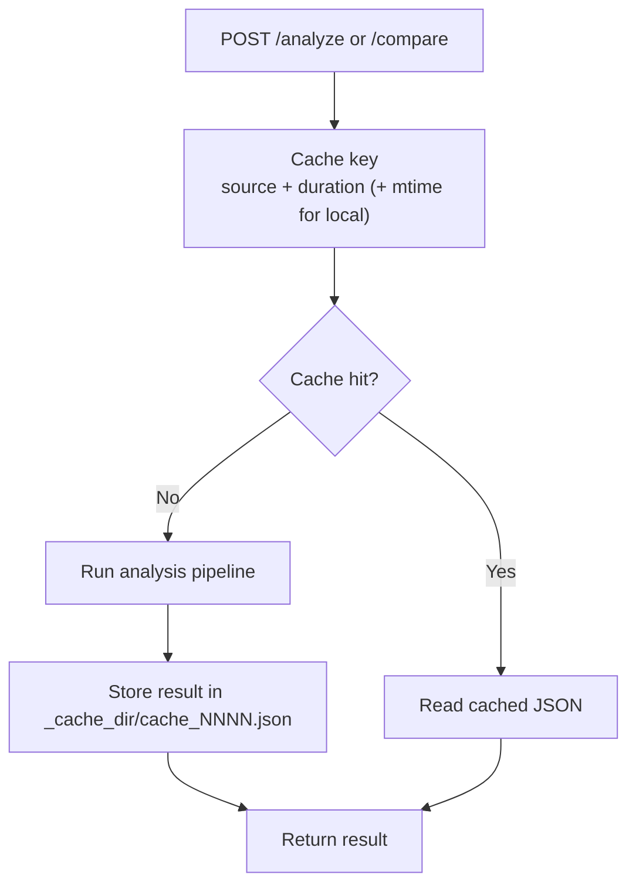

In comparison mode, each track is looked up in the cache individually:

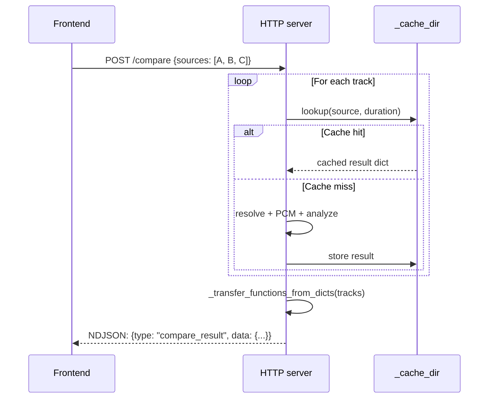

Save optimization: when `/save` includes the `source` + `duration` parameters,
it copies the cache file directly and avoids re-serializing.

### File input

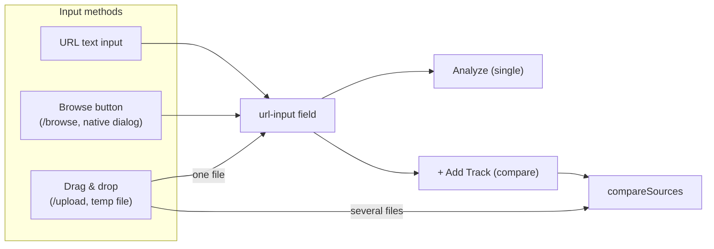

- **Browse**: `/browse` (POST) opens pywebview's `OPEN_DIALOG` and returns the file path
- **Drag & drop**: `/upload` (POST, octet-stream, X-Filename header) saves the file in a temporary directory and returns the path

### WebView2 drag & drop

WebView2's `AllowExternalDrop` (whether files can be dropped into it) is left at its default, true, so dropped files reach the page; pywebview itself turns off WebView2's swipe navigation.
On the JavaScript side, `stopImmediatePropagation` in the window capture phase blocks
propagation to WebView2's native handler.

### State machine

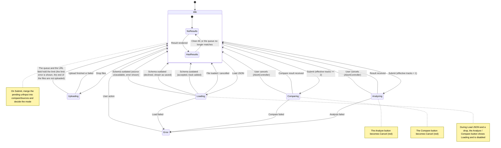

### Frontend state management

On Submit, the pending value of `urlInput` and `compareSources` are merged to decide the mode:

- `_effectiveTrackCount()`: the effective track count, including compareSources + the pending urlInput
- The Submit button label is updated dynamically on `urlInput`'s `input` event
- On Remove Track, it does not collapse when urlInput already has a value (the value is kept)
- Moving a row while a comparison is on screen runs `/compare` again in the new order (`_swapTracks()`, `_runAnalysis()`), because the first track is the reference of the transfer functions. The field's value is not added. The results stay until the new ones replace them, and a failed or cancelled run clears them. The focus goes back to where it was unless it went elsewhere during the run, and the scroll position stays through the replacement. The rows are disabled during the run. A move with a single result on screen clears it, and a move with nothing on screen runs nothing

### Keeping the pending source on Load JSON

Before `/load` runs, the value of `urlInput` is saved into `compareSources`, so that it does not disappear after the load:

- Single load + a pending value → both are added in Compare mode
- Multiple load + a pending value → the pending track is merged into the loaded tracks
- Old schema accepted + a pending value → the pending value + the source are added to the track list (re-analyzed on the next Submit)

### Cancel

When the user clicks the Cancel button during an analysis or a comparison:

1. **Frontend**: `AbortController.abort()` aborts the stream read through fetch's `signal`
2. **Backend**: the next `_send_event()` call gets `BrokenPipeError` or another `OSError`, raises `_ClientDisconnected`, and the processing ends
3. **User interface (UI)**: shows "Cancelled." in the status and puts the button back to Analyze / Compare

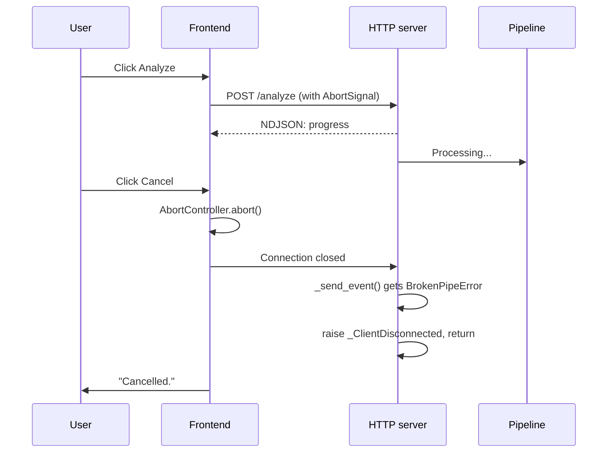

**Behavior on cancel**:

`_send_event()` of py-analyze-common's `GuiHandler` (`vendor/py-analyze-common/src/analyze_common/server.py`) raises `ClientDisconnected` when its write fails, so a cancel is detected only when the next NDJSON event is sent.
That is, long-blocking synchronous work like the following
**keeps running until that stage finishes** even after a cancel:

- `ffmpeg` / `ffprobe` child processes (`run_ffmpeg()` of py-analyze-common's
  `analyze_common/ffmpeg.py` / `subprocess.run`): a cancel sends no signal to the process, so
  PCM extraction and getting the duration run to the end. Ending the app kills a running `ffmpeg`
- `scipy.signal.welch` / `resample_poly`: NumPy/SciPy's C loops do not
  receive Python signals
- `yt_dlp.YoutubeDL.extract_info(download=True)`: the download and the audio
  extraction run to the end (no progress hook can stop them)

Right after a cancel the user immediately sees "Cancelled.", but background
processor / network usage remains until the stage finishes. Improving this behavior would
require implementing cancel propagation to the child processes through `Popen` + `terminate()`,
and it is not adopted because of the trade-off between complexity and
when memory is released.

### Theme

A 3-way theme switch (Light, then Dark, then Auto, then Light again):

- **Light**: always the light theme
- **Dark**: always the dark theme
- **Auto**: follows the operating system's (OS) `prefers-color-scheme` (default)

All colors are managed with Cascading Style Sheets (CSS) custom properties (`--bg`, `--text`, `--accent`, etc.).
The Canvas charts get the theme colors with `getThemeColors()` when drawing.
The charts are redrawn when the theme is switched. The choice is saved together with the language choice in the app's settings file (`settings.json`) and is used on the next launch too (reading is in the [White-flash prevention](#white-flash-prevention) diagram, saving is `POST /settings`).

3 states, light / dark / auto, with CSS variables + `[data-theme]`. The choice is saved in `theme` of the settings file ([Saving the theme and language](#saving-the-theme-and-language)), and a saved value other than `light` / `dark` is treated as auto. The toggle cycles light -> dark -> auto, and the icon is an SVG of a sun / crescent moon / half-filled circle (generated by `_createThemeIcon()` of py-analyze-common's `analyze_common/web/ui.js`). In auto, it subscribes to changes of `prefers-color-scheme` and reapplies. The initial application happens before paint ([White-flash prevention](#white-flash-prevention)).

### Accent color

analyze-spectrum uses blues (`--accent: #1565C0`), analyze-loudness purples (`--accent: #9C27B0`). The colors are separated by domain: blue = frequency spectrum, purple = loudness (volume). The CSS variable names are shared by both projects (`--text` / `--bg-card` / `--text-secondary` / `--text-muted`, etc.). The CSS variables and rules that are the same in both apps live in py-analyze-common's `analyze_common/web/common.css`, which `gui.py` serves as `/common/common.css` (the PyInstaller spec bundles it in `analyze_common/web`). `index.html` loads it before `style.css`, and `style.css` holds the remaining variables (the accent color, etc.) and the app's own rules. The `h1` in `@media (max-width: 480px)` for narrow screens has to come after the `h1` in each `style.css`, so it stays in `style.css`.

### i18n (languages)

`frontend/i18n.js` holds the en / ja dictionary, which py-analyze-common's `analyze_common/web/i18n.js` (`/common/i18n.js`, loaded before it) turns into `window.i18n`. The initial language is `navigator.language` (`ja*` -> ja, otherwise en), and the choice is saved in `lang` of the settings file ([Saving the theme and language](#saving-the-theme-and-language)). Static markup has its `data-i18n*` attributes replaced on DOMContentLoaded, and strings that `main.js` creates dynamically call `window.i18n.t(key)` directly. Elements whose text `main.js` writes according to the state (the theme button's `aria-label`, the submit button's text and `aria-label`) do not get `data-i18n*`; `main.js` writes them on load and on `window.i18n.onChange` (with it, they would go back to fixed text on DOMContentLoaded and on every language switch).

### Saving the theme and language

The theme and language choices are kept in the same settings file as auto-update's "Check at launch" (the location is in the "Settings" line of [Auto-update](#auto-update)). The reason for not using the webview's localStorage is in the "The 'Check at launch' setting" section of `vendor/py-analyze-common/docs/auto-update.md`.

- The mechanism itself lives in py-analyze-common and is shared with analyze-loudness: validating the values, the window's background color and the script passed to the page are `UiSettings` in `analyze_common/ui_settings.py`, and reading and writing on the page side is `analyze_common/web/settings.js` (`window.analyzeSettings`; bundled by the spec)
- `gui.py` creates only one `SettingsStore` for the settings file (`_settings`) and passes it to both `Updater` and `UiSettings`. They read and write the same file with the same lock
- The page receives the saved values through `/common/settings.js`. `main.js` saves to `/settings` with `window.analyzeSettings.save()` every time the theme or language is switched. Saves are sent one at a time in order, so even when switching quickly, the last chosen value is what remains
- When a save fails, the chosen theme / language stays in effect until the app is closed, and the status line shows the cause (`err.setting_save_failed`)

### White-flash prevention

The window and the page get the theme before the first paint:

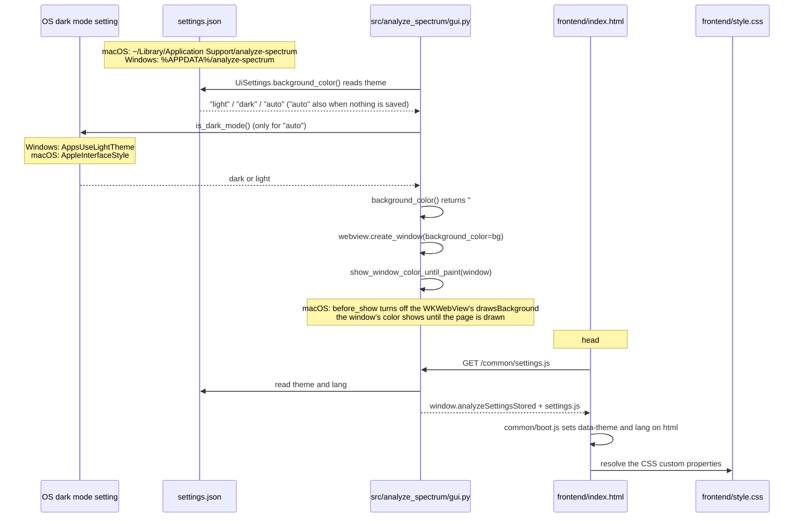

### Auto-update

How an update runs, what the user sees, what is verified and how each OS applies it are in [py-analyze-common's auto-update document](https://github.com/semnil/py-analyze-common/blob/main/docs/auto-update.md). What this app owns is `UPDATE_CONFIG` in `src/analyze_spectrum/update.py`, the exit handling (`_exit_for_update()`) in `src/analyze_spectrum/gui.py`, and stopping operations during the download (`_setUpdateLock()`) in `frontend/main.js`.

What this app holds:

- `UPDATE_CONFIG` in `src/analyze_spectrum/update.py`: the product, the repository, the public key `PUBLIC_KEY`, the temporary directory prefix and the mutex name
- `_exit_for_update()` in `src/analyze_spectrum/gui.py`: on Windows it ends with `window.destroy()`, and on macOS it deletes the temporary directories atexit would delete and ends with `os._exit(0)`
- `_setUpdateLock()` in `frontend/main.js` stops the input field, each button, track operations, drops and saving results during the download (result buttons redrawn while locked are also created disabled)
- Settings: "Check at launch" is `update_check_at_launch` in the app's settings file (`~/Library/Application Support/analyze-spectrum/settings.json` on macOS, `%APPDATA%\analyze-spectrum\settings.json` on Windows). Tests point the settings file at a temporary folder with `_isolated_settings` in `tests/conftest.py`

## Charts

### Chart types

| Chart | Library | X-axis | Y-axis | Mode |
|-------|---------|--------|--------|------|
| PSD Spectrum | uPlot | log(freq) Hz | Power dB | Single / Multi-track overlay |
| 1/3 Octave | Canvas | Band center Hz | Energy dB | Single / Grouped bars |
| Transfer Function | Canvas | log(freq) Hz | Delta dB | Multi-track only |
| Estimated EQ | HyperText Markup Language (HTML) table | - | - | Multi-track only (1 table per transfer function) |
| Low-End Detail | Canvas | Linear freq 20-500Hz | Power dB | Single / Multi-track overlay |
| Mid-High Detail | Canvas | log(freq) 500Hz-20kHz | Power dB | Single / Multi-track overlay |

uPlot (the log-frequency PSD overlay) + our own Canvas drawing (the 1/3-octave bar chart, the transfer function,
the low-end detail, the mid-high detail). The same vendor layout as analyze-loudness. The text of our own Canvas drawing and of the PNG export in `frontend/main.js` uses `CHART_FONT_FAMILY`, and the axes of the PSD overlay use `CHART_AXIS_FONTS`, both from py-analyze-common's `analyze_common/web/ui.js`, as analyze-loudness's charts do.

### Chart data flow

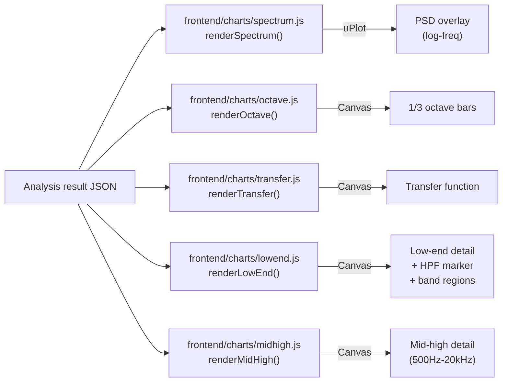

## Build & distribution

### Build pipeline

`python build.py` runs py-analyze-common's `analyze_common.build` with this app's names. It checks uPlot against the Secure Hash Algorithm 256 (SHA-256) values in `build_assets/checksums.json`, and the macOS ffmpeg / ffprobe against `build_assets/ffmpeg.json`.

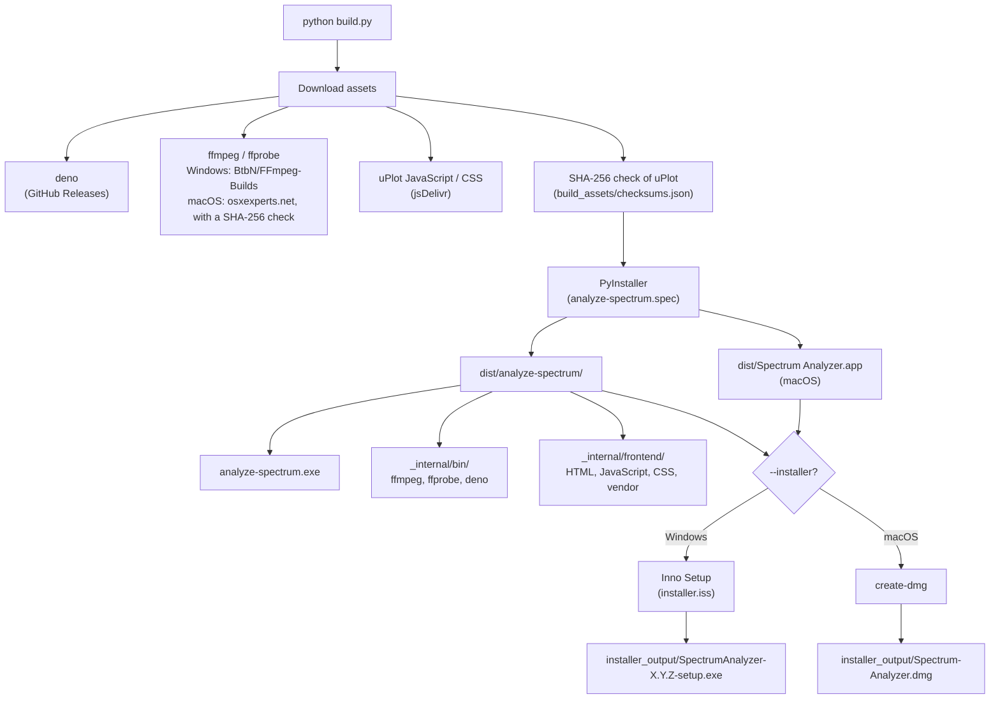

### Bundle structure

The Windows bundle (`analyze-spectrum.spec`). On macOS the same files are in `dist/Spectrum Analyzer.app`, with the binaries in `Contents/Frameworks/bin`.

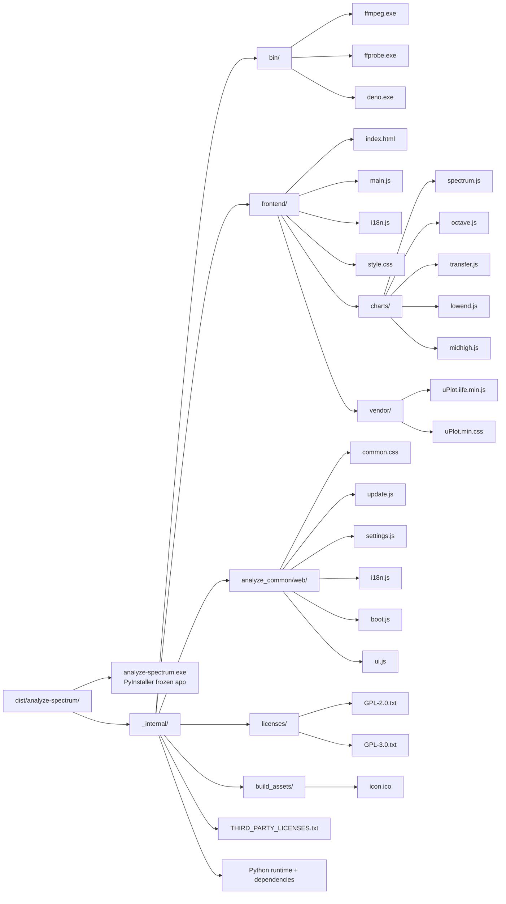

### Dependencies

#### CLI dependencies

- `yt-dlp` — downloading URLs (through the Python API)
- `ffmpeg` / `ffprobe` — PCM conversion, getting the duration, detecting the channel count
- `numpy`, `scipy` — spectral analysis
- `pytest`, `pytest-cov` — development dependencies

#### GUI dependencies

- `pywebview` — an optional dependency (`gui` extra)
- `numpy`, `scipy` — spectral analysis
- `yt-dlp` — bundled as a Python library (PyInstaller includes it automatically)
- `yt-dlp-ejs` — the YouTube challenge solver scripts yt-dlp runs on deno, pinned to the version of yt-dlp's `pin` extra. yt-dlp's own PyInstaller hook (`yt_dlp/__pyinstaller/hook-yt_dlp.py`) bundles their `.js` files; without them yt-dlp warns `n challenge solving failed: Some formats may be missing`; `tests/test_yt_dlp_ejs.py` fails when its version or scripts are not the ones the installed yt-dlp accepts, and Dependabot moves yt-dlp and yt-dlp-ejs in one pull request (the `yt-dlp` group of `.github/dependabot.yml`)
- `certifi` — the CA certificates that auto-update's HTTPS connections use (`gui` extra. In the frozen macOS app, the CA path that the bundled OpenSSL points at does not exist on the user's Mac). PyInstaller goes ahead with only a warning when certifi is missing, so `check_prerequisites()` of py-analyze-common's `analyze_common/build.py` (which `build.py` runs) stops the build when certifi cannot be imported
- ffmpeg, ffprobe, deno — bundled from `build_assets/bin/`
- `py-analyze-common` — git submodule (`vendor/py-analyze-common`). Provides OS detection, subprocess kwargs, dark mode detection, ffmpeg/ffprobe wrappers, yt-dlp download, JSON sanitizing, auto-update, and saving the theme and language. Not listed in pyproject.toml; used through `sys.path` injection

## Security

### Network

- The HTTP server binds to `127.0.0.1` (no external access)
- The port is assigned at random (chosen by the OS)
- A dropped file is taken by the page's drop handler in the window capture phase (`frontend/main.js`) and sent to `/upload`

### Input validation

- subprocess is run in list form (prevents shell injection)
- yt-dlp goes through the Python API (`yt_dlp.YoutubeDL`), so no subprocess stdout decoding is needed. The title is taken from the dict returned by `extract_info()` (the Document Object Model (DOM) shows it through `textContent`)
- POST bodies are limited to 10MB (JSON), 50MB (base64 image), 500MB (file upload)
- Upload file names go through `sanitize_filename()` (`vendor/py-analyze-common/src/analyze_common/download.py`): `\/:*?"<>|` and the control characters 0x00-0x1F are replaced with `_`, leading and trailing `.` and spaces are removed, a Windows reserved device name gets a leading `_`, and the name is cut to 200 characters
- Upload extensions are on an allowlist (`_ALLOWED_EXTENSIONS` in `src/analyze_spectrum/gui.py`, such as `.wav`, `.mp3`, `.m4a`)
- The duration parameter accepts only finite numbers from 0.01 to 240 minutes (`_parse_duration()`)
- The `sources` array of `/compare` must hold 2-6 non-empty strings, and a source that looks like a URL (`/analyze`'s `url` too) must be http or https (`_reject_bad_scheme()`)

### Cross-site scripting (XSS) prevention

- The frontend's DOM operations are based on `textContent` (no HTML interpretation of user input)
- `showError()` (`_renderError()` of `vendor/py-analyze-common/src/analyze_common/web/ui.js`) clears the status with `textContent = ""` and then sets the message with `textContent`
- When `/load` reports an outdated JSON, `_confirmModal()` (`frontend/main.js`) draws a modal in the page and sets its message and the JSON's source with `textContent`

### File system

- Temporary upload files are deleted automatically with `tempfile.mkdtemp` + `atexit`
- Cache files are deleted automatically with `tempfile.mkdtemp` + `atexit`
- The cache copy of `/save` uses `shutil.copy2` (only to a path chosen in the native dialog)

### Build and distribution

- Build-time assets: uPlot and the macOS ffmpeg / ffprobe are checked against SHA-256 values in the repository (`build_assets/checksums.json`, `build_assets/ffmpeg.json`)
- The release jobs install Python packages only from the hash-pinned `requirements/*.txt`, and Inno Setup / create-dmg from downloads checked against SHA-256 in `.github/workflows/release.yaml`
- The frozen build puts `_MEIPASS/bin` at the front of `PATH`
- What auto-update fetches is applied only after its Ed25519 signature is verified with the public key built into the app ([Auto-update](#auto-update))

## Design decisions

### Low-frequency 1/3-octave band interpolation

The frequency resolution of the Welch PSD (nperseg=4096, 48kHz) is 11.72 Hz.
The low-frequency 1/3-octave bands are narrower than that, so a band can hold one fast Fourier transform (FFT) bin or none:

| Band center | Band width | FFT bins |
|-------------|-----------|----------|
| 25 Hz | 5.8 Hz | 1 (23.44 Hz) |
| 31.5 Hz | 7.3 Hz | 1 (35.16 Hz) |
| 40 Hz | 9.3 Hz | 0 |
| 50 Hz | 11.6 Hz | 1 (46.88 Hz) |

When a band contains no FFT bin, `np.interp` interpolates the PSD at the band's center
frequency, and the energy is estimated by multiplying it by the bandwidth.

### Chunked Welch PSD for long signals

scipy.signal.welch internally allocates an intermediate array of segments × frequency bins.
For a long file (for example about 4 hours: 350,058 segments × 2,049 bins ≈ 5.3 GiB)
it runs out of memory.

The signal is split into chunks of 10 minutes (28,800,000 samples), and the PSDs of the chunks
are averaged into the final result. The frequency resolution does not change.

### yt-dlp is used through the Python API (no binary is bundled)

`yt_dlp.YoutubeDL` is called directly as a Python library, and the audio is extracted with the `FFmpegExtractAudio` postprocessor. Not bundling the binary fundamentally avoids the Team ID mismatch that occurs when re-signing with codesign for macOS (the Python.framework inside the onefile binary cannot be re-signed and is rejected by the hardened runtime).

### PCM conversion approach

analyze-loudness parses the stderr of the ebur128 filter, but this tool reads the raw PCM data
into numpy and processes it with scipy.signal.welch. The memory constraints are handled as follows:

- 48kHz mono float32 = 192 KB/s → 10 minutes = 115 MB (acceptable)
- Long files extract the middle with `--duration` (the same approach as analyze-loudness)

### Schema versioning

The single source of truth is `SCHEMA_VERSION` (an integer) in `src/analyze_spectrum/__init__.py`. It is raised independently of `__version__` (the app version). `meta` is assembled by `make_meta()` (a single result) and `make_compare_meta()` (a comparison) in the same file.

| ver | Added |
|-----|------|
| 1 | Initial version |
| 2 | `meta.duration_min` |

- `meta.version`: the app version (for display)
- `meta.schema_version`: the schema version. `/load` only validates that it is an integer (it may be absent), and does not judge compatibility by its value
- `meta.duration_min`: the minutes `--duration` cut out of the middle. Absent when the whole source was analyzed, which includes a source ffprobe estimates to be no longer than those minutes; ffmpeg then reads to the end of the source (py-analyze-common's `compute_middle()`). A comparison has it when any of its tracks was cut. `/load` keeps a result that has it out of the cache ([Result cache](#result-cache))
- Compatibility is **judged by whether fields exist, not by the version number**. The single source of truth for the list of fields needed for drawing is `missing_result_fields()` in `analysis.py`, which looks at `spectrum.freqs` / `spectrum.psd_db` / `bands.centers` / `bands.energy_db` / each band of `summary.band_energy`. Missing numeric metrics are not covered (the screen shows them as `?`)
- A single file with missing fields returns the `schema_outdated` flag and is not registered in the cache (re-analysis gets the latest format). In a multiple-file load too, the ones with missing fields are not registered in the cache
- Saving and loading Compare JSON has been removed (single analysis results only)

## Tests

### Test layout

| File | Kind | Main target |
|----------|------|----------|
| `tests/conftest.py` | fixture | Shared Waveform Audio File Format (WAV) byte generation (`_make_wav_bytes`, `wav_file`, `wav_file_b`), `_isolated_settings`, which points the settings file at a temporary folder, and `analyze_common.testing.configure()` for this repository and package |
| `tests/test_analysis.py` | unit | The analysis core (Welch PSD, 1/3 octave, metrics) |
| `tests/test_pcm.py` | unit | ffmpeg to PCM conversion |
| `tests/test_cli.py` | unit | argparse + CLI integration |
| `tests/test_gui.py` | unit | `src/analyze_spectrum/gui.py` (with mocks). Includes the update endpoints, `UPDATE_CONFIG`, and saving the theme and language (`/settings`, `/common/settings.js`, the window's background color) |
| `tests/test_integration.py` | integration | HTTPServer + the analysis pipeline |
| `tests/test_cache_failures.py` | integration | Cache fallback and failed analyses through the real HTTP handler |
| `tests/test_dialog_busy.py` | unit | Mutual exclusion of native dialogs (`_dialog_lock`) |
| `tests/test_ffmpeg_binary.py` | integration | Checks the ffmpeg / ffprobe on PATH with the app's PCM conversion and ffprobe reading (`EXPECT_FFMPEG_DIR` selects the bundled binaries) |
| `tests/test_release_workflow.py` | unit | That `.github/workflows/release.yaml` runs `tests/test_ffmpeg_binary.py` on the ffmpeg / ffprobe in the distributed files, that only `create-release` can write and it runs no Python, that the job holding the update signing key has a read-only token and installs only the hash-pinned yt-dlp, that the Developer ID identity is imported right before codesign and deleted when codesign ends, that the release jobs install packages only from `requirements/*.txt` and Inno Setup / create-dmg only after a SHA-256 check, that `requirements/release.txt` satisfies `pyproject.toml`, and that every `requirements/*.txt` resolves, with its own pins as constraints, to exactly the packages it pins under the same environment markers (the tests are py-analyze-common's `analyze_common.testing.release_workflow`) |
| `tests/test_third_party_licenses.py` | unit | The full GNU General Public License (GPL) texts that `THIRD_PARTY_LICENSES.txt` points at, and the spec / `installer.iss` that bundle them (`analyze_common.testing.third_party_licenses`) |
| `tests/test_chart_font.py` | unit | That no script names a font of its own, and that the scripts use `CHART_FONT_FAMILY` (`analyze_common.testing.chart_font`) |
| `tests/test_yt_dlp_ejs.py` | unit | That the installed yt-dlp-ejs has the version (major.minor) and the script hashes the installed yt-dlp accepts (`analyze_common.testing.yt_dlp_ejs`) |
| `tests/test_frontend.py` | end-to-end (e2e) | Playwright headless Chromium runner. Runs the update check, approval, failure and settings save, and saving the theme and language and restoring them on the next launch, on the actual `frontend/index.html`, and the `h1` color, the result title row, the first Tab, the summary tables' width, long track labels and the status line |
| `tests/test_chart_rendering.py` | e2e | The comparison charts and their Portable Network Graphics (PNG) export with the real browser scripts |
| `tests/test_browser_operations.py` | e2e | Context menu editing and keyboard navigation, track ordering, file drops, saving results and file selection through the app's page |
| `tests/frontend/test_ui.js` | browser | Frontend UI state tests |
| `tests/js_coverage.py` | tool | With `--js-coverage=PATH`, the V8 coverage of `frontend/*.js` that the Playwright tests run, written as LCOV |
| `tests/test_js_coverage.py` | unit | `tests/js_coverage.py`: matching V8 ranges to lines, and the LCOV it writes |

### Integration tests

`tests/test_integration.py` starts `HTTPServer` directly without pywebview
and verifies each endpoint through the real analysis pipeline.

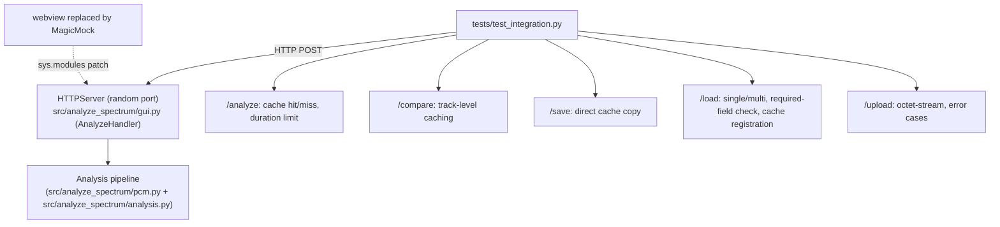

### Frontend UI tests

`tests/test_frontend.py` starts headless Chromium with Playwright,
opens `tests/frontend/test_ui.html` through a local HTTP server,
and reads the result from `window._testResult`.

`tests/frontend/test_ui.js` mocks fetch and verifies the DOM state directly:

- Adding / removing tracks
- The queue rows (number, kind, button names, colors)
- Rejecting duplicate tracks
- The 6-track limit
- Load JSON (single / multiple / accepting and rejecting an old schema) + keeping the pending source
- The theme toggle (Light, Dark, Auto)
- Clear All
- The setBusy button state
- Aborting the NDJSON stream
- The Submit label (including the dynamic update from urlInput input)
- Merging the pending urlInput on Submit (NDJSON stream mock)
- Rejecting the 6-track limit on Submit
- Single analysis with 1 track + an empty urlInput
- Keeping the urlInput value on Remove Track
- The estimated EQ tables in the comparison result and in Save Image
- The confirm modal closing on every answer
- No emoji in the UI sources and status icons

`playwright>=1.40` is a dev dependency (`pyproject.toml`).

With `--js-coverage=PATH`, `tests/js_coverage.py` records the line coverage of `frontend/*.js` (outside `frontend/vendor/`) on every Chromium page these tests open, and writes it as LCOV. Continuous integration (CI) uploads it to Codecov with the Python coverage.

### JavaScript coverage

With `--js-coverage=PATH`, `tests/js_coverage.py` starts V8's precise coverage on every Chromium page the tests open, before the page loads anything, and takes it before each navigation the test starts (`goto`, `reload`, `go_back`, `go_forward`), which leaves the scripts of the document behind, and when the page, its context or its browser is closed; each take adds the counts since the previous one. It counts the scripts of `frontend/` outside `frontend/vendor/`, served either from the project root (`/frontend/main.js`, `tests/frontend/test_ui.html`) or by the app's handler (`/main.js`), and writes every one of them to PATH as LCOV, a script no test loaded with zero hits. A line's hit count is the count of the innermost V8 range that contains all of its code, summed over pages; blank lines and lines that start a comment are not counted. It fails the test whose page ran a script of another length than the file on disk. py-analyze-common's scripts (`/common/*.js`) are not counted.

### Browser operation tests

`tests/test_browser_operations.py` exercises the app's page in headless Chromium: context menu editing and keyboard navigation, track ordering with and without rendered results, file drops, saving results and file selection. It checks input values, track data and rows, request bodies, PNG contents and the status of successful, cancelled and failed operations. Clipboard access and HTTP responses are controlled by the tests; native clipboard integration and file dialogs are not exercised by these tests.

### ffmpeg / ffprobe binary test

`tests/test_ffmpeg_binary.py` here reads a 48 kHz 16-bit stereo WAV written with numpy (a different sine wave on left and right) with the ffmpeg / ffprobe on PATH and the app's `extract_audio()` / `probe_info()`, and checks that the returned float32 PCM matches the written samples times 1/32768 (including a cut from the middle), and the channel count and length.

## Known limitations

- The GUI's comparison is limited to 6 tracks (chart readability); the CLI has no limit
- Real-time input (microphone) is out of scope
- 48kHz mono float32 = 192 KB/s, about 115 MB for 10 minutes (memory constraint)
- Long files are handled by extracting the middle with `--duration` of the CLI (a new analysis in the GUI is always of the full length; a loaded JSON keeps its own length, [Result cache](#result-cache))
- A cancel does not stop the stage that is running ([Cancel](#cancel))

## Reference standards

| Standard | Usage |
|----------|-------|
| American National Standards Institute (ANSI) S3.5-1997 | Speech Intelligibility Index (SII) band importance function (Low/Intel ratio) |
| International Electrotechnical Commission (IEC) 60268-16:2020 | Speech Transmission Index (STI) reference (intelligibility bands) |
| Upward spread of masking | Low-end masking analysis rationale |

- **ITU-R BS.1770**: True Peak — 4x oversampling, measured per channel
- **ANSI S3.5-1997**: SII band importance function (1-5kHz carries about 72% of intelligibility)
- **IEC 60268-16:2020**: STI — Ed.5 greatly reduced the 125/250Hz bands
- **Upward spread of masking**: the asymmetry in which low frequencies mask high frequencies
