# Architecture

> 日本語版は [architecture.ja.md](architecture.ja.md) を参照してください.

## Overview

analyze-spectrum is a desktop tool that analyzes the frequency spectrum of a YouTube video or a local audio file
and verifies whether equalizer (EQ) processing is appropriate.
It runs as a command-line interface (CLI) tool and as a Windows / macOS graphical user interface (GUI) application.

The GUI is built from pywebview (WebView2 / WebKit) + a local Hypertext Transfer Protocol (HTTP) server, which streams its progress and result as newline-delimited JavaScript Object Notation (JSON) lines (NDJSON).
It shares py-analyze-common (`vendor/py-analyze-common`) with its sister tool analyze-loudness.
The audio of a Uniform Resource Locator (URL) comes from yt-dlp's Python application programming interface (API), and ffmpeg turns every source into pulse-code modulation (PCM) samples.

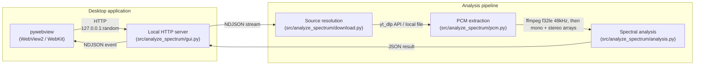

## Modules

`src/analyze_spectrum/analysis.py` computes the power spectral density (PSD) with Welch's method.

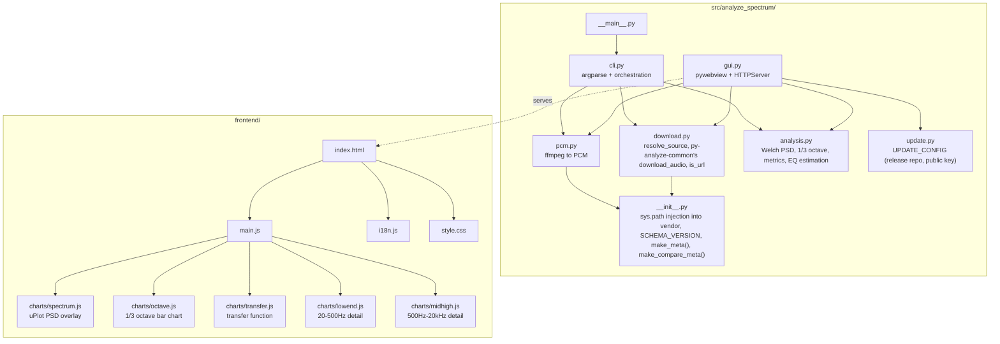

## Data flow

### Analysis pipeline

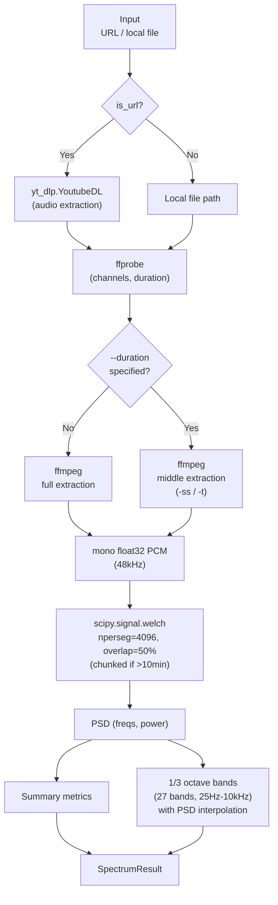

### Summary metrics

`analyze_track()` derives the summary from the Welch PSD, including the estimate of a high-pass filter (HPF).

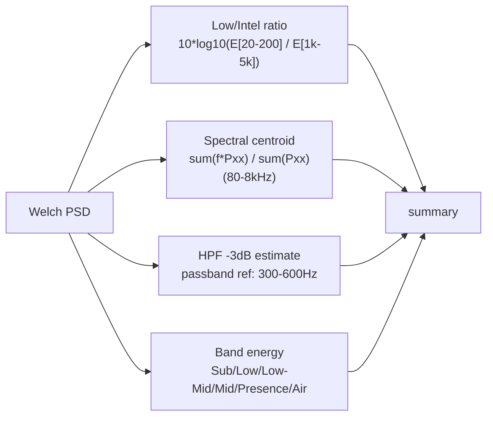

`summary` also holds `hpf_6db_hz`, `rolloff_db_per_decade`, `crest_factor_db`, `spectral_tilt_db_oct`, `presence_mid_ratio_db`, `brightness_db` and `hf_rolloff_hz` (`SpectrumResult.to_dict()` in `src/analyze_spectrum/analysis.py`).

### Comparison mode

The CLI compares with `compare_tracks()`. The GUI's tracks are serialized dicts, cached ones included ([Result cache](#result-cache)), and `_transfer_functions_from_dicts()` computes the transfer functions from them.

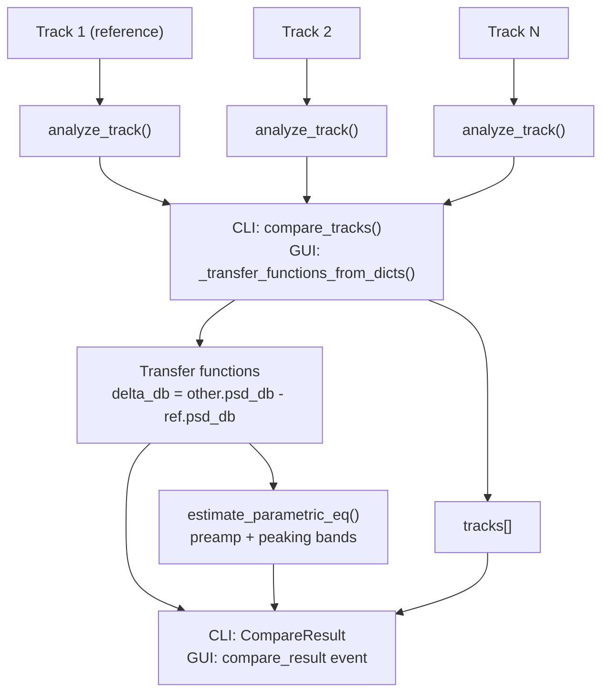

## GUI

### Communication model

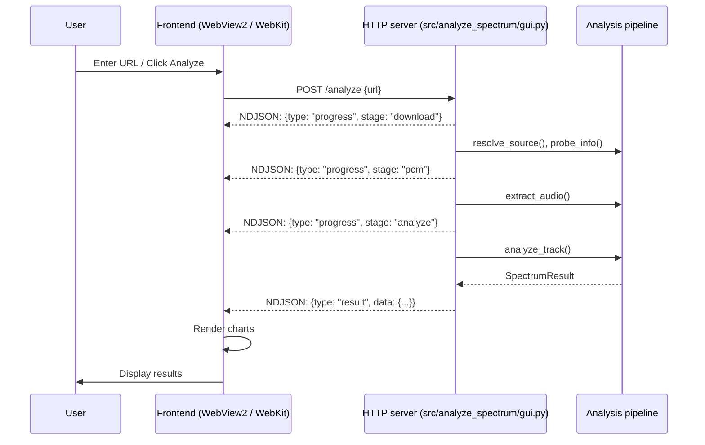

### Compare flow

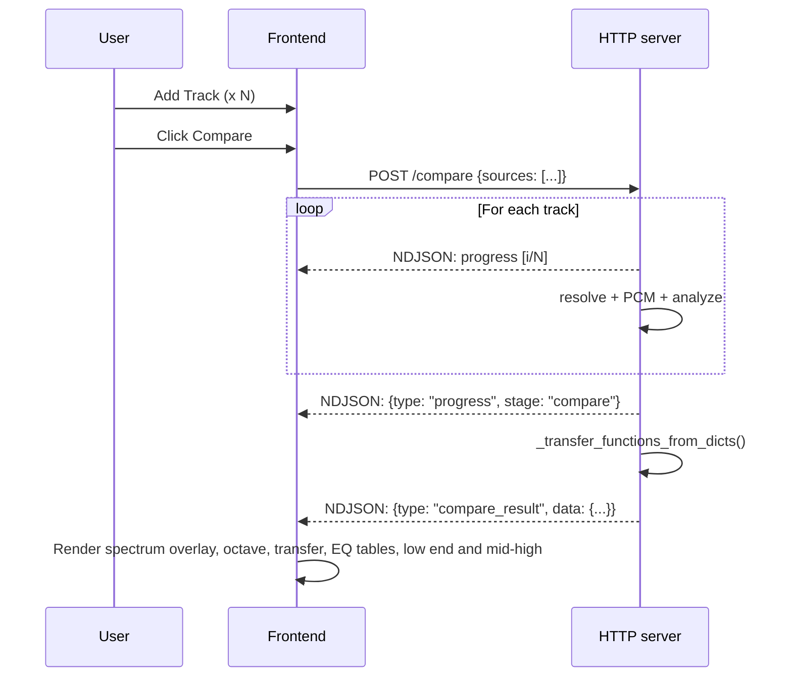

### Result cache

A session-scoped cache avoids re-analyzing the same source.
The cache is created with `tempfile.mkdtemp()` and deleted when the process exits (session-only).

A JSON read with Load JSON joins the cache in memory under its source with no duration (`_cache_loaded()`), and results the session analyzed itself are looked up first. A JSON that records `meta.duration_min` (the CLI's `--duration`) stays out of the cache, so a later analysis of its source, and its track in a comparison, are of the full length. A source ffprobe estimates to be no longer than `--duration` is analyzed to its end and records nothing, so its JSON joins the cache. A JSON saved by a version that did not record it joins the cache whatever its `duration_sec`, and answers them with its shorter range unless the session has already analyzed the source.

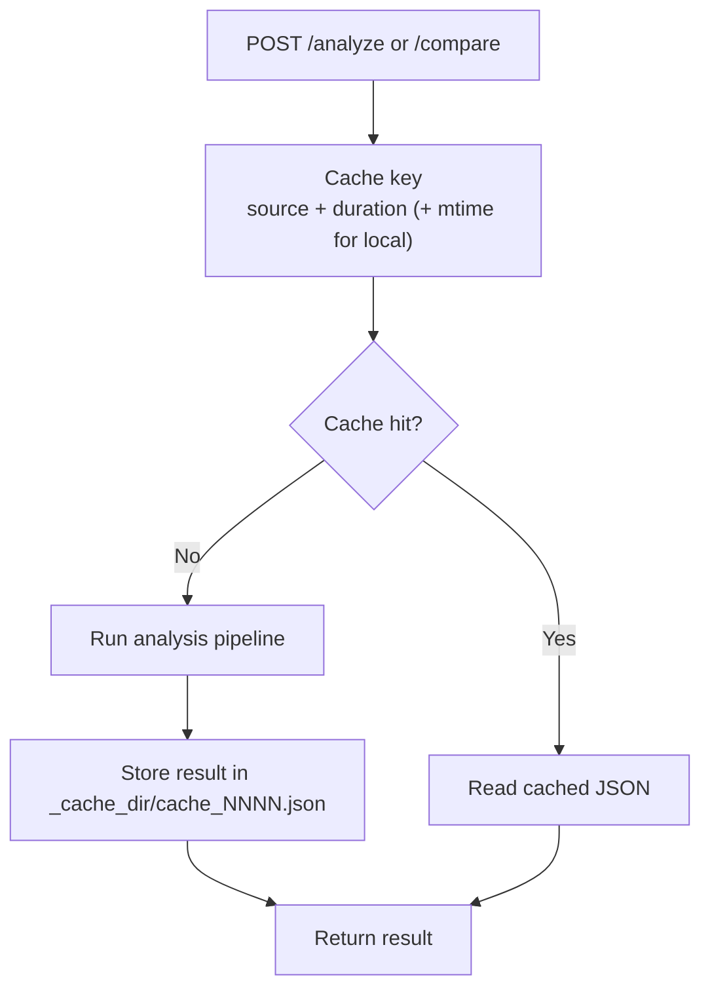

In comparison mode, each track is looked up in the cache individually:

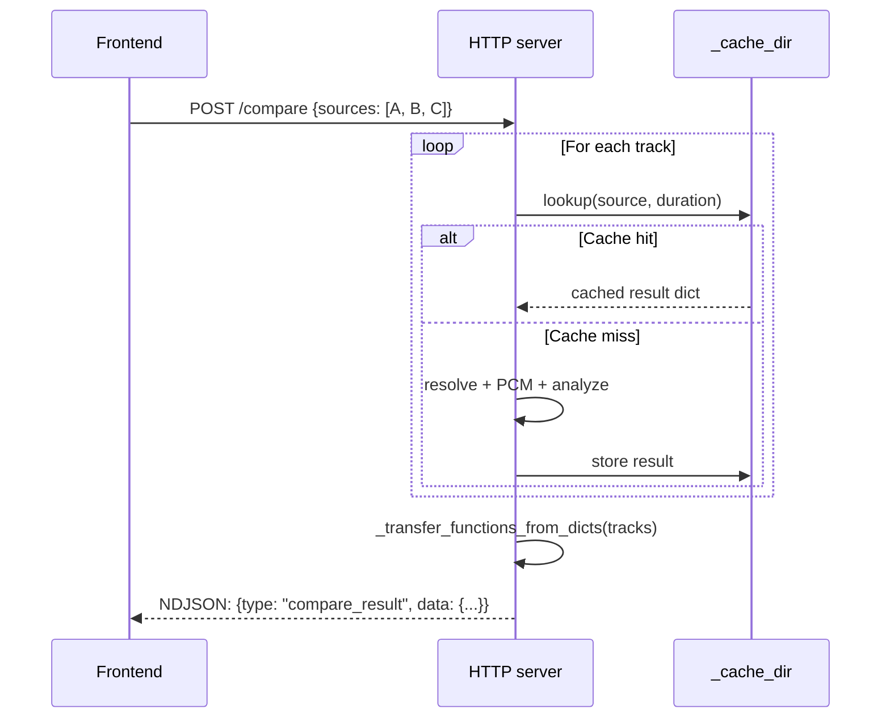

Save optimization: when `/save` includes the `source` + `duration` parameters,
it copies the cache file directly and avoids re-serializing.

### File input

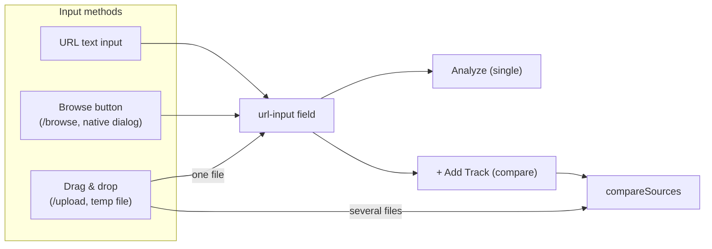

- **Browse**: `/browse` (POST) opens pywebview's `OPEN_DIALOG` and returns the file path
- **Drag & drop**: `/upload` (POST, octet-stream, X-Filename header) saves the file in a temporary directory and returns the path

### State machine

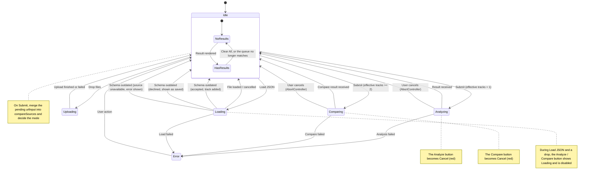

### Cancel

When the user clicks the Cancel button during an analysis or a comparison:

1. **Frontend**: `AbortController.abort()` aborts the stream read through fetch's `signal`
2. **Backend**: the next `_send_event()` call gets `BrokenPipeError` or another `OSError`, raises `_ClientDisconnected`, and the processing ends
3. **User interface (UI)**: shows "Cancelled." in the status and puts the button back to Analyze / Compare

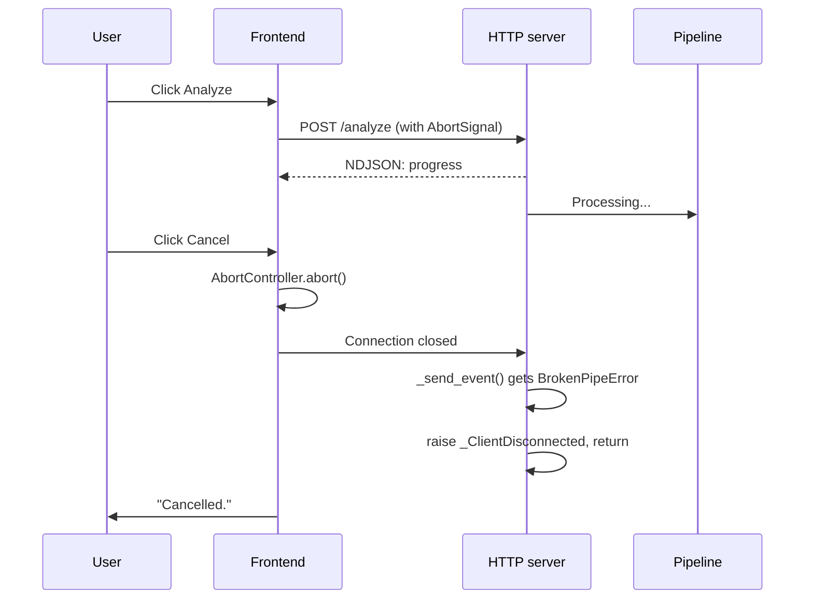

**Behavior on cancel**:

`_send_event()` of py-analyze-common's `GuiHandler` (`vendor/py-analyze-common/src/analyze_common/server.py`) raises `ClientDisconnected` when its write fails, so a cancel is detected only when the next NDJSON event is sent.
That is, long-blocking synchronous work like the following
**keeps running until that stage finishes** even after a cancel:

- `ffmpeg` / `ffprobe` child processes (`run_ffmpeg()` of py-analyze-common's
  `analyze_common/ffmpeg.py` / `subprocess.run`): a cancel sends no signal to the process, so
  PCM extraction and getting the duration run to the end. Ending the app kills a running `ffmpeg`
- `scipy.signal.welch` / `resample_poly`: NumPy/SciPy's C loops do not
  receive Python signals
- `yt_dlp.YoutubeDL.extract_info(download=True)`: the download and the audio
  extraction run to the end (no progress hook can stop them)

Right after a cancel the user immediately sees "Cancelled.", but background
processor / network usage remains until the stage finishes. Improving this behavior would
require implementing cancel propagation to the child processes through `Popen` + `terminate()`,
and it is not adopted because of the trade-off between complexity and
when memory is released.

### Theme

A 3-way theme switch (Light, then Dark, then Auto, then Light again):

- **Light**: always the light theme
- **Dark**: always the dark theme
- **Auto**: follows the operating system's (OS) `prefers-color-scheme` (default)

All colors are managed with Cascading Style Sheets (CSS) custom properties (`--bg`, `--text`, `--accent`, etc.).
The Canvas charts get the theme colors with `getThemeColors()` when drawing.
The charts are redrawn when the theme is switched. The choice is saved together with the language choice in the app's settings file (`settings.json`) and is used on the next launch too (reading is in the [White-flash prevention](#white-flash-prevention) diagram, saving is `POST /settings`).

### White-flash prevention

The window and the page get the theme before the first paint:

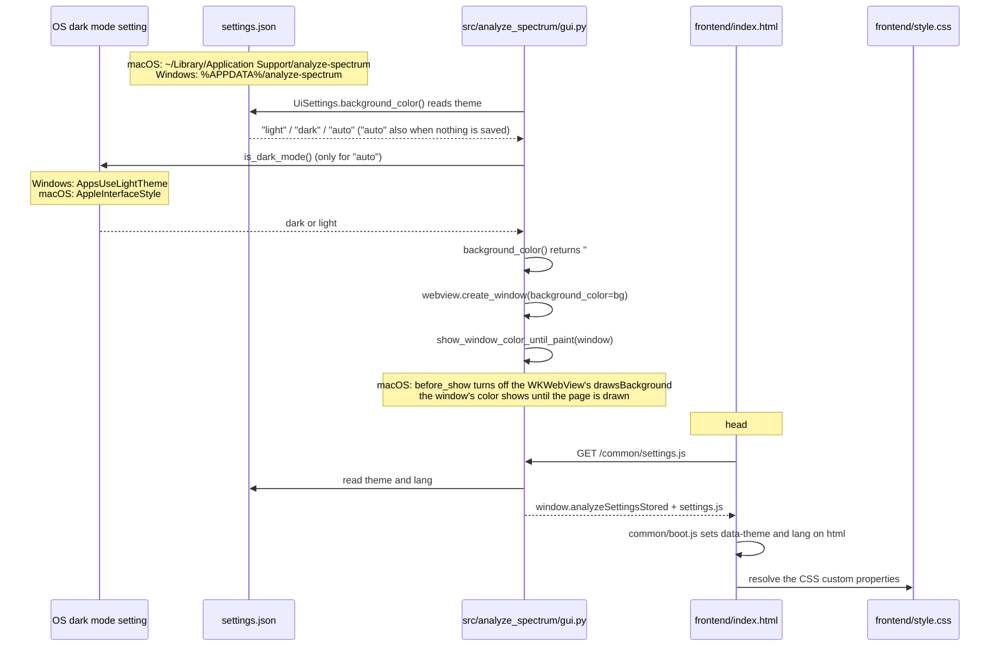

### Auto-update

The installed app checks whether the latest release has a newer version at launch (when "Check at launch" in the settings dialog is ON) and from "Check now" in the settings dialog. What it fetches is the Windows installer or the macOS disk image (DMG).
The screen side (the settings button, the settings dialog, the confirmation dialog) is handled by `vendor/py-analyze-common/src/analyze_common/web/update.js`, and fetching, verifying and applying by `vendor/py-analyze-common/src/analyze_common/update.py`; both are shared with analyze-loudness.
The `/update/*` endpoints are `GuiHandler`'s (`vendor/py-analyze-common/src/analyze_common/server.py`). What this app owns is `UPDATE_CONFIG` in `src/analyze_spectrum/update.py`, the exit handling (`_exit_for_update()`) in `src/analyze_spectrum/gui.py`, and stopping operations during the download (`_setUpdateLock()`) in `frontend/main.js`.
The signing key and the `.github/workflows/release.yaml` procedure are in the "Auto-update" section of the project's `CLAUDE.md`.

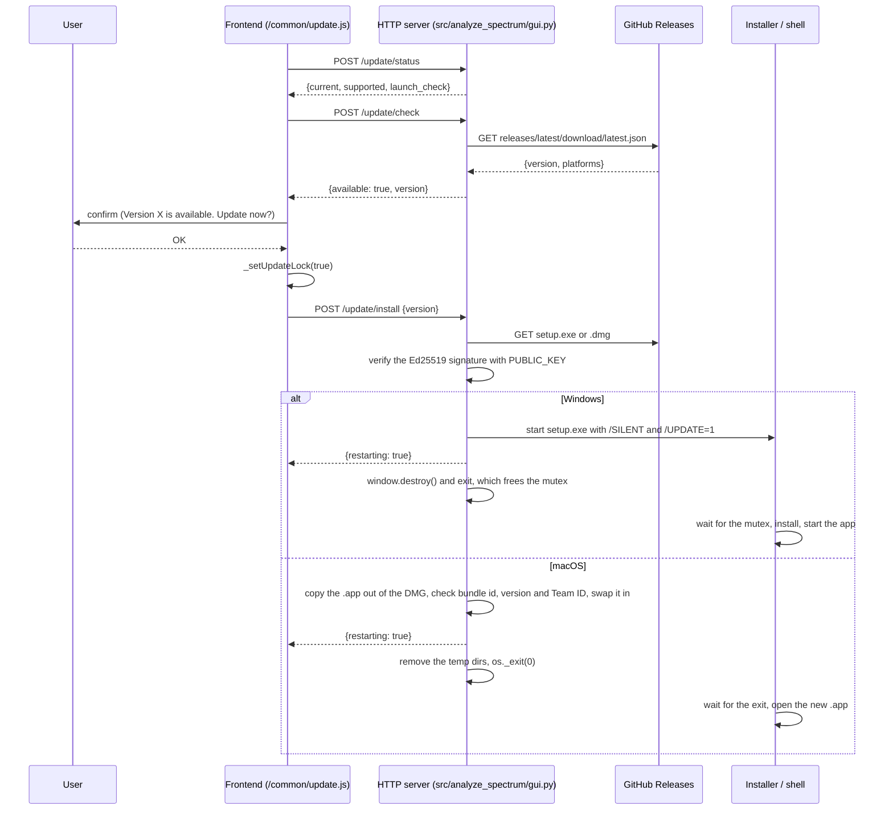

Cancel downloads nothing. The check at launch shows nothing when there is no newer version or when the check fails ("Check now" shows the result inside the dialog). During an analysis it declines without showing the confirmation dialog.
When any of the download, verification or apply fails, `_setUpdateLock(false)` gives the operations back, the status area shows the cause, and the app keeps running.
On Windows the installer shows the User Account Control (UAC) prompt, and by then the app has already exited. If UAC is declined, nothing is installed and the app stays closed (launching it again starts the old version, and if the check at launch is ON it offers the same update again).

## Charts

### Chart types

| Chart | Library | X-axis | Y-axis | Mode |
|-------|---------|--------|--------|------|
| PSD Spectrum | uPlot | log(freq) Hz | Power dB | Single / Multi-track overlay |
| 1/3 Octave | Canvas | Band center Hz | Energy dB | Single / Grouped bars |
| Transfer Function | Canvas | log(freq) Hz | Delta dB | Multi-track only |
| Estimated EQ | HyperText Markup Language (HTML) table | - | - | Multi-track only (1 table per transfer function) |
| Low-End Detail | Canvas | Linear freq 20-500Hz | Power dB | Single / Multi-track overlay |
| Mid-High Detail | Canvas | log(freq) 500Hz-20kHz | Power dB | Single / Multi-track overlay |

### Chart data flow

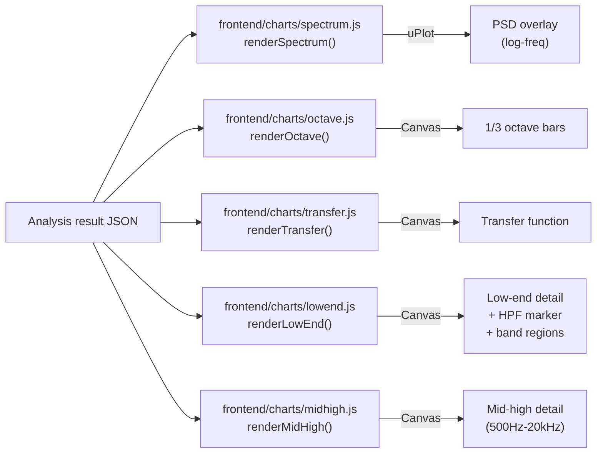

## Build & distribution

### Build pipeline

`python build.py` runs py-analyze-common's `analyze_common.build` with this app's names. It checks uPlot against the Secure Hash Algorithm 256 (SHA-256) values in `build_assets/checksums.json`, and the macOS ffmpeg / ffprobe against `build_assets/ffmpeg.json`.

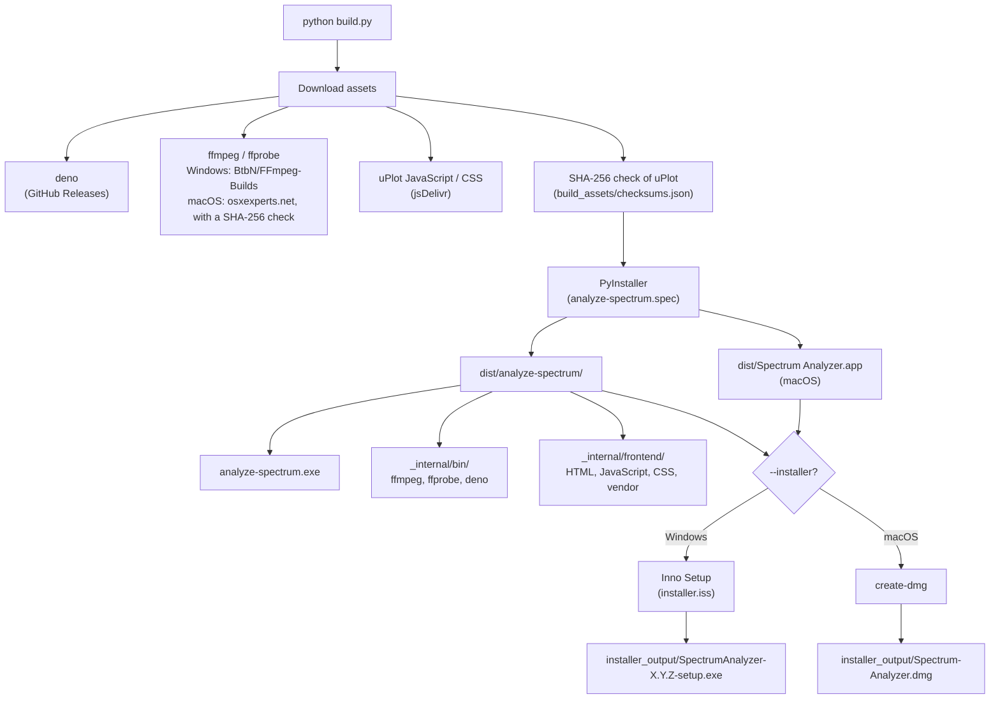

### Bundle structure

The Windows bundle (`analyze-spectrum.spec`). On macOS the same files are in `dist/Spectrum Analyzer.app`, with the binaries in `Contents/Frameworks/bin`.

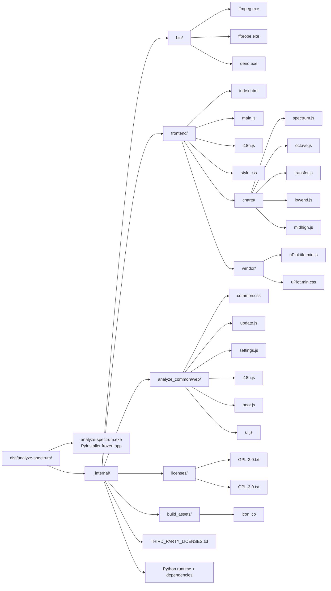

## Security

### Network

- The HTTP server binds to `127.0.0.1` (no external access)
- The port is assigned at random (chosen by the OS)
- A dropped file is taken by the page's drop handler in the window capture phase (`frontend/main.js`) and sent to `/upload`

### Input validation

- subprocess is run in list form (prevents shell injection)
- yt-dlp goes through the Python API (`yt_dlp.YoutubeDL`), so no subprocess stdout decoding is needed. The title is taken from the dict returned by `extract_info()` (the Document Object Model (DOM) shows it through `textContent`)
- POST bodies are limited to 10MB (JSON), 50MB (base64 image), 500MB (file upload)
- Upload file names go through `sanitize_filename()` (`vendor/py-analyze-common/src/analyze_common/download.py`): `\/:*?"<>|` and the control characters 0x00-0x1F are replaced with `_`, leading and trailing `.` and spaces are removed, a Windows reserved device name gets a leading `_`, and the name is cut to 200 characters
- Upload extensions are on an allowlist (`_ALLOWED_EXTENSIONS` in `src/analyze_spectrum/gui.py`, such as `.wav`, `.mp3`, `.m4a`)
- The duration parameter accepts only finite numbers of at least 0.01 minutes (`_parse_duration()`)
- The `sources` array of `/compare` must hold 2-6 non-empty strings, and a source that looks like a URL (`/analyze`'s `url` too) must be http or https (`_reject_bad_scheme()`)

### Cross-site scripting (XSS) prevention

- The frontend's DOM operations are based on `textContent` (no HTML interpretation of user input)
- `showError()` (`_renderError()` of `vendor/py-analyze-common/src/analyze_common/web/ui.js`) clears the status with `textContent = ""` and then sets the message with `textContent`
- When `/load` reports an outdated JSON, `_confirmModal()` (`frontend/main.js`) draws a modal in the page and sets its message and the JSON's source with `textContent`

### File system

- Temporary upload files are deleted automatically with `tempfile.mkdtemp` + `atexit`
- Cache files are deleted automatically with `tempfile.mkdtemp` + `atexit`
- The cache copy of `/save` uses `shutil.copy2` (only to a path chosen in the native dialog)

### Build and distribution

- Build-time assets: uPlot and the macOS ffmpeg / ffprobe are checked against SHA-256 values in the repository (`build_assets/checksums.json`, `build_assets/ffmpeg.json`). The Windows ffmpeg / ffprobe (the pinned series' build in BtbN's `latest`) and deno (its latest release) are not pinned
- The release jobs install Python packages only from the hash-pinned `requirements/*.txt`, and Inno Setup / create-dmg from downloads checked against SHA-256 in `.github/workflows/release.yaml`
- The frozen build puts `_MEIPASS/bin` at the front of `PATH`
- What auto-update fetches is applied only after its Ed25519 signature is verified with the public key built into the app ([Auto-update](#auto-update))

## Design decisions

### Low-frequency 1/3-octave band interpolation

The frequency resolution of the Welch PSD (nperseg=4096, 48kHz) is 11.72 Hz.
The low-frequency 1/3-octave bands are narrower than that, so a band can hold one fast Fourier transform (FFT) bin or none:

| Band center | Band width | FFT bins |
|-------------|-----------|----------|
| 25 Hz | 5.8 Hz | 1 (23.44 Hz) |
| 31.5 Hz | 7.3 Hz | 1 (35.16 Hz) |
| 40 Hz | 9.3 Hz | 0 |
| 50 Hz | 11.6 Hz | 1 (46.88 Hz) |

When a band contains no FFT bin, `np.interp` interpolates the PSD at the band's center
frequency, and the energy is estimated by multiplying it by the bandwidth.

### Chunked Welch PSD for long signals

scipy.signal.welch internally allocates an intermediate array of segments × frequency bins.
For a long file (for example about 4 hours: 350,058 segments × 2,049 bins ≈ 5.3 GiB)
it runs out of memory.

The signal is split into chunks of 10 minutes (28,800,000 samples), and the PSDs of the chunks
are averaged into the final result. The frequency resolution does not change.

## Tests

### Test layout

| File | Kind | Main target |
|----------|------|----------|
| `tests/conftest.py` | fixture | Shared Waveform Audio File Format (WAV) byte generation (`_make_wav_bytes`, `wav_file`, `wav_file_b`), `_isolated_settings`, which points the settings file at a temporary folder, and `analyze_common.testing.configure()` for this repository and package |
| `tests/test_analysis.py` | unit | The analysis core (Welch PSD, 1/3 octave, metrics) |
| `tests/test_pcm.py` | unit | ffmpeg to PCM conversion |
| `tests/test_cli.py` | unit | argparse + CLI integration |
| `tests/test_gui.py` | unit | `src/analyze_spectrum/gui.py` (with mocks). Includes the update endpoints, `UPDATE_CONFIG`, and saving the theme and language (`/settings`, `/common/settings.js`, the window's background color) |
| `tests/test_integration.py` | integration | HTTPServer + the analysis pipeline |
| `tests/test_cache_failures.py` | integration | Cache fallback and failed analyses through the real HTTP handler |
| `tests/test_dialog_busy.py` | unit | Mutual exclusion of native dialogs (`_dialog_lock`) |
| `tests/test_ffmpeg_binary.py` | integration | Checks the ffmpeg / ffprobe on PATH with the app's PCM conversion and ffprobe reading (`EXPECT_FFMPEG_DIR` selects the bundled binaries) |
| `tests/test_release_workflow.py` | unit | That `.github/workflows/release.yaml` runs `tests/test_ffmpeg_binary.py` on the ffmpeg / ffprobe in the distributed files, that only `create-release` can write and it runs no Python, that the job holding the update signing key has a read-only token and installs only the hash-pinned yt-dlp, that the Developer ID identity is imported right before codesign and deleted when codesign ends, that the release jobs install packages only from `requirements/*.txt` and Inno Setup / create-dmg only after a SHA-256 check, that `requirements/release.txt` satisfies `pyproject.toml`, and that every `requirements/*.txt` resolves, with its own pins as constraints, to exactly the packages it pins under the same environment markers (the tests are py-analyze-common's `analyze_common.testing.release_workflow`) |
| `tests/test_third_party_licenses.py` | unit | The full GNU General Public License (GPL) texts that `THIRD_PARTY_LICENSES.txt` points at, and the spec / `installer.iss` that bundle them (`analyze_common.testing.third_party_licenses`) |
| `tests/test_yt_dlp_ejs.py` | unit | That the installed yt-dlp-ejs has the version (major.minor) and the script hashes the installed yt-dlp accepts (`analyze_common.testing.yt_dlp_ejs`) |
| `tests/test_frontend.py` | end-to-end (e2e) | Playwright headless Chromium runner. Runs the update check, approval, failure and settings save, and saving the theme and language and restoring them on the next launch, on the actual `frontend/index.html`, and the `h1` color, the result title row, the first Tab, the summary tables' width, long track labels and the status line |
| `tests/test_chart_rendering.py` | e2e | The comparison charts and their Portable Network Graphics (PNG) export with the real browser scripts |
| `tests/test_browser_operations.py` | e2e | Context menu editing and keyboard navigation, track ordering, file drops, saving results and file selection through the app's page |
| `tests/frontend/test_ui.js` | browser | Frontend UI state tests |
| `tests/js_coverage.py` | tool | With `--js-coverage=PATH`, the V8 coverage of `frontend/*.js` that the Playwright tests run, written as LCOV |
| `tests/test_js_coverage.py` | unit | `tests/js_coverage.py`: matching V8 ranges to lines, and the LCOV it writes |

### Integration tests

`tests/test_integration.py` starts `HTTPServer` directly without pywebview
and verifies each endpoint through the real analysis pipeline.

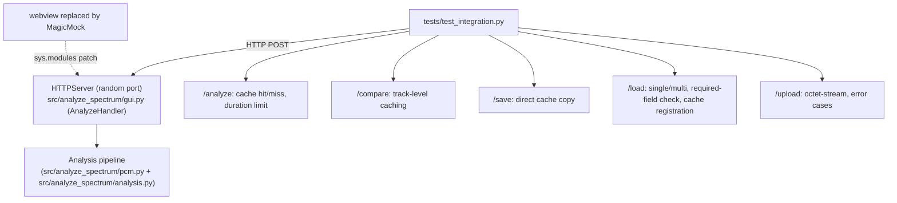

### Frontend UI tests

`tests/test_frontend.py` starts headless Chromium with Playwright,
opens `tests/frontend/test_ui.html` through a local HTTP server,
and reads the result from `window._testResult`.

`tests/frontend/test_ui.js` mocks fetch and verifies the DOM state directly:

- Adding / removing tracks
- The queue rows (number, kind, button names, colors)
- Rejecting duplicate tracks
- The 6-track limit
- Load JSON (single / multiple / accepting and rejecting an old schema) + keeping the pending source
- The theme toggle (Light, Dark, Auto)
- Clear All
- The setBusy button state
- Aborting the NDJSON stream
- The Submit label (including the dynamic update from urlInput input)
- Merging the pending urlInput on Submit (NDJSON stream mock)
- Rejecting the 6-track limit on Submit
- Single analysis with 1 track + an empty urlInput
- Keeping the urlInput value on Remove Track
- The estimated EQ tables in the comparison result and in Save Image
- The confirm modal closing on every answer
- No emoji in the UI sources and status icons

`playwright>=1.40` is a dev dependency (`pyproject.toml`).

With `--js-coverage=PATH`, `tests/js_coverage.py` records the line coverage of `frontend/*.js` (outside `frontend/vendor/`) on every Chromium page these tests open, and writes it as LCOV. Continuous integration (CI) uploads it to Codecov with the Python coverage.

## Known limitations

- The GUI's comparison is limited to 6 tracks (chart readability); the CLI has no limit
- Real-time input (microphone) is out of scope
- 48kHz mono float32 = 192 KB/s, about 115 MB for 10 minutes (memory constraint)
- Long files are handled by extracting the middle with `--duration` of the CLI (a new analysis in the GUI is always of the full length; a loaded JSON keeps its own length, [Result cache](#result-cache))
- A cancel does not stop the stage that is running ([Cancel](#cancel))
- Avoiding upload file name collisions in `/upload` is a time-of-check to time-of-use (TOCTOU) pattern (accepted for a single-user app)

## Reference standards

| Standard | Usage |
|----------|-------|
| American National Standards Institute (ANSI) S3.5-1997 | Speech Intelligibility Index (SII) band importance function (Low/Intel ratio) |
| International Electrotechnical Commission (IEC) 60268-16:2020 | Speech Transmission Index (STI) reference (intelligibility bands) |
| Upward spread of masking | Low-end masking analysis rationale |
