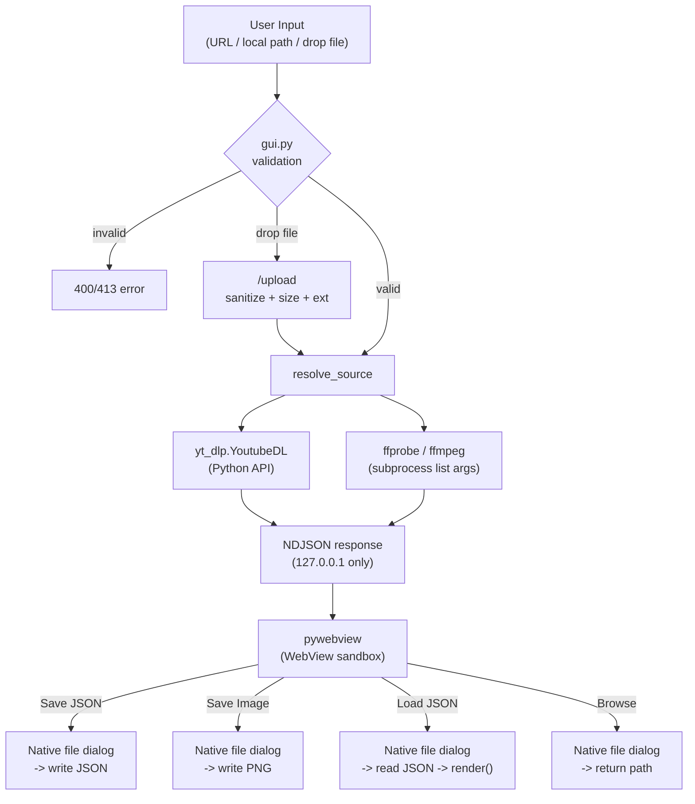

# Security Audit Report

**Date**: 2026-04-18 (SEC-22 と Summary の件数は 2026-04-26 に追補、CI/CD 節は 2026-09-30 に確認、SEC-23 は 2026-10-17 に追補、SEC-24 は 2026-10-20 に追補)
**Scope**:
- 2026-04-18 の監査 (2026-04-26 に SEC-22 を追補): CLI (`src/analyze_spectrum/`), GUI (`src/analyze_spectrum/gui.py`), Frontend SPA (`frontend/`), Build/Distribution (`build.py`, `analyze-spectrum.spec`, `installer.iss`)
- 2026-09-30 の確認: CI (`.github/workflows/`, `.github/tests/`) の action の固定と検査 (CI/CD 節)
- 2026-10-20 の追補 (SEC-24): 自動更新 (`src/analyze_spectrum/update.py`、`gui.py` の `/update/*`、`release.yaml` の署名、vendor の `analyze_common.update` / `analyze_common/web/update.js` / `installer/auto_update.iss`)

## Summary

| Category | Findings | Open | Resolved | Accepted |
|----------|----------|------|----------|----------|
| Local HTTP Server | 3 | 0 | 2 | 1 |
| Input Validation | 4 | 0 | 4 | 0 |
| Command Injection | 1 | 0 | 0 | 1 |
| File I/O (Save/Load/Browse) | 5 | 0 | 2 | 3 |
| File Upload (Drag & Drop) | 2 | 0 | 2 | 0 |
| Data Exposure | 1 | 0 | 0 | 1 |
| XSS | 1 | 0 | 0 | 1 |
| Subprocess Management | 2 | 0 | 1 | 1 |
| Bundled Binaries | 2 | 0 | 2 | 0 |
| Resource Management | 2 | 0 | 0 | 2 |
| Software Update | 1 | 0 | 0 | 1 |
| **Total** | **24** | **0** | **13** | **11** |

**Open: 0** / Resolved: 13 / Accepted (risk acknowledged): 11

Summary の件数は 2026-10-20 に SEC-24 を追加した時点のもの (2026-04-18 の監査の初版は SEC-01〜SEC-21 の 21 件、Resolved 11。2026-04-26 の SEC-22 追補で 22 件、Resolved 12。2026-10-17 の SEC-23 追補で 23 件、Resolved 13)。個々の指摘の本文は、その後のコード変更に合わせて更新されている (履歴は `git log -- docs/security-audit.md`)。2026-09-30 の CI/CD 節の確認はこの表に含まない。

---

## Resolved Findings

### SEC-01: バンドルバイナリの整合性検証 -- RESOLVED

- **Risk**: LOW -> RESOLVED
- **Location**: [build.py](../build.py), [build_assets/checksums.json](../build_assets/checksums.json), [build_assets/ffmpeg.json](../build_assets/ffmpeg.json)
- **Resolution**: 取得元ごとに照合の仕方が違う。いずれも git 管理対象のファイルが値を持つ。
  - uPlot (jsDelivr CDN、版を固定): `build_assets/checksums.json` の SHA256 と照合し、不一致でビルドを止める。`python build.py --update-checksums` がダウンロードして値を書き直す
  - macOS の ffmpeg / ffprobe (osxexperts.net): `build_assets/ffmpeg.json` の SHA256 と、zip の中のバイナリを照合し、不一致でビルドを止める (`analyze_common.ffmpeg_release.fetch_macos_binary()`)。値は osxexperts.net のページが載せるもの
  - Windows の ffmpeg / ffprobe (BtbN/FFmpeg-Builds の系列の latest) と deno (GitHub Releases の latest): 取得するたびに中身が変わりうるので SHA256 を固定せず、HTTPS の取得元を信頼する
  - JSON 構造は analyze-loudness と統一

### SEC-02: ローカル HTTP サーバーがループバック以外からアクセス可能 -- RESOLVED

- **Risk**: LOW -> RESOLVED
- **Location**: [gui.py](../src/analyze_spectrum/gui.py)
- **Resolution**: `HTTPServer(("127.0.0.1", 0), ...)` で 127.0.0.1 にバインド。外部ネットワークからのアクセス不可。ポートは OS が自動割当 (port 0) するため、他アプリとの競合も予測困難性も同時に確保。

### SEC-03: URL / ファイルパス入力のバリデーション (GUI) -- RESOLVED

- **Risk**: LOW -> RESOLVED
- **Location**: [gui.py](../src/analyze_spectrum/gui.py) `_handle_analyze` / `_handle_compare`
- **Resolution**: `url` フィールドの存在と `str` 型をチェック。空文字列は 400 エラーで拒否。比較モードでは `sources` 配列の最小 2 件 / 最大 6 件を強制。URL でない場合は `resolve_source` 内で `Path.exists()` チェックし、存在しないファイルは `FileNotFoundError` で拒否。

### SEC-04: duration パラメータのバリデーション -- RESOLVED

- **Risk**: LOW -> RESOLVED
- **Location**: [gui.py](../src/analyze_spectrum/gui.py) `_parse_duration`
- **Resolution**: `float()` 変換 + `math.isfinite()` (NaN / ±Inf 拒否) + 正数チェック。不正値は 400 エラーで拒否。`compute_middle` も `total_sec > 0` / `duration_min > 0` を検証。

### SEC-05: Windows subprocess コンソール非表示 -- RESOLVED

- **Risk**: LOW -> RESOLVED
- **Location**: [__init__.py](../src/analyze_spectrum/__init__.py) -> `analyze_common.platform.subprocess_kwargs()`
- **Resolution**: frozen mode 時に `STARTF_USESHOWWINDOW` を設定。ffmpeg / ffprobe / deno のコンソールウインドウを抑制し、UX を改善。yt-dlp は Python API として動作するため subprocess 起動しない。

### SEC-06: バンドルバイナリのバージョン管理 -- RESOLVED

- **Risk**: MEDIUM -> RESOLVED
- **Location**: [build.py](../build.py)
- **Resolution**: `build.py` が GitHub API / 公式配布元から最新安定版を取得。`--skip-download` フラグで既存バイナリの再利用も可能。全て HTTPS 経由でダウンロード。

### SEC-07: 不正 JSON リクエストボディの処理 -- RESOLVED

- **Risk**: LOW -> RESOLVED
- **Location**: [gui.py](../src/analyze_spectrum/gui.py) `_read_json_body`
- **Resolution**: `_read_json_body()` で `JSONDecodeError` / `ValueError` を catch し `None` を返却、呼び出し側が 400 エラーで拒否。ペイロードサイズ上限 (`_MAX_BODY = 10 MB`, 画像系は `_MAX_IMAGE_BODY = 50 MB`) で過大ペイロードも拒否。

### SEC-08: アップロードファイル名のサニタイズ -- RESOLVED

- **Risk**: MEDIUM -> RESOLVED
- **Location**: [download.py](../src/analyze_spectrum/download.py) `sanitize_filename`, [gui.py](../src/analyze_spectrum/gui.py) `_handle_upload`
- **Resolution**: `sanitize_filename` が `/`, `\`, `:`, `*`, `?`, `"`, `<`, `>`, `|` を `_` に置換。先頭末尾の `.` と空白を strip。これにより `../../../etc/passwd.wav` 等の path traversal 攻撃は `_.._.._etc_passwd.wav` のように無害化される。さらに拡張子を allowlist (`.wav, .mp3, .m4a, .flac, .ogg, .opus, .wma, .aac, .aiff, .aif, .webm, .mkv, .mp4`) に限定。
  - 同名ファイル衝突時は timestamp suffix で回避
  - 書き込み先は `_upload_dir` (`tempfile.mkdtemp`) に固定、`atexit` で削除

### SEC-09: アップロードサイズ上限 -- RESOLVED

- **Risk**: MEDIUM -> RESOLVED
- **Location**: [gui.py](../src/analyze_spectrum/gui.py) `_handle_upload`
- **Resolution**: `_MAX_UPLOAD = 500 MB` で Content-Length をチェックし、超過時は 413 で拒否。受信途中で切断された場合 (`remaining > 0`) は書き込み途中のファイルを削除し 400 エラー。

### SEC-10: アップロード完了前のファイル断片残留 -- RESOLVED

- **Risk**: LOW -> RESOLVED
- **Location**: [gui.py](../src/analyze_spectrum/gui.py) `_handle_upload`
- **Resolution**: 受信チャンクループが `remaining > 0` のまま抜けた場合 (Content-Length 分を受信しきれなかった場合) は `os.unlink` で途中ファイルを削除し 400 エラー。クライアント切断時でもディスクに不完全データが残らない。

### SEC-23: 事前確認の要らない Content-Type の POST を受け付ける -- RESOLVED

- **Added**: 2026-10-17 (2026-04-18 の監査の後に追補。Summary の件数もこの時点で更新)
- **Risk**: MEDIUM -> RESOLVED
- **Location**: [gui.py](../src/analyze_spectrum/gui.py) `do_POST`, `_check_content_type`
- **Resolution**: POST の本文を Content-Type に関係なく JSON として読んでいたため、ランダムなポートを見つけた別サイトのページが、CORS の事前確認 (preflight) の要らない `text/plain` や `application/x-www-form-urlencoded` の POST で `/analyze` を起動できた (ローカルのパスも解析対象にできる)。修正前は `/analyze` に `text/plain` / フォーム形式 / Content-Type なしの POST を送ると 200 で解析が始まり、`text/plain` の `/upload` はファイルを保存した。Host 検証の後に `_check_content_type()` を置き、Content-Type (`;` より前を小文字にしたもの) が JSON のエンドポイントでは `application/json`、`/upload` では `application/octet-stream` でなければ 415 を返す。ブラウザはこれらの型の別オリジンへの POST を事前確認の後にしか送らず、このサーバーは事前確認に応答しない。analyze-loudness にも同じ修正がある。

### SEC-22: pywebview ダイアログ例外のサイレント握りつぶし -- RESOLVED

- **Added**: 2026-04-26 (2026-04-18 の監査の後に追補。Summary の件数もこの時点で更新)
- **Risk**: LOW -> RESOLVED
- **Location**: [gui.py](../src/analyze_spectrum/gui.py) `_handle_save`, `_handle_save_image`, `_handle_load`, `_handle_browse`; [main.js](../frontend/main.js) clipboard copy
- **Resolution**: `create_file_dialog()` の例外を `except Exception: result = None` で握りつぶしていたため、ダイアログ障害時にユーザーへ「キャンセル」と誤通知していた。`traceback.print_exc()` + `_json_error(500, ...)` でフロントエンドにエラーを返却するよう修正。POST ハンドラの二重 catch 内側 (`pass`) も `traceback.print_exc()` に変更し、エラーレスポンス送信失敗を記録。フロントエンドのクリップボード copy 失敗は `btn.copy_failed` テキストで通知。analyze-loudness にも同一修正を適用。

### SEC-11: HTTP レスポンスのメッセージ フレーミング -- RESOLVED

- **Risk**: LOW -> RESOLVED
- **Location**: [gui.py](../src/analyze_spectrum/gui.py) `_json_response`, `_send_event`
- **Resolution**: 通常 JSON レスポンスに `Content-Length` ヘッダーを明示的に付与。EOF-framing ベースの切断で発生していた `ConnectionResetError` / テスト flakiness を解消。NDJSON ストリームは従来通りチャンク送信。さらにレスポンスボディの書き込みを `self.wfile.write()` から `self.request.sendall()` に変更。`wfile` (`SocketIO`, `wbufsize=0`) は内部で `socket.send()` に委譲し、ペイロードが `SO_SNDBUF` (~128 KB on macOS) を超えると partial write するため、大きな JSON レスポンスが黙って切り詰められる問題があった。`sendall()` は全バイト送信まで内部ループするため確実に配信される。

---

## Accepted Findings (risk acknowledged)

### SEC-12: ローカル HTTP サーバーの同一ホスト攻撃面 -- ACCEPTED

- **Risk**: VERY LOW
- **Location**: [gui.py](../src/analyze_spectrum/gui.py)
- **Analysis**: 127.0.0.1 バインドのため、同一マシン上の他プロセスからは `/analyze`, `/compare`, `/upload` 等のエンドポイントにアクセス可能。ただし:
  - ポートはランダム (port 0) のため予測困難
  - ブラウザの same-origin policy により、外部サイトからの CSRF は Content-Type: application/json の POST が preflight で阻止される
  - `/upload` は binary body + custom `X-Filename` header 前提のため、HTML フォームからの simple request ではトリガーできない (preflight 発生)
  - ローカルアプリの標準的な設計パターン
  - 最悪でも音声の分析が実行されるのみ（データ破壊なし）

### SEC-13: subprocess への URL / パス直接渡し -- SAFE

- **Risk**: NOT VULNERABLE
- **Location**: [pcm.py](../src/analyze_spectrum/pcm.py), [download.py](../src/analyze_spectrum/download.py)
- **Analysis**:
  - `subprocess.run(cmd, ...)` はすべてリスト引数 (`shell=False`) -> shell injection 不可
  - yt-dlp は Python API (`yt_dlp.YoutubeDL`) 経由で使用、subprocess を介さない
  - ユーザーが自分で入力した URL / ファイルパスをローカルで実行するため、攻撃ベクトルが成立しない

### SEC-14: フロントエンド XSS -- SAFE

- **Risk**: NOT VULNERABLE
- **Location**: [main.js](../frontend/main.js)
- **Analysis**:
  - トラックラベル / タイトル -> `textContent` (HTML パース不可)
  - `innerHTML` は数値フォーマット (`.toFixed()`) と静的テンプレート文字列のみ
  - ユーザー由来文字列は `innerHTML` パスに含まれない
  - `/load` エンドポイント経由で読み込んだ JSON も同じ表示パスを通るため XSS 耐性あり

### SEC-15: エラーメッセージによる内部情報露出 -- ACCEPTED

- **Risk**: VERY LOW
- **Location**: [gui.py](../src/analyze_spectrum/gui.py)
- **Analysis**: エラーメッセージは NDJSON / JSON で 127.0.0.1 にのみ送信される。ローカルアプリのためデバッグ情報の露出リスクは実質ゼロ。ffprobe/ffmpeg の stderr 末尾 500 文字を含めるが、攻撃者は同一ホスト上のユーザーに限定される。

### SEC-16: 一時ファイルのクリーンアップ -- SAFE

- **Risk**: NOT VULNERABLE
- **Location**: [gui.py](../src/analyze_spectrum/gui.py), [cli.py](../src/analyze_spectrum/cli.py), [pcm.py](../src/analyze_spectrum/pcm.py)
- **Analysis**:
  - 解析中の作業ディレクトリ: `tempfile.TemporaryDirectory` + `with` ブロック -> 例外発生時も自動削除
  - PCM 抽出中間ファイル: `tempfile.NamedTemporaryFile` + `try/finally` + `unlink(missing_ok=True)`
  - `_upload_dir`, `_cache_dir`: `tempfile.mkdtemp` + `atexit.register(shutil.rmtree, ...)` で通常終了時にクリーンアップ

### SEC-17: `/save` エンドポイントによるファイル書き込み -- ACCEPTED

- **Risk**: VERY LOW
- **Location**: [gui.py](../src/analyze_spectrum/gui.py) `_handle_save`
- **Analysis**: `/save` POST で JSON データをユーザー選択パスに書き込み可能。ただし:
  - 保存先パスは pywebview のネイティブファイルダイアログでユーザーが選択
  - 127.0.0.1 + ランダムポートのため外部からのアクセス不可
  - 書き込みエラーは `OSError` でキャッチし、エラーレスポンスを返却
  - 書き込む内容は分析結果 JSON のみ (実行可能コードではない)
  - キャッシュ済みデータは `shutil.copy2` でコピー、未キャッシュ時はリクエストボディから書き出し

### SEC-18: `/save-image` エンドポイントによる PNG 書き込み -- ACCEPTED

- **Risk**: VERY LOW
- **Location**: [gui.py](../src/analyze_spectrum/gui.py) `_handle_save_image`
- **Analysis**: `/save-image` POST で base64 エンコード PNG をユーザー選択パスに書き込み。
  - `data:image/png;base64,` prefix を検証し、不正な形式は 400 で拒否
  - `base64.b64decode` が不正な base64 を `ValueError` として拒否（catch 済み）
  - 保存先は SEC-17 と同様にネイティブダイアログでユーザーが選択
  - 127.0.0.1 + ランダムポートのため外部からの呼び出し不可

### SEC-19: `/load` および `/browse` エンドポイントによるファイル読み込み -- ACCEPTED

- **Risk**: VERY LOW
- **Location**: [gui.py](../src/analyze_spectrum/gui.py) `_handle_load`, `_handle_browse`
- **Analysis**:
  - `/load`: ユーザー選択パスから JSON を読み込み、`spectrum` フィールドの存在を検証。`tracks` キーを含む古い compare 形式は明示的に 400 で拒否 (loading individual tracks への誘導)。描画に要る項目が欠けている場合は再分析を促し、`meta.schema_version` が整数でなければ 400 で拒否
  - `/browse`: 音声ファイル選択ダイアログを開き、選択パスを返却するのみ (読み込みや実行は行わない)
  - どちらも `OSError` / `JSONDecodeError` を catch しエラーレスポンスを返却
  - 127.0.0.1 + ランダムポートのため外部からの呼び出し不可
  - 読み込んだデータはフロントエンドの `render()` に渡されるが、ユーザー由来文字列は `textContent` 経由で安全に表示（SEC-14 参照）

### SEC-20: クライアント切断時の subprocess orphaning -- ACCEPTED

- **Risk**: LOW
- **Location**: [gui.py](../src/analyze_spectrum/gui.py), [pcm.py](../src/analyze_spectrum/pcm.py), [download.py](../src/analyze_spectrum/download.py)
- **Analysis**: フロントエンドの Cancel (AbortController) でストリーム読み取りを中断すると、サーバー側の `_send_event()` が `_ClientDisconnected` を発生させて分析を中断する。ただし `yt_dlp.YoutubeDL.extract_info()` や `subprocess.run()` (ffmpeg/ffprobe) がブロッキング中の場合、該当処理は完了まで実行が継続する。
  - `_ClientDisconnected` は次の `_send_event()` 呼び出し時にのみ検出される
  - yt_dlp ダウンロード中や ffmpeg PCM 抽出中 (数秒〜十数秒) にキャンセルしても、該当処理は完了まで実行
  - 完了後に `_send_event()` が `_ClientDisconnected` を送出し、以降の処理を中断
  - `TemporaryDirectory` / `atexit` cleanup により一時ファイルのリークは発生しない
- **Accepted**: 最大でも十数秒の不要な subprocess 実行のみ。単一ユーザーのローカルアプリでは DoS やリソース枯渇のリスクなし

### SEC-21: キャッシュディレクトリの肥大化 -- ACCEPTED

- **Risk**: VERY LOW
- **Location**: [gui.py](../src/analyze_spectrum/gui.py) `_cache_put`
- **Analysis**: `_cache_dir` に解析結果 JSON をセッション全体で蓄積するため、同一セッション中に多数の URL / ファイルを解析するとディスク使用量が増加する。ただし:
  - 解析結果 JSON 1 件あたり数十〜数百 KB (スペクトルグラフ配列) 程度で、数百件でも 100 MB 未満
  - `atexit.register(shutil.rmtree, _cache_dir, True)` でアプリ終了時に削除
  - 異常終了 (SIGKILL 等) では残存するが、`spectrum_cache_` prefix で `tempfile` 領域に作成されるため OS 側の clean-up 対象
  - 単一ユーザーのローカルアプリでは実害なし

### SEC-24: 自動更新で取得したインストーラーの実行 -- ACCEPTED

- **Added**: 2026-10-20 (自動更新の追加と同時に追補。Summary の件数もこの時点で更新)
- **Risk**: LOW
- **Location**: [update.py](../src/analyze_spectrum/update.py) `PUBLIC_KEY` / `UPDATE_CONFIG`; [gui.py](../src/analyze_spectrum/gui.py) `_handle_update_settings`, `_handle_update_check`, `_handle_update_install`, `_exit_for_update`; [release.yaml](../.github/workflows/release.yaml) Sign Update Manifest; vendor の `analyze_common/update.py`
- **Analysis**: アプリはネットワークから取得したインストーラーを実行する (Windows) か、取得した `.app` で自分を置き換える (macOS)。取得物が本物であることを次の順に確かめる:
  - 取得元: `https://github.com/semnil/analyze-spectrum/releases/latest/download/latest.json`。マニフェストが指すダウンロード先は `https://github.com/semnil/analyze-spectrum/releases/download/<tag>/<name>` の形のものだけを受け付け、https から http へのリダイレクトは辿らない
  - 署名: Ed25519。署名の対象は成果物の SHA-256 だけでなく product (`analyze-spectrum`)・版・platform を含む文で、公開鍵はアプリに組み込んだ `PUBLIC_KEY`。別の版に付け替えた正規の成果物・別 OS 向けの成果物・analyze-loudness の成果物は検証で落ちる (`latest.json` の版を書き換える・他 platform の署名に差し替える・成果物の 1 バイトを反転する、の 3 通りがいずれも拒否されることを、`release.yaml` と同じ署名コマンドで作ったマニフェストとローカルのリリースサーバーで確認した)。検証に通らないファイルは削除してから失敗を返す
  - 版: 今の版より新しい版だけを更新として扱う (古い正規のリリースへの差し戻しは起きない)
  - macOS では加えて、取得した `.app` の bundle identifier と版が一致し、今のアプリが Team ID 付きで署名されているときは同じ Team ID で `codesign --verify --deep --strict` に通ることを確かめる
  - 同意: 取得はユーザーが確認ダイアログで OK を選んだ後だけ行う。ただし `/update/install` 自体は SEC-12 と同じく同一ホストの他プロセスから直接呼べる。別オリジンのページからは Content-Type の検査 (SEC-23) で届かない。直接呼ばれた場合に起きるのは、直前の確認が見つけた正規の新しい版のインストールだけ
- **Accepted**:
  - 署名の秘密鍵 (GitHub の secret `UPDATE_SIGNING_KEY`) が漏れると、その鍵で署名した任意の成果物をインストール済みのアプリが受け入れる。secret の値は GitHub の画面・API からは読み出せないが、リポジトリへの書き込み権限があればワークフローから使える。リポジトリの権限の保護に委ねる
  - Windows の検証済みインストーラーは `%TEMP%` の下で実行する。同じユーザーの権限で動く他のプロセスは、検証から実行までの間に差し替えうる (そのプロセスは差し替えなしでも同じ権限で任意のコードを実行できる)
  - 更新の確認は起動のたびに github.com へ接続する (設定で止められる)。新しい版が無いときと確認に失敗したときは何も表示しない

---

## CI/CD (GitHub Actions)

**確認日**: 2026-09-30。各ワークフローの実物と、master のルールセット・Actions の許可ポリシーの現在値を確認した。2026-04-18 の監査には含まれない。「Dependabot の自動マージ」の行と、「外部 action のピン留め」「必須チェック」の行のうち `dependabot-auto-merge.yml`・`Test 🧪`・`auto-merge` の記述は 2026-10-20 に追加した。

| 項目 | 対策 |
|------|------|
| 外部 action のピン留め | `ci.yaml` / `release.yaml` / `tag-release.yml` / `ffmpeg-watch.yml` / `workflow-checks-test.yml` / `dependabot-auto-merge.yml` の `uses:` はコミット SHA (40 桁) と同じ行のバージョンコメント (`@<sha> # vX.Y.Z`) で固定する。タグ参照ではないため、タグの付け替えで実行内容が変わらない |
| 固定の検査 (`workflow-checks.yml`) | PR ごとに `pull_request_target` で既定ブランチの定義を実行し、PR の head のワークフロー・action ファイルを GitHub API (git trees / blobs) でデータとして取得して yq で読む。PR のコードは checkout も実行もせず、トークンは `contents: read`。対象は `jobs.<id>.uses` / `jobs.<id>.steps[*].uses` / `action.yml` の `runs.steps[*].uses` |
| 同一リポジトリの参照 | ステップの `./` は runner の作業領域に対して解決される (前のステップが置いた内容を実行しうる) ため拒否し、`$/` (実行中のコミットに解決) を使わせる。ジョブ単位の再利用ワークフローは `./` / `$/` とも呼び出し元と同じコミットから読まれるため許可する。ローカル参照のパスは `A-Z a-z 0-9 . _ -` と `/` に限り、空・`.`・`..`・末尾が `.` の要素と、参照先までの経路上の git tree のシンボリックリンク・サブモジュール (ASCII の大文字小文字を区別せず照合) を拒否する |
| 取得対象の健全性 | ワークフロー・action ファイルが通常ファイルでない (シンボリックリンク等) とき、action ファイル名が小文字の `action.yml` / `action.yaml` でないときは失敗する |
| dispatch での検査 (`workflow-checks.yml`、2026-10-20 追加) | `workflow_dispatch` に PR 番号を渡すと、`pull_request_target` が走らない PR (GITHUB_TOKEN が作ったもの) にも同じ検査を行う。既定ブランチ以外の ref で起動したとき、PR が open でないとき、PR のベースが既定ブランチでないとき、head が 40 桁の SHA でないときは失敗する。検査の `action-pins` ジョブのトークンは `contents: read` のまま。結果は `checks: write` だけを持つ `report` ジョブが、PR の head commit に `action-pins` という名前の check run として載せる (検査が失敗・中断したときは `failure`) |
| 検査の自己改変の防止 | `workflow-checks.yml` のパス・mode・blob SHA が既定ブランチと一致しない PR は失敗する。検査を変更するときは必須チェックを一時的に外してからマージする |
| 必須チェック | master のルールセットで `action-pins`・`Test 🧪` (`ci.yaml`)・`auto-merge` (`dependabot-auto-merge.yml`) を必須とし、ベースブランチへの追随を求める (`strict_required_status_checks_policy: true`)。バイパスは設定していない |
| 検査の回帰テスト | `.github/tests/workflow-checks-test.sh` を `workflow-checks-test.yml` が実行する (検査ファイル・テストを変更する PR と master への push)。偽の `gh` がフィクスチャの git tree を返し、拒否すべき参照と通すべき参照の判定と失敗理由を検査する。dispatch の入口 (PR の解決の判定、`report` が載せる check run の中身、ジョブの権限とつなぎ) も検査する |
| 版上げからのタグ作成 (`tag-release.yml`、2026-10-17 追加) | `workflow_run` で CI の完了後に走り、master の `push` と `workflow_dispatch` で成功した run だけを処理する (2026-10-20 に `workflow_dispatch` を追加。`ffmpeg-watch.yml` が GITHUB_TOKEN でマージした版上げは push の CI を起動しないため)。checkout するのは CI が検査した `head_sha`。権限は `contents: write` (タグの push) と `actions: write` (`release.yaml` の dispatch)。既存のタグは動かさない |
| 更新用マニフェストの署名 (`release.yaml`、2026-10-20 追加) | Create Release ジョブが secret `UPDATE_SIGNING_KEY` を `$RUNNER_TEMP` のファイル (umask 077、ステップの終了時に削除) に書き、`python -m analyze_common.update_manifest sign` で `latest.json` を作る。各署名を `src/analyze_spectrum/update.py` の `PUBLIC_KEY` で検証してから書き出す。secret が無いとき・鍵が `PUBLIC_KEY` と合わないとき・タグがアプリの版と違うときはステップが失敗し、Release は作られない (SEC-24) |
| Dependabot の自動マージ (`dependabot-auto-merge.yml`、2026-10-20 追加) | PR ごとに `pull_request` で走り、PR の作成者が `dependabot[bot]` のときだけ `dependabot/fetch-metadata` と `gh` のステップを実行する (他の PR ではステップを skip し、ジョブは成功を報告する)。PR のコードは checkout も実行もせず、PR 由来の値 (URL・head SHA・更新種別) は環境変数で渡す。更新種別が semver の patch のときだけ、読んだ head SHA を条件 (`--match-head-commit`) に自動マージ (merge commit) を予約し、それ以外の種別では予約を解除する。ジョブ `auto-merge` は master の必須チェックで、その head についての判定が出る前にはマージされない。権限はジョブ単位の `contents: write` と `pull-requests: write` で、使うトークンは `GITHUB_TOKEN` (secret は使わない)。自動マージによるマージは `GITHUB_TOKEN` によるもので、master への push はワークフローを起動しない。`workflow_dispatch` (2026-10-20 追加) では両ステップを skip し、起動したブランチの head commit に `auto-merge` を報告する。`pull_request` の run が承認待ちになる、GITHUB_TOKEN が作った PR (`ffmpeg-watch.yml`) のため。`dependabot/` のブランチでの dispatch と、`dependabot[bot]` が作った PR に含まれるコミットに対する dispatch は失敗し (check run はコミットに付くため、ブランチ名だけでは断れない)、判定はその PR の `pull_request` の run だけが行う (`.github/tests/dependabot-auto-merge-test.sh` が確かめる) |
| ffmpeg の更新による patch リリース (`ffmpeg-watch.yml`、2026-10-20 追加) | schedule と `workflow_dispatch` で、master の上でだけ走る (他の ref では失敗する)。detect と smoke のトークンは `contents: read`。land だけが `contents: write` (bot のブランチの push)・`pull-requests: write` (PR の作成とマージ)・`actions: write` (CI・`dependabot-auto-merge.yml`・`workflow-checks.yml` の dispatch) を持ち、固定値の PR と版上げの PR をレビューなしでマージする。マージの前に、各 PR で dispatch した CI・`auto-merge`・`action-pins` の成功と、`gh pr checks --required` を待つ。新しい固定値は osxexperts.net のページから作り、系列は `MAJOR.MINOR`・URL は `https://www.osxexperts.net/` の zip に限り、両ファイルをページの SHA256 と照合したものだけを使う (`analyze_common.ffmpeg_release`)。ジョブ間の値は `env:` で渡し、`run:` に式を埋め込まない。Release の publish は人が行う |
| `pull_request_target` の許可 | public リポジトリの `pull_request_target` は 2026-11-02 から明示的な許可が必要なため、`workflow-checks.yml` を対象とした Actions の許可ポリシーを設定している |

---

## Threat Model

### Attack Surface

| Entry Point | Protocol | Auth | Validation |
|------------|----------|------|------------|
| CLI args | Local | N/A | argparse + `compute_middle` validation |
| GUI HTTP (`/analyze`) | 127.0.0.1 only | N/A (localhost) | URL/source + duration + JSON body validation |
| GUI HTTP (`/compare`) | 127.0.0.1 only | N/A (localhost) | sources array (2-6) + duration validation |
| GUI HTTP (`/upload`) | 127.0.0.1 only | N/A (localhost) | size limit 500MB + extension allowlist + `sanitize_filename` |
| GUI HTTP (`/save`, `/save-image`) | 127.0.0.1 only | N/A (localhost) | Native file dialog + content validation |
| GUI HTTP (`/load`, `/browse`) | 127.0.0.1 only | N/A (localhost) | Native file dialog + schema validation |
| Frontend SPA | pywebview (WebView2/WKWebView) | N/A | Static files, no SSR |
| File dialogs | Native OS | User interaction required | pywebview SAVE_DIALOG / OPEN_DIALOG, `_dialog_lock` non-blocking try-lock (409 on concurrent) |
| GUI HTTP (`/update/status`, `/update/settings`, `/update/check`, `/update/install`) | 127.0.0.1 only | N/A (localhost) | Content-Type gate; `/update/install` accepts only the version the last check offered |
| Update feed (`latest.json` + installers) | HTTPS (outbound to GitHub Releases) | Ed25519 signature (`PUBLIC_KEY`) | Asset URL prefix, newer-version-only, size / deadline limits; macOS bundle id + Team ID (SEC-24) |

### Abuse Scenarios

| Scenario | Impact | Mitigation | Status |
|----------|--------|------------|--------|
| External network access | Remote attack | 127.0.0.1 bind | Not vulnerable |
| Shell injection via URL/path | RCE | `subprocess.run` list args, yt-dlp Python API | Not vulnerable |
| Path traversal via /upload filename | Arbitrary file write | `sanitize_filename` (`/`, `\` 等を `_` 化) + extension allowlist | Resolved (SEC-08) |
| Oversized upload | Disk exhaustion | 500 MB limit + incomplete-upload cleanup | Resolved (SEC-09, SEC-10) |
| Malicious bundled binary | Code execution | SHA256 checksum verification | Resolved (SEC-01) |
| Local CSRF | Unintended analysis | Random port + Content-Type gate (`application/json`, `/upload` は `application/octet-stream`。他は 415) | Resolved (SEC-23) |
| Disk exhaustion (large video) | DoS | `TemporaryDirectory` auto-cleanup | Low risk |
| Arbitrary file write via /save | Data overwrite | Native dialog + 127.0.0.1 + random port | Very low risk |
| Arbitrary file read via /load | Info disclosure | Native dialog + 127.0.0.1 + random port + schema validation | Very low risk |
| XSS via loaded JSON label | Code execution | `textContent` (no HTML parse) | Not vulnerable |
| Invalid base64 in /save-image | Server crash | `ValueError` caught | Resolved |
| Non-finite duration (NaN/Inf) | Server crash / infinite loop | `math.isfinite` check | Resolved (SEC-04) |
| Cancel during subprocess | Orphaned process (~十数s) | `_ClientDisconnected` + `TemporaryDirectory` cleanup | Accepted (low) |
| Cache directory growth | Disk usage | `atexit` cleanup + tempfile location | Very low risk |
| Tampered or substituted update installer | Code execution | Ed25519 signature over product / version / platform / SHA-256, public key in the app | Mitigated (SEC-24) |
| Rollback to an older signed release | Reintroduced bugs | Only versions newer than the running one are offered | Not vulnerable |
| Leaked update signing key | Code execution on update | Key held only as a GitHub secret | Accepted (SEC-24) |

## Compliance Notes

- No user data stored (stateless analysis, temp files / upload dir / cache dir auto-deleted on exit)
- No authentication tokens or cookies
- No PII processing
- No network listeners on external interfaces
- Outbound: the installed app checks GitHub Releases for a newer version at launch (can be turned off in Settings) and downloads an update only after the user accepts it (SEC-24)
- Audio content analyzed locally, deleted after display / app exit
- ffmpeg bundled under LGPL-3.0+ (Windows, BtbN lgpl build) and GPL-2.0+ (macOS, osxexperts.net build with libx264 / libx265); source availability required for redistribution
- yt-dlp bundled under Unlicense (Python dependency, not binary)
- deno bundled under MIT (required by yt-dlp for YouTube JS extraction)
- THIRD_PARTY_LICENSES.txt included in installer
