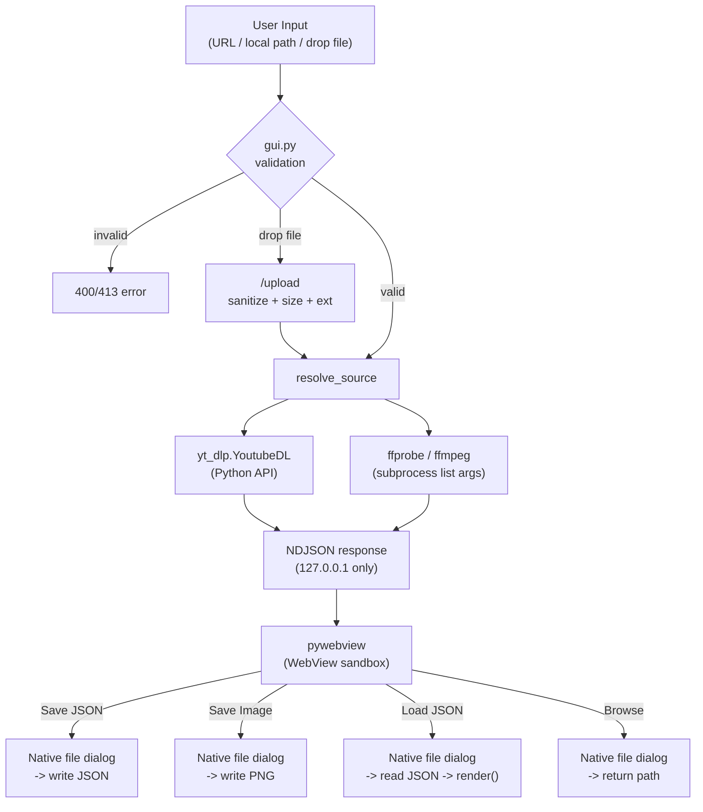

# Security Audit Report

**Date**: 2026-04-18 (SEC-22 and the Summary counts were added on 2026-04-26, the CI/CD section was checked on 2026-09-30, SEC-23 was added on 2026-10-17, SEC-24 was added on 2026-10-20)
**Scope**:
- Audit of 2026-04-18 (SEC-22 added on 2026-04-26): CLI (`src/analyze_spectrum/`), GUI (`src/analyze_spectrum/gui.py`), Frontend SPA (`frontend/`), Build/Distribution (`build.py`, `analyze-spectrum.spec`, `installer.iss`)
- Check of 2026-09-30: action pinning and its check in CI (`.github/workflows/`, `.github/tests/`) (CI/CD section)
- Addition of 2026-10-20 (SEC-24): auto-update (`src/analyze_spectrum/update.py`, `/update/*` in `gui.py`, the signing in `release.yaml`, the vendored `analyze_common.update` / `analyze_common/web/update.js` / `installer/auto_update.iss`)
- Addition of 2026-10-20 (the entry point table only): saving the theme and language (`/settings` and `/common/settings.js` in `gui.py`, the vendored `analyze_common.ui_settings` / `analyze_common/web/settings.js`). No findings were added (both the values accepted and the values passed to the page are only the validated `theme` / `lang`)

## Summary

| Category | Findings | Open | Resolved | Accepted |
|----------|----------|------|----------|----------|
| Local HTTP Server | 3 | 0 | 2 | 1 |
| Input Validation | 4 | 0 | 4 | 0 |
| Command Injection | 1 | 0 | 0 | 1 |
| File I/O (Save/Load/Browse) | 5 | 0 | 2 | 3 |
| File Upload (Drag & Drop) | 2 | 0 | 2 | 0 |
| Data Exposure | 1 | 0 | 0 | 1 |
| XSS | 1 | 0 | 0 | 1 |
| Subprocess Management | 2 | 0 | 1 | 1 |
| Bundled Binaries | 2 | 0 | 2 | 0 |
| Resource Management | 2 | 0 | 0 | 2 |
| Software Update | 1 | 0 | 0 | 1 |
| **Total** | **24** | **0** | **13** | **11** |

**Open: 0** / Resolved: 13 / Accepted (risk acknowledged): 11

The Summary counts are as of adding SEC-24 on 2026-10-20 (the first edition of the 2026-04-18 audit had the 21 findings SEC-01 to SEC-21, 11 Resolved; the SEC-22 addition on 2026-04-26 made 22, 12 Resolved; the SEC-23 addition on 2026-10-17 made 23, 13 Resolved). The text of each finding has been updated to follow later code changes (the history is `git log -- docs/security-audit.md`). The check of the CI/CD section on 2026-09-30 is not included in this table.

---

## Resolved Findings

### SEC-01: Integrity verification of bundled binaries -- RESOLVED

- **Risk**: LOW -> RESOLVED
- **Location**: [build.py](../build.py), [build_assets/checksums.json](../build_assets/checksums.json), [build_assets/ffmpeg.json](../build_assets/ffmpeg.json)
- **Resolution**: The way of checking differs per source. In every case, a file tracked by git holds the values.
  - uPlot (jsDelivr CDN, version pinned): checked against the SHA256 in `build_assets/checksums.json`, and the build stops on a mismatch. `python build.py --update-checksums` downloads and rewrites the values
  - macOS ffmpeg / ffprobe (osxexperts.net): the binaries inside the zip are checked against the SHA256 in `build_assets/ffmpeg.json`, and the build stops on a mismatch (`analyze_common.ffmpeg_release.fetch_macos_binary()`). The values are the ones that osxexperts.net's page shows
  - Windows ffmpeg / ffprobe (the series' latest in BtbN/FFmpeg-Builds) and deno (GitHub Releases' latest): the contents can change on every fetch, so the SHA256 is not pinned and the HTTPS source is trusted
  - ffmpeg / ffprobe in the distributed files: the release build (`release.yaml`) runs the copies that go into the installer and the DMG through `tests/test_ffmpeg_binary.py`, and on failure does not go on to uploading the artifacts and creating the Draft Release. The Windows build does not pin the SHA256, so the distributed files themselves are checked by this test
  - The JSON structure is unified with analyze-loudness

### SEC-02: Local HTTP server reachable from outside the loopback -- RESOLVED

- **Risk**: LOW -> RESOLVED
- **Location**: [gui.py](../src/analyze_spectrum/gui.py)
- **Resolution**: Binds to 127.0.0.1 with `HTTPServer(("127.0.0.1", 0), ...)`. No access from external networks. The port is assigned automatically by the OS (port 0), which both avoids conflicts with other apps and makes it hard to predict.

### SEC-03: Validation of URL / file path input (GUI) -- RESOLVED

- **Risk**: LOW -> RESOLVED
- **Location**: [gui.py](../src/analyze_spectrum/gui.py) `_handle_analyze` / `_handle_compare`
- **Resolution**: Checks that the `url` field exists and is of type `str`. An empty string is rejected with a 400 error. In comparison mode, a minimum of 2 / maximum of 6 entries is enforced for the `sources` array. When it is not a URL, `resolve_source` checks `Path.exists()`, and a file that does not exist is rejected with `FileNotFoundError`.

### SEC-04: Validation of the duration parameter -- RESOLVED

- **Risk**: LOW -> RESOLVED
- **Location**: [gui.py](../src/analyze_spectrum/gui.py) `_parse_duration`
- **Resolution**: `float()` conversion + `math.isfinite()` (rejects NaN / ±Inf) + a positive-number check. Invalid values are rejected with a 400 error. `compute_middle` also validates `total_sec > 0` / `duration_min > 0`.

### SEC-05: Hiding the Windows subprocess console -- RESOLVED

- **Risk**: LOW -> RESOLVED
- **Location**: [__init__.py](../src/analyze_spectrum/__init__.py) -> `analyze_common.platform.subprocess_kwargs()`
- **Resolution**: Sets `STARTF_USESHOWWINDOW` in frozen mode. Suppresses the console windows of ffmpeg / ffprobe / deno and improves the UX. yt-dlp runs as a Python API and does not start a subprocess.

### SEC-06: Version management of bundled binaries -- RESOLVED

- **Risk**: MEDIUM -> RESOLVED
- **Location**: [build.py](../build.py)
- **Resolution**: `build.py` fetches the latest stable versions from the GitHub API / the official distributors. Existing binaries can also be reused with the `--skip-download` flag. Everything is downloaded over HTTPS.

### SEC-07: Handling of invalid JSON request bodies -- RESOLVED

- **Risk**: LOW -> RESOLVED
- **Location**: [gui.py](../src/analyze_spectrum/gui.py) `_read_json_body`
- **Resolution**: `_read_json_body()` catches `JSONDecodeError` / `ValueError` and returns `None`, and the caller rejects with a 400 error. Oversized payloads are also rejected by the payload size limits (`_MAX_BODY = 10 MB`, and `_MAX_IMAGE_BODY = 50 MB` for images).

### SEC-08: Sanitizing upload file names -- RESOLVED

- **Risk**: MEDIUM -> RESOLVED
- **Location**: [download.py](../src/analyze_spectrum/download.py) `sanitize_filename`, [gui.py](../src/analyze_spectrum/gui.py) `_handle_upload`
- **Resolution**: `sanitize_filename` (defined in py-analyze-common's [analyze_common/download.py:22](https://github.com/semnil/py-analyze-common/blob/fab7f1f9845b90a1744a217cd8839b72b95109a7/src/analyze_common/download.py#L22)) replaces `/`, `\`, `:`, `*`, `?`, `"`, `<`, `>`, `|` with `_`, and strips leading and trailing `.` and whitespace. Because of this, a path traversal attack such as `../../../etc/passwd.wav` is made harmless, as in `_.._.._etc_passwd.wav`. In addition, the extensions are limited to an allowlist (`.wav, .mp3, .m4a, .flac, .ogg, .opus, .wma, .aac, .aiff, .aif, .webm, .mkv, .mp4`).
  - A collision with a file of the same name is avoided with a timestamp suffix
  - The write destination is fixed to `_upload_dir` (`tempfile.mkdtemp`), which is deleted with `atexit`

### SEC-09: Upload size limit -- RESOLVED

- **Risk**: MEDIUM -> RESOLVED
- **Location**: [gui.py](../src/analyze_spectrum/gui.py) `_handle_upload`
- **Resolution**: Checks the Content-Length against `_MAX_UPLOAD = 500 MB` and rejects with 413 when it is exceeded. When the connection is cut in the middle of receiving (`remaining > 0`), it deletes the partially written file and returns a 400 error.

### SEC-10: File fragments left behind before an upload completes -- RESOLVED

- **Risk**: LOW -> RESOLVED
- **Location**: [gui.py](../src/analyze_spectrum/gui.py) `_handle_upload`
- **Resolution**: When the receive chunk loop exits with `remaining > 0` (when the full Content-Length could not be received), it deletes the partial file with `os.unlink` and returns a 400 error. Even when the client disconnects, no incomplete data is left on disk.

### SEC-23: Accepting POSTs with a Content-Type that needs no preflight -- RESOLVED

- **Added**: 2026-10-17 (added after the 2026-04-18 audit; the Summary counts were also updated at this point)
- **Risk**: MEDIUM -> RESOLVED
- **Location**: [gui.py](../src/analyze_spectrum/gui.py) `do_POST`, `_check_content_type`
- **Resolution**: POST bodies were read as JSON regardless of the Content-Type, so a page on another site that found the random port could start `/analyze` with a POST of `text/plain` or `application/x-www-form-urlencoded`, which need no CORS preflight (and could make a local path the analysis target). Before the fix, sending a POST with `text/plain` / form format / no Content-Type to `/analyze` started the analysis with 200, and `/upload` with `text/plain` saved the file. `_check_content_type()` is placed after the Host validation, and returns 415 unless the Content-Type (the part before `;`, lowercased) is `application/json` for the JSON endpoints and `application/octet-stream` for `/upload`. Browsers send a cross-origin POST with these types only after a preflight, and this server does not answer preflights. analyze-loudness has the same fix.

### SEC-22: Silently swallowed pywebview dialog exceptions -- RESOLVED

- **Added**: 2026-04-26 (added after the 2026-04-18 audit; the Summary counts were also updated at this point)
- **Risk**: LOW -> RESOLVED
- **Location**: [gui.py](../src/analyze_spectrum/gui.py) `_handle_save`, `_handle_save_image`, `_handle_load`, `_handle_browse`; [main.js](../frontend/main.js) clipboard copy
- **Resolution**: Exceptions from `create_file_dialog()` were swallowed with `except Exception: result = None`, so when the dialog failed, the user was wrongly told it was cancelled. Fixed to return an error to the frontend with `traceback.print_exc()` + `_json_error(500, ...)`. The inner side of the POST handler's double catch (`pass`) was also changed to `traceback.print_exc()`, which records failures to send the error response. A failed clipboard copy in the frontend is reported with the `btn.copy_failed` text. The same fix was applied to analyze-loudness.

### SEC-11: Message framing of HTTP responses -- RESOLVED

- **Risk**: LOW -> RESOLVED
- **Location**: [gui.py](../src/analyze_spectrum/gui.py) `_json_response`, `_send_event`
- **Resolution**: Ordinary JSON responses get an explicit `Content-Length` header. This resolves the `ConnectionResetError` / test flakiness that came from disconnects based on EOF framing. NDJSON streams are sent in chunks as before. In addition, writing the response body was changed from `self.wfile.write()` to `self.request.sendall()`. `wfile` (`SocketIO`, `wbufsize=0`) delegates to `socket.send()` internally and does a partial write when the payload exceeds `SO_SNDBUF` (~128 KB on macOS), so large JSON responses were silently truncated. `sendall()` loops internally until every byte is sent, so delivery is reliable.

---

## Accepted Findings (risk acknowledged)

### SEC-12: The local HTTP server's attack surface from the same host -- ACCEPTED

- **Risk**: VERY LOW
- **Location**: [gui.py](../src/analyze_spectrum/gui.py)
- **Analysis**: Because it binds to 127.0.0.1, other processes on the same machine can reach endpoints such as `/analyze`, `/compare` and `/upload`. However:
  - The port is random (port 0), so it is hard to predict
  - Because of the browser's same-origin policy, CSRF from an external site with a Content-Type: application/json POST is blocked by the preflight
  - `/upload` assumes a binary body + a custom `X-Filename` header, so it cannot be triggered by a simple request from an HTML form (a preflight occurs)
  - A standard design pattern for local apps
  - At worst, an audio analysis runs (no data destruction)

### SEC-13: Passing URLs / paths directly to subprocess -- SAFE

- **Risk**: NOT VULNERABLE
- **Location**: [pcm.py](../src/analyze_spectrum/pcm.py), [download.py](../src/analyze_spectrum/download.py)
- **Analysis**:
  - `subprocess.run(cmd, ...)` always uses list arguments (`shell=False`) -> shell injection is not possible
  - yt-dlp is used through the Python API (`yt_dlp.YoutubeDL`), not through a subprocess
  - The URL / file path that the user entered themselves is run locally, so no attack vector holds

### SEC-14: Frontend XSS -- SAFE

- **Risk**: NOT VULNERABLE
- **Location**: [main.js](../frontend/main.js)
- **Analysis**:
  - Track labels / titles -> `textContent` (no HTML parsing)
  - `innerHTML` is used only for number formatting (`.toFixed()`) and static template strings
  - Strings from the user do not reach the `innerHTML` path
  - JSON loaded through the `/load` endpoint also goes through the same display path, so it resists XSS

### SEC-15: Internal information exposed through error messages -- ACCEPTED

- **Risk**: VERY LOW
- **Location**: [gui.py](../src/analyze_spectrum/gui.py)
- **Analysis**: Error messages are sent only to 127.0.0.1 as NDJSON / JSON. Because it is a local app, the risk of exposing debug information is practically zero. They include the last 500 characters of ffprobe/ffmpeg's stderr, but an attacker is limited to a user on the same host.

### SEC-16: Cleanup of temporary files -- SAFE

- **Risk**: NOT VULNERABLE
- **Location**: [gui.py](../src/analyze_spectrum/gui.py), [cli.py](../src/analyze_spectrum/cli.py), [pcm.py](../src/analyze_spectrum/pcm.py)
- **Analysis**:
  - The working directory during analysis: `tempfile.TemporaryDirectory` + a `with` block -> deleted automatically even when an exception occurs
  - Intermediate files of PCM extraction: `tempfile.NamedTemporaryFile` + `try/finally` + `unlink(missing_ok=True)`
  - `_upload_dir`, `_cache_dir`: cleaned up on a normal exit with `tempfile.mkdtemp` + `atexit.register(shutil.rmtree, ...)`

### SEC-17: File writes through the `/save` endpoint -- ACCEPTED

- **Risk**: VERY LOW
- **Location**: [gui.py](../src/analyze_spectrum/gui.py) `_handle_save`
- **Analysis**: A `/save` POST can write JSON data to a path that the user chose. However:
  - The destination path is chosen by the user in pywebview's native file dialog
  - No access from outside, because of 127.0.0.1 + a random port
  - Write errors are caught as `OSError`, and an error response is returned
  - What is written is only the analysis result JSON (not executable code)
  - Cached data is copied with `shutil.copy2`; when it is not cached, it is written out from the request body

### SEC-18: PNG writes through the `/save-image` endpoint -- ACCEPTED

- **Risk**: VERY LOW
- **Location**: [gui.py](../src/analyze_spectrum/gui.py) `_handle_save_image`
- **Analysis**: A `/save-image` POST writes a base64-encoded PNG to a path that the user chose.
  - Validates the `data:image/png;base64,` prefix, and rejects an invalid format with 400
  - `base64.b64decode` rejects invalid base64 as `ValueError` (caught)
  - As in SEC-17, the destination is chosen by the user in a native dialog
  - Cannot be called from outside, because of 127.0.0.1 + a random port

### SEC-19: File reads through the `/load` and `/browse` endpoints -- ACCEPTED

- **Risk**: VERY LOW
- **Location**: [gui.py](../src/analyze_spectrum/gui.py) `_handle_load`, `_handle_browse`
- **Analysis**:
  - `/load`: reads JSON from a path that the user chose and validates that the `spectrum` field exists. The old compare format that contains a `tracks` key is explicitly rejected with 400 (steering to loading individual tracks). When fields needed for drawing are missing, it prompts for a re-analysis, and if `meta.schema_version` is not an integer, it rejects with 400
  - `/browse`: only opens an audio file selection dialog and returns the chosen path (it does not read or run anything)
  - Both catch `OSError` / `JSONDecodeError` and return an error response
  - Cannot be called from outside, because of 127.0.0.1 + a random port
  - The loaded data is passed to the frontend's `render()`, but strings from the user are shown safely through `textContent` (see SEC-14)

### SEC-20: subprocess orphaning on client disconnect -- ACCEPTED

- **Risk**: LOW
- **Location**: [gui.py](../src/analyze_spectrum/gui.py), [pcm.py](../src/analyze_spectrum/pcm.py), [download.py](../src/analyze_spectrum/download.py)
- **Analysis**: When the frontend's Cancel (AbortController) aborts the stream read, the server's `_send_event()` raises `_ClientDisconnected` and aborts the analysis. However, when `yt_dlp.YoutubeDL.extract_info()` or `subprocess.run()` (ffmpeg/ffprobe) is blocking, that work keeps running until it finishes.
  - `_ClientDisconnected` is detected only on the next `_send_event()` call
  - Even when cancelled during a yt_dlp download or an ffmpeg PCM extraction (a few seconds to a dozen or so seconds), that work runs to completion
  - After it finishes, `_send_event()` raises `_ClientDisconnected`, and the rest of the processing is aborted
  - No temporary files leak, thanks to the `TemporaryDirectory` / `atexit` cleanup
- **Accepted**: At most a dozen or so seconds of unneeded subprocess execution. For a single-user local app, there is no risk of DoS or resource exhaustion

### SEC-21: Cache directory growth -- ACCEPTED

- **Risk**: VERY LOW
- **Location**: [gui.py](../src/analyze_spectrum/gui.py) `_cache_put`
- **Analysis**: `_cache_dir` accumulates analysis result JSON over the whole session, so analyzing many URLs / files in the same session increases disk usage. However:
  - Each analysis result JSON is about tens to hundreds of KB (the spectrum graph arrays), so even hundreds of them stay under 100 MB
  - Deleted when the app exits, with `atexit.register(shutil.rmtree, _cache_dir, True)`
  - It remains after an abnormal exit (SIGKILL, etc.), but it is created in the `tempfile` area with the `spectrum_cache_` prefix, so it is subject to the OS's clean-up
  - No real damage for a single-user local app

### SEC-24: Running the installer fetched by auto-update -- ACCEPTED

- **Added**: 2026-10-20 (added together with auto-update; the Summary counts were also updated at this point)
- **Risk**: LOW
- **Location**: [update.py](../src/analyze_spectrum/update.py) `PUBLIC_KEY` / `UPDATE_CONFIG`; [gui.py](../src/analyze_spectrum/gui.py) `_handle_update_settings`, `_handle_update_check`, `_handle_update_install`, `_exit_for_update`; [release.yaml](../.github/workflows/release.yaml) Sign Update Manifest; the vendored `analyze_common/update.py`
- **Analysis**: The app runs an installer fetched from the network (Windows) or replaces itself with a fetched `.app` (macOS). It confirms that what it fetched is genuine in the following order:
  - Source: `https://github.com/semnil/analyze-spectrum/releases/latest/download/latest.json`. Only download locations in the manifest of the form `https://github.com/semnil/analyze-spectrum/releases/download/<tag>/<name>` are accepted, and redirects from https to http are not followed
  - Signature: Ed25519. What is signed is a statement that contains not only the artifact's SHA-256 but also the product (`analyze-spectrum`), the version and the platform, and the public key is `PUBLIC_KEY` built into the app. A genuine artifact moved to another version, an artifact for another OS, and an analyze-loudness artifact fail the verification (confirmed, with a manifest made by the same signing command as `release.yaml` and a local release server, that all 3 of rewriting the version in `latest.json`, swapping in another platform's signature, and flipping 1 byte of an artifact are rejected). A file that fails the verification is deleted before the failure is returned
  - Version: only versions newer than the current one are treated as updates (no rollback to an older genuine release happens)
  - On macOS, it additionally confirms that the fetched `.app`'s bundle identifier and version match, and, when the current app is signed with a Team ID, that it passes `codesign --verify --deep --strict` with the same Team ID
  - Consent: the fetch happens only after the user chooses OK in the confirmation dialog. However, `/update/install` itself can be called directly by another process on the same host, as in SEC-12. A page of another origin cannot reach it, because of the Content-Type check (SEC-23). What happens when it is called directly is only the installation of the genuine newer version that the previous check found
- **Accepted**:
  - If the signing private key (the GitHub secret `UPDATE_SIGNING_KEY`) leaks, the installed apps accept any artifact signed with that key. The secret's value cannot be read from GitHub's UI or API, but anyone with write access to the repository can use it from a workflow. This is left to the protection of the repository's permissions
  - The verified Windows installer runs under `%TEMP%`. Another process running with the same user's privileges could swap it between the verification and the execution (that process can run arbitrary code with the same privileges even without swapping it)
  - The update check connects to github.com on every launch (it can be turned off in the settings). It shows nothing when there is no newer version or when the check fails

---

## CI/CD (GitHub Actions)

**Checked on**: 2026-09-30. Checked the actual workflows and the current values of the master ruleset and the Actions permission policy. Not part of the 2026-04-18 audit. The "Dependabot auto-merge" row, and the mentions of `dependabot-auto-merge.yml`, `Test 🧪` and `auto-merge` in the "Pinning external actions" and "Required checks" rows, were added on 2026-10-20.

| Item | Measure |
|------|------|
| Pinning external actions | The `uses:` of `ci.yaml` / `release.yaml` / `tag-release.yml` / `ffmpeg-watch.yml` / `workflow-checks-test.yml` / `dependabot-auto-merge.yml` are pinned with the commit SHA (40 characters) and a version comment on the same line (`@<sha> # vX.Y.Z`). They are not tag references, so moving a tag does not change what runs |
| Pin check (`workflow-checks.yml`) | For each PR, runs the default branch's definition on `pull_request_target`, fetches the workflow and action files of the PR's head as data through the GitHub API (git trees / blobs), and reads them with yq. The PR's code is neither checked out nor run, and the token is `contents: read`. The targets are `jobs.<id>.uses` / `jobs.<id>.steps[*].uses` / `runs.steps[*].uses` of `action.yml` |
| Same-repository references | A step's `./` is resolved against the runner's workspace (it can run what an earlier step placed there), so it is rejected and `$/` (resolved to the running commit) has to be used. Job-level reusable workflows are allowed with both `./` and `$/`, because both are read from the same commit as the caller. Local reference paths are limited to `A-Z a-z 0-9 . _ -` and `/`, and components that are empty, `.`, `..` or end with `.`, and symbolic links / submodules in the git tree on the path to the target (matched ignoring ASCII letter case), are rejected |
| Soundness of what is fetched | Fails when a workflow or action file is not a regular file (a symbolic link, etc.), and when an action file name is not a lowercase `action.yml` / `action.yaml` |
| Check on dispatch (`workflow-checks.yml`, added 2026-10-20) | Passing a PR number to `workflow_dispatch` runs the same check on PRs where `pull_request_target` does not run (ones created by GITHUB_TOKEN). It fails when started on a ref other than the default branch, when the PR is not open, when the PR's base is not the default branch, and when the head is not a 40-character SHA. The token of the check's `action-pins` job stays `contents: read`. The `report` job, which has only `checks: write`, puts the result on the PR's head commit as a check run named `action-pins` (`failure` when the check failed or was cancelled) |
| Preventing the check from modifying itself | A PR in which the path, mode or blob SHA of `workflow-checks.yml` does not match the default branch fails. To change the check, remove the required check temporarily and then merge |
| Required checks | The master ruleset requires `action-pins`, `Test 🧪` (`ci.yaml`) and `auto-merge` (`dependabot-auto-merge.yml`), and requires keeping up with the base branch (`strict_required_status_checks_policy: true`). No bypass is configured |
| Regression tests of the check | `workflow-checks-test.yml` runs `.github/tests/workflow-checks-test.sh` (on PRs that change the check files or tests, and on pushes to master). A fake `gh` returns fixture git trees, and it checks the decisions for references that should be rejected and ones that should pass, and the failure reasons. It also checks the dispatch entry point (deciding the PR resolution, the contents of the check run that `report` puts on, the jobs' permissions and wiring) |
| Tag creation from version bumps (`tag-release.yml`, added 2026-10-17) | On `workflow_run` it runs after CI completes, handles only runs that succeeded on a `push` to master, and checks out the `head_sha` that CI checked. `workflow_dispatch` (added 2026-10-20, because a version bump that `ffmpeg-watch.yml` merged with GITHUB_TOKEN does not start the push CI) handles the commit in the input `sha`; it confirms before checkout that it is a 40-character SHA, and after checkout that it is on master and that `ci.yaml` succeeded on that commit or on a parent commit with the same tree. The permissions are `contents: write` (pushing the tag) and `actions: write` (dispatching `release.yaml`). Existing tags are not moved |
| Signing the update manifest (`release.yaml`, added 2026-10-20) | The Create Release job writes the secret `UPDATE_SIGNING_KEY` to a file in `$RUNNER_TEMP` (umask 077, deleted at the end of the step) and creates `latest.json` with `python -m analyze_common.update_manifest sign`. It verifies each signature with `PUBLIC_KEY` in `src/analyze_spectrum/update.py` before writing it out. When the secret is missing, when the key does not match `PUBLIC_KEY`, or when the tag differs from the app's version, the step fails and no Release is created (SEC-24) |
| Dependabot auto-merge (`dependabot-auto-merge.yml`, added 2026-10-20) | Runs on `pull_request` for each PR, and runs the `dependabot/fetch-metadata` and `gh` steps only when the PR's author is `dependabot[bot]` (for other PRs the steps are skipped and the job reports success). The PR's code is neither checked out nor run, and values from the PR (URL, head SHA, update type) are passed through environment variables. Only when the update type is a semver patch does it schedule an auto-merge (merge commit) conditioned on the head SHA it read (`--match-head-commit`); for other types it cancels the schedule, and when it cannot read whether there is a schedule, it fails the job. The job `auto-merge` is a required check on master, so nothing is merged before the decision for that head is out. The permissions are the job-level `contents: write` and `pull-requests: write`, and the token used is `GITHUB_TOKEN` (no secrets are used). A merge by auto-merge is made with `GITHUB_TOKEN`, and the push to master does not start workflows. On `workflow_dispatch` (added 2026-10-20), both steps are skipped and `auto-merge` is reported to the head commit of the branch it was started on. This is for PRs created by GITHUB_TOKEN (`ffmpeg-watch.yml`), whose `pull_request` runs wait for approval. A dispatch on a `dependabot/` branch, and a dispatch for a commit contained in a PR created by `dependabot[bot]`, fail (a check run is attached to a commit, so the branch name alone cannot decline it), and the decision is made only by that PR's `pull_request` run (checked by `.github/tests/dependabot-auto-merge-test.sh`) |
| Patch release for an ffmpeg update (`ffmpeg-watch.yml`, added 2026-10-20) | Runs on schedule and `workflow_dispatch`, only on master (it fails on other refs). The tokens of detect and smoke are `contents: read`. Only land has `contents: write` (pushing the bot's branches), `pull-requests: write` (creating and merging PRs) and `actions: write` (dispatching CI, `dependabot-auto-merge.yml`, `workflow-checks.yml` and `tag-release.yml`), and it merges the pinned-value PR and the version bump PR without review. Before merging, it waits for the CI, `auto-merge` and `action-pins` dispatched on each PR to succeed, and for `gh pr checks --required`. After the version bump is merged, it passes that merge commit and starts `tag-release.yml`, and the checks before tagging are done by `tag-release.yml`. The new pinned values are created from the osxexperts.net page; the series is limited to `MAJOR.MINOR` and the URL to a zip under `https://www.osxexperts.net/`, and only values whose two files were checked against the page's SHA256 are used (`analyze_common.ffmpeg_release`). Values between jobs are passed through `env:`, and no expressions are embedded in `run:`. Publishing the Release is done by a person |
| Permission for `pull_request_target` | `pull_request_target` in a public repository needs explicit permission from 2026-11-02, so an Actions permission policy targeting `workflow-checks.yml` is configured |

---

## Threat Model

### Attack Surface

| Entry Point | Protocol | Auth | Validation |
|------------|----------|------|------------|
| CLI args | Local | N/A | argparse + `compute_middle` validation |
| GUI HTTP (`/analyze`) | 127.0.0.1 only | N/A (localhost) | URL/source + duration + JSON body validation |
| GUI HTTP (`/compare`) | 127.0.0.1 only | N/A (localhost) | sources array (2-6) + duration validation |
| GUI HTTP (`/upload`) | 127.0.0.1 only | N/A (localhost) | size limit 500MB + extension allowlist + `sanitize_filename` |
| GUI HTTP (`/save`, `/save-image`) | 127.0.0.1 only | N/A (localhost) | Native file dialog + content validation |
| GUI HTTP (`/load`, `/browse`) | 127.0.0.1 only | N/A (localhost) | Native file dialog + schema validation |
| Frontend SPA | pywebview (WebView2/WKWebView) | N/A | Static files, no SSR |
| File dialogs | Native OS | User interaction required | pywebview SAVE_DIALOG / OPEN_DIALOG, `_dialog_lock` non-blocking try-lock (409 on concurrent) |
| GUI HTTP (`/update/status`, `/update/settings`, `/update/check`, `/update/install`) | 127.0.0.1 only | N/A (localhost) | Content-Type gate; `/update/install` accepts only the version the last check offered |
| GUI HTTP (`/settings`, GET `/common/settings.js`) | 127.0.0.1 only | N/A (localhost) | Content-Type gate (POST); one of `theme` (light / dark / auto) or `lang` (en / ja) per request; the script carries only those validated values, which hold nothing sensitive |
| Update feed (`latest.json` + installers) | HTTPS (outbound to GitHub Releases) | Ed25519 signature (`PUBLIC_KEY`) | Asset URL prefix, newer-version-only, size / deadline limits; macOS bundle id + Team ID (SEC-24) |

### Abuse Scenarios

| Scenario | Impact | Mitigation | Status |
|----------|--------|------------|--------|
| External network access | Remote attack | 127.0.0.1 bind | Not vulnerable |
| Shell injection via URL/path | RCE | `subprocess.run` list args, yt-dlp Python API | Not vulnerable |
| Path traversal via /upload filename | Arbitrary file write | `sanitize_filename` (`/`, `\`, etc. to `_`) + extension allowlist | Resolved (SEC-08) |
| Oversized upload | Disk exhaustion | 500 MB limit + incomplete-upload cleanup | Resolved (SEC-09, SEC-10) |
| Malicious bundled binary | Code execution | SHA256 checksum verification | Resolved (SEC-01) |
| Local CSRF | Unintended analysis | Random port + Content-Type gate (`application/json`, `application/octet-stream` for `/upload`; 415 otherwise) | Resolved (SEC-23) |
| Disk exhaustion (large video) | DoS | `TemporaryDirectory` auto-cleanup | Low risk |
| Arbitrary file write via /save | Data overwrite | Native dialog + 127.0.0.1 + random port | Very low risk |
| Arbitrary file read via /load | Info disclosure | Native dialog + 127.0.0.1 + random port + schema validation | Very low risk |
| XSS via loaded JSON label | Code execution | `textContent` (no HTML parse) | Not vulnerable |
| Invalid base64 in /save-image | Server crash | `ValueError` caught | Resolved |
| Non-finite duration (NaN/Inf) | Server crash / infinite loop | `math.isfinite` check | Resolved (SEC-04) |
| Cancel during subprocess | Orphaned process (~a dozen or so s) | `_ClientDisconnected` + `TemporaryDirectory` cleanup | Accepted (low) |
| Cache directory growth | Disk usage | `atexit` cleanup + tempfile location | Very low risk |
| Tampered or substituted update installer | Code execution | Ed25519 signature over product / version / platform / SHA-256, public key in the app | Mitigated (SEC-24) |
| Rollback to an older signed release | Reintroduced bugs | Only versions newer than the running one are offered | Not vulnerable |
| Leaked update signing key | Code execution on update | Key held only as a GitHub secret | Accepted (SEC-24) |

## Compliance Notes

- No user data stored (stateless analysis, temp files / upload dir / cache dir auto-deleted on exit)
- No authentication tokens or cookies
- No PII processing
- No network listeners on external interfaces
- Outbound: the installed app checks GitHub Releases for a newer version at launch (can be turned off in Settings) and downloads an update only after the user accepts it (SEC-24)
- Audio content analyzed locally, deleted after display / app exit
- ffmpeg bundled under GPL-3.0+ (Windows, BtbN gpl build) and GPL-2.0+ (macOS, osxexperts.net build), both with libx264 / libx265; the GPL v2 / v3 texts are bundled from `licenses/`; source availability required for redistribution
- yt-dlp bundled under Unlicense (Python dependency, not binary)
- deno bundled under MIT (required by yt-dlp for YouTube JS extraction)
- THIRD_PARTY_LICENSES.txt included in installer
